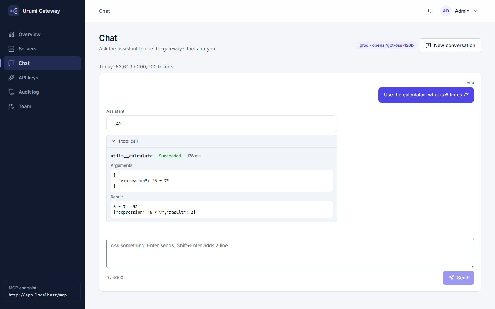

# MCP Gateway on Kubernetes

A WooCommerce store running on Kubernetes, paired with a team MCP gateway. Platform admins register MCP servers once; team members then use all of their tools through a single gateway endpoint and a dashboard chat agent. The whole platform is deployed with one Helm chart to a local k3d cluster or a single-node k3s VPS.

> **Status: under construction (the store, three MCP servers, the team MCP gateway, the web dashboard and the chat agent run on Kubernetes, hardened in Phase 5 with default-deny NetworkPolicies, Pod Security `restricted` and a loopback-only local cluster; the production values were rehearsed on a second k3d cluster, not on a VPS; the complete README comes in Phase 6).** Verify a running cluster with `scripts\smoke-test.ps1`; the end-to-end demo is [docs/demo-script.md](docs/demo-script.md). See the [implementation plan](docs/superpowers/plans/2026-10-18-mcp-gateway-implementation-plan.md) for the current phase status, and the [design spec](docs/superpowers/specs/2026-10-18-mcp-gateway-design.md).

## 1. Project Name and Overview

*(written in Phase 6)*

## 2. Problem Being Solved and Motivation

*(written in Phase 6)*

## 3. Key Features and User Capabilities

*(the full section is written in Phase 6; what works today:)*

- **A WooCommerce store on Kubernetes** at <http://store.localhost>: shop, cart, Cash-on-delivery checkout, customer accounts, admin. One command starts it ([run guide](docs/run-guide.md)).
- **A WooCommerce MCP server** (Phase 2, internal to the cluster): six tools an AI client can call to list and create products and to list, read and update orders. It uses stateless MCP over HTTP with a bearer token, and talks to the store through signed REST calls with a least-privilege `urumi-mcp` shop-manager key. Not reachable from outside the cluster; the gateway fronts it. How to run and explore it with MCP Inspector: [run guide, section 8](docs/run-guide.md#8-woocommerce-mcp-server-phase-2). How the protocol works, with real captured requests: [docs/learning/02-mcp-protocol.md](docs/learning/02-mcp-protocol.md).
- **Two more MCP servers** (Phase 3, internal): `mcp-notes` (five tools, notes kept in memory, bearer token) and `mcp-utilities` (four tools: date ranges, current time and a safe calculator, custom header key).
- **The team MCP gateway** (Phase 3): one endpoint, <http://app.localhost/mcp>, that aggregates the 15 tools of the three MCP servers (named `woo__...`, `notes__...`, `utils__...`). It has its own Postgres database with users, personal API keys (shown once, hashed, revocable at once), invite links, a server registry with health checks (a dead server only loses its own tools; measured: tools gone within 4-12 s, back within 16 s), AES-GCM encrypted upstream credentials, an SSRF guard, and an audit log of every tool call and every rejected credential. It is driven through the REST API at <http://app.localhost/api> (PowerShell examples in the [run guide](docs/run-guide.md#9-the-gateway-phase-3)); MCP Inspector works against it, Claude Code and Cursor snippets are in the run guide but **not tested**. How it works, with real captured traffic: [docs/learning/03-gateway.md](docs/learning/03-gateway.md). Design, security and failure handling: [system-design.md](docs/system-design.md), [security.md](docs/security.md) (partial), [error-handling.md](docs/error-handling.md).
- **The dashboard** (Phase 4) at <http://app.localhost/>: a responsive web app (desktop and phone) for the whole gateway. Admins see server health, add, edit, disable or delete MCP servers (a stored credential is never sent to a new host), invite teammates with one-time links, change roles and disable users; everyone creates and revokes their own API keys (shown once, with ready-to-paste Claude Code, Cursor and MCP Inspector setups) and reads the audit log (members see only their own rows). Served by its own non-root nginx pod on the same origin as the API, with a strict Content-Security-Policy. Checked in a real browser at 1440 px and 390 px by `scripts\check-dashboard.ps1` (Playwright). Every page: [run guide, the dashboard](docs/run-guide.md#the-dashboard-phase-4).
- **The chat agent** (Phase 4) on the dashboard's Chat page: ask in plain words ("What orders came in today?", "Create a draft product called Mug priced 9.99") and an LLM calls the gateway's tools **as you**, through the same `/mcp` endpoint, permissions and audit log as any MCP client, showing each tool call it made. It uses a **free Groq API key** (default model `openai/gpt-oss-120b`, chosen by a measured spike) behind a provider-independent layer, so switching to OpenRouter is a configuration change. Limits, retries and failures: [docs/ai-integration.md](docs/ai-integration.md); how the loop works, with a captured request: [docs/learning/04-chat-agent.md](docs/learning/04-chat-agent.md).
- **Chat guardrails** (Phase 5b): the assistant only helps with the store, your notes and small utility tasks. A small model checks each message first and off-topic ones get a fixed refusal without a call to the main model; answers are capped at 1024 tokens; each user has a daily budget of 50,000 tokens (`CHAT_BUDGET_EXCEEDED`, visible on the Chat page). If the check itself fails, the turn still runs under the scope rule. [ADR-020](docs/decisions/ADR-020-chat-guardrails.md), [AI integration](docs/ai-integration.md#9-guardrails-scope-topic-check-answer-cap-and-daily-budget-phase-5b).
- **A store hosted elsewhere** (Phase 5b): the WooCommerce MCP server can work against an HTTPS store with Basic auth (`mcpWoocommerce.externalStore.*`), and the chart can switch the in-cluster store off (`store.enabled: false`). Proven live against the local WooCommerce 11.2.1 over HTTPS; the chart variant is rendered and validated, not installed. [ADR-019](docs/decisions/ADR-019-external-woocommerce-store.md), [deployment guide](docs/deployment.md#using-a-woocommerce-store-hosted-elsewhere).
- **Your own MCP servers inside the cluster** (Phase 5b): list them in `gateway.internalUpstreams` and the chart opens exactly their namespace and port to the gateway; proven live in two namespaces. [Deployment guide](docs/deployment.md#registering-mcp-servers-that-run-inside-the-cluster), [ADR-016](docs/decisions/ADR-016-default-deny-network-policies.md).
- **Connecting Claude Code** (Phase 5b): the command-line route and a `.mcp.json` route that keeps the key in an environment variable ([`.mcp.json.example`](.mcp.json.example), [run guide](docs/run-guide.md#connect-claude-code)). The example file is validated; the connection itself is not tested yet. If the public address ever changes: [what follows by itself](docs/deployment.md#when-the-public-address-changes).

## 4. Main Workflows and How the Application Works

*(written in Phase 6)*

## 5. Screenshots or Visual Demonstrations

The dashboard's Chat page after one question: the model called `utils__calculate` through the gateway, and the trace shows the call, its arguments and its result (captured from the local cluster on 2026-10-20):



More: [overview](docs/screenshots/overview.png), [servers](docs/screenshots/servers.png), [server detail](docs/screenshots/server-detail.png), [audit log](docs/screenshots/audit.png), [servers on a 390 px phone](docs/screenshots/servers-mobile.png). *(A demo video is planned for Phase 6.)*

## 6. System Architecture and Links to Design Documents

*(written in Phase 6)*

## 7. Architecture and Workflow Diagrams

*(the curated set is written in Phase 6)* Today every workflow has a Mermaid diagram with a failure table in [docs/workflows.md](docs/workflows.md), for example [a chat turn](docs/workflows.md#15-a-chat-turn-tool-loop-retries-and-fallback) and [an MCP tool call through the gateway](docs/workflows.md#8-mcp-tool-call-through-the-gateway); the index is [docs/diagrams/README.md](docs/diagrams/README.md).

## 8. Technology Stack and Rationale

*(written in Phase 6)*

## 9. Repository Structure

*(written in Phase 6)*

## 10. Prerequisites and Required Software Versions

*(written in Phase 6)*

## 11. Complete Local Installation and Setup

*(the complete guide, including the gateway and dashboard, is written in Phase 6)*

### Quick start (local store)

This works today and installs the WooCommerce store, the three MCP servers, the gateway with its Postgres database, and the dashboard. You need Docker Desktop (running), `k3d`, `kubectl` and `helm`; see [docs/deployment.md](docs/deployment.md) for versions and every step explained. From the repository root, in PowerShell:

```powershell
powershell -NoProfile -ExecutionPolicy Bypass -File scripts\setup-hosts.ps1   # optional, once: hosts entries for Node tools (UAC prompt)
powershell -NoProfile -ExecutionPolicy Bypass -File scripts\up.ps1            # start the cluster, install the store if needed, print the URLs
```

`up.ps1` builds the five images (mcp-woocommerce, mcp-notes, mcp-utilities, gateway, dashboard) and imports them into the cluster before deploying (so Docker must be running), typically takes about 2-3 minutes the first time (observed on the reference machine; it downloads images and WooCommerce), and prints the store URLs. The admin area is <http://store.localhost/wp-admin> (user `admin`); copy the generated password to your clipboard with:

```powershell
powershell -NoProfile -ExecutionPolicy Bypass -File scripts\get-admin-password.ps1
```

Check the MCP server end to end with `powershell -NoProfile -ExecutionPolicy Bypass -File scripts\check-mcp-woocommerce.ps1` (read-only; it lists the 6 tools and calls a few). The check runs a small Node client on your PC, so it needs Node 24 and, once, `npm ci` from the repository root ([run guide, section 2](docs/run-guide.md#2-prerequisites-and-one-time-setup)). It is internal-only, so there is no URL; see the [run guide](docs/run-guide.md#8-woocommerce-mcp-server-phase-2) for exploring it with MCP Inspector.

**The gateway (quick start).** After `up.ps1` the gateway is at <http://app.localhost/api> and <http://app.localhost/mcp>. Check it end to end with `powershell -NoProfile -ExecutionPolicy Bypass -File scripts\check-gateway.ps1 -Write` (login, a temporary API key, all 15 tools, the audit log; it prints no secrets and needs Node 24 and `npm ci`). The admin account is `admin@example.com`; copy its password with `powershell -NoProfile -ExecutionPolicy Bypass -File scripts\get-secret.ps1 -Namespace gateway -Name gateway-bootstrap -Key password`. To create your own API key from PowerShell, connect MCP Inspector, invite a teammate or look inside the gateway's Postgres database, follow the [run guide, sections 9 and 10](docs/run-guide.md#9-the-gateway-phase-3).

**The dashboard (quick start).** Open <http://app.localhost/> and sign in as `admin@example.com` with the password that the `get-secret.ps1` command above copies to your clipboard. From there you manage servers, keys, the team and the audit log; every page is described in the [run guide](docs/run-guide.md#the-dashboard-phase-4). Check it in a real browser with `powershell -NoProfile -ExecutionPolicy Bypass -File scripts\check-dashboard.ps1` (once: `npx playwright install chromium`).

**The AI chat (quick start).** Get a free key at <https://console.groq.com/keys>, copy `.env.example` to `.env`, put the key after `GROQ_API_KEY=`, and run `powershell -NoProfile -ExecutionPolicy Bypass -File scripts\create-secrets.ps1` (it stores the key in the cluster and prints only `set` or `empty`). Then open <http://app.localhost/chat>. Step by step for beginners: [Set up the AI chat](docs/run-guide.md#set-up-the-ai-chat).

**Check everything in one command.** `powershell -NoProfile -ExecutionPolicy Bypass -File scripts\smoke-test.ps1` runs the pod check, the WooCommerce, MCP and gateway checks, the dashboard in a browser, the network-policy probes, the invite-log check and `npm audit`, then prints a PASS/FAIL table (`-Quick` skips the browser and the audit). The local cluster listens on `127.0.0.1` only; recreating it deletes all data and generates new passwords ([run guide](docs/run-guide.md#the-cluster-listens-on-this-computer-only-phase-5)).

Pause with `scripts\stop.ps1` (keeps your data). The complete beginner guide (daily use, customer accounts, viewing the database, resetting) is the [run guide](docs/run-guide.md).

Something wrong? See [docs/troubleshooting.md](docs/troubleshooting.md). To start over completely: [docs/deployment.md](docs/deployment.md#step-9-uninstall-and-what-is-kept).

## 12. Environment-Variable Configuration

*(the full section is written in Phase 6)* In the cluster every variable is set by the Helm chart; the only values you supply are the AI keys in `.env` (see [`.env.example`](.env.example), which explains each line). The gateway's variables are listed in [apps/gateway/README.md](apps/gateway/README.md#configuration-environment-variables), the LLM and chat ones in [docs/ai-integration.md](docs/ai-integration.md#2-configuration).

## 13. Obtaining and Configuring Free-Tier AI API Keys

The chat uses **Groq's free plan** (no card needed as of 2026-10-19). Its limits for the default model `openai/gpt-oss-120b` were 30 requests and 8,000 tokens per minute, 1,000 requests and 200,000 tokens per day; one simple chat question costs about 3,000 tokens, so expect about two questions a minute before Groq asks you to wait. **Free limits change; check them before relying on them.** OpenRouter's `:free` models (20 requests a minute, 50 a day) are an optional fallback. Gemini is not used.

1. Create a key at <https://console.groq.com/keys> (**Create API Key**; it is shown once).
2. `Copy-Item .env.example .env`, then put the key after `GROQ_API_KEY=` in `.env` (Git ignores this file).
3. `powershell -NoProfile -ExecutionPolicy Bypass -File scripts\create-secrets.ps1`, then check that `kubectl -n gateway logs deploy/gateway | Select-String "llm "` shows `llm configured: groq/openai/gpt-oss-120b`.

Never paste a key into a chat, an issue or a commit. Details, switching provider or model, and every error: [docs/ai-integration.md](docs/ai-integration.md) and the run guide's [Set up the AI chat](docs/run-guide.md#set-up-the-ai-chat).

## 14. Database Setup, Migrations, and Initialization

*(written in Phase 6)*

## 15. Development Commands

*(written in Phase 6)*

## 16. Testing Commands and Installation Verification

*(written in Phase 6)*

## 17. Build and Production Execution

*(written in Phase 6)*

## 18. Deployment Instructions

Local (k3d): above. Production (one k3s VPS with TLS, backups, upgrade and rollback): the beginner guide [Production (k3s VPS)](docs/deployment.md#production-k3s-vps). Its cluster side was rehearsed on 2026-10-23 on a second local k3d cluster with a self-signed issuer (the chart, the production values, the Secrets script, TLS redirect and HSTS, Pod Security and the NetworkPolicies). The steps that need a server, DNS, Let's Encrypt or a registry were **not executed**; no real VPS, domain or certificate has been used. The full section is written in Phase 6.

## 19. Security Considerations and Secret Management

*(written in Phase 6)*

## 20. Troubleshooting

*(written in Phase 6)*

## 21. Links to Documentation in `docs/`

See the [documentation map](docs/README.md) for an index of all project documentation. Most used: the [run guide](docs/run-guide.md), [architecture](docs/architecture.md), [system design](docs/system-design.md), [workflows](docs/workflows.md), [AI integration](docs/ai-integration.md), [security](docs/security.md), [error handling](docs/error-handling.md), [testing](docs/testing.md), [troubleshooting](docs/troubleshooting.md), [deployment](docs/deployment.md) and the [decision records](docs/decisions/README.md).

## 22. Known Limitations, Assumptions, and Future Improvements

*(the full section is written in Phase 6)* Known today: one gateway replica; the local cluster is reachable from this computer only (a design choice since 2026-10-23, see [security.md](docs/security.md#16-the-real-client-ip-the-loopback-only-cluster-and-production-secrets-phase-5)) and k3d still publishes its Kubernetes API on all interfaces; the chat shares one free provider key across the whole team, so heavy use hits Groq's per-minute limit; chat messages and tool results are sent to the AI provider; prompt injection through tool output is a documented residual risk ([security.md](docs/security.md#12-untrusted-data-and-prompt-injection)); Claude Code and Cursor are not tested against the gateway; the production (VPS) deployment is documented and render-validated but has not been run on a real VPS ([deployment guide](docs/deployment.md#production-k3s-vps)).
