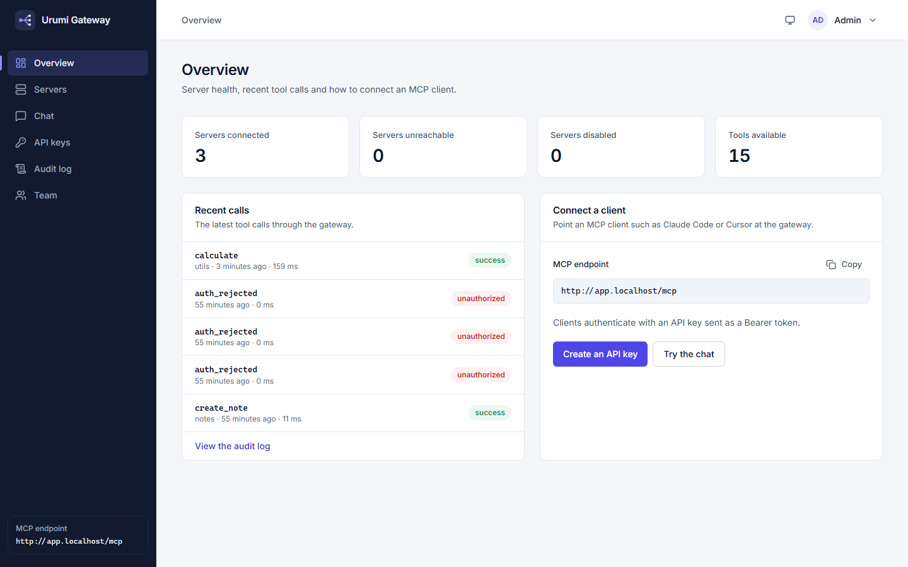
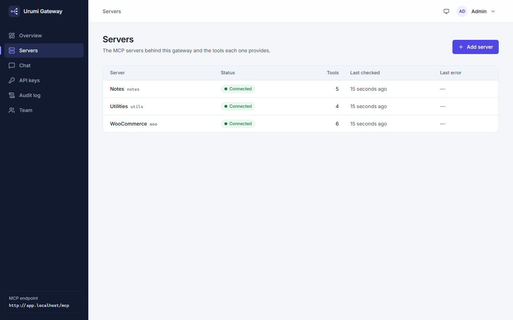
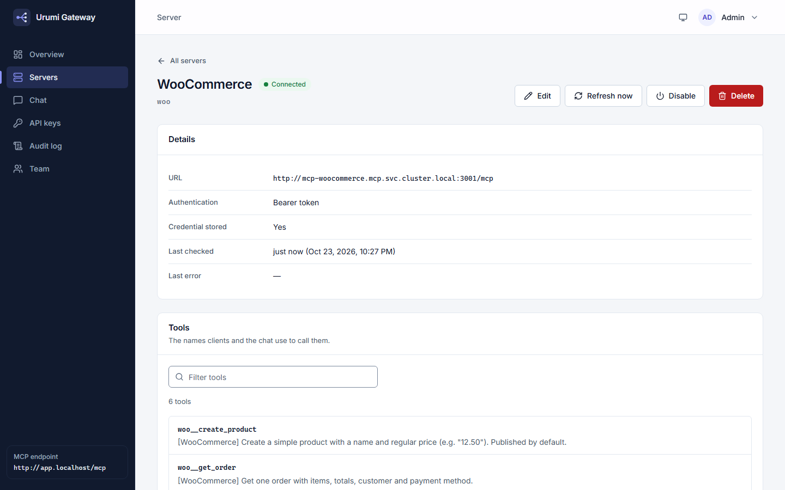
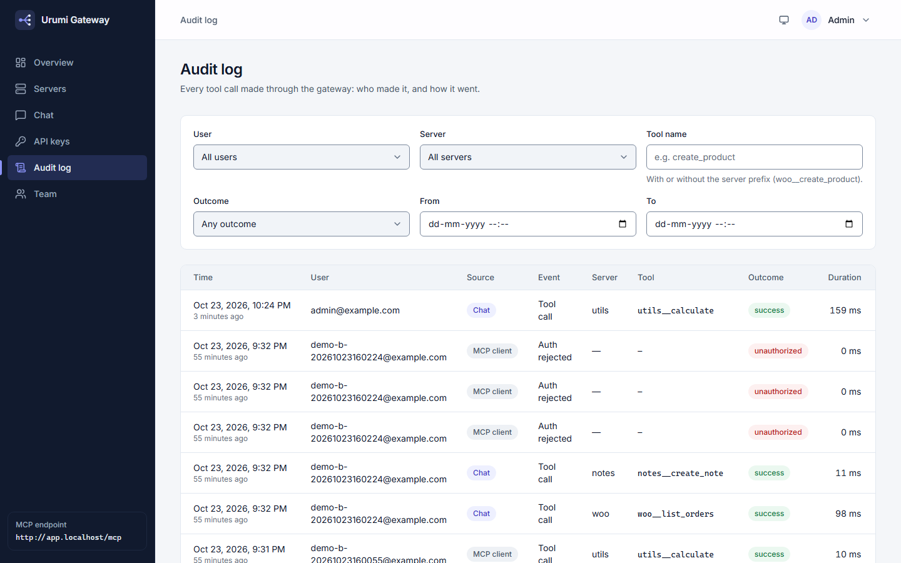
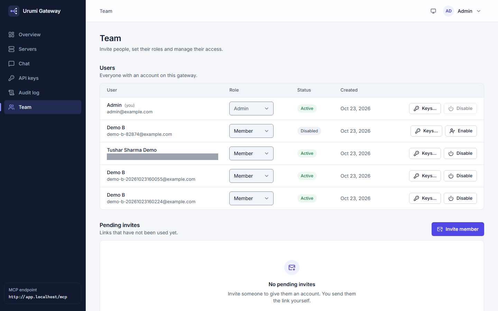
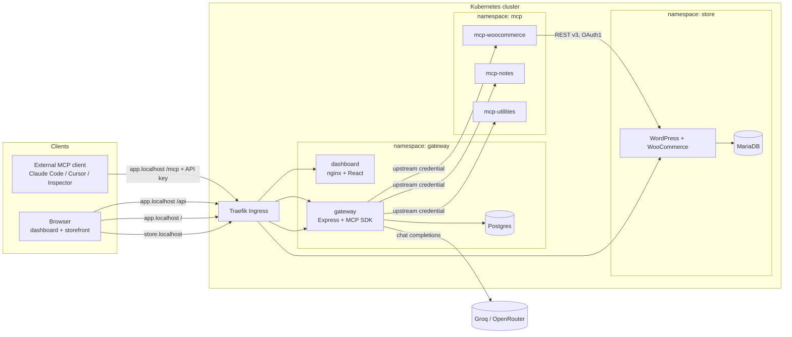
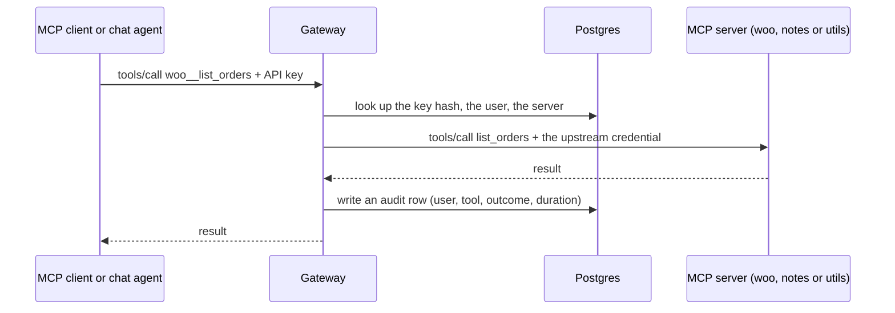

# MCP Gateway on Kubernetes

A WooCommerce store and a **team MCP gateway** on Kubernetes. Platform admins register MCP servers once; team members then use all their tools through one endpoint, either from an external MCP client (Claude Code, Cursor, MCP Inspector) or from a chat agent in the dashboard. One Helm chart installs everything on a local k3d cluster or on a single-node k3s server.

> **Status: complete and verified locally.** Everything below was built and run on a local k3d cluster (checked 2026-10-23). **Not done:** the production (VPS) setup was *rehearsed on a second local k3d cluster, not run on a real VPS*; the chart mode for a store hosted elsewhere is *rendered and validated, not installed*; Claude Code and Cursor were *not run against the gateway* (MCP Inspector and the chat agent were). Details: [section 22](#22-known-limitations-assumptions-and-future-improvements) and the [assignment checklist](docs/assignment-checklist.md).

**Contents:** [1 Overview](#1-project-name-and-overview) · [2 Problem](#2-problem-being-solved-and-motivation) · [3 Features](#3-key-features-and-user-capabilities) · [4 Workflows](#4-main-workflows-and-how-the-application-works) · [5 Screenshots](#5-screenshots-or-visual-demonstrations) · [6 Architecture](#6-system-architecture-and-links-to-design-documents) · [7 Diagrams](#7-architecture-and-workflow-diagrams) · [8 Stack](#8-technology-stack-and-rationale) · [9 Structure](#9-repository-structure) · [10 Prerequisites](#10-prerequisites-and-required-software-versions) · [11 Local setup](#11-complete-local-installation-and-setup) · [12 Environment](#12-environment-variable-configuration) · [13 AI keys](#13-obtaining-and-configuring-free-tier-ai-api-keys) · [14 Database](#14-database-setup-migrations-and-initialization) · [15 Development](#15-development-commands) · [16 Testing](#16-testing-commands-and-installation-verification) · [17 Build](#17-build-and-production-execution) · [18 Deployment](#18-deployment-instructions) · [19 Security](#19-security-considerations-and-secret-management) · [20 Troubleshooting](#20-troubleshooting) · [21 Docs](#21-links-to-documentation-in-docs) · [22 Limitations](#22-known-limitations-assumptions-and-future-improvements)

## 1. Project Name and Overview

**Urumi MCP Gateway** (repository `MCP-Gateway-on-Kubernetes`). It is made of:

- a **WooCommerce store** (WordPress, MariaDB) at <http://store.localhost>;
- **three MCP servers** that only the gateway can reach: WooCommerce (6 tools), Notes (5) and Utilities (4);
- the **gateway** (<http://app.localhost/mcp> for MCP clients, <http://app.localhost/api> for the dashboard) with its own Postgres database: users, API keys, a server registry, an audit log;
- a **web dashboard** (<http://app.localhost/>) and a **chat agent** on its Chat page that calls the gateway's tools as the logged-in user.

## 2. Problem Being Solved and Motivation

AI assistants are useful when they can act on real systems, and MCP (Model Context Protocol) is the standard way to give them tools. In a team that becomes messy: every person wires every MCP server by hand, server credentials are copied onto laptops, and nobody can see who called what or switch a broken server off for everyone.

The gateway puts that in one place. A member holds one personal API key and one URL. Upstream credentials stay in the gateway, encrypted, and are never shown to members. An admin can add, disable or remove a server for the whole team, and every call is in the audit log with the user it came from. The store gives the tools something real to work on (list and create products, read and update orders). Why each choice was made: [System design and tradeoffs](docs/system-design-and-tradeoffs.md).

## 3. Key Features and User Capabilities

- **A store on Kubernetes:** shop, cart, Cash-on-delivery checkout, customer accounts, admin. One command starts it.
- **One MCP endpoint, 15 tools.** Tools are named `woo__...`, `notes__...`, `utils__...` so equal names from different servers never collide. A dead server only loses its own tools (measured: isolation check 2026-10-19: gone in 4-12 s, back in 16 s; pod kill 2026-10-23: 3.7 s / 19.9 s).
- **Personal API keys** (shown once, stored as hashes, revoked at once), **invite links** for new members, **roles** (admin, member) and disabling users.
- **A server registry with health checks,** an SSRF guard on every URL an admin enters, and **upstream credentials encrypted** (AES-GCM) and bound to their origin.
- **An audit log** of every tool call and every rejected credential, attributed to the user. Members see only their own rows.
- **The dashboard,** responsive from a 390 px phone to a desktop: overview, servers, keys, audit log, team, chat.
- **A chat agent** (free Groq key; OpenRouter optional) that calls the tools as you and shows each call it made. **Guardrails:** a scope rule, a small topic-check model, a 1,024-token answer cap and a daily token budget per user.
- **Hardened Kubernetes layer:** default-deny NetworkPolicies, Pod Security `restricted`, a loopback-only local cluster, TLS and HSTS in the production values.
- **Extras:** the WooCommerce MCP server can talk to a store hosted elsewhere; your own in-cluster MCP servers can be registered ([deployment guide](docs/deployment.md#registering-mcp-servers-that-run-inside-the-cluster)). The assignment's optional items, with honest status: [stand-out items](docs/stand-out-items.md).

## 4. Main Workflows and How the Application Works

1. **A shopper places an order** on the storefront; the admin sees it in WooCommerce ([how to place an order](#how-to-place-an-order)).
2. **An admin registers MCP servers** in the dashboard; the gateway checks each one every 15 seconds and caches its tool list.
3. **A member creates an API key** on the Keys page and connects an external MCP client ([how](#how-to-connect-an-external-mcp-client)).
4. **A tool call** goes client, Traefik, gateway (authenticate, route by the name prefix, audit), the right MCP server and, for WooCommerce, on to the store.
5. **The chat agent** runs the same path: the dashboard sends your message, the gateway asks the LLM, and each tool the model picks is called through the gateway's own `/mcp` **as you** ([how to use it](#how-to-use-the-chat-agent)).
6. **An admin controls the team:** revoke a key (its next call is rejected), disable a server (its tools vanish for everyone), watch the audit log.

Each workflow with a failure table: [docs/workflows.md](docs/workflows.md). The assignment's end-to-end demo with two users: [docs/demo-script.md](docs/demo-script.md).

### How the WooCommerce MCP server talks to the store, and why

Inside the cluster it uses the **WooCommerce REST API (v3) with OAuth 1.0a signatures**, from a least-privilege `urumi-mcp` shop-manager key, sent to the store's Service address. WooCommerce documents OAuth 1.0a as the method for plain-HTTP connections, and in-cluster traffic is plain HTTP (it never leaves the cluster, and adding TLS inside would add certificates for no gain). The signature must be computed over the store's public URL while the request goes to the Service name, which is why the server takes two URLs ([ADR-005](docs/decisions/ADR-005-woocommerce-rest-oauth1.md)). For a store hosted elsewhere, the same server switches to **HTTPS with Basic auth** (`mcpWoocommerce.externalStore.*`): over HTTPS the key is protected in transit, so the simpler Basic header is enough, and plain HTTP is refused because Basic would send the key and secret in clear text ([ADR-019](docs/decisions/ADR-019-external-woocommerce-store.md), [guide](docs/deployment.md#using-a-woocommerce-store-hosted-elsewhere)). The external mode was proven live against the local store over HTTPS; the chart variant was rendered, not installed.

### How to place an order

1. Open <http://store.localhost/shop/> and click a product, then **Add to cart**.
2. Open the cart, go to checkout and fill in the billing details. The only payment method is **Cash on delivery**.
3. Press **Place order**; the "Order received" page confirms it.
4. Confirm it as the admin: <http://store.localhost/wp-admin/> then **WooCommerce, Orders** (user `admin`; get the password with the command in [step 6](#step-6-passwords-commands-only-never-printed-here)).

To see the order under **My account, Orders**, register and log in *before* you check out (guest orders are not linked to a later account). More: [run guide, using the store](docs/run-guide.md#6-using-the-store).

### How to connect an external MCP client

You need only the gateway URL, `http://app.localhost/mcp`, and a personal API key (dashboard, **API keys**, **Create key**; the key is shown once).

- **MCP Inspector** (tested): `npx -y @modelcontextprotocol/inspector@2.11.0 --cli http://app.localhost/mcp --transport http --header "Authorization: Bearer <your key>" --method tools/list` lists the tools. Step by step, including the exact commands that were run: [run guide, MCP Inspector](docs/run-guide.md#call-the-gateway-with-mcp-inspector-command-line).
- **Claude Code** (command line or a `.mcp.json` that keeps the key in an environment variable): [run guide, Connect Claude Code](docs/run-guide.md#connect-claude-code) and [`.mcp.json.example`](.mcp.json.example). **Not tested here:** the owner's machine has no `claude` command; only the example file's format was validated. No external LLM client has been run against the gateway yet; the owner runs one as a dry run before recording ([demo script, section 0](docs/demo-script.md#0-before-you-start)).
- **Cursor:** [run guide, Connect Cursor](docs/run-guide.md#connect-cursor-not-tested) (**not tested**).

Never paste a key into a chat, an issue or a commit.

### How to use the chat agent

1. Set it up once: [section 13](#13-obtaining-and-configuring-free-tier-ai-api-keys).
2. Log in to <http://app.localhost/> and open **Chat**. Ask in plain words: "Use the calculator: what is 6 times 7?", "What orders came in today?", "Create a draft product called Mug priced 9.99".
3. Under each answer, **N tool calls** shows every call the model made, with its arguments and result. They are in the **Audit log** with the source **Chat**.

**Guardrails.** The assistant acts as you (it can do what you could do through `/mcp`) and only helps with the store, your notes and small utility tasks. A small model checks each message first and most off-topic ones are refused before the main model runs (a cleverly worded or forged message can still get through, so the answer cap and the budget are the real bounds). Answers are capped at 1,024 tokens, each user has 50,000 tokens a day (the page shows `Today: used / limit tokens`), and each user is limited to 10 messages a minute. Details and every error: [ai-integration.md](docs/ai-integration.md).

## 5. Screenshots or Visual Demonstrations

Captured from the local cluster on 2026-10-23 with `scripts\dev\capture-screenshots.ps1`; demo users use `example.com` addresses, and no key, link or password is shown. A demo video is not part of this repository.

**Overview** (servers connected, recent calls, how to connect a client):



**Servers** and one **server's detail** (`woo`: URL, health, its 6 tools):




**Audit log** (who called what, from which client, with what outcome) and **Team** (users and roles; the invite dialog is not shown):




**Chat** after one question. The model called `utils__calculate` through the gateway; the trace shows the call, its arguments and its result. The budget line reads `Today: 53,619 / 200,000 tokens` because the limit was raised to 200,000 for this one capture (the admin's real 50,000 daily budget had been used up by earlier testing) and restored afterwards; the numbers are as the page showed them:


**On a 390 px phone** (the server table becomes cards): [servers-mobile.png](docs/screenshots/servers-mobile.png).

## 6. System Architecture and Links to Design Documents

Three namespaces, one Helm release. Only Traefik is reachable from outside; the MCP servers and both databases have no Ingress, and NetworkPolicies enforce that.

| Namespace | Runs | Reachable from outside |
|---|---|---|
| `store` | WordPress + WooCommerce, MariaDB, the one-off `store-setup` Job, the `wp-cron` CronJob | `store.localhost` through Traefik |
| `mcp` | `mcp-woocommerce`, `mcp-notes`, `mcp-utilities` | no (only the gateway may call them) |
| `gateway` | the gateway, Postgres, the dashboard (nginx) | `app.localhost` through Traefik |

Read next: [architecture.md](docs/architecture.md) (components and namespaces), [system-design.md](docs/system-design.md) (data model, routing, failure handling), [the short design note](docs/system-design-and-tradeoffs.md), [the short threat model](docs/threat-model.md), the [decision records](docs/decisions/README.md) (ADR-001 to ADR-020) and the [Helm resource map](docs/diagrams/helm-resource-map.md) (every object the chart renders).

## 7. Architecture and Workflow Diagrams



A tool call from an external client and from the chat take the same path through the gateway:



More, each with a failure table: [workflows.md](docs/workflows.md) (for example [a chat turn](docs/workflows.md#15-a-chat-turn-tool-loop-retries-and-fallback) and [an MCP tool call](docs/workflows.md#8-mcp-tool-call-through-the-gateway)); the index of every diagram is [docs/diagrams/README.md](docs/diagrams/README.md).

## 8. Technology Stack and Rationale

| Technology | Used for | Why |
|---|---|---|
| Kubernetes (k3d locally, k3s on a VPS) with Traefik | The platform | The assignment's target; k3s ships Traefik, so local and server behave the same ([ADR-002](docs/decisions/ADR-002-k3d-k3s-traefik.md)) |
| One Helm chart, two values files | Install, upgrade, rollback | Local and production differ only by values ([ADR-003](docs/decisions/ADR-003-single-helm-chart-three-namespaces.md)) |
| WordPress 7.1 + WooCommerce 11.2, MariaDB 11.8 | The store | WooCommerce is required; its REST API is what the MCP server wraps |
| TypeScript on Node 24, npm workspaces | Gateway, MCP servers, dashboard | One language and one set of types across the monorepo ([ADR-001](docs/decisions/ADR-001-typescript-monorepo.md)) |
| MCP TypeScript SDK, stateless Streamable HTTP | Every MCP server and the gateway | No session affinity; a new server object per request ([ADR-007](docs/decisions/ADR-007-mcp-sdk-version.md)) |
| Express 5, zod, Postgres 17 (`pg`, Drizzle migrations) | The gateway and its data | Validated inputs, transactional state (users, hashed keys, audit log) |
| argon2id and AES-GCM | Passwords and API keys (hashed); upstream credentials (encrypted) | Hashing where the secret is only compared, encryption where it must be sent ([ADR-008](docs/decisions/ADR-008-api-key-hashing.md), [ADR-009](docs/decisions/ADR-009-upstream-credential-encryption.md)) |
| React 19, Vite, Tailwind CSS, TanStack Query, served by nginx | The dashboard | A small static bundle on the same origin as the API, strict CSP ([ADR-015](docs/decisions/ADR-015-dashboard-served-by-nginx.md)) |
| Groq (free plan), OpenRouter optional, one OpenAI-compatible adapter | The chat agent | Free tiers; switching provider is configuration ([ADR-011](docs/decisions/ADR-011-llm-provider-abstraction.md)) |
| Vitest, Playwright, kubeconform | Tests, browser checks, chart validation | [testing.md](docs/testing.md) |

## 9. Repository Structure

```text
apps/
  gateway/          the gateway: REST API, /mcp endpoint, upstream manager, auth, audit, chat agent, DB migrations
  dashboard/        the React web app, its nginx config and the Playwright browser checks (e2e/)
  mcp-woocommerce/  MCP server: 6 store tools over the WooCommerce REST API
  mcp-notes/        MCP server: 5 tools, notes kept in memory
  mcp-utilities/    MCP server: 4 tools (date ranges, current time, calculator, ping)
packages/shared/    code shared by the apps (names, errors, config helpers)
charts/urumi-platform/   the Helm chart (templates, values.yaml, values.schema.json)
deploy/             values-local.yaml, values-prod.yaml, k3d cluster configs, examples
docker/             the two Dockerfiles (Node apps, dashboard)
scripts/            PowerShell scripts you run (up, stop, checks, secrets); scripts/dev (probes), scripts/prod (production Secrets)
docs/               all documentation (map: docs/README.md), screenshots/, diagrams/, decisions/, learning/
.env.example        the template for your AI keys
.mcp.json.example   the Claude Code project file (keys stay in an environment variable)
CLAUDE.md           the standing project instructions
```

## 10. Prerequisites and Required Software Versions

You need a Windows 11 PC with Windows PowerShell 5.1 (the scripts are PowerShell). The versions below are the ones used on the reference machine (a Linux or macOS host should work with the same tools but was not tried).

| Tool | Version used | Check |
|---|---|---|
| Docker Desktop (WSL2 backend), **running** | 4.85.0 | `docker version` |
| k3d | v5.9.0 | `k3d version` |
| kubectl | v1.36.1 (ships with Docker Desktop) | `kubectl version --client` |
| Helm | v4.3.1 | `helm version` |
| Node.js | 24 (24.15 or newer recommended; 24.0.1 works but `npm ci` prints `EBADENGINE` warnings) | `node -v` |
| Git | any recent | `git --version` |
| Free ports 80 and 443 on this computer | - | [port in use](docs/troubleshooting.md#port-80-is-already-in-use) |

Memory: about 9 GB for Docker (the reference machine has 15 GB RAM). Nothing else is needed to run the platform: every program is built inside Docker. Node is needed only for the checks, the tests and MCP Inspector.

## 11. Complete Local Installation and Setup

Everything below is run in PowerShell. The first `up.ps1` takes about 2 to 3 minutes (observed on the reference machine; it downloads images and WooCommerce).

### Step 1. Install the tools

Install Docker Desktop from docker.com, then in PowerShell:

```powershell
winget install --id Helm.Helm -e
winget install --id k3d.k3d -e
winget install --id OpenJS.NodeJS.LTS -e
winget install --id Git.Git -e
```

Open a **new** terminal so the new tools are on your `PATH`. Start Docker Desktop and wait for "Engine running".

### Step 2. Cap the memory WSL2 may take (recommended)

Create `C:\Users\<you>\.wslconfig` (the reference machine has 15 GB of RAM; scale to yours):

```ini
[wsl2]
memory=9GB
processors=8
swap=4GB
```

Then run `wsl --shutdown` and restart Docker Desktop. Why: [setup log](docs/learning/00-setup-log.md).

### Step 3. Get the code and install the packages

```powershell
git clone https://github.com/tushar66sharma/MCP-Gateway-on-Kubernetes.git MCP-Gateway-on-Kubernetes
cd MCP-Gateway-on-Kubernetes
npm ci
npx playwright install chromium   # optional, once: only for the browser checks
```

Run every later command from this folder. The folder path may contain spaces; the scripts quote their own paths.

### Step 4. Make `*.localhost` resolve (optional)

Browsers and `curl` resolve `*.localhost` to your own computer by themselves, so the store and dashboard work without this. Node-based tools (the check scripts, MCP Inspector, Claude Code) use the operating system resolver and need hosts entries:

```powershell
powershell -NoProfile -ExecutionPolicy Bypass -File scripts\setup-hosts.ps1   # one UAC prompt; safe to repeat
```

**The local domain approach.** There is no DNS to set up: `store.localhost` and `app.localhost` both point at `127.0.0.1`, where k3d publishes ports 80 and 443 (**loopback only**, so other computers on your network cannot reach the cluster; chosen on 2026-10-23, [security.md](docs/security.md#16-the-real-client-ip-the-loopback-only-cluster-and-production-secrets-phase-5)). Traefik tells the two sites apart by the `Host` name. If port 80 is taken, see [deployment.md](docs/deployment.md#step-10-if-host-port-80-is-taken-use-8081).

### Step 5. Start everything

```powershell
powershell -NoProfile -ExecutionPolicy Bypass -File scripts\up.ps1
```

It creates the cluster `urumi` (kube context `k3d-urumi`), builds the five images and imports them, installs the Helm release, waits until the pods are ready and prints the URLs. When it ends, `kubectl get pods -A` shows every pod `1/1 Running` (the `store-setup` Job: `Completed`). Run it again any time: it starts a stopped cluster and keeps your data. After changing the chart or a values file run it with `-Redeploy`. Pause with `scripts\stop.ps1` (keeps data); recreating the cluster deletes all data and generates new passwords.

### Step 6. Passwords (commands only, never printed here)

Passwords are generated on first install and live only in Kubernetes Secrets. Each command copies one to your clipboard; add `-Show` to print it instead.

```powershell
powershell -NoProfile -ExecutionPolicy Bypass -File scripts\get-admin-password.ps1    # store admin, user "admin"
powershell -NoProfile -ExecutionPolicy Bypass -File scripts\get-secret.ps1 -Namespace gateway -Name gateway-bootstrap -Key password   # dashboard admin
```

### Step 7. Open the store

<http://store.localhost/> (shop at `/shop/`). The admin area is <http://store.localhost/wp-admin/>.

### Step 8. Open the dashboard

<http://app.localhost/>. Log in as `admin@example.com` with the password from step 6.

### Step 9. Turn on the AI chat (optional)

Needs a free Groq key; see [section 13](#13-obtaining-and-configuring-free-tier-ai-api-keys). Without it everything else works and the Chat page says the provider is not configured.

### Step 10. First login and a quick check

Log in at <http://app.localhost/> (step 8), open **Servers**: `notes`, `utils` and `woo` show **Connected**. Then run the one-command check:

```powershell
powershell -NoProfile -ExecutionPolicy Bypass -File scripts\smoke-test.ps1 -Quick
```

Step 4 (the hosts entries) is needed here: the gateway check (`check-gateway.ps1`, which runs `node` against `http://app.localhost`) and, without `-Quick`, the dashboard check stop with a "does not resolve" error if `app.localhost` does not resolve on your machine. The pods-ready, WooCommerce API, MCP-server and network-policy checks use `kubectl` and port-forwards and do not need it (steps 1, 2, 3 and 6 of `scripts\smoke-test.ps1`). The invite-log check (step 7) requests `http://app.localhost` with `curl.exe`, so keep the entries for it too.

It prints a PASS/FAIL table (pods, WooCommerce, MCP servers, gateway end to end, network-policy probes, invite-log check). Without `-Quick` it also drives the dashboard in a browser (this needs the `npx playwright install chromium` from step 3) and runs `npm audit`, and it spends one live chat turn when the AI key is set.

The complete beginner guide (daily use, customer accounts, viewing the databases, resetting) is the [run guide](docs/run-guide.md).

## 12. Environment-Variable Configuration

In the cluster, every variable is set by the Helm chart from the values files; you supply only the AI keys in `.env`; the admin email is the Helm value `gateway.bootstrapAdminEmail` (git-ignored; template [`.env.example`](.env.example) explains each line).

| Variable | Where | Meaning |
|---|---|---|
| `GROQ_API_KEY` | `.env`, then `scripts\create-secrets.ps1` | Free Groq key for the chat |
| `OPENROUTER_API_KEY` | `.env` (optional) | Fallback or alternative provider |
| `LLM_PROVIDER`, `LLM_MODEL`, `LLM_FALLBACK_PROVIDER` | Helm values `gateway.llm.*` | Which provider and model the chat uses |
| `CHAT_DAILY_TOKEN_BUDGET`, `CHAT_TOPIC_CHECK`, `LLM_MAX_OUTPUT_TOKENS` | Helm values `gateway.chat.*`, `gateway.llm.*` | The guardrails (defaults 50,000, on, 1,024) |
| `BOOTSTRAP_ADMIN_EMAIL` | Helm values (default `admin@example.com`) | The first dashboard admin |

Every variable of the gateway with its default and range: [apps/gateway/README.md](apps/gateway/README.md#configuration-environment-variables); the LLM and chat ones: [ai-integration.md](docs/ai-integration.md#2-configuration). Changing a value: edit `deploy/values-local.yaml`, then `scripts\up.ps1 -Redeploy`.

## 13. Obtaining and Configuring Free-Tier AI API Keys

The chat uses **Groq's free plan** (no card needed as of 2026-10-19). Its limits for the default model `openai/gpt-oss-120b` were 30 requests and 8,000 tokens per minute, 1,000 requests and 200,000 tokens per day; one simple question costs about 3,000 tokens, so expect about two questions a minute before Groq asks you to wait. **Free limits change; check them before relying on them.** OpenRouter's `:free` models (20 requests a minute, 50 a day) are an optional fallback. Gemini is not used.

1. Create a key at <https://console.groq.com/keys> (**Create API Key**; it is shown once).
2. `Copy-Item .env.example .env`, then put the key after `GROQ_API_KEY=` in `.env` (Git ignores this file).
3. Send it to the cluster; the script prints only `set` or `empty`:

   ```powershell
   powershell -NoProfile -ExecutionPolicy Bypass -File scripts\create-secrets.ps1
   ```

4. Check: `kubectl -n gateway logs deploy/gateway | Select-String "llm "` shows `llm configured: groq/openai/gpt-oss-120b`. Then open <http://app.localhost/chat>.

Never paste a key into a chat, an issue or a commit. Switching provider or model, and every error: [ai-integration.md](docs/ai-integration.md) and the run guide's [Set up the AI chat](docs/run-guide.md#set-up-the-ai-chat).

## 14. Database Setup, Migrations, and Initialization

There are two databases and you set neither up by hand.

- **Store (MariaDB):** created by the chart. The one-off `store-setup` Job (WP-CLI) installs WordPress and WooCommerce, enables Cash on delivery, creates the least-privilege `urumi-mcp` API key and seeds sample products (`storeSetup.seedProducts`, default `true`). It is safe to run again.
- **Gateway (Postgres 17):** created by the chart on a persistent volume. The gateway applies its migrations (`apps/gateway/drizzle/`) when it starts, under a lock so two starts never race, and creates the first admin from the bootstrap Secret.

To look inside (read-only): [run guide, the store database](docs/run-guide.md#7-viewing-the-store-database-mariadb) and [the gateway database](docs/run-guide.md#10-viewing-the-gateway-database-postgres). Wiping everything and starting over: [deployment.md, uninstall](docs/deployment.md#step-9-uninstall-and-what-is-kept).

## 15. Development Commands

Run from the repository root (Node 24, after `npm ci`).

| Command | Does |
|---|---|
| `npm run build` | Builds the shared package, then every workspace (the dashboard prints a known warning about one large JS chunk) |
| `npm run typecheck` | Type-checks every workspace (including the dashboard's `e2e/`) |
| `npm run lint` | ESLint over the repository |
| `npm run dev -w @urumi/dashboard` | The dashboard's Vite dev server (it needs a gateway to talk to; the cluster's is fine) |
| `npm test -w @urumi/gateway` | One workspace's tests (also `@urumi/dashboard`, `@urumi/shared`, `@urumi/mcp-notes`, `@urumi/mcp-utilities`, `@urumi/mcp-woocommerce`) |
| `scripts\up.ps1 -Redeploy` | Rebuild the images from your working tree and upgrade the release |
| `powershell -NoProfile -ExecutionPolicy Bypass -File scripts\dev\capture-screenshots.ps1` | Retake the documentation screenshots (spends one chat turn; `-SkipChat` avoids it) |

Per-app notes: [gateway](apps/gateway/README.md), [dashboard](apps/dashboard/README.md), [mcp-woocommerce](apps/mcp-woocommerce/README.md), [mcp-notes](apps/mcp-notes/README.md), [mcp-utilities](apps/mcp-utilities/README.md).

## 16. Testing Commands and Installation Verification

```powershell
npm test                      # 671 tests across 6 workspaces, about 70 s; Playwright is not part of it
npm run typecheck
npm run lint
npm run build
powershell -NoProfile -ExecutionPolicy Bypass -File scripts\validate-chart.ps1    # chart lint, render rules and kubeconform on both values files (needs Docker, no cluster)
powershell -NoProfile -ExecutionPolicy Bypass -File scripts\smoke-test.ps1 -Quick # everything on the cluster except the browser and npm audit
powershell -NoProfile -ExecutionPolicy Bypass -File scripts\smoke-test.ps1        # the full check, with the dashboard in Chromium and one live chat turn
```

Single checks: `scripts\check-mcp-woocommerce.ps1`, `scripts\check-gateway.ps1 -Write -Isolation`, `scripts\check-dashboard.ps1`, `scripts\test-network-policies.ps1` (13 allowed/blocked probes). Every command, test count and what each proves: [docs/testing.md](docs/testing.md). The definition-of-done flow with two users: [docs/demo-script.md](docs/demo-script.md).

## 17. Build and Production Execution

`scripts\build-images.ps1` builds the five images (`mcp-woocommerce`, `mcp-notes`, `mcp-utilities`, `gateway`, `dashboard`; `up.ps1` calls it) from `docker/node-app.Dockerfile` and `docker/dashboard.Dockerfile`, tags them from the Git commit, and imports them into the local cluster. Nothing is pushed anywhere. For a server, the images must be built for the server's CPU (x86-64 or arm64) and pushed to a registry; that part was **not executed** ([deployment.md, step 6](docs/deployment.md#6-build-and-push-multi-arch-images-not-executed)). `deploy/values-prod.yaml` is the production counterpart of `deploy/values-local.yaml`.

## 18. Deployment Instructions

**Local (k3d):** [section 11](#11-complete-local-installation-and-setup).

**VPS or production setup (k3s):** one Linux server (2 CPU, 8 GB or more), k3s, DNS records for the store and app hosts, cert-manager with a Let's Encrypt issuer, images in a registry, Secrets created on the server by `scripts/prod/create-prod-secrets.sh` (generated there, never in Git), then `helm upgrade --install urumi charts/urumi-platform --namespace urumi-system --create-namespace -f deploy/values-prod.yaml`. What changes between local and production is only the values file: public hostnames and `https`, TLS with redirect and HSTS, storage class and sizes, pre-created Secrets instead of generated ones, registry images, no hosts entries. Upgrade and rollback are `helm upgrade` and `helm rollback`; backup commands are in the guide. The step by step beginner guide, with the cost of each step: [deployment.md, Production (k3s VPS)](docs/deployment.md#production-k3s-vps).

**Honest status.** This was **rehearsed on 2026-10-23 on a second local k3d cluster** with a self-signed issuer: the chart, the production values, the Secrets script, the TLS redirect and HSTS, Pod Security and the NetworkPolicies. **No real VPS, domain or Let's Encrypt certificate has been used**; the steps that need a server, DNS, a certificate or a registry were not executed. What follows when the public address changes: [deployment.md](docs/deployment.md#when-the-public-address-changes).

## 19. Security Considerations and Secret Management

- **Two credentials that never meet.** A client's API key authenticates it to the gateway only; it is never passed to an upstream. Each upstream has its own credential, held encrypted by the gateway. A member can use a tool but never sees the credential behind it ([threat-model.md](docs/threat-model.md)).
- **At rest:** API keys and passwords are hashes (argon2id for passwords); upstream credentials are AES-GCM encrypted and bound to their origin, so changing a server's URL cannot send them elsewhere.
- **Network:** default-deny NetworkPolicies, Pod Security `restricted` (non-root, no capabilities), no Kubernetes API access for any component, the local cluster on loopback only, an SSRF guard on every admin-entered URL, CSRF protection and a strict Content-Security-Policy on the dashboard.
- **Secrets** live in Kubernetes Secrets (generated at install locally; created on the server by script in production), plus `.env` for the AI keys. `.env` is git-ignored. **Nothing in this repository, its screenshots or its script output contains a password or key**; scripts print commands that fetch them, never the values.
- **The chat** sends your messages and tool results to the AI provider (a third party). Prompt injection through tool output is a documented residual risk.

Full detail and residual risks: [security.md](docs/security.md) and [threat-model.md](docs/threat-model.md).

## 20. Troubleshooting

| Symptom | First thing to try |
|---|---|
| `docker`, `k3d` or `helm` not found | Open a **new** terminal after installing; check Docker Desktop shows "Engine running" |
| `up.ps1` stops on port 80 | Another program uses it: [port 80 is in use](docs/troubleshooting.md#port-80-is-already-in-use) |
| `store.localhost` or `app.localhost` does not open in a Node tool | Run `scripts\setup-hosts.ps1` |
| A pod is not `1/1` | `kubectl get pods -A`, then `kubectl -n <namespace> logs <pod>`; wait a minute after a start |
| `npm ci` prints `EBADENGINE` | Node 24 older than 24.15: a warning only; update Node to silence it |
| The chat says the provider is not configured, rejects the key or is rate limited | [not configured](docs/troubleshooting.md#chat-says-the-ai-provider-isnt-configured), [key rejected](docs/troubleshooting.md#chat-says-the-ai-provider-rejected-the-api-key-llm_auth_failed), [rate limited](docs/troubleshooting.md#chat-says-the-ai-provider-is-rate-limited-429) |
| Forgot a password | The two commands in [step 6](#step-6-passwords-commands-only-never-printed-here) |
| Start over completely | [deployment.md, uninstall](docs/deployment.md#step-9-uninstall-and-what-is-kept) |

All of them, with causes and fixes: [docs/troubleshooting.md](docs/troubleshooting.md).

## 21. Links to Documentation in `docs/`

The index is [docs/README.md](docs/README.md). The deliverables at a glance:

| Need | Document |
|---|---|
| Run everything, day to day | [run-guide.md](docs/run-guide.md) |
| Local and VPS deployment | [deployment.md](docs/deployment.md) |
| The demo in the assignment's order | [demo-script.md](docs/demo-script.md) |
| System design and tradeoffs (short) | [system-design-and-tradeoffs.md](docs/system-design-and-tradeoffs.md) |
| Threat model (short) | [threat-model.md](docs/threat-model.md) |
| Stand-out and bonus items | [stand-out-items.md](docs/stand-out-items.md) |
| Every requirement, where and how verified | [assignment-checklist.md](docs/assignment-checklist.md) |
| Architecture, design, workflows, diagrams | [architecture.md](docs/architecture.md), [system-design.md](docs/system-design.md), [workflows.md](docs/workflows.md), [diagrams/](docs/diagrams/README.md) |
| AI, errors, security, testing | [ai-integration.md](docs/ai-integration.md), [error-handling.md](docs/error-handling.md), [security.md](docs/security.md), [testing.md](docs/testing.md) |
| Why each choice was made | [decision records](docs/decisions/README.md) |

## 22. Known Limitations, Assumptions, and Future Improvements

**Not run, or only partly run (stated plainly):**

- **The VPS setup was rehearsed, not deployed.** It ran on a second local k3d cluster with a self-signed certificate; no real server, domain, Let's Encrypt certificate, registry push or arm64 image was used.
- **The external-store chart mode is rendered and validated, not installed.** The WooCommerce MCP server's HTTPS Basic mode itself was proven live against the local store.
- **Claude Code and Cursor were not run against the gateway.** MCP Inspector and the dashboard chat were; the Claude Code files were only format-checked.

**Design limits:**

- **One gateway replica,** and one MariaDB and one Postgres. No multi-replica scaling, no per-key rate limits (limits are per user and per client address), no metrics endpoint.
- **The notes server is shared by all users.** `mcp-notes` keeps notes in memory under one upstream identity, so every member sees the same notes and a restart clears them.
- **The chat's topic check has a residual bypass.** A cleverly worded or forged message can pass the small model; the scope rule, the 1,024-token cap and the daily budget are the real bounds. The chat shares one free provider key across the team, so heavy use hits Groq's per-minute limit, and messages and tool results go to the AI provider. Prompt injection through tool output is a documented residual risk ([security.md](docs/security.md#12-untrusted-data-and-prompt-injection)).
- **k3d still publishes the Kubernetes API port on all interfaces** (the web ports are loopback only). Open registration on the demo store has no CAPTCHA or email verification.

**Deferred polish (owner decision, 2026-10-23: documentation and demo only):**

- **Accessibility:** the page `h1` headings, focus after navigating from the mobile drawer and the focus ring on table row actions need another pass.
- **Rate-limit countdown text:** the wording and announcement of the chat's "try again in N seconds" countdown need polish.
- **Audit date validation:** the audit log's date filters do not check that "from" is not later than "to".
- **Bundle splitting:** the dashboard ships one JavaScript chunk over 500 kB (routes are not lazy-loaded).
- **Startup database wait:** the gateway retries its first Postgres connection 90 times, 2 s apart, but a single attempt has no deadline of its own and the whole wait has no total deadline.

Their detail and the rest of the list: [docs/stand-out-items.md](docs/stand-out-items.md) and the [assignment checklist](docs/assignment-checklist.md).
