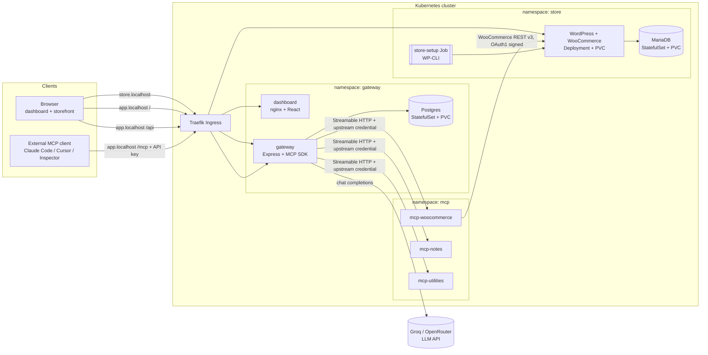
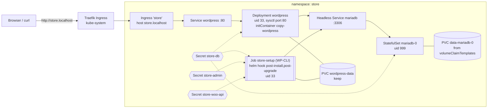
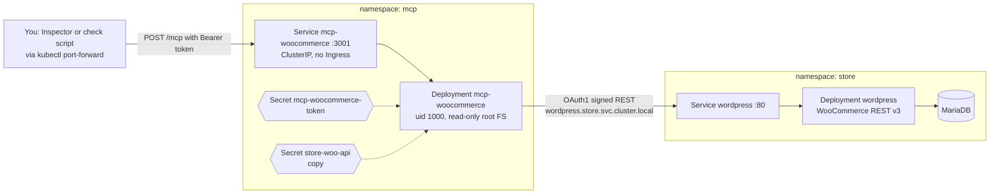

# Architecture

> **Status (end of Phase 2).** The local k3d cluster, the Helm chart, the **store** (WordPress + WooCommerce, MariaDB, the `store-setup` hook Job, the Ingress and the Secrets) and the **WooCommerce MCP server** (namespace `mcp`, internal only) are **built and verified**. The `gateway` namespace exists but is empty. Every component marked **(planned)** below is the target design for a later phase. See [What exists today](#what-exists-today), the [Phase 1 store details](#the-store-built-in-phase-1) and the [Phase 2 MCP server details](#the-woocommerce-mcp-server-built-in-phase-2).

## Purpose

This project runs a WooCommerce store and a team MCP (Model Context Protocol) gateway on Kubernetes, installed by a single Helm chart. The gateway gives a team one authenticated `/mcp` endpoint that aggregates several upstream MCP servers (WooCommerce, notes, utilities), with a dashboard for managing servers, members, API keys and the audit log, plus a chat agent. This document is the high-level map; the full design is in the [design spec](superpowers/specs/2026-10-18-mcp-gateway-design.md), and detail documents are listed in the [documentation map](README.md).

## Target architecture diagram

**Reading the diagram.** There are two kinds of client. A *browser* user visits the storefront at `store.localhost` (routed by Traefik to WordPress/WooCommerce, backed by MariaDB and prepared by the one-off `store-setup` Job) and the dashboard at `app.localhost` (static files from the `dashboard` pod; its `/api` calls go to the `gateway`). An *external MCP client* such as Claude Code, Cursor or the MCP Inspector sends MCP requests to `app.localhost/mcp` with an API key; only the gateway receives them. The gateway stores its state in Postgres, authenticates the caller, then forwards tool calls over Streamable HTTP to the right upstream MCP server (`mcp-woocommerce`, `mcp-notes`, `mcp-utilities`) using a separate upstream credential. `mcp-woocommerce` in turn calls the WooCommerce REST API (v3, OAuth1 signed). For the chat feature the gateway calls an external LLM API (Groq, with OpenRouter as a fallback).

**Key rule:** the only path to an upstream MCP server is *through the gateway*. MCP servers have no Ingress, and NetworkPolicies only admit traffic from gateway pods **(planned, Phase 5)**.

## Components and responsibilities

| Component | Tech | Responsibility | Status |
|---|---|---|---|
| `apps/dashboard` | React 19 + Vite + TypeScript + Tailwind + Radix UI + TanStack Query + React Router | UI for servers, team, keys, audit log, chat. Talks only to `/api` on the same origin. | **(planned)** — Phase 4 |
| `apps/gateway` | Node 24 + Express 5 + TypeScript + MCP TS SDK + Drizzle ORM + pg + pino + zod | Dashboard REST API, auth, API keys, upstream registry and health, aggregated `/mcp`, audit log, chat agent. | **(planned)** — Phase 3 (core), Phase 4 (chat agent) |
| `apps/mcp-woocommerce` | Node 24 + MCP TS SDK + zod | MCP tools over the WooCommerce REST API v3. | **Built in Phase 2** (internal only; verified in the cluster) |
| `apps/mcp-notes` | Node 24 + MCP TS SDK | Upstream #2: simple in-memory notes; bearer-token protected. | **(planned)** — Phase 3 |
| `apps/mcp-utilities` | Node 24 + MCP TS SDK | Upstream #3: date ranges, current time, calculator; custom-header protected. | **(planned)** — Phase 3 |
| `packages/shared` | TypeScript | Logger, env config loader, MCP HTTP server bootstrap, health endpoints, auth middleware for upstreams. | **Built in Phase 2** |
| Store (WordPress + WooCommerce, MariaDB, `store-setup` Job) | Deployment + StatefulSet + Job | The WooCommerce store the MCP server operates on. | **Built in Phase 1** (verified: install, upgrade, uninstall/reinstall, fresh install) |
| `charts/urumi-platform` | Helm 4 (chart `apiVersion: v2`, also installable with Helm 3.x) | Every Kubernetes resource. | **Store (Phase 1) and MCP server (Phase 2) built**; grows in Phases 3-5 |

The repo is an **npm workspaces monorepo**: one `package.json` at the root, one lockfile, shared TypeScript config ([ADR-001](decisions/ADR-001-typescript-monorepo.md)).

## Namespaces and exposure

One Helm release owns three namespaces ([ADR-003](decisions/ADR-003-single-helm-chart-three-namespaces.md)). Only the services behind Traefik are reachable from outside the cluster; everything else is internal. The `store` row and the `mcp-woocommerce` part of the `mcp` row are built; `mcp-notes`, `mcp-utilities` and the `gateway` row are **(planned)** (the `gateway` namespace exists but is empty), as are the NetworkPolicies.

| Namespace | Workloads | Public via Ingress | Internal only |
|---|---|---|---|
| `store` | WordPress + WooCommerce (Deployment, PVC), MariaDB (StatefulSet, PVC), `store-setup` Job | WordPress at `store.localhost` | MariaDB, the setup Job |
| `mcp` | `mcp-woocommerce` (built), `mcp-notes`, `mcp-utilities` (planned) | Nothing (no Ingress; verified for `mcp-woocommerce`) | All three. Reachable only from gateway pods once NetworkPolicies exist (Phase 5, not built); today any pod in the cluster can reach `mcp-woocommerce`, but needs its bearer token |
| `gateway` | `dashboard`, `gateway`, Postgres (StatefulSet, PVC) | `dashboard` at `app.localhost/`; `gateway` at `app.localhost/api` and `app.localhost/mcp` | Postgres |

Hostnames shown are the local defaults; production uses real DNS names (see [ADR-012](decisions/ADR-012-deployment-target-k3s-vps.md)).

## Technology choices

| Choice | Reason | Decision record |
|---|---|---|
| TypeScript npm-workspaces monorepo | One language and lockfile for gateway, MCP servers, dashboard and shared code | [ADR-001](decisions/ADR-001-typescript-monorepo.md) |
| k3d locally, k3s in production, Traefik ingress | Same Kubernetes distribution and ingress class in both environments | [ADR-002](decisions/ADR-002-k3d-k3s-traefik.md) |
| One Helm chart owning three namespaces | Single install/upgrade unit; `resource-policy: keep` protects store data | [ADR-003](decisions/ADR-003-single-helm-chart-three-namespaces.md) |
| Own MariaDB/Postgres templates (no Bitnami charts) | Fewer moving parts and full control of the manifests | [ADR-004](decisions/ADR-004-own-database-templates.md) |
| WooCommerce REST v3 with OAuth1 | How `mcp-woocommerce` talks to the store (confirmed by the Phase 1 spike: sign the public store URL, not the URL requested) | [ADR-005](decisions/ADR-005-woocommerce-rest-oauth1.md) |
| Tool naming `<slug>__<tool>` | Collision-free aggregated tool catalog within the 64-character limit | [ADR-006](decisions/ADR-006-tool-naming-scheme.md) |
| MCP SDK v2, stateless Streamable HTTP via `createMcpHandler` | Simple horizontally scalable servers; one endpoint serves 2026-07-28 and 2025-era clients (verified with the v1 SDK client, the v2 client (auto/legacy/modern) and MCP Inspector 2.11.0; Claude Code/Cursor not yet tested) | [ADR-007](decisions/ADR-007-mcp-sdk-version.md) |
| API keys: random + SHA-256, shown once | High-entropy keys do not need a slow password hash | [ADR-008](decisions/ADR-008-api-key-hashing.md) |
| Upstream credentials AES-256-GCM at rest | Credentials are recoverable for forwarding but not stored in plaintext | [ADR-009](decisions/ADR-009-upstream-credential-encryption.md) |
| Chat agent loops back through the real `/mcp` | The chat exercises the same auth, audit and routing as external clients | [ADR-010](decisions/ADR-010-chat-agent-loopback.md) |
| One OpenAI-compatible LLM adapter (Groq, OpenRouter) | Provider switching by configuration; no Gemini | [ADR-011](decisions/ADR-011-llm-provider-abstraction.md) |
| k3s on a VPS as deployment target | Needs a real Kubernetes cluster; Vercel/Render offer no Kubernetes and no persistent disks on their free tiers | [ADR-012](decisions/ADR-012-deployment-target-k3s-vps.md) |
| Invite links for onboarding | No email service or temporary passwords needed | [ADR-013](decisions/ADR-013-invite-links.md) |
| Cached, health-checked tool catalog | `tools/list` stays fast and survives dead upstreams | [ADR-014](decisions/ADR-014-cached-tool-catalog.md) |

All records are indexed in [decisions/README.md](decisions/README.md).

## The store (built in Phase 1)

**Reading the diagram.** A browser request for `store.localhost` reaches Traefik (the k3s ingress controller), which matches the Ingress `store` and forwards to a Ready WordPress Pod through the Service's endpoints. WordPress reads and writes its files on the PVC `wordpress-data` and talks to MariaDB through the headless Service `mariadb` (database on PVC `data-mariadb-0`). The `store-setup` Job is run by Helm after install/upgrade; it mounts the same WordPress volume (so it is scheduled on the same node by pod affinity) and drives WooCommerce with WP-CLI. Dotted lines are Secrets injected as environment variables; they are generated by the chart and kept across `helm uninstall`. The step-by-step flows with failure handling are in [workflows.md](workflows.md); commands to run it are in [deployment.md](deployment.md).

### Store design points

- **Everything runs non-root** (spec §8.5, [ADR-004](decisions/ADR-004-own-database-templates.md)). MariaDB is uid/gid 999 (the image's `mysql` user). WordPress and the setup Job are uid/gid 33 (`www-data`).
- **Why WordPress can be uid 33 and still serve port 80.** Binding a port below 1024 normally needs root. The pod sets the namespaced, Kubernetes-"safe" sysctl `net.ipv4.ip_unprivileged_port_start=0`, which allows any user to bind low ports. No root and no Linux capabilities (`capabilities.drop: [ALL]`) are needed.
- **Why the `copy-wordpress` initContainer exists.** The official image's entrypoint copies WordPress onto `/var/www/html` with `tar`, which also does a `chmod` on the target root. A fresh PVC root is owned by root, so a non-root user cannot `chmod` it and the container crashes. The initContainer runs the same image as uid 33 and copies with `cp -R` first (which never changes the root directory's mode). The entrypoint then sees `index.php`, skips its own copy, and still generates `wp-config.php`.
- **`WP_HOME`/`WP_SITEURL` come from the `WORDPRESS_CONFIG_EXTRA` environment variable.** Verified on the running pod: `wp-config.php` contains `if ($configExtra = getenv_docker('WORDPRESS_CONFIG_EXTRA', '')) { eval($configExtra); }`, so the constants are evaluated from the pod's environment at **every start**, not baked into the file. A changed public URL therefore takes effect after a redeploy without editing the volume.
- **The public URL** is `{publicScheme}://{host}` plus `:{publicPort}` only when the port is not the scheme's default (helper `urumi.publicUrl`). It feeds `WP_HOME`/`WP_SITEURL` (and `NOTES.txt`/`WP_URL`). The Ingress uses the bare `storeHost`. The OAuth1 signing base is derived from it (scheme replaced by `http`, see [ADR-005](decisions/ADR-005-woocommerce-rest-oauth1.md)); the chart helper `urumi.storeSigningBaseUrl` computes it for the MCP server (`WOO_SIGNING_BASE_URL`), and `check-woo-api.ps1` derives it by the same rule.
- **Credentials** (`store-db`, `store-admin`, `store-woo-api`) are generated once by `urumi.generatedValue`, stored only in cluster Secrets, and annotated `helm.sh/resource-policy: keep`. Pre-created Secrets can replace them via `secrets.existing.*` (required keys are listed in [deployment.md](deployment.md)).

## The WooCommerce MCP server (built in Phase 2)

**Reading the diagram.** The MCP server is one Pod behind a ClusterIP Service in the `mcp` namespace. There is no Ingress, so it cannot be reached from outside the cluster; today you reach it with `kubectl port-forward`, and in Phase 3 the gateway will call it. Two Secrets are injected as environment variables (dotted lines): the bearer token that callers must present, and a copy of the WooCommerce REST key (Secrets cannot be shared across namespaces, so the chart renders the same generated value into both namespaces). For each tool call the server validates the input, signs a WooCommerce REST request (OAuth 1.0a) and sends it to the `wordpress` Service by its in-cluster DNS name. The step-by-step flow with every failure case is [workflow 6](workflows.md#6-mcp-tool-call-to-the-store); the protocol with captured JSON is in [learning/02-mcp-protocol.md](learning/02-mcp-protocol.md).

### MCP server design points

- **Stateless Streamable HTTP, SDK v2** ([ADR-007](decisions/ADR-007-mcp-sdk-version.md)). A new `McpServer` is built per request, so there are no sessions and replicas would need no affinity. Packages: `@modelcontextprotocol/server` 2.3.1, `/node` 2.1.1 and `/express` 2.0.2 (server side) and `/client` 2.3.1 (tests, smoke script).
- **Probes never depend on WooCommerce.** `/healthz` (liveness) and `/readyz` (readiness) check only the process. A fresh install would otherwise deadlock: `helm --wait` waits for this pod, and the store-setup Job that creates the API key only starts after that.
- **Host check on `/mcp` only.** `MCP_ALLOWED_HOSTS` lists hostnames without ports (the SDK compares hostnames only); probes are exempt because the kubelet sends `Host: <pod IP>:3001`.
- **Least privilege at both ends.** The pod runs as uid 1000 with a read-only root filesystem, a `/tmp` emptyDir, no service-account token and all Linux capabilities dropped. The WooCommerce key belongs to the `urumi-mcp` **shop manager**, not the administrator, so a leaked key cannot manage plugins or users ([ADR-005](decisions/ADR-005-woocommerce-rest-oauth1.md)).
- **Images are built locally and imported into k3d**, tagged with the git short SHA (plus `-dirty-<timestamp>` for an unclean tree). See the [run guide](run-guide.md#build-the-program-images-build-imagesps1).
- **No retries** of WooCommerce calls (nonce reuse, non-idempotent writes): [workflow 6](workflows.md#6-mcp-tool-call-to-the-store).

## What exists today

The local k3d cluster `urumi` with its scripts; the Helm chart `charts/urumi-platform` with the **store** (MariaDB, WordPress + WooCommerce, the `store-setup` hook Job, the `store.localhost` Ingress, Secrets), verified by install, upgrade, uninstall/reinstall and a destructive fresh install (see [deployment.md](deployment.md) and [workflows.md](workflows.md)); the OAuth1 check `scripts/check-woo-api.ps1`; the **WooCommerce MCP server** (`apps/mcp-woocommerce`, `packages/shared`, the image build via `scripts/build-images.ps1`, the `mcp` templates in the chart, `scripts/check-mcp-woocommerce.ps1`), verified in the cluster; and the learning and decision documents ([setup log](learning/00-setup-log.md), [Kubernetes primer](learning/01-kubernetes-primer.md), [MCP protocol notes](learning/02-mcp-protocol.md)). The gateway, dashboard, the notes and utilities MCP servers, Postgres, the LLM integration and NetworkPolicies in the first diagram are **not built yet** (Phases 3-5).
