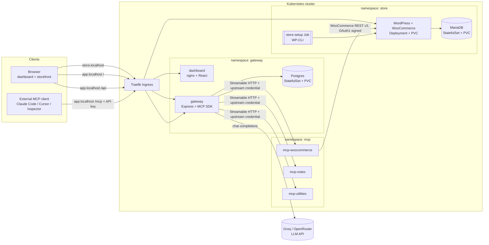

# Architecture

> **Target architecture.** As of Phase 0 only the local k3d cluster and tooling exist; every component below is **(planned)** and its section will be updated when built.

## Purpose

This project runs a WooCommerce store and a team MCP (Model Context Protocol) gateway on Kubernetes, installed by a single Helm chart. The gateway gives a team one authenticated `/mcp` endpoint that aggregates several upstream MCP servers (WooCommerce, notes, utilities), with a dashboard for managing servers, members, API keys and the audit log, plus a chat agent. This document is the high-level map; the full design is in the [design spec](superpowers/specs/2026-10-18-mcp-gateway-design.md), and detail documents are listed in the [documentation map](README.md).

## Target architecture diagram

**Reading the diagram.** There are two kinds of client. A *browser* user visits the storefront at `store.localhost` (routed by Traefik to WordPress/WooCommerce, backed by MariaDB and prepared by the one-off `store-setup` Job) and the dashboard at `app.localhost` (static files from the `dashboard` pod; its `/api` calls go to the `gateway`). An *external MCP client* such as Claude Code, Cursor or the MCP Inspector sends MCP requests to `app.localhost/mcp` with an API key; only the gateway receives them. The gateway stores its state in Postgres, authenticates the caller, then forwards tool calls over Streamable HTTP to the right upstream MCP server (`mcp-woocommerce`, `mcp-notes`, `mcp-utilities`) using a separate upstream credential. `mcp-woocommerce` in turn calls the WooCommerce REST API (v3, OAuth1 signed). For the chat feature the gateway calls an external LLM API (Groq, with OpenRouter as a fallback).

**Key rule:** the only path to an upstream MCP server is *through the gateway*. MCP servers have no Ingress, and NetworkPolicies only admit traffic from gateway pods **(planned, Phase 5)**.

## Components and responsibilities

| Component | Tech | Responsibility | Status |
|---|---|---|---|
| `apps/dashboard` | React 19 + Vite + TypeScript + Tailwind + Radix UI + TanStack Query + React Router | UI for servers, team, keys, audit log, chat. Talks only to `/api` on the same origin. | **(planned)** — Phase 4 |
| `apps/gateway` | Node 24 + Express 5 + TypeScript + MCP TS SDK + Drizzle ORM + pg + pino + zod | Dashboard REST API, auth, API keys, upstream registry and health, aggregated `/mcp`, audit log, chat agent. | **(planned)** — Phase 3 (core), Phase 4 (chat agent) |
| `apps/mcp-woocommerce` | Node 24 + MCP TS SDK + zod | MCP tools over the WooCommerce REST API v3. | **(planned)** — Phase 2 |
| `apps/mcp-notes` | Node 24 + MCP TS SDK | Upstream #2: simple in-memory notes; bearer-token protected. | **(planned)** — Phase 3 |
| `apps/mcp-utilities` | Node 24 + MCP TS SDK | Upstream #3: date ranges, current time, calculator; custom-header protected. | **(planned)** — Phase 3 |
| `packages/shared` | TypeScript | Logger, env config loader, MCP HTTP server bootstrap, health endpoints, auth middleware for upstreams. | **(planned)** — Phase 2 |
| Store (WordPress + WooCommerce, MariaDB, `store-setup` Job) | Deployment + StatefulSet + Job | The WooCommerce store the MCP server operates on. | **(planned)** — Phase 1 |
| `charts/urumi-platform` | Helm 4 (chart `apiVersion: v2`, also installable with Helm 3.x) | Every Kubernetes resource. | **(planned)** — grows in Phases 1-5 |

The repo is an **npm workspaces monorepo**: one `package.json` at the root, one lockfile, shared TypeScript config ([ADR-001](decisions/ADR-001-typescript-monorepo.md)).

## Namespaces and exposure

One Helm release owns three namespaces ([ADR-003](decisions/ADR-003-single-helm-chart-three-namespaces.md)). Only the services behind Traefik are reachable from outside the cluster; everything else is internal. All of this is **(planned)**.

| Namespace | Workloads | Public via Ingress | Internal only |
|---|---|---|---|
| `store` | WordPress + WooCommerce (Deployment, PVC), MariaDB (StatefulSet, PVC), `store-setup` Job | WordPress at `store.localhost` | MariaDB, the setup Job |
| `mcp` | `mcp-woocommerce`, `mcp-notes`, `mcp-utilities` | Nothing (no Ingress) | All three, reachable only from gateway pods (enforced by NetworkPolicies, Phase 5) |
| `gateway` | `dashboard`, `gateway`, Postgres (StatefulSet, PVC) | `dashboard` at `app.localhost/`; `gateway` at `app.localhost/api` and `app.localhost/mcp` | Postgres |

Hostnames shown are the local defaults; production uses real DNS names (see [ADR-012](decisions/ADR-012-deployment-target-k3s-vps.md)).

## Technology choices

| Choice | Reason | Decision record |
|---|---|---|
| TypeScript npm-workspaces monorepo | One language and lockfile for gateway, MCP servers, dashboard and shared code | [ADR-001](decisions/ADR-001-typescript-monorepo.md) |
| k3d locally, k3s in production, Traefik ingress | Same Kubernetes distribution and ingress class in both environments | [ADR-002](decisions/ADR-002-k3d-k3s-traefik.md) |
| One Helm chart owning three namespaces | Single install/upgrade unit; `resource-policy: keep` protects store data | [ADR-003](decisions/ADR-003-single-helm-chart-three-namespaces.md) |
| Own MariaDB/Postgres templates (no Bitnami charts) | Fewer moving parts and full control of the manifests | [ADR-004](decisions/ADR-004-own-database-templates.md) |
| WooCommerce REST v3 with OAuth1 | How `mcp-woocommerce` talks to the store (to be confirmed by a Phase 1 spike) | [ADR-005](decisions/ADR-005-woocommerce-rest-oauth1.md) |
| Tool naming `<slug>__<tool>` | Collision-free aggregated tool catalog within the 64-character limit | [ADR-006](decisions/ADR-006-tool-naming-scheme.md) |
| MCP SDK v2, stateless Streamable HTTP | Simple horizontally scalable servers; v1 is the fallback (Phase 2 compatibility gate) | [ADR-007](decisions/ADR-007-mcp-sdk-version.md) |
| API keys: random + SHA-256, shown once | High-entropy keys do not need a slow password hash | [ADR-008](decisions/ADR-008-api-key-hashing.md) |
| Upstream credentials AES-256-GCM at rest | Credentials are recoverable for forwarding but not stored in plaintext | [ADR-009](decisions/ADR-009-upstream-credential-encryption.md) |
| Chat agent loops back through the real `/mcp` | The chat exercises the same auth, audit and routing as external clients | [ADR-010](decisions/ADR-010-chat-agent-loopback.md) |
| One OpenAI-compatible LLM adapter (Groq, OpenRouter) | Provider switching by configuration; no Gemini | [ADR-011](decisions/ADR-011-llm-provider-abstraction.md) |
| k3s on a VPS as deployment target | Needs a real Kubernetes cluster; Vercel/Render offer no Kubernetes and no persistent disks on their free tiers | [ADR-012](decisions/ADR-012-deployment-target-k3s-vps.md) |
| Invite links for onboarding | No email service or temporary passwords needed | [ADR-013](decisions/ADR-013-invite-links.md) |
| Cached, health-checked tool catalog | `tools/list` stays fast and survives dead upstreams | [ADR-014](decisions/ADR-014-cached-tool-catalog.md) |

All records are indexed in [decisions/README.md](decisions/README.md).

## What exists today

Only the local k3d cluster `urumi` with its scripts, and the learning and decision documents; see the [setup log](learning/00-setup-log.md) and the [Kubernetes primer](learning/01-kubernetes-primer.md). Nothing in the diagram above has been built yet.
