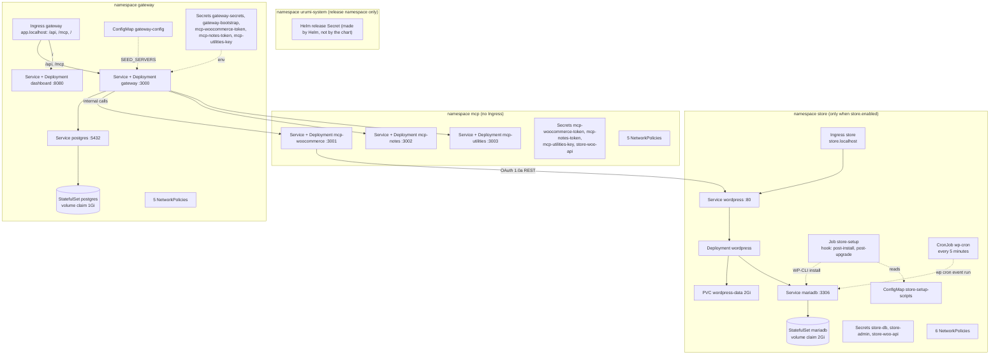

# Helm resource map

What the chart `charts/urumi-platform` renders, per namespace. The facts come from `helm template urumi charts/urumi-platform -n urumi-system -f deploy/values-local.yaml`, run on 2026-10-23: **54 objects** (3 Namespaces and 51 namespaced objects). The variants in [Objects that depend on values](#objects-that-depend-on-values) come from further `helm template` runs with `--set` flags, also on 2026-10-23. Nothing here was read from a live cluster; for the live checks see [run-guide.md](../run-guide.md) and `scripts\smoke-test.ps1`.

Two notes before the picture:

- **`urumi-system` holds no chart object.** It is only the Helm release namespace (`-n urumi-system --create-namespace`), where Helm keeps its release Secret. The chart creates the three namespaces `store`, `mcp` and `gateway` itself (`templates/namespaces.yaml`), with Pod Security `restricted` labels and `helm.sh/resource-policy: keep`, so `helm uninstall` does not delete them.
- The NetworkPolicies have their own diagram: [network-policies.md](network-policies.md). Here they appear only as a count.

The Secret `llm-api-keys` (namespace `gateway`) is **not** in the chart: `scripts\create-secrets.ps1` creates it from `.env`, and the gateway references it with `optional: true` (`templates/gateway/gateway.yaml`).

## Every object rendered with `deploy/values-local.yaml`

### Namespace `store` (19 objects)

| Kind | Name | Purpose |
|---|---|---|
| Namespace | `store` | Holds the shop. Pod Security `restricted`; kept on uninstall. |
| StatefulSet | `mariadb` | The shop database; a 2Gi volume claim made from `volumeClaimTemplates` (not Helm-managed, survives `helm uninstall`). |
| Service | `mariadb` | ClusterIP, port 3306. |
| Deployment | `wordpress` | WordPress with WooCommerce (Apache, port 80). |
| Service | `wordpress` | ClusterIP, port 80; target of the Ingress and of the `mcp-woocommerce` REST calls. |
| PersistentVolumeClaim | `wordpress-data` | 2Gi for `wp-content`. |
| Ingress | `store` | `store.localhost`, path `/` to Service `wordpress`. |
| Job | `store-setup` | Helm hook (`post-install`, `post-upgrade`, delete policy `before-hook-creation`): installs WordPress and WooCommerce, applies the shop settings, seeds the products (`storeSetup.seedProducts`) and creates the REST key, all with WP-CLI. |
| ConfigMap | `store-setup-scripts` | The scripts the Job runs. |
| CronJob | `wp-cron` | Runs due WordPress and Action Scheduler events every 5 minutes with WP-CLI, so WordPress never calls its own public URL ([ADR-018](../decisions/ADR-018-wordpress-cron-via-cronjob.md)). |
| Secret | `store-db` | MariaDB root and application passwords. |
| Secret | `store-admin` | The WordPress admin account. |
| Secret | `store-woo-api` | The WooCommerce REST consumer key and secret. |
| NetworkPolicy | `default-deny-all` | Denies all ingress and egress in the namespace. |
| NetworkPolicy | `allow-dns-egress` | Lets every pod ask CoreDNS. |
| NetworkPolicy | `wordpress`, `mariadb`, `store-setup`, `wp-cron` | The allowed flows of each workload (see [network-policies.md](network-policies.md)). |

### Namespace `mcp` (16 objects)

| Kind | Name | Purpose |
|---|---|---|
| Namespace | `mcp` | The MCP servers. No Ingress: they are reachable only from the gateway. |
| Deployment, Service | `mcp-woocommerce` | Store tools; port 3001. |
| Deployment, Service | `mcp-notes` | Notes tools; port 3002. |
| Deployment, Service | `mcp-utilities` | Utility tools; port 3003. |
| Secret | `mcp-woocommerce-token` | The bearer token the server expects. |
| Secret | `mcp-notes-token` | The bearer token the server expects. |
| Secret | `mcp-utilities-key` | The `X-Utilities-Key` value the server expects. |
| Secret | `store-woo-api` | A copy of the store's REST key, so the `mcp-woocommerce` pod can sign calls. |
| NetworkPolicy | `default-deny-all`, `allow-dns-egress` | Default deny, DNS egress. |
| NetworkPolicy | `mcp-woocommerce`, `mcp-notes`, `mcp-utilities` | Ingress from the gateway pod only; `mcp-woocommerce` also has egress to the WordPress Service (to the internet instead in external-store mode). |

### Namespace `gateway` (19 objects)

| Kind | Name | Purpose |
|---|---|---|
| Namespace | `gateway` | The gateway, its database and the dashboard. |
| StatefulSet | `postgres` | The gateway database; a 1Gi volume claim (not Helm-managed). |
| Service | `postgres` | ClusterIP, port 5432. |
| Deployment, Service | `gateway` | The MCP gateway, the REST API and the chat agent; port 3000. |
| Deployment, Service | `dashboard` | The React app served by nginx; port 8080. |
| Ingress | `gateway` | `app.localhost`: `/api` and `/mcp` to `gateway`, `/` to `dashboard`. |
| ConfigMap | `gateway-config` | `SEED_SERVERS`: the three built-in upstreams (names, slugs, URLs, auth types) the gateway registers on first start. |
| Secret | `gateway-secrets` | Postgres password, the encryption key and the internal token secret. |
| Secret | `gateway-bootstrap` | The first admin's email and password. |
| Secret | `mcp-woocommerce-token`, `mcp-notes-token`, `mcp-utilities-key` | The gateway's copies of the upstream credentials, used to seed the upstreams. |
| NetworkPolicy | `default-deny-all`, `allow-dns-egress` | Default deny, DNS egress. |
| NetworkPolicy | `gateway`, `dashboard`, `postgres` | `gateway`: Traefik in; the three MCP servers, Postgres and the internet (LLM providers, external MCP servers) out. `dashboard`: Traefik in, no egress. `postgres`: only the gateway in, nothing out. |

The three counts add up to the 54 objects: 19 + 16 + 19.

## Objects that depend on values

Each row was checked by rendering the chart with the stated values and comparing the list of objects with the base render.

| Condition | Effect on the render | Where in the chart |
|---|---|---|
| `global.tls.enabled=true` (`deploy/values-prod.yaml`; the schema also needs `global.publicScheme: https`) | Adds 4 Traefik `Middleware` objects: `redirect-https` (301 to https, keeps a non-443 public port) and `hsts` (one year, no subdomains, no preload), one pair in `store` and one pair in `gateway`. None in `mcp`, which has no Ingress. The two Ingresses gain `tls:` blocks and a `router.middlewares` annotation. | `templates/traefik/redirect-https.yaml`, `hsts.yaml`, `store/ingress.yaml`, `gateway/ingress.yaml` |
| `global.tls.enabled=true` and `global.tls.clusterIssuer` set, with `networkPolicies.enabled` | Adds the NetworkPolicy `acme-http01-solver` in `store` and in `gateway` (Traefik to the cert-manager solver pod on TCP 8089) and the Ingress annotation `cert-manager.io/cluster-issuer`. The production render has 48 objects: the 54 above, plus 4 Middlewares and 2 `acme-http01-solver` policies, minus the 12 Secrets that `secrets.existing` replaces. | `templates/network/acme-solver.yaml` |
| `secrets.existing.*` (all set in `deploy/values-prod.yaml`) | The chart does not render the matching Secret; the workload references the one you created (`scripts/prod/create-prod-secrets.sh`). | `templates/*/secrets.yaml`, `templates/mcp/secrets.yaml` |
| `gateway.internalUpstreams` with an entry whose `namespace` equals the `mcp` namespace | Adds one NetworkPolicy `mcp-internal-upstream-<n>` in `mcp` (gateway to those pods on the entry's port). An entry for another namespace renders nothing extra: that namespace must admit the gateway in its own policies, and the gateway's egress rule and SSRF allow-list still gain the namespace. An entry for the `gateway` namespace fails the render. | `templates/network/mcp.yaml`, `templates/gateway/gateway.yaml` |
| `store.enabled=false` with `mcpWoocommerce.externalStore.url` (https only) and `existingSecret` | Removes everything in `store` (the namespace, StatefulSet, Deployment, Services, PVC, Ingress, Job and its ConfigMap, CronJob, 3 Secrets and 6 NetworkPolicies) and the `store-woo-api` Secret in `mcp`: 34 objects remain (20 fewer than the base). `mcp-woocommerce` then uses HTTP Basic over https with the Secret you name, and gets egress to the public internet plus `extraEgressCIDRs`. Not installed on a cluster: render-validated only ([ADR-019](../decisions/ADR-019-external-woocommerce-store.md)). | `templates/namespaces.yaml`, `templates/mcp/mcp-woocommerce.yaml`, `templates/mcp/secrets.yaml`, `templates/store/*` |
| `wordpress.cron.enabled=false` | Removes the CronJob `wp-cron` and its NetworkPolicy; WordPress uses its built-in loopback WP-Cron again. | `templates/store/wp-cron.yaml`, `templates/network/store.yaml` |
| `storeSetup.enabled=false` | Removes the Job `store-setup` and the ConfigMap `store-setup-scripts`. | `templates/store/store-setup.yaml` |
| `networkPolicies.enabled=false` | Removes all NetworkPolicies. | `templates/network/*` |
| `gateway.enabled=false`, `dashboard.enabled=false`, `mcpWoocommerce.enabled`, `mcpNotes.enabled`, `mcpUtilities.enabled` | Remove the matching Deployment, Service, Secrets and ConfigMap entries. Not re-rendered for this note: read from the `{{ if }}` guards in the templates. | `templates/gateway/*`, `templates/mcp/*` |

## How this note was made

1. `helm template urumi charts/urumi-platform -n urumi-system -f deploy/values-local.yaml` (read-only; no cluster needed), then a one-line `awk` over the output to list `kind|namespace|name` for each document (Namespaces have no namespace).
2. The same list for `deploy/values-prod.yaml` and for the `--set` variants above, compared with `diff`.
3. Ports, volume sizes, Ingress paths, the hook annotation and the cron schedule were read from the rendered YAML; purposes from the templates.
