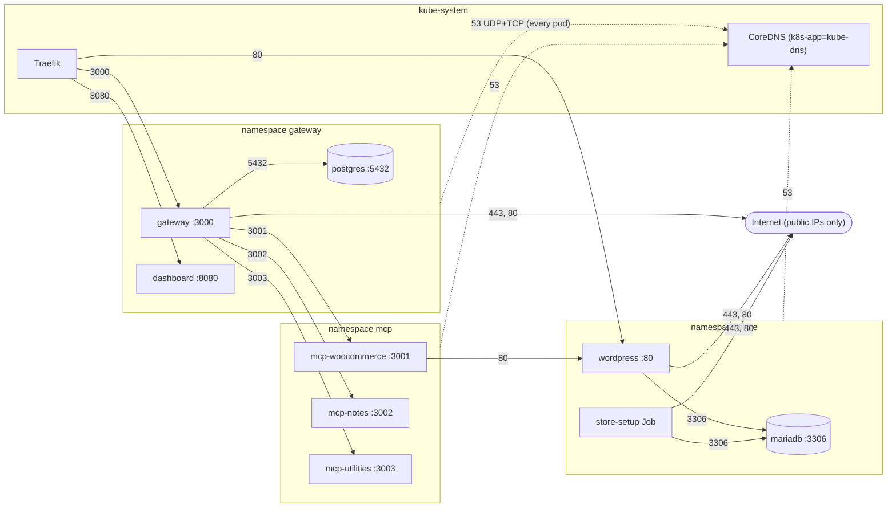

# NetworkPolicy map

Which pod may open a connection to which other pod, since Phase 5 (Task 5.3). Every arrow is one rule in `charts/urumi-platform/templates/network/`; **any flow that has no arrow is denied** (default-deny for ingress and egress in `store`, `mcp` and `gateway`). Decision record: [ADR-016](../decisions/ADR-016-default-deny-network-policies.md). Verified results are in [security.md, section 15](../security.md#15-networkpolicies-phase-5).

## How to read it

- **Solid arrows** are allowed flows, labelled with the destination port. **Dotted arrows** are DNS, allowed for every pod in the three namespaces to the pods labelled `k8s-app=kube-dns` in `kube-system`, on UDP and TCP 53.
- **Internet arrows** (`gateway`, `wordpress`, `store-setup`) go to `0.0.0.0/0` on 443 and 80 **except** `10.0.0.0/8`, `172.16.0.0/12`, `192.168.0.0/16`, `169.254.0.0/16`, `100.64.0.0/10` and `127.0.0.0/8`. That keeps the cloud metadata address, node addresses and pod and service addresses out of reach even if a request is tricked into targeting them; in-cluster destinations are allowed only by the explicit pod and namespace selectors above. The gateway needs the internet for LLM providers and for admin-added external MCP servers (the application-level SSRF guard still applies). WordPress needs it for wp-admin update and marketplace checks (without the rule those pages hang on timeouts). `store-setup` needs it to download WooCommerce.
- **No egress** for `mariadb`, `postgres`, `dashboard`, `mcp-notes` and `mcp-utilities` except DNS. (`mcp-utilities` and `mcp-notes` make no outbound calls: `grep "fetch(" apps/mcp-utilities/src` finds none.)
- **Traefik** is selected by namespace `kube-system` plus pod label `app.kubernetes.io/name=traefik`. Namespaces are selected by the automatic label `kubernetes.io/metadata.name`; the app pods by the chart's selector labels (`app.kubernetes.io/instance` plus `app.kubernetes.io/name`); the `store-setup` Job by its own pod label `app.kubernetes.io/name=store-setup`.
- **Not covered by policy:** kubelet probes and `kubectl port-forward`/`exec` (they reach the pod through the node, not as pod traffic; verified on k3s, all pods stayed 1/1 and the check scripts that use a port-forward passed).

## Failure behaviour worth knowing

- A blocked connection is usually *refused* (curl exit 7), not a silent timeout, because kube-router rejects instead of dropping. The probe script accepts exit 7 or 28 with no HTTP code as "blocked".
- kube-router programs a **new pod's** rules a few seconds after it starts (observed 3 to 6 s, 2026-10-22). In that window a new pod is unrestricted for flows that should be blocked and cut off for flows that should be allowed. See the residual-risk note in [security.md](../security.md#15-networkpolicies-phase-5).
