# Kubernetes Primer (tied to this project)

Interview-prep notes. Every concept has: what it is, one command to look at it, and where this project uses it. Commands assume the local cluster from [00-setup-log.md](00-setup-log.md) is running (context `k3d-urumi`).

The one-sentence story of the project: *a WooCommerce store (WordPress + MariaDB) and a team MCP gateway (gateway, dashboard, MCP servers, Postgres) run on a local Kubernetes cluster, installed by a single Helm chart.*

## The hello-world request path

When you run `curl http://hello.localhost` this is what happens:

```mermaid
flowchart LR
    B["Browser / curl<br/>http://hello.localhost"] -->|"1. resolves to 127.0.0.1<br/>port 80"| H["Host port 80<br/>(Docker Desktop)"]
    H -->|"2. Docker port mapping"| LB["k3d-urumi-serverlb<br/>(nginx container)"]
    LB -->|"3. forwards to node port 80"| T["Traefik<br/>(Ingress controller Pod)"]
    T -->|"4. matches Host: hello.localhost<br/>against Ingress rules"| S["Service 'hello'<br/>ClusterIP 10.43.x.x:80"]
    S -->|"5. picks a Ready Pod<br/>by label app=hello"| P["Pod hello-xxxx<br/>traefik/whoami :80"]
```



1. **Name resolution.** `hello.localhost` resolves to `127.0.0.1` (curl and browsers do this for any `*.localhost`; we also add a hosts-file line for tools that use the OS resolver). The request goes to port 80 on your own machine.
2. **Host port 80.** k3d asked Docker to publish host ports 80 and 443 (see `deploy/k3d-config.yaml`). Docker forwards them into the k3d network.
3. **k3d load balancer (`k3d-urumi-serverlb`).** A small nginx container k3d creates in front of the cluster. It forwards ports 80/443 to the k3s node, where the Traefik Service (type LoadBalancer, backed by k3s "svclb" pods) listens.
4. **Traefik.** The Ingress controller. It watches `Ingress` objects through the Kubernetes API; the one for `hello.localhost` says "send this host to Service `hello`". It also adds the `X-Forwarded-*` headers you see in the output.
5. **Service `hello`.** A stable virtual IP and DNS name in front of Pods. It selects Pods by label (`app: hello`) and only sends traffic to Pods that are Ready.
6. **Pod.** The `traefik/whoami` container, which echoes the request it received (its `Hostname:` is the Pod name).

Why this matters: a Pod's IP changes every time it restarts, so nothing talks to Pods directly. Services give stable addresses, and the Ingress is the only door from outside.

## Concepts

### Cluster
A cluster is the whole Kubernetes system: a control plane (API server, scheduler, controllers, etcd/SQLite datastore) plus worker machines. You declare desired state ("3 copies of this container, reachable at this name") and controllers continuously make reality match. Here the cluster is **k3s** (a lightweight, certified Kubernetes distribution) running inside Docker containers via **k3d**; it is named `urumi`.

```
kubectl cluster-info
kubectl config get-contexts
```
Where we use it: one local cluster, `k3d-urumi`, for every phase.

### Node
A node is a machine (real or virtual) that runs Pods. Each runs a kubelet (starts containers) and a container runtime. Our cluster has a single node, `k3d-urumi-server-0`, that is both control plane and worker (`agents: 0`).

```
kubectl get nodes -o wide
kubectl describe node k3d-urumi-server-0
```
Where we use it: the single node is a Docker container; its capacity is bounded by the WSL2 memory cap.

### Namespace
A namespace is a named partition of a cluster for grouping and isolating objects. Names only need to be unique within a namespace; policies, quotas and RBAC can be applied per namespace. Namespaces are **not** a network boundary by themselves (NetworkPolicies do that).

```
kubectl get namespaces
kubectl get all -n kube-system
```
Where we use it: `store` (WordPress, MariaDB), `mcp` (MCP servers), `gateway` (gateway, dashboard, Postgres). The `default` namespace was used only for the hello example.

### Pod
The smallest deployable unit: one or more containers that share a network identity (one IP) and storage volumes and are always scheduled together. Pods are disposable; if one dies it is replaced by a new one with a new IP. You rarely create Pods directly; a controller does.

```
kubectl get pods -A -o wide
kubectl describe pod <name> -n <namespace>
kubectl logs <name> -n <namespace>
```
Where we use it: every workload runs as Pods; the hello `whoami` container is one.

### Deployment vs StatefulSet
A **Deployment** manages interchangeable, stateless Pods through ReplicaSets: it keeps N replicas running, does rolling updates, and supports rollback. A **StatefulSet** is for stateful apps: Pods get stable names (`mariadb-0`), start/stop in order, and each Pod keeps its own PersistentVolumeClaim across restarts. Rule of thumb: if losing the Pod's disk would hurt, use a StatefulSet.

```
kubectl get deployments,statefulsets -A
kubectl rollout history deployment/traefik -n kube-system
```
Where we use it: WordPress, MCP servers, gateway and dashboard are **Deployments**; MariaDB and Postgres are **StatefulSets** with PVCs.

### Service (ClusterIP)
A Service gives a set of Pods a stable virtual IP and a DNS name (`<service>.<namespace>.svc.cluster.local`), and load-balances across the Ready Pods matched by its label selector. `ClusterIP` (the default) is reachable only inside the cluster. Other types (NodePort, LoadBalancer) expose it outside; we avoid them and use an Ingress instead.

```
kubectl get svc -A
kubectl get endpoints <service> -n <namespace>
```
Where we use it: every workload has a ClusterIP Service (e.g. WordPress reaches MariaDB at `mariadb.store.svc`). The MCP servers have a Service but **no Ingress**, so they are internal only.

### Ingress and Ingress controller (Traefik)
An **Ingress** is a set of HTTP routing rules ("host X, path Y goes to Service Z"). On its own it does nothing; an **Ingress controller** is the program that reads those rules and actually routes traffic. k3s ships **Traefik** as the controller, and `ingressClassName: traefik` selects it. This lets many apps share ports 80/443 and be told apart by hostname.

```
kubectl get ingressclass
kubectl get ingress -A
kubectl -n kube-system get pods -l app.kubernetes.io/name=traefik
```
Where we use it: `store.localhost` routes to WordPress and `app.localhost` to the gateway dashboard.

### PersistentVolumeClaim and StorageClass (local-path)
A container's filesystem disappears with the container. A **PersistentVolumeClaim (PVC)** is a Pod's request for durable storage ("5 Gi, read-write"). A **StorageClass** says *how* to create the volume on demand; k3s's default is **local-path**, which provisions a directory on the node's disk (so it survives Pod restarts, but not deletion of the cluster, and it is not replicated). With `WaitForFirstConsumer` the volume is created only when a Pod using the claim is scheduled.

```
kubectl get storageclass
kubectl get pvc -A
kubectl get pv
```
Where we use it: MariaDB and Postgres StatefulSets use `volumeClaimTemplates` backed by local-path. `cluster-down.ps1` wipes these volumes.

### Secret vs ConfigMap
Both inject configuration into Pods (as environment variables or mounted files). A **ConfigMap** holds non-sensitive settings (URLs, feature flags). A **Secret** holds sensitive values (passwords, API keys). Secrets are only base64-encoded, not encrypted, by default; their benefit is separate RBAC, not being printed in `describe` output, and being kept out of images and Git. Never commit real secret values.

```
kubectl get configmaps,secrets -A
kubectl get secret <name> -n <namespace> -o jsonpath='{.data}'
```
Where we use it: Secrets for DB passwords and API credentials (generated/supplied via Helm values); ConfigMaps for non-sensitive app settings.

### Probes: readiness vs liveness vs startup
The kubelet runs health checks on containers. **Readiness**: "can this Pod take traffic yet?" On failure the Pod is removed from Service endpoints but not restarted. **Liveness**: "is this container stuck?" On failure the container is restarted. **Startup**: "has a slow app finished booting?" It suspends the other two until it succeeds, which stops slow starters (WordPress, databases) from being killed too early. Mixing these up is a classic cause of restart loops.

```
kubectl describe pod <name> | grep -E 'Liveness|Readiness|Startup'
```
Where we use it: `deploy/examples/hello.yaml` already has readiness and liveness probes; all real workloads follow the same pattern, with startup probes on the slow ones.

### Requests vs limits
`requests` are what the scheduler reserves for a container (it decides placement from these). `limits` are the hard ceiling: exceeding the **memory** limit gets the container OOM-killed; exceeding the **CPU** limit just throttles it. Requests close to real usage keep the cluster honest; limits protect neighbours from a runaway container.

```
kubectl describe node k3d-urumi-server-0   # see "Allocated resources"
kubectl top pods -A                         # needs metrics-server (included)
```
Where we use it: every container sets both (hello: 10m CPU / 16Mi requests, 100m / 32Mi limits). This matters a lot because the whole cluster shares a 9 GB WSL2 budget.

### Job and Helm hooks
A **Job** runs a Pod to completion (retrying on failure) instead of forever; a CronJob is a Job on a schedule. A **Helm hook** is an annotation (`helm.sh/hook: post-install`) that makes Helm run a resource at a particular moment of the release lifecycle rather than as an ordinary part of it. Because WordPress must be up before it can be configured, setup is a hook that runs after the other resources are installed.

```
kubectl get jobs -A
kubectl logs job/<name> -n <namespace>
```
Where we use it: a Helm **post-install Job** runs WP-CLI to install WordPress, create the store and configure WooCommerce. (Seen already: `helm-install-traefik` in `kube-system` is a Job that k3s uses to install Traefik.)

### NetworkPolicy
By default every Pod can talk to every other Pod. A **NetworkPolicy** restricts which Pods may send or receive traffic, selected by labels and namespaces. A common secure pattern is *default deny* (a policy selecting all Pods that allows nothing) followed by explicit allow rules. Policies are enforced by the cluster's network layer; k3s includes the kube-router NetworkPolicy controller, so they actually work here (on some clusters they are silently ignored).

```
kubectl get networkpolicy -A
kubectl describe networkpolicy <name> -n <namespace>
```
Where we use it: each namespace is default-deny, then we allow only needed paths (Traefik to WordPress and dashboard, WordPress to MariaDB, gateway to MCP servers and Postgres). This is also why MCP servers cannot be reached from outside.

### Helm
Helm is the package manager for Kubernetes. A **chart** is a folder of Go-templated manifests plus defaults (`values.yaml`); Helm renders templates with values into plain manifests and applies them. An installed instance is a **release**; every `helm upgrade` creates a new numbered **revision**, so `helm rollback` can return to a previous one. Different environments are just different values files.

```
helm list -A
helm template <release> <chart> -f <values>   # show rendered manifests
helm history <release>
```
Where we use it: one chart, `charts/urumi-platform`, deployed with `values-local.yaml` (k3d) or `values-prod.yaml` (a real cluster). Typical flow: `helm upgrade --install urumi charts/urumi-platform -f charts/urumi-platform/values-local.yaml`.

## Quick interview answers

- **Why a Service in front of Pods?** Pod IPs are ephemeral; a Service is the stable address and only routes to Ready Pods.
- **Why a StatefulSet for databases?** Stable identity and a per-Pod PVC that is re-attached after restart.
- **Ingress vs Service?** A Service load-balances inside the cluster; an Ingress (plus controller) routes external HTTP by host/path to Services.
- **Liveness vs readiness?** Liveness failure restarts the container; readiness failure only stops traffic to it.
- **How do you keep the MCP servers private?** ClusterIP Service, no Ingress, and a default-deny NetworkPolicy that allows only the gateway.
