# Kubernetes Primer (tied to this project)

Interview-prep notes. Every concept has: what it is, one command to look at it, and where this project uses it. Commands assume the local cluster from [00-setup-log.md](00-setup-log.md) is running (context `k3d-urumi`).

> **Status banner (what exists today, end of Phase 1).** Built and verified: the local k3d/k3s cluster `urumi` (with the k3s defaults Traefik, local-path storage, CoreDNS, metrics-server and the NetworkPolicy controller); the `deploy/examples/hello.yaml` example manifest (only present while you apply it yourself); and the **store**, installed by the Helm chart `charts/urumi-platform` as release `urumi`: namespaces `store`/`mcp`/`gateway`, MariaDB (StatefulSet), WordPress + WooCommerce (Deployment), their Services, Secrets and PVCs, the `store.localhost` Ingress and the `store-setup` hook Job. The `mcp` and `gateway` namespaces exist but are empty. Everything else in the "Where we use it" lines (the gateway, dashboard, MCP servers, Postgres, NetworkPolicies) is the **design for later phases** and is marked **(planned)**. Lines without that marker describe something that exists now and was run against the real cluster.

The one-sentence story of the project: *a WooCommerce store (WordPress + MariaDB) is running on a local Kubernetes cluster, installed by a single Helm chart; a team MCP gateway (gateway, dashboard, MCP servers, Postgres) will be added to the same chart in later phases **(planned)**.* Commands for the store: [../deployment.md](../deployment.md); how its workflows run: [../workflows.md](../workflows.md).

## The hello-world request path

When you run `curl http://hello.localhost` (after applying the example with `kubectl apply -f deploy/examples/hello.yaml`; the example is not left deployed) this is what happens. Each numbered arrow in the diagram matches the numbered step below it:

```mermaid
flowchart LR
    B["Browser / curl<br/>http://hello.localhost"] -->|"1. look up the name"| R["Name resolution<br/>*.localhost = 127.0.0.1"]
    R -->|"2. connect to 127.0.0.1:80"| H["Host port 80<br/>(Docker Desktop)"]
    H -->|"3. Docker port mapping"| LB["k3d-urumi-serverlb<br/>(nginx container)"]
    LB -->|"4. forwards to node port 80"| T["Traefik<br/>(Ingress controller Pod)"]
    T -->|"5. matches Host: hello.localhost<br/>against Ingress rules"| S["Service 'hello'<br/>(used as a list of endpoints)"]
    S -->|"6. Traefik connects straight to<br/>a Ready Pod IP (not the ClusterIP)"| P["Pod hello-xxxx<br/>traefik/whoami :80"]
```



1. **Name resolution.** `hello.localhost` resolves to `127.0.0.1` (curl and browsers do this for any `*.localhost`; we also add a hosts-file line for tools that use the OS resolver).
2. **Host port 80.** The request goes to port 80 on your own machine, where Docker Desktop is listening.
3. **Docker port mapping.** k3d asked Docker to publish host ports 80 and 443 (see `deploy/k3d-config.yaml`). Docker forwards them into the k3d network, to the **k3d load balancer (`k3d-urumi-serverlb`)**, a small nginx container k3d creates in front of the cluster.
4. **Load balancer to Traefik.** The load balancer forwards ports 80/443 to the k3s node, where the Traefik Service (type LoadBalancer, backed by k3s "svclb" pods) listens and hands the request to the **Traefik** Pod.
5. **Traefik matches the Ingress.** Traefik is the Ingress controller. It watches `Ingress` objects through the Kubernetes API; the one for `hello.localhost` says "send this host to Service `hello`". It also adds the `X-Forwarded-*` headers you see in the output.
6. **Traefik connects to a Pod through the Service's endpoints.** The Ingress names a Service, but Traefik does **not** send the request to the Service's ClusterIP (the virtual IP that kube-proxy/iptables would translate). Instead it reads the Service's EndpointSlices (the list of Ready Pod IPs, chosen by the Service's label selector `app: hello`) and load-balances across those Pod IPs itself. So the Service still decides *which* Pods are eligible (only Ready ones appear in the list), but the packet goes from Traefik straight to the Pod. The Pod runs `traefik/whoami`, which echoes the request it received (its `Hostname:` is the Pod name). The same is true for `store.localhost`: Traefik goes straight to the WordPress Pod IP. (The ClusterIP is what *in-cluster* clients use, for example WordPress reaching `mariadb.store.svc.cluster.local`, which is headless and resolves straight to the Pod IP anyway.)

Why this matters: a Pod's IP changes every time it restarts, so nothing hard-codes Pod IPs. Services (and their endpoint lists) give stable names and always-current membership, and the Ingress is the only door from outside.

## Concepts

### Cluster
A cluster is the whole Kubernetes system: a control plane (API server, scheduler, controllers, etcd/SQLite datastore) plus worker machines. You declare desired state ("3 copies of this container, reachable at this name") and controllers continuously make reality match. Here the cluster is **k3s** (a lightweight, certified Kubernetes distribution) running inside Docker containers via **k3d**; it is named `urumi`.

```
kubectl cluster-info
kubectl config get-contexts
```
Where we use it: one local cluster, `k3d-urumi`, for every phase.

### Node
A node is a machine (real or virtual) that runs Pods. Each runs a kubelet (starts containers) and a container runtime. Our cluster has a single node, `k3d-urumi-server-0`, that is both control plane and worker (`agents: 0`).

```
kubectl get nodes -o wide
kubectl describe node k3d-urumi-server-0
```
Where we use it: the single node is a Docker container; its capacity is bounded by the WSL2 memory cap.

### Namespace
A namespace is a named partition of a cluster for grouping and isolating objects. Names only need to be unique within a namespace; policies, quotas and RBAC can be applied per namespace. Namespaces are **not** a network boundary by themselves (NetworkPolicies do that).

```
kubectl get namespaces
kubectl get all -n kube-system
```
Where we use it: the chart creates three namespaces: `store` (WordPress, MariaDB, the setup Job; in use), and `mcp` (MCP servers) and `gateway` (gateway, dashboard, Postgres), which exist but are empty until Phases 2-3 **(planned)**. Try `kubectl get ns` and `kubectl -n store get all`. The chart's own release record lives in `urumi-system` (`helm list -n urumi-system`). The hello example manifest (`deploy/examples/hello.yaml`), when applied, deploys into `default`.

### Pod
The smallest deployable unit: one or more containers that share a network identity (one IP) and storage volumes and are always scheduled together. Pods are disposable; if one dies it is replaced by a new one with a new IP. You rarely create Pods directly; a controller does.

```
kubectl get pods -A -o wide
kubectl describe pod <name> -n <namespace>
kubectl logs <name> -n <namespace>
```
Where we use it: the k3s system Pods, and in namespace `store` the Pods `mariadb-0`, `wordpress-<hash>` and (finished) `store-setup-<hash>`: `kubectl -n store get pods -o wide`. WordPress also has an **initContainer** (`copy-wordpress`) that runs to completion before the main container starts: `kubectl -n store describe pod -l app.kubernetes.io/name=wordpress`. The hello example manifest, when applied, runs a `whoami` Pod; the gateway and MCP server Pods are **(planned)**.

### Deployment vs StatefulSet
A **Deployment** manages interchangeable, stateless Pods through ReplicaSets: it keeps N replicas running, does rolling updates, and supports rollback. A **StatefulSet** is for stateful apps: Pods get stable names (`mariadb-0`), start/stop in order, and each Pod keeps its own PersistentVolumeClaim across restarts. Rule of thumb: if losing the Pod's disk would hurt, use a StatefulSet.

```
kubectl get deployments,statefulsets -A
kubectl rollout history deployment/traefik -n kube-system
```
Where we use it: Traefik is a Deployment. **WordPress is a Deployment** (1 replica, strategy `Recreate`: its volume is ReadWriteOnce, so the old Pod must stop before the new one mounts it) and **MariaDB is a StatefulSet** (`mariadb-0` with its own PVC `data-mariadb-0`): `kubectl -n store get deployments,statefulsets`. The MCP servers, gateway and dashboard will be Deployments and Postgres a StatefulSet **(planned)**.

### Service (ClusterIP)
A Service gives a set of Pods a stable virtual IP and a DNS name (`<service>.<namespace>.svc.cluster.local`), and load-balances across the Ready Pods matched by its label selector. `ClusterIP` (the default) is reachable only inside the cluster. Other types (NodePort, LoadBalancer) expose it outside; we avoid them and use an Ingress instead.

```
kubectl get svc -A
kubectl get endpointslices -l kubernetes.io/service-name=<service> -n <namespace>
```
Where we use it: in `store`, Service `wordpress` (ClusterIP, port 80) and Service `mariadb` (**headless**: `clusterIP: None`, so its DNS name resolves straight to the Pod and gives the StatefulSet a stable name). WordPress reaches the database at `mariadb.store.svc.cluster.local:3306`: `kubectl -n store get svc,endpointslices`. The MCP servers will get a Service but **no Ingress**, so they stay internal only **(planned)**.

### Ingress and Ingress controller (Traefik)
An **Ingress** is a set of HTTP routing rules ("host X, path Y goes to Service Z"). On its own it does nothing; an **Ingress controller** is the program that reads those rules and actually routes traffic. k3s ships **Traefik** as the controller, and `ingressClassName: traefik` selects it. This lets many apps share ports 80/443 and be told apart by hostname.

```
kubectl get ingressclass
kubectl get ingress -A
kubectl -n kube-system get pods -l app.kubernetes.io/name=traefik
```
Where we use it: Ingress `store` in namespace `store` routes host `store.localhost` (every path) to Service `wordpress:80`: `kubectl -n store get ingress store -o yaml`. The hello example manifest, when applied, does the same for `hello.localhost`. `app.localhost` to the gateway dashboard is **(planned)**.

### PersistentVolumeClaim and StorageClass (local-path)
A container's filesystem disappears with the container. A **PersistentVolumeClaim (PVC)** is a Pod's request for durable storage ("5 Gi, read-write"). A **StorageClass** says *how* to create the volume on demand; k3s's default is **local-path**, which provisions a directory on the node's disk (so it survives Pod restarts, but not deletion of the cluster, and it is not replicated). With `WaitForFirstConsumer` the volume is created only when a Pod using the claim is scheduled.

```
kubectl get storageclass
kubectl get pvc -A
kubectl get pv
```
Where we use it: the `local-path` StorageClass (k3s default) backs two 2Gi PVCs in `store`: `data-mariadb-0` (created by the StatefulSet's `volumeClaimTemplates`, so Helm does not manage it) and `wordpress-data` (a standalone PVC in the chart, annotated `helm.sh/resource-policy: keep`). Both survive `helm uninstall`. The PVs have reclaim policy `Delete`, so they vanish when their PVC is deleted (`kubectl delete ns store`) and `cluster-down.ps1` deletes the cluster and therefore all of them. Look: `kubectl -n store get pvc` and `kubectl get pv`. The Postgres StatefulSet will use the same mechanism **(planned)**.

### Secret vs ConfigMap
Both inject configuration into Pods (as environment variables or mounted files). A **ConfigMap** holds non-sensitive settings (URLs, feature flags). A **Secret** holds sensitive values (passwords, API keys). Secrets are only base64-encoded, not encrypted, by default; their benefit is separate RBAC, not being printed in `describe` output, and being kept out of images and Git. Never commit real secret values.

```
kubectl get configmaps,secrets -A
kubectl get secret <name> -n <namespace> -o jsonpath='{.data}'
```
Where we use it: three generated Secrets in `store`: `store-db` (MariaDB root and app passwords), `store-admin` (WordPress admin password) and `store-woo-api` (WooCommerce REST consumer key/secret). Helm generates them once, never in a values file or Git, and keeps them across `helm uninstall` (annotation `keep`). Read the admin password with the one-liner in [../deployment.md](../deployment.md). The only ConfigMap is `store-setup-scripts` (the two setup scripts, mounted into the Job): `kubectl -n store get secrets,configmaps`. Gateway/MCP Secrets are **(planned)**.

### Probes: readiness vs liveness vs startup
The kubelet runs health checks on containers. **Readiness**: "can this Pod take traffic yet?" On failure the Pod is removed from Service endpoints but not restarted. **Liveness**: "is this container stuck?" On failure the container is restarted. **Startup**: "has a slow app finished booting?" It suspends the other two until it succeeds, which stops slow starters (WordPress, databases) from being killed too early. Mixing these up is a classic cause of restart loops.

```
kubectl describe pod <name> | grep -E 'Liveness|Readiness|Startup'
```
Where we use it: MariaDB uses `healthcheck.sh` (startup/readiness: `--connect --innodb_initialized`; liveness: `--connect`); WordPress uses HTTP `/wp-login.php` for all three probes (it needs PHP and the database, and answers 302 before installation, which counts as success). See them with `kubectl -n store describe pod mariadb-0 | grep -E 'Liveness|Readiness|Startup'`. You may see transient events such as `Startup probe failed: HTTP probe failed with statuscode: 500` (WordPress started before MariaDB was ready) or `Probe terminated redirects` warnings; both are expected during first start. Because the WordPress liveness probe needs the database, a database outage longer than about 2 minutes restarts WordPress (known trade-off). The hello example also has probes; gateway/MCP probes are **(planned)**.

### Requests vs limits
`requests` are what the scheduler reserves for a container (it decides placement from these). `limits` are the hard ceiling: exceeding the **memory** limit gets the container OOM-killed; exceeding the **CPU** limit just throttles it. Requests close to real usage keep the cluster honest; limits protect neighbours from a runaway container.

```
kubectl describe node k3d-urumi-server-0   # see "Allocated resources"
kubectl top pods -A                         # needs metrics-server (included)
```
Where we use it: every store container sets both: MariaDB 100m/256Mi requests, 500m/512Mi limits; WordPress 100m/256Mi, 1 CPU/512Mi; setup Job 100m/256Mi, 1 CPU/768Mi (WP-CLI plus the WooCommerce download needs the headroom). Check: `kubectl -n store describe pod -l app.kubernetes.io/name=wordpress | grep -A4 -E 'Limits|Requests'`. This matters a lot because the whole cluster shares a 9 GB WSL2 budget. Future containers will follow the same rule **(planned)**.

### Job and Helm hooks
A **Job** runs a Pod to completion (retrying on failure) instead of forever; a CronJob is a Job on a schedule. A **Helm hook** is an annotation (`helm.sh/hook: post-install`) that makes Helm run a resource at a particular moment of the release lifecycle rather than as an ordinary part of it. A `post-install` hook runs after the release's resources have been *submitted* to the API server, **not** after they are Ready, unless you pass `--wait`. With `--wait` (which `scripts/deploy.ps1` uses), Helm runs post-install/post-upgrade hooks only **after the release's workloads are Ready**. This was observed on Helm 4.3.1: on a fresh install WordPress became Ready at 10:46:54Z and the Job started at 10:46:55Z; on an earlier upgrade WordPress was Ready at 10:23:45Z and the Job started at 10:28:34Z. The consequence: **no workload's readiness may depend on what the setup Job creates**, or `--wait` would deadlock. A setup Job that needs a database or WordPress must itself wait and retry until they respond (ours waits for `wp-config.php` and for the database). A `post-install` hook runs only on install, so we use `helm.sh/hook: post-install,post-upgrade` to make it run on both. Hook resources are not managed as part of the release, so they are not removed by `helm uninstall` (the finished `store-setup` Job and Pod are still there afterwards; harmless) unless you set a `helm.sh/hook-delete-policy`; we use `before-hook-creation`, which deletes the previous Job right before creating the next one, so its logs stay readable until the next deploy. The Job has `backoffLimit: 3` (up to 3 retries on failure) and `activeDeadlineSeconds: 480`, deliberately shorter than the `--timeout 10m` so a stuck Job fails the release with a clear reason.

```
kubectl get jobs -A
kubectl logs job/<name> -n <namespace>
```
Where we use it: the Helm **post-install,post-upgrade Job** `store-setup` runs WP-CLI to install WordPress, configure WooCommerce, seed products and create the REST key: `kubectl -n store logs job/store-setup` (the last line is `SETUP COMPLETE`). Step by step in [../workflows.md](../workflows.md). Also visible: `helm-install-traefik` in `kube-system` is a Job that k3s uses to install Traefik.

### NetworkPolicy
By default every Pod can talk to every other Pod. A **NetworkPolicy** restricts which Pods may send or receive traffic, selected by labels and namespaces. A common secure pattern is *default deny* (a policy selecting all Pods that allows nothing) followed by explicit allow rules. Policies are enforced by the cluster's network layer; k3s includes the kube-router NetworkPolicy controller, so they actually work here (on some clusters they are silently ignored).

```
kubectl get networkpolicy -A
kubectl describe networkpolicy <name> -n <namespace>
```
Where we use it: **(planned)** each namespace default-deny, then explicit allows for only the needed paths (Traefik to WordPress and dashboard, WordPress to MariaDB, gateway to MCP servers and Postgres). No NetworkPolicies exist yet; the enforcing controller (kube-router) is already part of k3s.

### Helm
Helm is the package manager for Kubernetes. A **chart** is a folder of Go-templated manifests plus defaults (`values.yaml`); Helm renders templates with values into plain manifests and applies them. An installed instance is a **release**; every `helm upgrade` creates a new numbered **revision**, so `helm rollback` can return to a previous one. Different environments are just different values files.

```
helm list -A
helm template <release> <chart> -f <values>   # show rendered manifests
helm history <release>
```
Where we use it: one chart, `charts/urumi-platform`, release `urumi` in namespace `urumi-system`, installed by `scripts/deploy.ps1`, which runs `helm upgrade --install urumi charts/urumi-platform -n urumi-system --create-namespace -f deploy/values-local.yaml --wait --timeout 10m`. Look: `helm list -A`, `helm history urumi -n urumi-system`, `helm get values urumi -n urumi-system`. `deploy/values-prod.yaml` is a stub completed in Phase 5 **(planned)**. Helm CLI is v4.3.1. Install, upgrade, rollback and uninstall are in [../deployment.md](../deployment.md). Two pieces of chart logic worth knowing: the helper `urumi.generatedValue` creates each password once and reuses it on upgrades (Helm's `lookup` function reads the existing Secret), and `helm.sh/resource-policy: keep` stops `helm uninstall` from deleting the namespaces, the `wordpress-data` PVC and the Secrets.

## Quick interview answers

Answers marked **(planned)** describe the intended design, not yet built.

- **Why a Service in front of Pods?** Pod IPs are ephemeral; a Service is the stable address and only routes to Ready Pods.
- **Why a StatefulSet for databases?** Stable identity and a per-Pod PVC that is re-attached after restart.
- **Ingress vs Service?** A Service load-balances inside the cluster; an Ingress (plus controller) routes external HTTP by host/path to Services.
- **Liveness vs readiness?** Liveness failure restarts the container; readiness failure only stops traffic to it.
- **Why does WordPress run as uid 33 and still bind port 80?** The pod sets the safe sysctl `net.ipv4.ip_unprivileged_port_start=0`, so any user may bind low ports; no root and no capabilities. An initContainer pre-copies the WordPress files because the image's own copy step fails as non-root on a root-owned volume.
- **What survives `helm uninstall`?** The three namespaces, the `wordpress-data` PVC, the MariaDB PVC (not Helm-managed) and the three Secrets. Passwords must survive because the MariaDB data was initialised with them.
- **Why is the setup Job safe to re-run?** Every step checks current state first (already installed? right WooCommerce version? products exist?), so a re-run changes nothing.
- **How will you keep the MCP servers private? (planned)** ClusterIP Service, no Ingress, and a default-deny NetworkPolicy that allows only the gateway.
