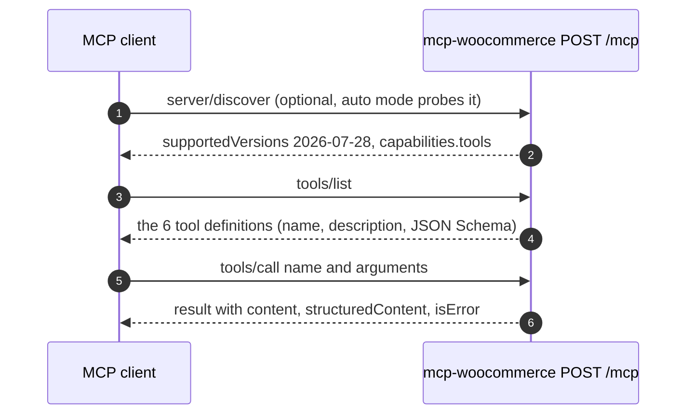

# 02 - The MCP protocol, as our server speaks it

Interview-prep notes for Phase 2. Everything marked **captured** is real traffic from our own `mcp-woocommerce` server running in the k3d cluster, recorded on 2026-10-19 through a `kubectl port-forward`. Secrets are replaced by placeholders (`<token>`); no consumer key, consumer secret or signed WooCommerce URL appears anywhere in this file. Statements about the spec or the SDK that I did not observe are labelled **expected** or point to [ADR-007](../decisions/ADR-007-mcp-sdk-version.md), which holds the spike evidence.

Related: how to call the server yourself is in the [run guide](../run-guide.md#8-woocommerce-mcp-server-phase-2); what happens after the request reaches the tool is in [workflows.md](../workflows.md#6-mcp-tool-call-to-the-store).

## 1. What MCP is, in one paragraph

The **Model Context Protocol** is an open standard that lets an AI application (the *client*, or *host*) discover and call **tools** (and resources and prompts, which we do not use) offered by a *server*. Without it, every AI app would need custom glue code for every system it wants to touch. With it, our WooCommerce server describes its six tools once, and any MCP client (MCP Inspector, Claude Code, our own gateway later) can list and call them. Our server uses only the **tools** part of MCP.

## 2. JSON-RPC 2.0 in two minutes

MCP messages are **JSON-RPC 2.0**: small JSON objects sent over a transport (here: HTTP POST).

| Message | Shape | Meaning |
|---|---|---|
| Request | `{"jsonrpc":"2.0","id":1,"method":"tools/list","params":{...}}` | "Do this and answer me." The `id` ties the answer to the question. |
| Success response | `{"jsonrpc":"2.0","id":1,"result":{...}}` | The answer. |
| Error response | `{"jsonrpc":"2.0","id":1,"error":{"code":-32602,"message":"..."}}` | The **protocol** failed (bad JSON, unknown method, bad auth in our server). |
| Notification | like a request but with no `id` | Fire and forget. No answer comes back. |

Important distinction used later: a *protocol* error is a JSON-RPC `error`. A *tool* failure (WooCommerce said 404) is a normal JSON-RPC `result` whose payload has `isError: true`.

## 3. Transport: Streamable HTTP, stateless (spec 2026-07-28)

Our server exposes one endpoint, `POST /mcp`. A client sends one JSON-RPC message per HTTP request and gets one answer. The server could answer with `Content-Type: text/event-stream` (a stream of events) for long calls, which is why clients send `Accept: application/json, text/event-stream`; **all captured answers below were plain `application/json`**.

The 2026-07-28 version of the spec is **stateless**:

- There is **no `initialize` handshake and no `Mcp-Session-Id`**. Every request carries what the server needs: the protocol version, who the client is, and what it supports, inside `params._meta`.
- A `server/discover` call replaces the old handshake. It is optional information ("which versions and capabilities do you have?"), not a required first step.
- There is no standalone GET stream: `GET /mcp` returns `405` (**captured**, below).

Why this matters for us: a stateless server needs no session affinity and no shared session store, so the gateway in Phase 3 can run several replicas and Kubernetes can restart pods freely. Our code creates a brand-new `McpServer` per HTTP request (`createMcpHandler` calls the factory each time, see `packages/shared/src/mcpHttpServer.ts`).

**Older clients still work.** The SDK's default stateless legacy fallback also answers 2025-era clients that do send `initialize`. That is why MCP Inspector's default mode (`--protocol-era legacy`) works against the same endpoint. Evidence and the full compatibility matrix: [ADR-007](../decisions/ADR-007-mcp-sdk-version.md). Claude Code and Cursor were **not tested against the gateway in Phase 3**: the Claude Code command is for you to try ([run guide](../run-guide.md#connect-claude-code-for-you-to-try)), and Cursor is not tested.

### Headers the client sends (captured)

| Header | Value | Why |
|---|---|---|
| `Accept` | `application/json, text/event-stream` | The client can handle either answer style. |
| `Content-Type` | `application/json` | The body is JSON-RPC. |
| `MCP-Protocol-Version` | `2026-07-28` | Which spec version this request follows. |
| `Mcp-Method` | `tools/list`, `tools/call`, `server/discover` | A copy of the JSON-RPC method, so proxies can route without parsing the body. |
| `Mcp-Name` | the tool name (only on `tools/call`) | Same idea: routing without parsing. |
| `Authorization` | `Bearer <token>` | **Our** auth, not part of MCP itself. See section 8. |

## 4. The flow we actually use



- **Discovery** (`server/discover`): the server says which spec versions it supports and that it offers `tools`.
- **`tools/list`**: the server returns each tool's `name`, `title`, `description` and `inputSchema` (JSON Schema, generated from our zod schemas). A model reads these to decide what to call. This is why descriptions are kept short: every description is sent to the LLM on every turn.
- **`tools/call`**: the client sends the tool `name` and `arguments`. The SDK validates the arguments against our zod schema **before** our handler runs.

## 5. Captured traffic

Setup used (secrets never printed):

```powershell
kubectl -n mcp port-forward svc/mcp-woocommerce 13001:3001      # in the background
# a small Node script (kept outside the repo) used the v2 SDK client with versionNegotiation auto and
# logged each HTTP exchange with the Authorization header replaced by "Bearer <token>"
```

The capture script is a throwaway kept outside the repository, so it is not in the repo. To reproduce the calls yourself, start the port-forward above and either send the raw requests with `curl.exe` (headers listed in section 3, body as shown below), or run `scripts/dev/mcp-smoke.mjs` (via `scripts\check-mcp-woocommerce.ps1`), which makes the same SDK calls but prints only a summary.

The request/response bodies below are verbatim from the server, except that `tools/list` is trimmed from six tools to two (marked `...`).

### 5.1 `server/discover` (the client probes it first in `auto` mode)

Request:

```http
POST /mcp
Accept: application/json, text/event-stream
Authorization: Bearer <token>
Content-Type: application/json
Mcp-Method: server/discover
MCP-Protocol-Version: 2026-07-28
```

```json
{"jsonrpc":"2.0","id":"server-discover-probe-1","method":"server/discover",
 "params":{"_meta":{"io.modelcontextprotocol/protocolVersion":"2026-07-28",
   "io.modelcontextprotocol/clientInfo":{"name":"doc-capture","version":"0.1.0"},
   "io.modelcontextprotocol/clientCapabilities":{}}}}
```

Response (`200 application/json`):

```json
{"result":{"supportedVersions":["2026-07-28"],"capabilities":{"tools":{"listChanged":true}},
  "resultType":"complete","ttlMs":0,"cacheScope":"private",
  "_meta":{"io.modelcontextprotocol/serverInfo":{"name":"mcp-woocommerce","version":"0.1.0"}}},
 "jsonrpc":"2.0","id":"server-discover-probe-1"}
```

Note the `_meta` block on the request: the client states its protocol version, its identity and its capabilities every time, because there is no session to remember them.

### 5.2 `tools/list` (trimmed to two of six tools)

Request: same headers with `Mcp-Method: tools/list`.

```json
{"method":"tools/list","jsonrpc":"2.0","id":0,
 "params":{"_meta":{"io.modelcontextprotocol/protocolVersion":"2026-07-28",
   "io.modelcontextprotocol/clientInfo":{"name":"doc-capture","version":"0.1.0"},
   "io.modelcontextprotocol/clientCapabilities":{}}}}
```

Response (`200`, trimmed):

```json
{"result":{"tools":[
  {"name":"create_product","title":"Create product",
   "description":"Create a simple product with a name and regular price (e.g. \"12.50\"). Published by default.",
   "inputSchema":{"type":"object","$schema":"https://json-schema.org/draft/2020-12/schema",
     "properties":{
       "name":{"type":"string","minLength":1,"maxLength":200},
       "regular_price":{"type":["string","number"]},
       "description":{"type":"string","maxLength":2000},
       "status":{"default":"publish","type":"string","enum":["publish","draft"]}},
     "required":["name","regular_price"]}},
  {"name":"ping","title":"Ping","description":"Health check: returns ok and the server time.",
   "inputSchema":{"type":"object","$schema":"https://json-schema.org/draft/2020-12/schema","properties":{}}}
  ...],
 "resultType":"complete","ttlMs":0,"cacheScope":"private",
 "_meta":{"io.modelcontextprotocol/serverInfo":{"name":"mcp-woocommerce","version":"0.1.0"}}},
 "jsonrpc":"2.0","id":0}
```

The real response lists all six tools: `list_products`, `create_product`, `list_orders`, `get_order`, `update_order_status`, `ping`. The `inputSchema` is plain JSON Schema, produced from the zod schema, so the same definition both validates input and tells the model what to send.

Every character of this list is sent to the model on every turn, so the schemas are kept small: checks that would emit a long regular expression (the price format, the `after`/`before` date-time format) run as zod `refine` steps, which do not appear in the JSON Schema; the server still enforces them. `regular_price` accepts a string or a JSON number, because models and the Inspector often send `12.5` as a number. (The `regular_price` line and the result texts in 5.3 and 5.4 were **re-captured** on 2026-10-19 after the final-review fixes; the rest of the capture is from 2026-10-18 and unchanged.)

### 5.3 `tools/call`, success

Request headers add `Mcp-Method: tools/call` and `Mcp-Name: list_products`.

```json
{"jsonrpc":"2.0","id":7,"method":"tools/call",
 "params":{"name":"list_products","arguments":{"per_page":1},
   "_meta":{"io.modelcontextprotocol/protocolVersion":"2026-07-28",
     "io.modelcontextprotocol/clientInfo":{"name":"curl","version":"0"},
     "io.modelcontextprotocol/clientCapabilities":{}}}}
```

Response (`200`, reformatted for reading; the `text` field is one JSON string in the real answer):

```json
{"result":{
  "content":[{"type":"text","text":"Found 1 product(s) on page 1.\n{\"products\":[{\"id\":26, ... }],\"page\":1,\"per_page\":1}"}],
  "structuredContent":{"products":[{"id":26,"name":"MCP smoke 2026-10-18T18:27:22.451Z","status":"draft",
      "price":"1.00","regular_price":"1.00","stock_status":"instock",
      "permalink":"http://store.localhost/?post_type=product&p=26"}],
    "page":1,"per_page":1},
  "resultType":"complete",
  "_meta":{"io.modelcontextprotocol/serverInfo":{"name":"mcp-woocommerce","version":"0.1.0"}}},
 "jsonrpc":"2.0","id":7}
```

(Product 26 is the draft product created by `check-mcp-woocommerce.ps1 -Write`.)

A second success, `list_orders` with `{"period":"today","per_page":1}`, returned an empty list plus the time range the server computed in the store time zone (this is the "empty store" case; it is a success, not an error):

```json
"structuredContent":{"orders":[],"range":{"after":"2026-10-18T18:30:00.000Z",
  "before":"2026-10-19T18:30:00.000Z","timeZone":"Asia/Kolkata"},"page":1,"per_page":1}
```

`range` is the real UTC window ("today" in Asia/Kolkata starts at 18:30 UTC the day before). The request the server then sends to WooCommerce carries the same instants **without** the `Z`: `after=2026-10-18T18:30:00&before=2026-10-19T18:30:00&dates_are_gmt=true`. That is deliberate. With `dates_are_gmt=true` WooCommerce compares against the GMT column, but WordPress's date query first converts any string that has a zone (`Z` or `+05:30`) into the **site's local time**, so a `Z` bound would be shifted by +5:30 and orders placed between local midnight and 05:30 would land in the wrong day. A string with no zone is used as written. This was **verified live** on 2026-10-19: order 27, placed at 00:41 IST (19:11 UTC on the 18th), was listed under `yesterday` before the fix and under `today` after it.

### 5.4 `tools/call`, tool-level error (`isError: true`)

`create_product` with `{"name":"x","regular_price":"abc"}` fails our zod validation. HTTP status is still `200` and the JSON-RPC message is still a `result`:

```json
{"result":{"content":[{"type":"text","text":"Input validation error: Invalid arguments for tool create_product: regular_price: regular_price must be non-negative with at most 2 decimals, like \"12\", \"12.50\" or 12.5"}],
  "isError":true,"resultType":"complete",
  "_meta":{"io.modelcontextprotocol/serverInfo":{"name":"mcp-woocommerce","version":"0.1.0"}}},
 "jsonrpc":"2.0","id":2}
```

A WooCommerce failure looks the same. `get_order` with `{"order_id":999999}` returned (**captured**):

```json
{"result":{"content":[{"type":"text","text":"WooCommerce returned 404: Invalid ID."}],"isError":true,"resultType":"complete", ...},"jsonrpc":"2.0","id":8}
```

### 5.5 Protocol and transport errors (before MCP even runs)

These come from our Express layer, not from a tool. All **captured**:

| Request | HTTP | Body |
|---|---|---|
| No `Authorization` header, or a wrong token | `401`, header `WWW-Authenticate: Bearer` | `{"jsonrpc":"2.0","error":{"code":-32001,"message":"Unauthorized"},"id":null}` |
| Correct token but `Host: evil.example.com` | `403` | `{"jsonrpc":"2.0","error":{"code":-32000,"message":"Invalid Host: evil.example.com"},"id":null}` |
| `GET /mcp` | `405`, header `Allow: POST` | `{"jsonrpc":"2.0","error":{"code":-32000,"message":"Method not allowed"},"id":null}` |

An unknown tool name on a `registerTool` server throws a protocol error (`-32602`, "Tool nope not found"); that is recorded in ADR-007 from the spike and was not re-captured here.

## 6. `content` versus `structuredContent`

A tool result can carry both:

| Field | Audience | Our use |
|---|---|---|
| `content` | The **model** (and older clients). A list of blocks; ours is one `text` block: a one-line summary, then the data as compact JSON (no indentation, to save model tokens). | Always present, so even a client that ignores structured data gets everything. |
| `structuredContent` | **Programs**. A JSON object the client can use without parsing text. | Same data as the JSON in `content`. Our smoke script and tests read this. |

We return both from every success (`ok()` in `src/tools/format.ts`). Failures return only `content` plus `isError: true`.

## 7. `isError` versus a protocol error

| | Tool error (`isError: true`) | Protocol error (JSON-RPC `error`) |
|---|---|---|
| Example here | WooCommerce 404, validation failure, timeout | Wrong token (401), bad Host (403), malformed JSON |
| JSON-RPC shape | `result` | `error` |
| Who sees it | The **model**, which can read the text and retry with fixed arguments | The client library, which usually throws |
| Why | "The call ran and failed in a way the model may fix." | "The request was not valid MCP, or not allowed." |

Our rule: anything the model could plausibly act on (bad arguments, a missing order) is an `isError` result with a short message. Credentials and signed URLs are never in these messages: `WooClient` redacts them, and tests prove it.

## 8. Where authentication happens

Authentication is **not** part of the MCP spec for our setup; it is an HTTP layer in front of it. In `packages/shared/src/mcpHttpServer.ts` the request passes, in order: the Host-header check, `upstreamAuthMiddleware` (bearer token, timing-safe compare), JSON body parsing, and only then the MCP handler. A failed check never reaches MCP code, which is why section 5.5 shows plain JSON-RPC-shaped HTTP errors with `id: null`.

- The token lives in the Secret `mcp-woocommerce-token` (key `token`). The server reads it from `MCP_AUTH_TOKEN`.
- `/healthz` and `/readyz` need no token and no Host check (kubelet probes send `Host: <pod IP>:3001`).
- Today the only caller is you (through a port-forward). In Phase 3 the **gateway** holds this token and calls the server on behalf of authenticated users; users never see it.
- WooCommerce has its own, separate credential (the OAuth1 consumer key). The server signs each WooCommerce request with it. See [ADR-005](../decisions/ADR-005-woocommerce-rest-oauth1.md).

## 9. Likely interview questions (short answers)

- **Why stateless?** No session affinity or shared session state, so replicas and restarts are free. The cost: the client re-sends its context (`_meta`) on every request.
- **What does `tools/list` return and who uses it?** Name, description and JSON Schema for each tool. The model uses it to choose a tool and build arguments.
- **A tool failed; is that an HTTP error?** No. HTTP 200, a JSON-RPC `result` with `isError: true`. HTTP 401 and 403 are for auth and Host problems before MCP runs.
- **Why validate with zod?** One schema gives runtime validation, the JSON Schema shown to the model, and the TypeScript types.
- **What if a client only speaks the 2025 handshake?** The SDK's stateless legacy fallback answers `initialize` per request (ADR-007). Clients that need a session id or the GET stream are not covered (not tested).
- **Why do you not retry WooCommerce calls?** A retry would reuse an OAuth1 nonce (rejected) and `create_product` is not idempotent. See [workflows.md](../workflows.md#6-mcp-tool-call-to-the-store).

## 10. Try it yourself

```powershell
powershell -NoProfile -ExecutionPolicy Bypass -File scripts\check-mcp-woocommerce.ps1     # SDK client, read-only
```

For raw HTTP, MCP Inspector and the full port-forward steps, see the [run guide](../run-guide.md#8-woocommerce-mcp-server-phase-2).
