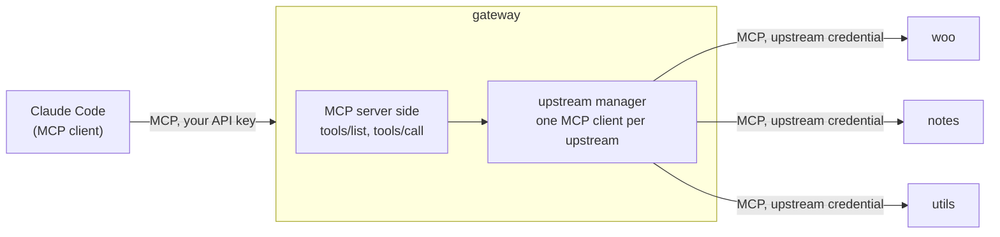
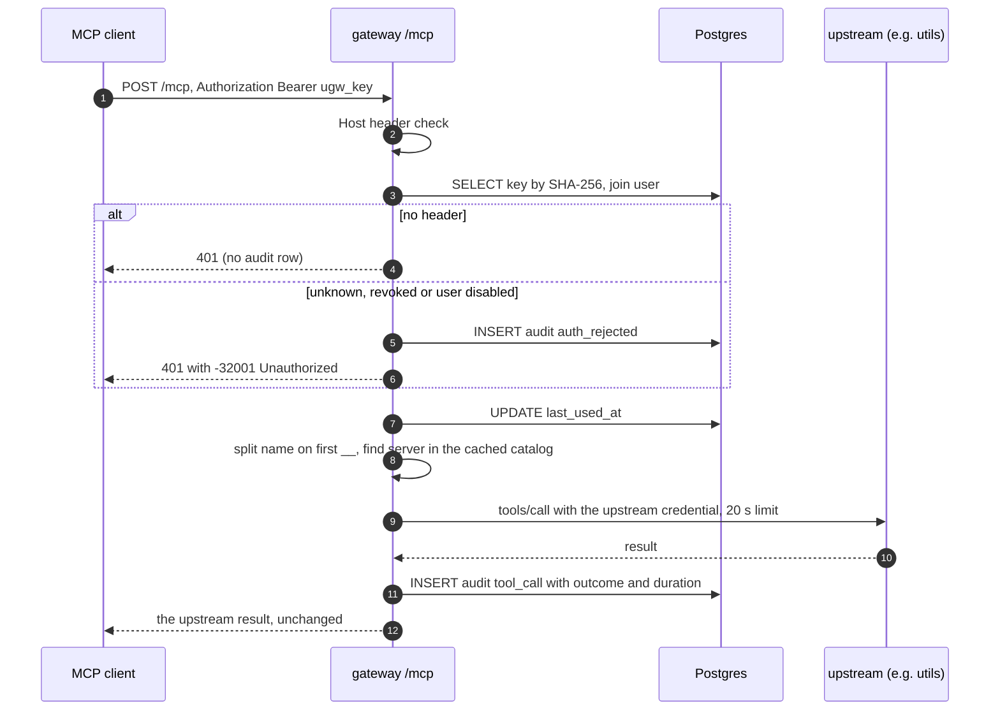

# 03 - The gateway: one endpoint in front of many MCP servers

Interview-prep notes for Phase 3. Everything marked **captured** is real traffic from our own gateway running in the k3d cluster, recorded on 2026-10-19 against `http://app.localhost/mcp` with a temporary API key that was revoked afterwards. The key, the session cookie and the admin password are never shown (`<redacted>` marks where they were). Statements about things I did not run are labelled **expected**, **tested** (an automated test pins it) or **not tested**.

Related: how to run it is in the [run guide](../run-guide.md#9-the-gateway-phase-3); the design is [system-design.md](../system-design.md); the protocol basics are in [02-mcp-protocol.md](02-mcp-protocol.md).

## 1. The gateway is a client and a server



To your AI tool the gateway looks like one MCP server with 15 tools. To each upstream the gateway looks like one MCP client. The two halves use **different credentials** and nothing from the first side is forwarded to the second (no token passthrough): your `ugw_` key proves who you are to the gateway; the gateway's stored credential proves the gateway to `woo`, `notes` or `utils`. Why bother: one revocable key per person, one place to log who called what, and the upstream secrets never leave the cluster.

## 2. Cached catalog versus live fan-out

A naive gateway answers `tools/list` by asking every upstream. Then one slow upstream makes everyone's list slow, and a dead one makes it fail. Ours ([ADR-014](../decisions/ADR-014-cached-tool-catalog.md)) keeps a **cached catalog** and a background **health loop**:

- every 15 s each enabled server gets a `tools/list` with a 5 s timeout; success replaces its cached tools, failure marks it `unreachable` and drops its tools;
- `tools/list` from a client reads memory only, so it costs the same whatever the upstreams are doing;
- a connection error during a `tools/call` marks the server unreachable immediately.

Evidence (**live**, `check-gateway.ps1 -Isolation`): with `mcp-utilities` scaled to 0 its four `utils__` tools disappeared from the list after 12.2 s (4.1 s in another run), `woo__ping` kept working throughout, and 16.4 s after scaling back all 15 tools were listed again. The price: the list can be wrong for up to about 20 s (the interval plus the timeout).

## 3. Collision-free naming

`woo`, `notes` and `utils` each have a `ping`. The gateway names every tool `<slug>__<tool>`: `woo__ping`, `notes__ping`, `utils__ping`. The slug is chosen once by an admin (`^[a-z][a-z0-9-]{1,15}$`) and never changes, because renaming would silently break every client that uses the old names. Routing splits on the **first** `__`; slugs cannot contain `_`, so there is never doubt about where the slug ends. The whole name must fit `^[a-zA-Z0-9_-]{1,64}$`, the strictest pattern clients accept; an upstream tool that would break it is skipped alone (listed in `skippedTools`) and the rest of that server is still served. The description gets a prefix such as `[Utilities] `, and the input schema is passed through untouched. Decision: [ADR-006](../decisions/ADR-006-tool-naming-scheme.md).

**A worked example with two servers that both have `ping`.** Say an admin registers two servers, slug `shop` and slug `crm`, and each exposes a tool called `ping` and one more tool (`shop` has `list_orders`, `crm` has `find_customer`). The upstreams know nothing about each other, and each one's `tools/list` returns plain names:

| Server (slug) | Upstream tool name | Name the client sees | Description the client sees |
|---|---|---|---|
| `shop` | `ping` | `shop__ping` | `[Shop] <shop's own text>` |
| `shop` | `list_orders` | `shop__list_orders` | `[Shop] ...` |
| `crm` | `ping` | `crm__ping` | `[CRM] <crm's own text>` |
| `crm` | `find_customer` | `crm__find_customer` | `[CRM] ...` |

1. `tools/list` returns the four prefixed names; the cached entry keeps the upstream name beside each one (`upstreamName`, `apps/gateway/src/upstreams/manager.ts:299`).
2. A client calls `crm__ping`. The gateway splits on the first `__` (`naming.ts:17-23`): slug `crm`, tool `ping`. It looks the slug up (`manager.ts:195`), takes the stored credential for `crm` only, and calls the upstream with the plain name `ping`. `shop` never sees the call.
3. The audit row stores server `crm` and tool `ping` (the upstream's name), so it reads like the upstream's own log.
4. If `crm` registered a tool whose prefixed name broke `^[a-zA-Z0-9_-]{1,64}$`, only that tool would be skipped (`manager.ts:292-296`), shown as skipped on the server page; `crm__ping` and the whole `shop` server are unaffected.

This example is illustrative (two made-up servers); the real, running case is `woo__ping`, `notes__ping` and `utils__ping` above, listed live in [5.1](#51-toolslist-trimmed-from-15-tools-to-three).

## 4. Hashing versus encryption, and the auth flow

- **API keys are hashed** (SHA-256). The gateway only ever needs to ask "is this the key I issued?", so it stores a one-way hash; a database leak does not hand out working keys. SHA-256 is enough because a key is 32 random bytes: nobody can guess it, so slowness would add cost without safety ([ADR-008](../decisions/ADR-008-api-key-hashing.md)). Passwords are hashed with the slow argon2id because humans pick guessable ones.
- **Upstream credentials are encrypted** (AES-256-GCM). The gateway must *send* them, so it needs the plaintext back; the key lives in a Kubernetes Secret, not the database. The row id is bound in as associated data, so a ciphertext pasted into another row fails ([ADR-009](../decisions/ADR-009-upstream-credential-encryption.md)).



There is no auth cache: revoking a key takes effect on the very next request (**captured** below as a 401).

## 5. Captured traffic

Setup: I created a key through the REST API, put it in an environment variable and ran a throwaway Node script (kept outside the repository, so it is not in the repo) that sent raw `fetch` requests to `http://app.localhost/mcp` with the headers from [02-mcp-protocol.md](02-mcp-protocol.md#headers-the-client-sends-captured): `Accept`, `Content-Type`, `MCP-Protocol-Version: 2026-07-28`, `Mcp-Method`, and `Mcp-Name` on calls. The script replaced the key with `<redacted>` in everything it printed, and the key was revoked afterwards (the audit table shows the key's last use and revocation 0.1 s apart). Bodies are verbatim except where marked trimmed. To reproduce with the SDK client instead, run `scripts\check-gateway.ps1`; to send raw requests, see the [run guide](../run-guide.md#call-the-gateway-with-curl-raw-http).

Every request carried the header `Authorization: Bearer <redacted>` except where said.

### 5.1 `tools/list` (trimmed from 15 tools to three)

Request body (headers as above, `Mcp-Method: tools/list`):

```json
{"jsonrpc":"2.0","id":0,"method":"tools/list",
 "params":{"_meta":{"io.modelcontextprotocol/protocolVersion":"2026-07-28",
   "io.modelcontextprotocol/clientInfo":{"name":"doc-capture","version":"0.1.0"},
   "io.modelcontextprotocol/clientCapabilities":{}}}}
```

Response (`200 application/json`, 92 ms, trimmed to three tools; the real list has 15, sorted by name):

```json
{"result":{"tools":[
  {"name":"notes__create_note",
   "description":"[Notes] Save a note with a title and text. Returns the new note.",
   "inputSchema":{"$schema":"https://json-schema.org/draft/2020-12/schema","type":"object",
     "properties":{"title":{"type":"string","minLength":1,"maxLength":200},
                   "content":{"type":"string","minLength":1,"maxLength":2000}},
     "required":["title","content"]},
   "title":"Create note"},
  {"name":"utils__calculate",
   "description":"[Utilities] Evaluate arithmetic: + - * / % ^ and parentheses, decimals allowed.",
   "inputSchema":{"$schema":"https://json-schema.org/draft/2020-12/schema","type":"object",
     "properties":{"expression":{"type":"string","minLength":1,"maxLength":200}},
     "required":["expression"]},
   "title":"Calculate"},
  {"name":"utils__ping",
   "description":"[Utilities] Health check: returns ok and the server time.",
   "inputSchema":{"$schema":"https://json-schema.org/draft/2020-12/schema","type":"object","properties":{}},
   "title":"Ping"}
  ...],
 "resultType":"complete","ttlMs":0,"cacheScope":"private",
 "_meta":{"io.modelcontextprotocol/serverInfo":{"name":"urumi-gateway","version":"0.1.0"}}},
 "jsonrpc":"2.0","id":0}
```

The full list was: `notes__create_note, notes__delete_note, notes__list_notes, notes__ping, notes__search_notes, utils__calculate, utils__current_time, utils__date_range, utils__ping, woo__create_product, woo__get_order, woo__list_orders, woo__list_products, woo__ping, woo__update_order_status`. Note the `[Notes]` / `[Utilities]` description prefix and that the schemas are exactly the upstream's own.

### 5.2 A routed `tools/call` that succeeds

Request (`Mcp-Method: tools/call`, `Mcp-Name: utils__calculate`):

```json
{"jsonrpc":"2.0","id":1,"method":"tools/call",
 "params":{"name":"utils__calculate","arguments":{"expression":"2+3*4"},
   "_meta":{"io.modelcontextprotocol/protocolVersion":"2026-07-28",
     "io.modelcontextprotocol/clientInfo":{"name":"doc-capture","version":"0.1.0"},
     "io.modelcontextprotocol/clientCapabilities":{}}}}
```

Response (`200`, 326 ms):

```json
{"result":{"_meta":{"io.modelcontextprotocol/serverInfo":{"name":"mcp-utilities","version":"0.1.0"}},
  "content":[{"type":"text","text":"2+3*4 = 14\n{\"expression\":\"2+3*4\",\"result\":14}"}],
  "structuredContent":{"expression":"2+3*4","result":14},
  "resultType":"complete"},
 "jsonrpc":"2.0","id":1}
```

Look at `serverInfo`: it says `mcp-utilities`, not `urumi-gateway`. The gateway passes the upstream's result through **unchanged**, including its own `_meta`. The gateway rewrote only two things on the way: the name (`utils__calculate` became `calculate` for the upstream) and, in `tools/list`, the description prefix.

A call that crosses into the store works the same way. `woo__list_orders` with `{"period":"today","per_page":1}` (`200`, 795 ms, because the upstream calls WooCommerce):

```json
{"result":{"_meta":{"io.modelcontextprotocol/serverInfo":{"name":"mcp-woocommerce","version":"0.1.0"}},
  "content":[{"type":"text","text":"Found 1 order(s) on page 1.\n{\"orders\":[{\"id\":27, ... }],\"page\":1,\"per_page\":1}"}],
  "structuredContent":{"orders":[{"id":27,"number":"27","status":"processing","currency":"USD","total":"3.00",
      "date_created_gmt":"2026-10-18T19:11:56","customer":"Smoke Tester","item_count":1}],
    "range":{"after":"2026-10-18T18:30:00.000Z","before":"2026-10-19T18:30:00.000Z","timeZone":"Asia/Kolkata"},
    "page":1,"per_page":1},
  "resultType":"complete"},
 "jsonrpc":"2.0","id":2}
```

Both calls left audit rows (**live**, read with SQL afterwards): `tool_call | mcp | utils | calculate | success | 298 ms` and `tool_call | mcp | woo | list_orders | success | 782 ms`. The tool name column holds the **upstream** name, with the server slug beside it.

### 5.3 A tool-level error (`isError: true`)

`notes__delete_note` with `{"id":999}` (no such note). HTTP is still `200`; it is a normal JSON-RPC `result`:

```json
{"result":{"_meta":{"io.modelcontextprotocol/serverInfo":{"name":"mcp-notes","version":"0.1.0"}},
  "content":[{"type":"text","text":"Note 999 not found."}],
  "isError":true,"resultType":"complete"},
 "jsonrpc":"2.0","id":3}
```

Audit row: `tool_call | mcp | notes | delete_note | error | 114 ms | Note 999 not found.` (**live**). The gateway does not hide upstream errors, and it does not retry them: the model can read the text and decide.

An **unknown tool** is the gateway's own `isError`, not an upstream's (`zzz__ping`):

```json
{"result":{"content":[{"type":"text","text":"Unknown tool: zzz__ping"}],"isError":true,"resultType":"complete",
  "_meta":{"io.modelcontextprotocol/serverInfo":{"name":"urumi-gateway","version":"0.1.0"}}},
 "jsonrpc":"2.0","id":4}
```

Audit row: `tool_call | mcp | (no server) | zzz__ping | denied | 0 ms | Unknown tool: zzz__ping`.

### 5.4 Protocol-level failures (before any tool runs)

**401, no `Authorization` header at all** (`401`, 5 ms, header `WWW-Authenticate: Bearer`):

```json
{"jsonrpc":"2.0","error":{"code":-32001,"message":"Unauthorized"},"id":null}
```

**401, a well-formed but unknown key** (`Authorization: Bearer <redacted>`; `401`, 8 ms, same header and the same body). The answer is deliberately identical for a missing, unknown, revoked or disabled credential, so a caller learns nothing about which keys exist. The difference is internal: the unknown key wrote an audit row `auth_rejected | unauthorized | unknown or malformed credential` (**live**, captured before the final-review fix; the message is now `unknown credential`, and only a well-formed `ugw_` key or a validly signed internal token writes a row at all), and the request with no header wrote none (**live**). A revoked key is the same 401, with the audit message `API key revoked` (**live**: the isolation check shows it).

**405, `GET /mcp`** (`405`, header `Allow: POST`):

```json
{"jsonrpc":"2.0","error":{"code":-32000,"message":"Method not allowed"},"id":null}
```

### 5.5 A timeout (`isError`) - message shape from the tests, **not captured live**

The JSON below is **not** real captured traffic; it is built by hand from the message the gateway code produces. I did not force a 20 s timeout on the cluster. The behaviour is pinned by the manager test `times out a slow upstream with a clear error and a timeout audit row`, which uses a 1000 ms limit and asserts the text `Upstream 'slow' did not respond within 1000ms`; with the production limit of 20000 ms the text is the one shown. The `...` marks fields left out:

```json
{"result":{"content":[{"type":"text","text":"Upstream 'woo' did not respond within 20000ms"}],"isError":true, ... },
 "jsonrpc":"2.0","id":5}
```

Audit row: outcome `timeout`, duration about the limit. A timeout is **not** a connection failure, so the server stays `connected` and keeps its tools. The limit is above the WooCommerce server's own 10 s timeout on purpose, so a slow store normally comes back as that server's clean `isError`, not as a gateway abort.

### 5.6 A dead upstream, captured live

Captured on **2026-10-23** (Task 6.1, the definition-of-done run on the local k3d cluster, at API level) while the `utils` pod had just been killed with `kubectl -n mcp delete pod -l app.kubernetes.io/name=mcp-utilities`. `utils` was already marked `unreachable` (the first health check had failed with `connection refused`), and user B called its tool through the gateway with B's API key. The key is shown as `<redacted>`; the request was sent as plain HTTP with `Mcp-Method` and `Mcp-Name` headers, as the modern clients do.

```
POST /mcp HTTP/1.1
Authorization: Bearer <redacted>
Content-Type: application/json
Accept: application/json, text/event-stream
Mcp-Method: tools/call
Mcp-Name: utils__calculate

{"jsonrpc":"2.0","id":1,"method":"tools/call","params":{"name":"utils__calculate","arguments":{"expression":"6*7"}}}

-> HTTP 200
event: message
data: {"result":{"content":[{"type":"text","text":"Server 'utils' is disabled or unreachable"}],"isError":true},"jsonrpc":"2.0","id":1}
```

What it shows:

- It is **HTTP 200** with `isError: true`, not an HTTP error: the call reached the gateway, was authenticated and was routed, and the tool itself failed. The model (or a person) reads the text and decides.
- The text is the gateway's own `Server '<slug>' is disabled or unreachable` (`apps/gateway/src/upstreams/manager.ts:201-203`). The upstream was **not contacted**: no connection is open to a server in that state, so the code returns this text before any connection is attempted (reading the code path; no timing was measured) and nothing waits on that server.
- The audit row for it: `tool_call`, source `mcp`, user B, server `utils`, tool `calculate`, outcome **`denied`**, message `Server 'utils' is disabled or unreachable`.
- Meanwhile `woo__list_products` through the same gateway returned HTTP 200 (the other servers keep working). The same `utils__calculate` call returned `6*7 = 42` once `utils` was connected again (19.9 s after the kill, a health check every 15 s); `utils` showed `unreachable` after 3.7 s.
- A different case, not captured: if the pod dies **during** a call (the server still looks `connected`), the caller gets `Upstream 'utils' is unreachable: <reason>`, outcome `error`, and the server is marked unreachable at once (`manager.ts:224-227`, **tested**).

Source: the run is recorded in [demo-script.md](../demo-script.md#kill-the-pod-of-one-upstream-server).

## 6. Likely interview questions (short answers)

- **Why a cached catalog and not live fan-out?** One slow or dead upstream must not slow or break everyone's `tools/list`. The cost is up to about 20 s of staleness, which was measured as: isolation check 2026-10-19, gone in 4-12 s and back in 16 s; pod kill 2026-10-23, 3.7 s and 19.9 s.
- **Why SHA-256 for keys but argon2 for passwords?** Entropy. A random 32-byte key cannot be guessed, so a fast hash is safe and cheap per request; a human password can, so the hash must be slow.
- **Why encrypt the upstream credentials instead of hashing them?** The gateway has to send them. AES-GCM with the row id as associated data, key in a Kubernetes Secret: a database dump alone is not enough.
- **What is token passthrough and why not do it?** Forwarding the client's token to the upstream. Then the upstream would have to trust gateway-issued keys and a compromised upstream would hold user keys. We keep the two credentials separate.
- **What happens when a key is revoked?** The next request is a 401 (no cache). **Live**: yes.
- **What happens when an upstream dies mid-call?** The caller gets an `isError` result `Upstream '<slug>' is unreachable: <reason>`, the server is marked unreachable at once and its tools leave the list (**tested**). Calls are never retried, because a retry could repeat a write.
- **Why does the audit log store the upstream tool name?** With the server slug beside it, it matches what the upstream's own logs would say, and a server can be deleted without losing readable history (`server_id` becomes null, `server_slug` stays).
- **What is the SSRF guard for?** Admins give the gateway URLs to call from inside the cluster. It refuses metadata, loopback and private addresses (unless allow-listed), re-checks at connect time against DNS rebinding, and never follows redirects ([security.md](../security.md#5-ssrf-guard)).
- **Can it scale to several replicas?** Not as built: health state and edits are per replica ([system-design.md](../system-design.md#8-trade-offs-and-limits)).
- **Does Claude Code work with it?** The snippet is in the run guide, labelled **for you to try**; I did not run it. MCP Inspector 2.11.0 and the MCP SDK client do work (**live**).

## 7. Try it yourself

```powershell
powershell -NoProfile -ExecutionPolicy Bypass -File scripts\check-gateway.ps1 -Write -Isolation
```

For raw HTTP, MCP Inspector, creating your own key and reading the database, see the [run guide](../run-guide.md#9-the-gateway-phase-3).
