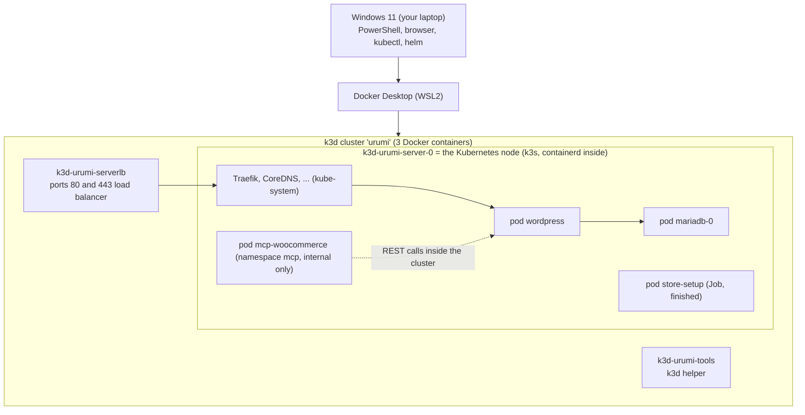

# Run guide

How to run, use and inspect every part of the project, written for someone new to Kubernetes. Every phase extends this guide. Parts that are not built yet are marked **(planned — Phase N)** and contain no commands.

Statements are either **verified** (run on the reference machine, with the date) or labelled **expected**.

> **Quick start (TL;DR)**
>
> First time on this machine? Do [section 2 (one-time setup)](#2-prerequisites-and-one-time-setup) first.
>
> 1. Start **Docker Desktop** and wait until it says "Engine running".
> 2. In PowerShell, go to the repository: `cd "<path to MCP-Gateway-on-Kubernetes>"`
> 3. Start everything: `powershell -NoProfile -ExecutionPolicy Bypass -File scripts\up.ps1`
> 4. Ctrl+click the URLs it prints (Windows Terminal and VS Code make them links), or add `-Open` to open the storefront for you (storefront, shop, my account, wp-admin).
> 5. Need the admin password? `powershell -NoProfile -ExecutionPolicy Bypass -File scripts\get-admin-password.ps1` copies it to your clipboard (user `admin`).
> 6. Done for the day: `powershell -NoProfile -ExecutionPolicy Bypass -File scripts\stop.ps1` (keeps your data).

All commands are run from the repository root in **Windows PowerShell 5.1**. The folder path contains spaces on the reference machine; the scripts quote their own paths, so just `cd` into the folder first.

**Script invocation convention.** Where these docs write `scripts\x.ps1 [args]` for short, run `powershell -NoProfile -ExecutionPolicy Bypass -File scripts\x.ps1 [args]` from the repository root. Typing `scripts\x.ps1` directly is usually blocked by Windows' default execution policy (see [troubleshooting](troubleshooting.md#running-scripts-is-disabled-on-this-system)).

## Contents

1. [What runs where](#1-what-runs-where)
2. [Prerequisites and one-time setup](#2-prerequisites-and-one-time-setup)
3. [Daily use](#3-daily-use)
4. [URLs](#4-urls)
5. [Passwords and secrets](#5-passwords-and-secrets)
6. [Using the store](#6-using-the-store)
7. [Viewing the store database (MariaDB)](#7-viewing-the-store-database-mariadb)
8. [WooCommerce MCP server (Phase 2)](#8-woocommerce-mcp-server-phase-2)
9. [The gateway database (Postgres)](#9-the-gateway-database-postgres-planned--phase-3)
10. [Each part of the project](#10-each-part-of-the-project)
11. [Health checks and logs](#11-health-checks-and-logs)
12. [Resetting](#12-resetting)
13. [Troubleshooting pointers](#13-troubleshooting-pointers)

---

## 1. What runs where



Reading it from the outside in: your browser talks to port 80 on Windows. Docker Desktop forwards that to the `k3d-urumi-serverlb` container, which hands it to Traefik (the ingress controller) inside the node, which routes `store.localhost` to the WordPress pod. WordPress stores everything in MariaDB. The MCP server pod (section 8) has no route in from outside; it only calls WordPress from inside the cluster, which the dotted arrow shows.

**Why Docker Desktop shows only 3 containers (verified 2026-10-18).** They are:

| Container | What it is |
|---|---|
| `k3d-urumi-server-0` | The Kubernetes node itself (k3s). |
| `k3d-urumi-serverlb` | The load balancer that publishes ports 80 and 443. |
| `k3d-urumi-tools` | A helper container used by k3d. |

The pods (WordPress, MariaDB and so on) run **inside** `k3d-urumi-server-0`, under that container's own container runtime (containerd). Docker Desktop only sees the outer containers, so it never lists the pods.

**Why Docker Desktop's "Kubernetes" tab shows no cluster.** That tab manages only Docker Desktop's own built-in Kubernetes. This project uses **k3d** instead (see [ADR-002](decisions/ADR-002-k3d-k3s-traefik.md)), so the tab stays empty and that is normal. Do not enable Docker Desktop's Kubernetes for this project.

**How to see the pods.**

```powershell
kubectl get pods -A          # every pod in every namespace
kubectl -n store get pods    # only the store
```

Optional graphical tools (not required; **not tested on the reference machine**):

- **Headlamp**, a Kubernetes GUI: `winget install --id Headlamp.Headlamp -e`. It reads `~/.kube/config`, where the `k3d-urumi` context lives.
- The **Kubernetes** extension for VS Code, which also reads `~/.kube/config`.

## 2. Prerequisites and one-time setup

| Step | What | Notes |
|---|---|---|
| 1 | Windows 11, PowerShell 5.1 | Check: `$PSVersionTable.PSVersion` |
| 2 | **Docker Desktop** (WSL2 backend) | Must be **running** whenever you use the project. |
| 3 | Memory cap in `C:\Users\<you>\.wslconfig` | On the reference machine (15 GB RAM) the file sets `memory=9GB`, `processors=8`, `swap=4GB`. Without a cap WSL2 may take half the RAM. After editing run `wsl --shutdown` and restart Docker Desktop. |
| 4 | `winget install --id Helm.Helm -e` and `winget install --id k3d.k3d -e` | Then open a **new** terminal so PATH refreshes. `kubectl` ships with Docker Desktop. |
| 5 | **Node.js 24** | `winget install --id OpenJS.NodeJS.LTS -e` (on 2026-10-19 winget lists 24.20.0 as the LTS; that command was not run here, the reference machine has Node 24.0.1), or the Node 24 Windows installer from nodejs.org. Open a **new** terminal, then check: `node -v` prints `v24.` something. Not needed for the store itself; needed for the MCP check, MCP Inspector and the tests. |
| 6 | `npm ci`, once, from the repository root | Installs the project's Node packages into `node_modules`. `scripts\check-mcp-woocommerce.ps1` runs a small MCP client (`scripts/dev/mcp-smoke.mjs`) that imports the MCP SDK from there; without it the check stops with `Dependencies not installed: run npm ci ...`. The Docker images install their own packages, so `up.ps1` works without this step. Run it again after pulling changes to `package-lock.json`. |
| 7 | Hosts entries (optional) | `powershell -NoProfile -ExecutionPolicy Bypass -File scripts\setup-hosts.ps1` (UAC prompt, safe to repeat). Browsers do not need it; Node-based MCP tools do. |
| 8 | The first `up.ps1` | Creates the cluster, downloads images and WooCommerce, installs the store. **Typically about 2–3 minutes** the first time (observed on the reference machine). |

Versions used, and how each tool was installed, are in [learning/00-setup-log.md](learning/00-setup-log.md). The long-form deployment steps are in [deployment.md](deployment.md).

## 3. Daily use

### Start

```powershell
powershell -NoProfile -ExecutionPolicy Bypass -File scripts\up.ps1
```

`up.ps1` checks that `docker`, `k3d`, `kubectl` and `helm` exist and that Docker is running, starts (or creates) the cluster, warns if the hosts entry is missing, installs the store **only if it is not installed yet**, waits until the store is ready, and prints a URL block. It never prints passwords. Whenever it deploys (first install, repair, or `-Redeploy`) it first runs `build-images.ps1` (below), because our own program images, such as the MCP server, must exist inside the cluster before Helm starts them.

It also reads the Helm release state, because `helm status` succeeds even for a broken release. Release `deployed` and namespace `store` present: it just waits for the pods (fast path): MariaDB and WordPress, then the MCP server if it is installed (if the MCP server is not ready within 2 minutes it prints a yellow warning and carries on, because the store works without it). Release `failed`, or the `store` namespace missing: it prints a yellow "previous install did not complete" notice and runs the deploy to repair it. Release `pending-install`, `pending-upgrade` or `pending-rollback` (an interrupted Helm operation): it stops and prints the command to recover; see [troubleshooting](troubleshooting.md#another-operation-is-in-progress-pending-install). The decision function was tested in isolation; the real failed and pending paths were not triggered on the live release. The ending looks like this:

```text
================ Urumi platform is running ================
  Storefront   : http://store.localhost/
  Shop         : http://store.localhost/shop/
  My account   : http://store.localhost/my-account/   (customers: register, log in, see their orders)
  WP admin     : http://store.localhost/wp-admin/     (user: admin)
  MCP server   : internal only (namespace mcp) - check with scripts\check-mcp-woocommerce.ps1

  Admin password - run this to copy it to the clipboard (it is never printed here):
    powershell -ExecutionPolicy Bypass -File scripts\get-admin-password.ps1
  Stop everything (keeps data):
    powershell -ExecutionPolicy Bypass -File scripts\stop.ps1
  Full guide: docs/run-guide.md
===========================================================
```

Options:

| Option | Effect |
|---|---|
| `-Open` | Also opens the storefront in your browser. |
| `-Redeploy` | Also rebuilds the images and runs `helm upgrade` so code, chart or value changes take effect (a plain `up.ps1` does not touch a healthy installed release). Full form: `powershell -NoProfile -ExecutionPolicy Bypass -File scripts\up.ps1 -Redeploy`. |

Full form for the options: `powershell -NoProfile -ExecutionPolicy Bypass -File scripts\up.ps1 -Open`.

### Build the program images (`build-images.ps1`)

Our own programs (today only the MCP server) run from container images that you build on your laptop; there is no registry. `up.ps1` runs this for you whenever it deploys. Run it yourself only if you want to rebuild without a full redeploy:

```powershell
powershell -NoProfile -ExecutionPolicy Bypass -File scripts\build-images.ps1
```

It builds `urumi/mcp-woocommerce:<tag>` with Docker, copies it into the k3d cluster (`k3d image import`, because the cluster cannot see your Docker images otherwise), and writes the tag to `deploy/.images.local.yaml`, which `deploy.ps1` passes to Helm. Then run `up.ps1 -Redeploy` to roll the new image out.

**How the image tag is chosen.** The tag is the short git commit id (for example `05ca559`). If `git status --porcelain` shows **any** change, including a new untracked file such as a log, the tag becomes `<sha>-dirty-<timestamp>`. This matters:

| Working tree | Tag | What a redeploy does |
|---|---|---|
| Clean (everything committed) | `05ca559` | Same tag as last time, so the pod is **not** restarted (verified 2026-10-18: same pod through a redeploy). |
| Any change, even one untracked file | `05ca559-dirty-20261018235805` | A new tag every build, so the pod is replaced on every redeploy. Harmless, just slower. |

The tag is written **in quotes** (`imageTag: "c7914c9"`). About one commit in 27 has a short id made only of digits, such as `1234567`, and unquoted YAML would read that as a number. The chart also turns such a number back into its digits, so a hand-written `imageTag: 1234567` still renders as `urumi/mcp-woocommerce:1234567` (verified with `helm template`). A tag with a leading zero cannot be repaired that way, because YAML reads `0123456` as an octal number, so always quote tags you write by hand.

If you deploy without `deploy/.images.local.yaml` (for example you ran `deploy.ps1` by hand on a fresh clone), the chart falls back to tag `dev`, which does not exist in the cluster, so the pod cannot start. With the chart's default pull policy `IfNotPresent` it shows `ErrImagePull` and then `ImagePullBackOff` (**expected**; not observed on the reference machine, because `up.ps1` always builds first; `ErrImageNeverPull` appears only if the pull policy is `Never`). `deploy.ps1` prints a yellow warning (`no local image tag; run scripts\build-images.ps1`). Fix: [troubleshooting](troubleshooting.md#mcp-woocommerce-is-in-errimageneverpull-or-imagepullbackoff).

### Stop

```powershell
powershell -NoProfile -ExecutionPolicy Bypass -File scripts\stop.ps1
```

This runs `k3d cluster stop urumi`, which frees the RAM. **Data survives a stop and the next `up.ps1` — verified (2026-10-18):** the products and two orders were still present afterwards.

### After a laptop restart

Start Docker Desktop, wait for "Engine running", then run `up.ps1` again. The k3d containers use the Docker restart policy `unless-stopped`, so after a reboot the cluster may already be running or may be stopped (expected; not tested across a reboot). `up.ps1` handles both and keeps your data.

## 4. URLs

With the default settings (host port 80, **verified**):

| What | URL | Notes |
|---|---|---|
| Storefront | <http://store.localhost/> | |
| Shop | <http://store.localhost/shop/> | Product list |
| Cart | <http://store.localhost/cart/> | |
| Checkout | <http://store.localhost/checkout/> | Redirects to the cart when the cart is empty (normal) |
| My account | <http://store.localhost/my-account/> | Customers register and log in here |
| My orders | <http://store.localhost/my-account/orders/> | A logged-in customer's order history |
| WordPress admin | <http://store.localhost/wp-admin/> | User `admin`, password: see [section 5](#5-passwords-and-secrets) |
| Dashboard | **(planned — Phase 4)** | Not built yet |
| WooCommerce MCP server | **internal only** | No URL on your machine. Reach it with a port-forward, see [section 8](#8-woocommerce-mcp-server-phase-2) |
| Gateway `/mcp` endpoint | **(planned — Phase 3/4)** | Not built yet |

If you moved the store to port 8081 (see [deployment.md](deployment.md)), add `:8081` to every URL; `up.ps1` should print the right ones (expected; the 8081 case was not re-tested for this script).

## 5. Passwords and secrets

**Admin password.** The password is generated on first install and lives only in a Kubernetes Secret. To get it:

```powershell
powershell -NoProfile -ExecutionPolicy Bypass -File scripts\get-admin-password.ps1          # copies to the clipboard (user: admin)
powershell -NoProfile -ExecutionPolicy Bypass -File scripts\get-admin-password.ps1 -Show    # copies AND prints it
```

The default admin username is `admin`. If `storeSetup.adminUser` was overridden, find it with `helm get values urumi --namespace urumi-system --all --output json` and look at `storeSetup.adminUser`.

**Clipboard caveat.** If Windows clipboard history (Win+V) or cloud clipboard sync is on, a copied password persists or syncs to other devices. Clear the history, or use `-Show` in a private terminal. If the clipboard is unavailable the script says `Could not copy to the clipboard; re-run with -Show.`

**Why scripts never print passwords.** Console output ends up in scrollback, screenshots, shared terminals and chat logs. The scripts print the *command that retrieves* a secret instead. The only exception is the `-Show` switch, which you type on purpose.

**Where every secret lives** (namespace `store`; values are never shown in this guide):

| Secret | Keys | Used by |
|---|---|---|
| `store-admin` | `password` | The WordPress `admin` login; created at install and read by `get-admin-password.ps1`. |
| `store-db` | `root-password`, `password` | MariaDB. `password` is for the app user `wordpress`, which WordPress and the store-setup Job use. `root-password` is for the MariaDB `root` user (`MARIADB_ROOT_PASSWORD` in the MariaDB pod); only MariaDB and you (inspection, section 7) use it. The store-setup Job does **not** use it. |
| `store-woo-api` | `consumer-key`, `consumer-secret` | The WooCommerce REST/OAuth1 key created at install for the MCP server; used by `check-woo-api.ps1`. A byte-identical copy lives in namespace `mcp`, because Secrets cannot be shared across namespaces; the MCP server reads that copy. The key belongs to the `urumi-mcp` shop manager (section 8). In the `wp_woocommerce_api_keys` table only the consumer key is hashed; the `consumer_secret` column is stored in **plain text** (OAuth1 needs it). Do not `SELECT *` on that table or screenshot it, and never select `wp_users.user_pass`. |

In namespace `mcp` (verified 2026-10-19):

| Secret | Keys | Used by |
|---|---|---|
| `store-woo-api` | `consumer-key`, `consumer-secret` | Copy of the store's key; read by the MCP server pod. |
| `mcp-woocommerce-token` | `token` | The bearer token the MCP server requires. Copy it to your clipboard with `scripts\get-secret.ps1 -Namespace mcp -Name mcp-woocommerce-token -Key token` (add `-Show` to also print it). Phase 3 will copy it into namespace `gateway`. |

`get-secret.ps1` works for any Secret value: `-Namespace`, `-Name` and `-Key` are required, the value goes to the clipboard, and it is printed only with `-Show`. The same clipboard caveat as above applies.

**Rule: never paste a secret into a chat, an issue or a commit.** Secrets are generated per install, so they are not in Git.

## 6. Using the store

### As a shopper

1. Open the storefront or `/shop/` and click a product, then **Add to cart**.
2. Open the cart and go to checkout.
3. Fill in the billing details and choose **Cash on delivery** (the only payment method; shipping is disabled).
4. **Place order**. The "Order received" page confirms it.

### As a customer with an account

Customer accounts are enabled (**verified 2026-10-18** by `scripts\dev\customer-order-smoke.ps1`).

- Register at <http://store.localhost/my-account/> or tick "Create an account" at checkout (the checkout sign-up is **expected**: only the `checkoutAllowsSignup` setting was confirmed, the tick-box flow was not exercised). The username is generated for you, and you choose your own **password**, because there is no mail server to send a generated one.
- After logging in, **My Account → Orders** lists your orders with date, status and total; **View** opens the details.
- **Guest orders are NOT linked to a later account.** In WooCommerce 11.2.1 an order placed as a guest stays a guest order, even if you later register with the same email. It will not show in My Account → Orders (**verified 2026-10-18**: a guest order stayed `customer_id 0` and was absent from My Orders). Guest orders are visible only to the admin, in WooCommerce → Orders. To see an order under My Account, log in **before** you check out.

The full flow is in [workflows.md](workflows.md#5-customer-account-and-order-history).

> **Security note (demo setting).** Open registration is a demo-store choice. Anyone who can reach the store can register an account. There is no email verification and no CAPTCHA. The password-strength meter runs in the browser only, so a direct POST accepts weak passwords. The "already registered" error reveals which emails have accounts. With cash-on-delivery guest checkout, bots could create fake accounts and orders.
>
> k3d publishes ports 80 and 443 without a host IP, so Docker is **expected** to bind them on all interfaces; the store is then likely reachable from your local network (for example café Wi-Fi). This was **not verified** on this machine. On untrusted networks stop the cluster with `powershell -NoProfile -ExecutionPolicy Bypass -File scripts\stop.ps1`. A production toggle is planned for Phase 5.

### As the admin

Log in at <http://store.localhost/wp-admin/> as `admin`.

- **WooCommerce → Orders:** all orders, including guest orders. Open an order to change its status.
- **Products → All Products / Add New:** add, edit or delete products.

### Adding staff users

**Users → Add New User**, fill in username, email and a password, and set **Role** to **Shop manager** to give someone store access without full site control. Then press **Add New User**.

| Role | What it can do |
|---|---|
| Administrator | Everything: settings, plugins, users, themes, orders, products. |
| Shop manager | Manage products, orders and customers, and see WooCommerce reports. Cannot change site-wide WordPress settings or install plugins. |
| Customer | Buy and view their own orders in My Account. No access to wp-admin (expected; not exercised). This is the default for registered shoppers. |

The role descriptions follow standard WooCommerce behavior (expected; the Shop manager role was not exercised here).

## 7. Viewing the store database (MariaDB)

The store keeps everything in MariaDB: database `wordpress` (48 tables, verified 2026-10-18) in namespace `store`, pod `mariadb-0`.

**Read-only browsing is fine. Never edit WooCommerce tables by hand.** WooCommerce enforces its own business rules (stock, order totals, status changes, caches); a manual `UPDATE` can leave the store inconsistent. Use wp-admin for changes.

### (a) Quick SQL in the terminal

The pod already has the root password in its own environment variable `MARIADB_ROOT_PASSWORD`, so this route never puts the password on the Windows command line:

```powershell
kubectl -n store exec -it mariadb-0 -- sh -c 'exec mariadb -uroot -p"$MARIADB_ROOT_PASSWORD" wordpress'
```

Type `exit` to leave. Notes:

- `kubectl exec -it` needs an interactive terminal. It fails from non-TTY runners such as a VS Code "Run" button; use a normal PowerShell window. (The interactive `-it` form itself was not run here because the test harness has no terminal; the identical command with `-i` and SQL piped in was verified on 2026-10-18.)
- The password is read inside the pod from `MARIADB_ROOT_PASSWORD`; you never see or type it.

A single query without opening the client. In PowerShell 5.1, passing the SQL through `-e "..."` breaks (the quotes are mangled and MariaDB reports a syntax error; **tried 2026-10-18**), so pipe it in instead (**verified 2026-10-18**):

```powershell
"SELECT ID, post_title FROM wp_posts WHERE post_type='product';" | kubectl -n store exec -i mariadb-0 -- sh -c 'exec mariadb -uroot -p"$MARIADB_ROOT_PASSWORD" wordpress'
```

Alternative (puts the password on the command line): `$pw = [Text.Encoding]::UTF8.GetString([Convert]::FromBase64String((kubectl -n store get secret store-db -o 'jsonpath={.data.root-password}')))` followed by `kubectl -n store exec -it mariadb-0 -- mariadb -uroot "-p$pw" wordpress`. `"-p$pw"` is visible in the command line of the Windows `kubectl.exe` process and inside the pod, so other local processes that can read command lines could see it. That is acceptable on a single-user development machine only. The GUI route in (b) (port-forward plus `scripts\get-db-password.ps1`, which copies the password to the clipboard) also keeps it off command lines.

Four useful queries (run inside the client, or piped in one at a time as above). They were run against the live database on 2026-10-18 (read-only) and worked:

```sql
-- 1. Products
SELECT ID, post_title, post_status FROM wp_posts WHERE post_type='product' AND post_status IN ('publish','draft') ORDER BY ID;

-- 2. Orders (HPOS is off, so orders are wp_posts rows; total and customer come from wp_postmeta)
SELECT p.ID AS order_id, p.post_status, p.post_date, m.meta_value AS total, c.meta_value AS customer_user
FROM wp_posts p
JOIN wp_postmeta m ON m.post_id=p.ID AND m.meta_key='_order_total'
JOIN wp_postmeta c ON c.post_id=p.ID AND c.meta_key='_customer_user'
WHERE p.post_type='shop_order' ORDER BY p.ID DESC LIMIT 10;

-- 3. Order line items (what was bought in each order)
SELECT order_id, order_item_name, order_item_type FROM wp_woocommerce_order_items ORDER BY order_id DESC LIMIT 10;

-- 4. Users
SELECT ID, user_login, user_email, user_registered FROM wp_users ORDER BY ID;
```

What they showed (columns and sample rows, no secrets):

- Query 1: columns `ID, post_title, post_status`; rows such as `10 Urumi Coffee Mug publish`.
- Query 2: columns `order_id, post_status, post_date, total, customer_user`; rows such as `19 wc-processing ... 3.00 0` (a guest order, customer_user `0`) and `18 wc-processing ... 3.00 2` (customer 2).
- Query 3: columns `order_id, order_item_name, order_item_type`; rows such as `19 Urumi Testing shirt line_item`.
- Query 4: columns `ID, user_login, user_email, user_registered`; the `admin` user is ID 1.

Why orders come from `wp_postmeta` here and not `wp_wc_order_stats`: that analytics table is filled by a background job and **lagged behind** (**observed 2026-10-18**: it held orders 14 and 15 while 18 and 19 were not in it yet), so `wp_postmeta` is the reliable source.

### (b) A graphical SQL client (optional; not tested on the reference machine)

Terminal 1 (leave it running; it forwards local port 3307 to MariaDB):

```powershell
kubectl -n store port-forward svc/mariadb 3307:3306
```

Install a client, either one:

```powershell
winget install --id HeidiSQL.HeidiSQL -e
winget install --id DBeaver.DBeaver.Community -e
```

Create a connection with these standard MySQL/MariaDB settings:

| Field | Value |
|---|---|
| Host | `127.0.0.1` |
| Port | `3307` |
| User | `root` |
| Password | copied to your clipboard by the command below, then paste it |
| Database | `wordpress` |

```powershell
powershell -NoProfile -ExecutionPolicy Bypass -File scripts\get-db-password.ps1          # copies the root password to the clipboard
powershell -NoProfile -ExecutionPolicy Bypass -File scripts\get-db-password.ps1 -Show    # copies AND prints it
```

Press Ctrl+C in terminal 1 to close the tunnel when you are done.

### Which data lives in which tables

HPOS ("high-performance order storage") is **off** (`woocommerce_custom_orders_table_enabled = no`), so orders use the classic WordPress layout.

| Data | Tables |
|---|---|
| Products | `wp_posts` (`post_type='product'`), `wp_postmeta` (price, stock), `wp_wc_product_meta_lookup` (fast price/stock lookup) |
| Orders | `wp_posts` (`post_type='shop_order'`, status like `wc-processing`), `wp_postmeta` (total, customer, billing) |
| Order line items | `wp_woocommerce_order_items` (+ `wp_woocommerce_order_itemmeta`) |
| Order analytics | `wp_wc_order_stats` (date, status, total; filled by a background job, can lag) |
| Users and customers | `wp_users`, `wp_usermeta` (role, name) |
| Settings | `wp_options` |
| MCP/REST API key | `wp_woocommerce_api_keys` (the consumer key is hashed, but `consumer_secret` is plain text: do not `SELECT *` it or screenshot it). To see who owns the key without touching secrets: `SELECT k.key_id, u.user_login, k.permissions FROM wp_woocommerce_api_keys k JOIN wp_users u ON u.ID=k.user_id;` returned `4 urumi-mcp read_write` (verified 2026-10-19). |

## 8. WooCommerce MCP server (Phase 2)

### What it is

`mcp-woocommerce` is a small service that speaks the **Model Context Protocol (MCP)**, the standard way for AI tools to call functions ("tools") on another system. This one lets an AI client list and create products and list, read and update orders in the WooCommerce store. It runs as one pod in the namespace `mcp` and talks to the store through WooCommerce's REST API. The protocol itself is explained, with real captured requests, in [learning/02-mcp-protocol.md](learning/02-mcp-protocol.md); the code is documented in [apps/mcp-woocommerce/README.md](../apps/mcp-woocommerce/README.md).

### Why it is internal-only

It has a ClusterIP Service and **no Ingress**, so nothing outside the cluster can reach it (verified 2026-10-19: `kubectl get ingress -A` lists only `store`, and `http://store.localhost/mcp` is answered by WordPress with a 404, not by the MCP server). Its only protection is a bearer token, and it can change real store data, so it is not exposed directly. In Phase 3 the **gateway** will be the single public door: it checks who the caller is, then calls this server with the token. NetworkPolicies that restrict which pods may reach it arrive in Phase 5 (**not built yet**; today any pod in the cluster can reach the Service, but still needs the token).

### How it starts

`scripts\up.ps1` does everything: it builds the image, loads it into the cluster, and deploys it with the rest of the platform (section 3). You do not start it separately. Stopping with `stop.ps1` and starting again brings it back with the cluster.

### Is it healthy?

```powershell
kubectl -n mcp get pods,svc                          # mcp-woocommerce should be 1/1 Running; the Service type is ClusterIP
kubectl -n mcp logs deploy/mcp-woocommerce           # JSON log lines: "mcp-woocommerce started", then one "request" line per call
kubectl get ingress -A                               # only the store: there is no ingress for the MCP server
```

Verified 2026-10-19: pod `1/1 Running`, 0 restarts. The log never contains the token or the WooCommerce key; each request line shows only method, path, status and duration.

### End-to-end check

```powershell
powershell -NoProfile -ExecutionPolicy Bypass -File scripts\check-mcp-woocommerce.ps1          # read-only
powershell -NoProfile -ExecutionPolicy Bypass -File scripts\check-mcp-woocommerce.ps1 -Write   # also writes
```

The script reads the bearer token from the Secret (it never prints it), opens a temporary `kubectl port-forward` on local port 13001, runs `scripts/dev/mcp-smoke.mjs` with the MCP SDK client, and stops the port-forward afterwards. Read-only mode lists the 6 tools, calls `ping`, `list_products` (3 products) and `list_orders` for today. It ends with a green line `WooCommerce MCP server works end to end`.

`-Write` additionally:

1. **Creates one product** named `MCP smoke <timestamp>` with price 1.00 (sent as the JSON number `1`, which the server stores as `"1.00"`) and status **draft** (so it is not visible on the storefront; find it in wp-admin under Products, Drafts). Each run creates another one; delete them in wp-admin when you like.
2. Calls `update_order_status` on the newest order with the status it **already has**, which proves a signed PUT works without changing anything visible (expected; the run recorded `order 25 kept as processing`).

Verified 2026-10-18 (Task 2.6): read-only run found 6 tools, ping ok, 3 products, 9 orders today; `-Write` run created draft product 26 and kept order 25 as `processing`. Verified again 2026-10-19 after the final-review fixes, when the script also **asserts** the answers (ping returns `ok: true`, the product and order lists are arrays, the new product has a numeric id; any mismatch fails the check): both modes passed, and `-Write` created draft product 29 with `regular_price` `1.00` and kept order 27 as `processing`.

The script stops at once with `Dependencies not installed: run npm ci ...` if the repository's `node_modules` is missing (see section 2). It puts the token into the environment only after the port-forward has started, so the `kubectl` process never holds it.

### Explore it with MCP Inspector

MCP Inspector is the official debugging client for MCP servers. Because the server is internal, you reach it through a port-forward and authenticate with its bearer token.

**Step 1.** In terminal 1, open the tunnel and leave it running (Ctrl+C closes it):

```powershell
kubectl -n mcp port-forward svc/mcp-woocommerce 13001:3001
```

**Step 2.** In terminal 2, copy the token to the clipboard (it is not printed):

```powershell
powershell -NoProfile -ExecutionPolicy Bypass -File scripts\get-secret.ps1 -Namespace mcp -Name mcp-woocommerce-token -Key token
```

**Step 3a. Command-line Inspector (verified from Git Bash; PowerShell form not run).** Needs Node (the first run downloads the Inspector through `npx`). This puts the token in an environment variable of this terminal only:

```powershell
$env:MCP_TOKEN = Get-Clipboard
npx -y @modelcontextprotocol/inspector@2.11.0 --cli http://127.0.0.1:13001/mcp --transport http --header "Authorization: Bearer $env:MCP_TOKEN" --method tools/list
npx -y @modelcontextprotocol/inspector@2.11.0 --cli http://127.0.0.1:13001/mcp --transport http --header "Authorization: Bearer $env:MCP_TOKEN" --method tools/call --tool-name ping
npx -y @modelcontextprotocol/inspector@2.11.0 --cli http://127.0.0.1:13001/mcp --transport http --header "Authorization: Bearer $env:MCP_TOKEN" --method tools/call --tool-name list_orders --tool-arg period=today
Remove-Item Env:MCP_TOKEN
```

**The PowerShell form of these commands was not run**; the equivalent commands were verified 2026-10-19 against the pod in the cluster (from Git Bash): `tools/call ping` returned `{"ok": true, "server": "mcp-woocommerce", ...}` (run from Git Bash; the PowerShell form differs only in how the variable is written). `tools/list` returned the 6 tools in Task 2.4. Notes:

- **Numbers become numbers.** `--tool-arg regular_price=12.50` sends the JSON number 12.5. `create_product` accepts a number or a string and stores `"12.50"` either way, so no quoting is needed (verified 2026-10-19 from Git Bash: the call created draft product 28 with `regular_price` `"12.50"`). A price with more than 2 decimals, such as 12.555, is refused with an `isError` result rather than rounded.
- **A libuv assertion at the end** (`Assertion failed: ... src\win\async.c`) can appear on Windows after a command finishes. It is cosmetic noise from the Inspector's shutdown, not from the server (observed in Task 2.4); the result printed above it is valid.
- The token is on the command line of that process, visible to other programs on your PC while it runs. Acceptable on a single-user development machine; the UI route avoids it.
- The Inspector's default mode talks the 2025 protocol; add `--protocol-era auto` to use the 2026-07-28 one. Both work ([ADR-007](decisions/ADR-007-mcp-sdk-version.md)).

**Step 3b. Inspector with a web page (UI route; not tested here).** Run `npx -y @modelcontextprotocol/inspector@2.11.0`, open the address it prints, choose transport **Streamable HTTP**, enter URL `http://127.0.0.1:13001/mcp`, add the header `Authorization` with value `Bearer ` followed by the pasted token, and connect. **Tools -> List tools** shows the 6 tools; pick `create_product` and enter `{"name":"Demo Mug","regular_price":"12.50"}`. The product is then visible at <http://store.localhost/shop/> (expected; the UI route was not run, but the same call through the SDK client is covered by `-Write`, which uses status `draft`).

### The tools

| Tool | Does | Changes data? |
|---|---|---|
| `list_products` | Lists products (search, status, paging; 10 per page unless `per_page` says otherwise, at most 50). | No |
| `create_product` | Creates a simple product (`name`, `regular_price` such as `"12.50"` or `12.5`, optional `description`, `status` `publish` or `draft`). | **Yes**, and calling twice creates two products |
| `list_orders` | Lists orders, newest first, 10 per page by default. `period` = `today`, `yesterday` or `last_7_days` in the store time zone (`Asia/Kolkata` locally), or `after`/`before` as ISO 8601 date-times with a zone, such as `2026-10-18T00:00:00+05:30`. | No |
| `get_order` | One order with items, totals, customer and payment method. | No |
| `update_order_status` | Changes an order's status (`processing`, `completed`, `cancelled` ...). | **Yes** |
| `ping` | Returns `ok` and the server time. Does not touch WooCommerce. | No |

Full input rules are in the [server README](../apps/mcp-woocommerce/README.md#tools). When a tool fails (WooCommerce error, bad input, timeout) the answer is a normal result with `isError: true` and a short message; see [workflows.md](workflows.md#6-mcp-tool-call-to-the-store) for every failure case.

### Who owns the WooCommerce API key (security note)

The REST key the MCP server uses belongs to a dedicated WordPress user **`urumi-mcp`** with the **Shop manager** role, not to the administrator. A leaked key can therefore read and change products and orders but cannot manage plugins, themes or users. The store-setup Job creates that user (random password nobody sees) and marks it with the user meta `urumi_managed_key_owner=1`.

**Why the marker.** Customer registration is open and WooCommerce derives the login from the e-mail address, so anyone could register `urumi-mcp@example.com` and get a customer account whose login is `urumi-mcp`. Without the marker the Job would then promote that stranger to Shop manager and hand them the key. The Job therefore **fails** instead of promoting a user it did not create. If you ever see that failure, see [troubleshooting](troubleshooting.md#the-store-setup-job-fails-with-missing-urumi_managed_key_owner-marker).

Verified 2026-10-19 with SQL against the live database (section 7): one key row, owner `urumi-mcp`, permissions `read_write`; the user has role `shop_manager` and the marker is `1`. The refusal itself was proven in Task 2.5 by running the Job's PHP check against a throwaway unmarked shop manager (it printed the refusal); the shell branch of `setup.sh` is syntax-checked but was not run live.

### What is not possible yet

- **No external access.** Nothing outside the cluster can call this server. Claude Code, Cursor and the dashboard connect through the **gateway** (Phase 3), which is not built.
- **No per-user identity.** There is one shared bearer token for the server; user accounts, API keys and the audit log arrive with the gateway.
- **No NetworkPolicies** yet (Phase 5).

## 9. The gateway database (Postgres) (planned — Phase 3)

Not built yet; there are no commands to run. The gateway will have its **own** Postgres database holding gateway users, hashed API keys, the MCP-server registry and the audit log. It is separate from MariaDB on purpose:

- **Ownership:** MariaDB belongs to WooCommerce, which owns its schema and upgrades. The gateway's data must not live in, or depend on, another application's tables.
- **Security:** gateway API-key hashes and the audit log are more sensitive than shop data; a separate database means separate credentials and a smaller blast radius if the store is compromised.
- **Independence:** each side can be upgraded, backed up, restored or replaced without touching the other.
- **Failure isolation:** a broken or overloaded store database does not take the gateway down, and the other way around.

Exact steps arrive in Phase 3.

## 10. Each part of the project

| Part | Status | How to run | How to check | Logs |
|---|---|---|---|---|
| **Store** (WordPress + WooCommerce + MariaDB) | Available (Phase 1) | `scripts\up.ps1`; stop with `scripts\stop.ps1` (full command form: see the convention at the top) | `kubectl -n store get pods`; `scripts\check-woo-api.ps1`; `scripts\dev\customer-order-smoke.ps1` | `kubectl -n store logs deploy/wordpress -c wordpress`; `kubectl -n store logs mariadb-0`; `kubectl -n store logs job/store-setup` |
| **WooCommerce MCP server** | Available (Phase 2), internal only | `scripts\up.ps1` builds and deploys it; rebuild with `scripts\build-images.ps1` then `up.ps1 -Redeploy` | `kubectl -n mcp get pods`; `scripts\check-mcp-woocommerce.ps1` (add `-Write` to also create a draft product); explore with MCP Inspector, see [section 8](#8-woocommerce-mcp-server-phase-2) | `kubectl -n mcp logs deploy/mcp-woocommerce` |
| **Gateway + Postgres** | (planned — Phase 3) | — | — | — |
| **Dashboard + chat agent** | (planned — Phase 4) | — | — | — |

## 11. Health checks and logs

```powershell
kubectl -n store get pods                                    # wordpress and mariadb-0 should be 1/1 Running; store-setup is Completed
kubectl -n store logs deploy/wordpress -c wordpress          # Apache access log and PHP errors
kubectl -n store logs job/store-setup                        # install log; the last line is SETUP COMPLETE
kubectl -n mcp get pods                                      # mcp-woocommerce should be 1/1 Running
kubectl -n mcp logs deploy/mcp-woocommerce                   # MCP server log (never contains the token or keys)
powershell -NoProfile -ExecutionPolicy Bypass -File scripts\check-mcp-woocommerce.ps1             # MCP server end-to-end check
powershell -NoProfile -ExecutionPolicy Bypass -File scripts\check-woo-api.ps1                       # WooCommerce REST key check
powershell -NoProfile -ExecutionPolicy Bypass -File scripts\dev\customer-order-smoke.ps1            # register, order, see it in My Account
powershell -NoProfile -ExecutionPolicy Bypass -File scripts\dev\customer-order-smoke.ps1 -CheckGuestLinking   # also checks guest-order linking
```

The smoke test leaves a demo customer and order in the store (users like `smoke+<timestamp>@example.com`). It never prints the password it generates.

## 12. Resetting

| Goal | Command | Effect |
|---|---|---|
| Remove the store but keep the data | `helm uninstall urumi --namespace urumi-system` | The data volumes and namespace are kept; a later `up.ps1` reinstalls and the data comes back (verified, see [deployment.md](deployment.md#step-9-uninstall-and-what-is-kept)). |
| Wipe all store data | 1. `helm uninstall urumi --namespace urumi-system`<br>2. `kubectl delete ns store mcp gateway --wait=true --timeout=300s`<br>3. `powershell -NoProfile -ExecutionPolicy Bypass -File scripts\up.ps1` | **Destroys all data**: products, orders, users and passwords. Do the uninstall first: if the Helm release stays installed while its namespace is gone, `up.ps1` now notices the missing `store` namespace and redeploys (expected; this exact combination was not re-run after the up.ps1 change), but the clean sequence below is the one verified in Phase 1. After all three steps `up.ps1` builds a brand-new store with new passwords (same sequence as [deployment.md](deployment.md#step-9-uninstall-and-what-is-kept), verified in Phase 1). |
| Delete the whole cluster | `powershell -NoProfile -ExecutionPolicy Bypass -File scripts\cluster-down.ps1` | **Destroys everything**, including all data. `up.ps1` recreates it from scratch. |

## 13. Troubleshooting pointers

- `up.ps1` says Docker is not running: [troubleshooting](troubleshooting.md#upps1-says-docker-is-not-running)
- `up.ps1` warns that `store.localhost` is not in the hosts file: [troubleshooting](troubleshooting.md#upps1-warns-that-storelocalhost-is-not-in-the-hosts-file)
- Docker Desktop's Kubernetes tab shows no cluster: [troubleshooting](troubleshooting.md#docker-desktops-kubernetes-tab-shows-no-cluster)
- A guest order is missing from My Account: [troubleshooting](troubleshooting.md#i-cannot-see-my-guest-order-in-my-account)
- `customer-order-smoke.ps1` fails: [troubleshooting](troubleshooting.md#customer-order-smokeps1-fails)
- "running scripts is disabled on this system": [troubleshooting](troubleshooting.md#running-scripts-is-disabled-on-this-system)
- `up.ps1` says "previous install did not complete", or stops with a pending Helm operation: [troubleshooting](troubleshooting.md#upps1-says-previous-install-did-not-complete)
- `mcp-woocommerce` pod in `ErrImageNeverPull` / `ImagePullBackOff`: [troubleshooting](troubleshooting.md#mcp-woocommerce-is-in-errimageneverpull-or-imagepullbackoff)
- `mcp-woocommerce` pod in `CrashLoopBackOff` with an environment message: [troubleshooting](troubleshooting.md#mcp-woocommerce-crashloopbackoff-with-an-environment-variable-message)
- The MCP server answers 401: [troubleshooting](troubleshooting.md#the-mcp-server-answers-401-unauthorized); 403 Invalid Host: [troubleshooting](troubleshooting.md#the-mcp-server-answers-403-invalid-host); a tool says WooCommerce 401 Invalid signature: [troubleshooting](troubleshooting.md#an-mcp-tool-returns-woocommerce-401-invalid-signature); a tool times out: [troubleshooting](troubleshooting.md#an-mcp-tool-times-out); port 13001 busy: [troubleshooting](troubleshooting.md#the-port-forward-port-13001-is-already-in-use); Inspector oddities: [libuv assertion](troubleshooting.md#inspector-prints-a-libuv-assertion-at-the-end-windows); a price is refused: [troubleshooting](troubleshooting.md#create_product-says-regular_price-must-be-non-negative-with-at-most-2-decimals)
- `check-mcp-woocommerce.ps1` says `Dependencies not installed`, or Node says `Cannot find package '@modelcontextprotocol/client'`: [troubleshooting](troubleshooting.md#the-mcp-check-says-dependencies-not-installed-or-cannot-find-package-modelcontextprotocolclient)
- The store-setup Job fails with `missing urumi_managed_key_owner marker`: [troubleshooting](troubleshooting.md#the-store-setup-job-fails-with-missing-urumi_managed_key_owner-marker)
- Port 80 in use, pods not ready, setup Job failed and the rest: the full list at the top of [troubleshooting.md](troubleshooting.md).
