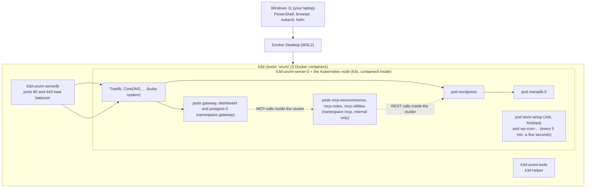

# Run guide

How to run, use and inspect every part of the project, written for someone new to Kubernetes. Every phase extended this guide; it is final as of Phase 6 and nothing in it is planned. Statements about things that were not run are labelled **expected** or **not tested**.

Statements are either **verified** (run on the reference machine, with the date) or labelled **expected**.

> **Quick start (TL;DR)**
>
> First time on this machine? Do [section 2 (one-time setup)](#2-prerequisites-and-one-time-setup) first.
>
> 1. Start **Docker Desktop** and wait until it says "Engine running".
> 2. In PowerShell, go to the repository: `cd "<path to MCP-Gateway-on-Kubernetes>"`
> 3. Start everything: `powershell -NoProfile -ExecutionPolicy Bypass -File scripts\up.ps1`
> 4. Ctrl+click the URLs it prints (Windows Terminal and VS Code make them links), or add `-Open` to open the storefront for you (storefront, shop, my account, wp-admin).
> 5. Need the admin password? `powershell -NoProfile -ExecutionPolicy Bypass -File scripts\get-admin-password.ps1` copies it to your clipboard (user `admin`).
> 6. The team dashboard is <http://app.localhost/>: log in as `admin@example.com` with the password that `powershell -NoProfile -ExecutionPolicy Bypass -File scripts\get-secret.ps1 -Namespace gateway -Name gateway-bootstrap -Key password` copies to your clipboard ([the dashboard](#the-dashboard-phase-4)). For the AI chat, follow [Set up the AI chat](#set-up-the-ai-chat) once.
> 7. Done for the day: `powershell -NoProfile -ExecutionPolicy Bypass -File scripts\stop.ps1` (keeps your data).

All commands are run from the repository root in **Windows PowerShell 5.1**. The folder path contains spaces on the reference machine; the scripts quote their own paths, so just `cd` into the folder first.

**Script invocation convention.** Where these docs write `scripts\x.ps1 [args]` for short, run `powershell -NoProfile -ExecutionPolicy Bypass -File scripts\x.ps1 [args]` from the repository root. Typing `scripts\x.ps1` directly is usually blocked by Windows' default execution policy (see [troubleshooting](troubleshooting.md#running-scripts-is-disabled-on-this-system)).

## Contents

1. [What runs where](#1-what-runs-where)
2. [Prerequisites and one-time setup](#2-prerequisites-and-one-time-setup)
3. [Daily use](#3-daily-use)
4. [URLs](#4-urls)
5. [Passwords and secrets](#5-passwords-and-secrets)
6. [Using the store](#6-using-the-store)
7. [Viewing the store database (MariaDB)](#7-viewing-the-store-database-mariadb)
8. [WooCommerce MCP server (Phase 2)](#8-woocommerce-mcp-server-phase-2)
9. [The gateway (Phase 3)](#9-the-gateway-phase-3)
10. [Viewing the gateway database (Postgres)](#10-viewing-the-gateway-database-postgres)
    - [The dashboard (Phase 4)](#the-dashboard-phase-4)
    - [Set up the AI chat](#set-up-the-ai-chat)
11. [Each part of the project](#11-each-part-of-the-project)
12. [Health checks and logs](#12-health-checks-and-logs)
13. [Resetting](#13-resetting)
14. [Troubleshooting pointers](#14-troubleshooting-pointers)

---

## 1. What runs where



Reading it from the outside in: your browser talks to port 80 on Windows. Docker Desktop forwards that to the `k3d-urumi-serverlb` container, which hands it to Traefik (the ingress controller) inside the node, which routes `store.localhost` to the WordPress pod. WordPress stores everything in MariaDB. The MCP server pods (section 8) have no route in from outside; the WooCommerce one only calls WordPress from inside the cluster, which the dotted arrow shows. `app.localhost` goes the same way: `/` to the dashboard pod (the web page, [the dashboard](#the-dashboard-phase-4)), `/api` and `/mcp` to the gateway pod (section 9), which calls the MCP servers and its own Postgres from inside the cluster. For the chat, the gateway also calls the AI provider (Groq) on the internet ([Set up the AI chat](#set-up-the-ai-chat)).

**Why Docker Desktop shows only 3 containers (verified 2026-10-18).** They are:

| Container | What it is |
|---|---|
| `k3d-urumi-server-0` | The Kubernetes node itself (k3s). |
| `k3d-urumi-serverlb` | The load balancer that publishes ports 80 and 443. |
| `k3d-urumi-tools` | A helper container used by k3d. |

The pods (WordPress, MariaDB and so on) run **inside** `k3d-urumi-server-0`, under that container's own container runtime (containerd). Docker Desktop only sees the outer containers, so it never lists the pods.

**Why Docker Desktop's "Kubernetes" tab shows no cluster.** That tab manages only Docker Desktop's own built-in Kubernetes. This project uses **k3d** instead (see [ADR-002](decisions/ADR-002-k3d-k3s-traefik.md)), so the tab stays empty and that is normal. Do not enable Docker Desktop's Kubernetes for this project.

**How to see the pods.**

```powershell
kubectl get pods -A          # every pod in every namespace
kubectl -n store get pods    # only the store
```

Optional graphical tools (not required; **not tested on the reference machine**):

- **Headlamp**, a Kubernetes GUI: `winget install --id Headlamp.Headlamp -e`. It reads `~/.kube/config`, where the `k3d-urumi` context lives.
- The **Kubernetes** extension for VS Code, which also reads `~/.kube/config`.

## 2. Prerequisites and one-time setup

| Step | What | Notes |
|---|---|---|
| 1 | Windows 11, PowerShell 5.1 | Check: `$PSVersionTable.PSVersion` |
| 2 | **Docker Desktop** (WSL2 backend) | Must be **running** whenever you use the project. |
| 3 | Memory cap in `C:\Users\<you>\.wslconfig` | On the reference machine (15 GB RAM) the file sets `memory=9GB`, `processors=8`, `swap=4GB`. Without a cap WSL2 may take half the RAM. After editing run `wsl --shutdown` and restart Docker Desktop. |
| 4 | `winget install --id Helm.Helm -e` and `winget install --id k3d.k3d -e` | Then open a **new** terminal so PATH refreshes. `kubectl` ships with Docker Desktop. |
| 5 | **Node.js 24** | `winget install --id OpenJS.NodeJS.LTS -e` (on 2026-10-19 winget lists 24.20.0 as the LTS; that command was not run here, the reference machine has Node 24.0.1), or the Node 24 Windows installer from nodejs.org. Open a **new** terminal, then check: `node -v` prints `v24.` something. **Node 24.15 or newer is recommended:** the dashboard's test library jsdom 30 declares `^24.15`, so on older Node 24 releases `npm ci` prints `EBADENGINE` warnings (the tests still passed on 24.0.1). Not needed for the store itself; needed for the MCP check, MCP Inspector, the dashboard check and the tests. |
| 6 | `npm ci`, once, from the repository root | Installs the project's Node packages into `node_modules`. `scripts\check-mcp-woocommerce.ps1` runs a small MCP client (`scripts/dev/mcp-smoke.mjs`) that imports the MCP SDK from there; without it the check stops with `Dependencies not installed: run npm ci ...`. The Docker images install their own packages, so `up.ps1` works without this step. Run it again after pulling changes to `package-lock.json`. |
| 7 | Hosts entries (optional) | `powershell -NoProfile -ExecutionPolicy Bypass -File scripts\setup-hosts.ps1` (UAC prompt, safe to repeat). Browsers do not need it; Node-based MCP tools do. |
| 7b | Playwright's Chromium (optional, once) | Only for the dashboard check `scripts\check-dashboard.ps1`: run `npx playwright install chromium` from the repository root after `npm ci` (about 118 MiB, into `%LOCALAPPDATA%\ms-playwright`). |
| 8 | The first `up.ps1` | Creates the cluster, downloads images and WooCommerce, installs the store. **Typically about 2–3 minutes** the first time (observed on the reference machine). |

Versions used, and how each tool was installed, are in [learning/00-setup-log.md](learning/00-setup-log.md). The long-form deployment steps are in [deployment.md](deployment.md).

## 3. Daily use

### Start

```powershell
powershell -NoProfile -ExecutionPolicy Bypass -File scripts\up.ps1
```

`up.ps1` checks that `docker`, `k3d`, `kubectl` and `helm` exist and that Docker is running, starts (or creates) the cluster, warns if the hosts entry is missing, installs the store **only if it is not installed yet**, waits until the store is ready, and prints a URL block. It never prints passwords. Whenever it deploys (first install, repair, or `-Redeploy`) it first runs `build-images.ps1` (below), because our own program images, such as the MCP server, must exist inside the cluster before Helm starts them.

It also reads the Helm release state, because `helm status` succeeds even for a broken release. Release `deployed` and namespace `store` present: it just waits for the pods (fast path): MariaDB and WordPress, then the MCP server if it is installed (if the MCP server is not ready within 2 minutes it prints a yellow warning and carries on, because the store works without it). Release `failed`, or the `store` namespace missing: it prints a yellow "previous install did not complete" notice and runs the deploy to repair it. Release `pending-install`, `pending-upgrade` or `pending-rollback` (an interrupted Helm operation): it stops and prints the command to recover; see [troubleshooting](troubleshooting.md#another-operation-is-in-progress-pending-install). The decision function was tested in isolation; the real failed and pending paths were not triggered on the live release. The ending looks like this:

```text
================ Urumi platform is running ================
  Storefront   : http://store.localhost/
  Shop         : http://store.localhost/shop/
  My account   : http://store.localhost/my-account/   (customers: register, log in, see their orders)
  WP admin     : http://store.localhost/wp-admin/     (user: admin)
  MCP server   : internal only (namespace mcp) - check with scripts\check-mcp-woocommerce.ps1
  Dashboard    : http://app.localhost/
  Gateway API  : http://app.localhost/api
  MCP endpoint : http://app.localhost/mcp   (needs a personal API key)
  Gateway admin: admin@example.com - copy the password with: powershell -ExecutionPolicy Bypass -File scripts\get-secret.ps1 -Namespace gateway -Name gateway-bootstrap -Key password
  AI chat      : not set up - see docs/run-guide.md "Set up the AI chat"

  Admin password - run this to copy it to the clipboard (it is never printed here):
    powershell -ExecutionPolicy Bypass -File scripts\get-admin-password.ps1
  Stop everything (keeps data):
    powershell -ExecutionPolicy Bypass -File scripts\stop.ps1
  Full guide: docs/run-guide.md
===========================================================
```

The three `Gateway` lines appear only when the gateway is enabled (`gateway.enabled`), and the admin email is the release's `gateway.bootstrapAdminEmail`, both read from the installed release's values. The `Dashboard` line appears when `dashboard.enabled` is true too. The yellow `AI chat` line appears only while the Secret `llm-api-keys` does not exist (the script checks that it exists and never reads it); after [Set up the AI chat](#set-up-the-ai-chat) it disappears (verified 2026-10-19).

Options:

| Option | Effect |
|---|---|
| `-Open` | Also opens the storefront in your browser. |
| `-Redeploy` | Also rebuilds the images and runs `helm upgrade` so code, chart or value changes take effect (a plain `up.ps1` does not touch a healthy installed release). Full form: `powershell -NoProfile -ExecutionPolicy Bypass -File scripts\up.ps1 -Redeploy`. |

Full form for the options: `powershell -NoProfile -ExecutionPolicy Bypass -File scripts\up.ps1 -Open`.

### Build the program images (`build-images.ps1`)

Our own programs (the three MCP servers, the gateway and, since Phase 4, the dashboard) run from container images that you build on your laptop; there is no registry. `up.ps1` runs this for you whenever it deploys. Run it yourself only if you want to rebuild without a full redeploy:

```powershell
powershell -NoProfile -ExecutionPolicy Bypass -File scripts\build-images.ps1
```

It builds the five images (`urumi/mcp-woocommerce`, `urumi/mcp-notes`, `urumi/mcp-utilities`, `urumi/gateway` and `urumi/dashboard`, all with the same `<tag>`) with Docker, copies them into the k3d cluster (`k3d image import`, because the cluster cannot see your Docker images otherwise), and writes the tag to `deploy/.images.local.yaml`, which `deploy.ps1` passes to Helm. Then run `up.ps1 -Redeploy` to roll the new image out.

**How the image tag is chosen.** The tag is the short git commit id (for example `05ca559`). If `git status --porcelain` shows **any** change, including a new untracked file such as a log, the tag becomes `<sha>-dirty-<timestamp>`. This matters:

| Working tree | Tag | What a redeploy does |
|---|---|---|
| Clean (everything committed) | `05ca559` | Same tag as last time, so the pod is **not** restarted (verified 2026-10-18: same pod through a redeploy). |
| Any change, even one untracked file | `05ca559-dirty-20261018235805` | A new tag every build, so the pod is replaced on every redeploy. Harmless, just slower. |

The tag is written **in quotes** (`imageTag: "c7914c9"`). About one commit in 27 has a short id made only of digits, such as `1234567`, and unquoted YAML would read that as a number. The chart also turns such a number back into its digits, so a hand-written `imageTag: 1234567` still renders as `urumi/mcp-woocommerce:1234567` (verified with `helm template`). A tag with a leading zero cannot be repaired that way, because YAML reads `0123456` as an octal number, so always quote tags you write by hand.

If you deploy without `deploy/.images.local.yaml` (for example you ran `deploy.ps1` by hand on a fresh clone), the chart falls back to tag `dev`, which does not exist in the cluster, so the pod cannot start. With the chart's default pull policy `IfNotPresent` it shows `ErrImagePull` and then `ImagePullBackOff` (**expected**; not observed on the reference machine, because `up.ps1` always builds first; `ErrImageNeverPull` appears only if the pull policy is `Never`). `deploy.ps1` prints a yellow warning (`no local image tag; run scripts\build-images.ps1`). Fix: [troubleshooting](troubleshooting.md#mcp-woocommerce-is-in-errimageneverpull-or-imagepullbackoff).

### Stop

```powershell
powershell -NoProfile -ExecutionPolicy Bypass -File scripts\stop.ps1
```

This runs `k3d cluster stop urumi`, which frees the RAM. **Data survives a stop and the next `up.ps1` — verified (2026-10-18):** the products and two orders were still present afterwards.

### After a laptop restart

Start Docker Desktop, wait for "Engine running", then run `up.ps1` again. The k3d containers use the Docker restart policy `unless-stopped`, so after a reboot the cluster may already be running or may be stopped (expected; not tested across a reboot). `up.ps1` handles both and keeps your data.

### The cluster listens on this computer only (Phase 5)

Since 2026-10-23 `deploy/k3d-config.yaml` publishes the cluster's ports as `127.0.0.1:80` and `127.0.0.1:443`, so only programs on this computer can reach the store, the dashboard and the gateway. Before, k3d published them on every network interface, so another device on the same Wi-Fi could open `http://<this computer's address>/` with a `Host: store.localhost` header. **Verified 2026-10-23:** `curl.exe -m 5 http://127.0.0.1/ -H "Host: store.localhost"` answers `200`; the same request to this computer's Wi-Fi address (<your LAN IPv4>) gets no answer (curl exit 7, connection refused); `docker port k3d-urumi-serverlb` lists `80/tcp -> 127.0.0.1:80` and `443/tcp -> 127.0.0.1:443`. One more port stays open: the Kubernetes API (`6443/tcp -> 0.0.0.0:<random port>`), which needs the cluster's client certificate (see [security.md](security.md#8-residual-risks), risk 9).

The browser, `curl` and all scripts use `localhost` names, so nothing changes in daily use. A device on your network can no longer open the store; to show it to someone else use a screen share, or the production path in [deployment.md](deployment.md#production-k3s-vps).

**Recreating the cluster loses all local data.** The cluster was deleted and recreated on 2026-10-23 to apply this setting (the owner agreed): products, orders, customers, gateway users, API keys and the audit log are gone, and **new passwords were generated** (store admin, database, gateway admin). Fetch them again with the commands in [section 5](#5-passwords-and-secrets); the AI keys come back by running `scripts\create-secrets.ps1` once (it reads `.env` itself). Any API key you created before the recreation no longer works; any MCP client that stored one needs a new key. To check the whole platform after such a recreation run `scripts\smoke-test.ps1` (below, section 12).

## 4. URLs

With the default settings (host port 80, **verified**):

| What | URL | Notes |
|---|---|---|
| Storefront | <http://store.localhost/> | |
| Shop | <http://store.localhost/shop/> | Product list |
| Cart | <http://store.localhost/cart/> | |
| Checkout | <http://store.localhost/checkout/> | Redirects to the cart when the cart is empty (normal) |
| My account | <http://store.localhost/my-account/> | Customers register and log in here |
| My orders | <http://store.localhost/my-account/orders/> | A logged-in customer's order history |
| WordPress admin | <http://store.localhost/wp-admin/> | User `admin`, password: see [section 5](#5-passwords-and-secrets) |
| Gateway REST API | <http://app.localhost/api> | Verified 2026-10-19; see [section 9](#9-the-gateway-phase-3) |
| Gateway MCP endpoint | <http://app.localhost/mcp> | Needs a personal API key (section 9); verified |
| Dashboard | <http://app.localhost/> | The team web page (log in as `admin@example.com`); verified 2026-10-19 and 2026-10-20. See [the dashboard](#the-dashboard-phase-4) |
| Dashboard chat | <http://app.localhost/chat> | Needs the AI key once: [Set up the AI chat](#set-up-the-ai-chat) |
| Invite links | `http://app.localhost/invite/<token>` | Created by an admin on the Team page; each works once, for 72 hours |
| WooCommerce MCP server | **internal only** | No URL on your machine. Reach it with a port-forward, see [section 8](#8-woocommerce-mcp-server-phase-2) |

If you moved the store to port 8081 (see [deployment.md](deployment.md)), add `:8081` to every URL; `up.ps1` should print the right ones (expected; the 8081 case was not re-tested for this script).

## 5. Passwords and secrets

**Admin password.** The password is generated on first install and lives only in a Kubernetes Secret. To get it:

```powershell
powershell -NoProfile -ExecutionPolicy Bypass -File scripts\get-admin-password.ps1          # copies to the clipboard (user: admin)
powershell -NoProfile -ExecutionPolicy Bypass -File scripts\get-admin-password.ps1 -Show    # copies AND prints it
```

The default admin username is `admin`. If `storeSetup.adminUser` was overridden, find it with `helm get values urumi --namespace urumi-system --all --output json` and look at `storeSetup.adminUser`.

**Clipboard caveat.** If Windows clipboard history (Win+V) or cloud clipboard sync is on, a copied password persists or syncs to other devices. Clear the history, or use `-Show` in a private terminal. If the clipboard is unavailable the script says `Could not copy to the clipboard; re-run with -Show.`

**Why scripts never print passwords.** Console output ends up in scrollback, screenshots, shared terminals and chat logs. The scripts print the *command that retrieves* a secret instead. The only exception is the `-Show` switch, which you type on purpose.

**Where every secret lives** (namespace `store`; values are never shown in this guide):

| Secret | Keys | Used by |
|---|---|---|
| `store-admin` | `password` | The WordPress `admin` login; created at install and read by `get-admin-password.ps1`. |
| `store-db` | `root-password`, `password` | MariaDB. `password` is for the app user `wordpress`, which WordPress and the store-setup Job use. `root-password` is for the MariaDB `root` user (`MARIADB_ROOT_PASSWORD` in the MariaDB pod); only MariaDB and you (inspection, section 7) use it. The store-setup Job does **not** use it. |
| `store-woo-api` | `consumer-key`, `consumer-secret` | The WooCommerce REST/OAuth1 key created at install for the MCP server; used by `check-woo-api.ps1`. A byte-identical copy lives in namespace `mcp`, because Secrets cannot be shared across namespaces; the MCP server reads that copy. The key belongs to the `urumi-mcp` shop manager (section 8). In the `wp_woocommerce_api_keys` table only the consumer key is hashed; the `consumer_secret` column is stored in **plain text** (OAuth1 needs it). Do not `SELECT *` on that table or screenshot it, and never select `wp_users.user_pass`. |

In namespace `mcp` (verified 2026-10-19):

| Secret | Keys | Used by |
|---|---|---|
| `store-woo-api` | `consumer-key`, `consumer-secret` | Copy of the store's key; read by the MCP server pod. |
| `mcp-woocommerce-token` | `token` | The bearer token the MCP server requires. Copy it to your clipboard with `scripts\get-secret.ps1 -Namespace mcp -Name mcp-woocommerce-token -Key token` (add `-Show` to also print it). A copy lives in namespace `gateway` (it is only used there to seed the server registry). |
| `mcp-notes-token` | `token` | The bearer token `mcp-notes` requires (48 characters, generated at install). |
| `mcp-utilities-key` | `key` | The key `mcp-utilities` requires in the header `X-Utilities-Key` (48 characters, generated at install). |

In namespace `gateway` (verified 2026-10-19 by the pods running and the checks passing; values are never shown):

| Secret | Keys | Used by |
|---|---|---|
| `gateway-bootstrap` | `email`, `password` | The first admin account, created on first start. Copy the password with `scripts\get-secret.ps1 -Namespace gateway -Name gateway-bootstrap -Key password`. |
| `gateway-secrets` | `postgres-password`, `encryption-key`, `internal-token-secret` | Postgres; the AES key for stored upstream credentials (32 random bytes, base64); the signing secret of the internal chat token. `postgres-password` is for the database (section 10). Do not lose `encryption-key`: stored credentials cannot be read without it. |
| `llm-api-keys` | `GROQ_API_KEY`, `OPENROUTER_API_KEY` | The AI provider keys for the chat (Phase 4). **Not generated by Helm:** `scripts\create-secrets.ps1` creates it from your `.env` ([Set up the AI chat](#set-up-the-ai-chat)). Optional: without it the gateway runs and the chat says it is not configured. |
| `mcp-woocommerce-token`, `mcp-notes-token`, `mcp-utilities-key` | as in `mcp` | Byte-identical copies of the `mcp` Secrets, used only to **seed** the server registry on first start. After that the encrypted copy in the database is the source of truth, so editing a credential in the gateway does not touch these Secrets. Each built-in server is seeded once: a deleted one is not re-created ([re-add it](#delete-and-re-add-a-built-in-server)). |

`get-secret.ps1` works for any Secret value: `-Namespace`, `-Name` and `-Key` are required, the value goes to the clipboard, and it is printed only with `-Show`. The same clipboard caveat as above applies.

**Rule: never paste a secret into a chat, an issue or a commit.** Secrets are generated per install, so they are not in Git. The one secret you supply yourself is the AI provider key; it lives in the git-ignored `.env` and in the Secret `llm-api-keys`, nowhere else.

## 6. Using the store

### As a shopper

1. Open the storefront or `/shop/` and click a product, then **Add to cart**.
2. Open the cart and go to checkout.
3. Fill in the billing details and choose **Cash on delivery** (the only payment method; shipping is disabled).
4. **Place order**. The "Order received" page confirms it.

### As a customer with an account

Customer accounts are enabled (**verified 2026-10-18** by `scripts\dev\customer-order-smoke.ps1`).

- Register at <http://store.localhost/my-account/> or tick "Create an account" at checkout (the checkout sign-up is **expected**: only the `checkoutAllowsSignup` setting was confirmed, the tick-box flow was not exercised). The username is generated for you, and you choose your own **password**, because there is no mail server to send a generated one.
- After logging in, **My Account → Orders** lists your orders with date, status and total; **View** opens the details.
- **Guest orders are NOT linked to a later account.** In WooCommerce 11.2.1 an order placed as a guest stays a guest order, even if you later register with the same email. It will not show in My Account → Orders (**verified 2026-10-18**: a guest order stayed `customer_id 0` and was absent from My Orders). Guest orders are visible only to the admin, in WooCommerce → Orders. To see an order under My Account, log in **before** you check out.

The full flow is in [workflows.md](workflows.md#5-customer-account-and-order-history).

> **Security note (demo setting).** Open registration is a demo-store choice. Anyone who can reach the store can register an account. There is no email verification and no CAPTCHA. The password-strength meter runs in the browser only, so a direct POST accepts weak passwords. The "already registered" error reveals which emails have accounts. With cash-on-delivery guest checkout, bots could create fake accounts and orders.
>
> k3d publishes ports 80 and 443 without a host IP, so Docker is **expected** to bind them on all interfaces; the store is then likely reachable from your local network (for example café Wi-Fi). This was **not verified** on this machine. On untrusted networks stop the cluster with `powershell -NoProfile -ExecutionPolicy Bypass -File scripts\stop.ps1`. The production toggle is described below.

> **Registration toggle (Phase 5).** Turn registration off with `storeSetup.customerRegistration: false` (chart value, default `true`, a boolean in the schema); the setup Job then sets `woocommerce_enable_myaccount_registration` and `woocommerce_enable_signup_and_login_from_checkout` to `no`. **Verified 2026-10-22** on the local cluster: with `--set storeSetup.customerRegistration=false` My Account had no Register form (login form only) and the block checkout's settings said `checkoutAllowsSignup:false`; after `up.ps1 -Redeploy` (default `true`) the Register form was back and `checkoutAllowsSignup:true`. The page HTML was checked with curl, not a browser. There is no CAPTCHA or email verification, so production turns registration off ([security.md](security.md#8-residual-risks)). With registration off, customers can still check out as guests; existing accounts keep working.

### As the admin

Log in at <http://store.localhost/wp-admin/> as `admin`.

- **WooCommerce → Orders:** all orders, including guest orders. Open an order to change its status.
- **Products → All Products / Add New:** add, edit or delete products.

### Adding staff users

**Users → Add New User**, fill in username, email and a password, and set **Role** to **Shop manager** to give someone store access without full site control. Then press **Add New User**.

| Role | What it can do |
|---|---|
| Administrator | Everything: settings, plugins, users, themes, orders, products. |
| Shop manager | Manage products, orders and customers, and see WooCommerce reports. Cannot change site-wide WordPress settings or install plugins. |
| Customer | Buy and view their own orders in My Account. No access to wp-admin (expected; not exercised). This is the default for registered shoppers. |

The role descriptions follow standard WooCommerce behavior (expected; the Shop manager role was not exercised here).

## 7. Viewing the store database (MariaDB)

The store keeps everything in MariaDB: database `wordpress` (48 tables, verified 2026-10-18) in namespace `store`, pod `mariadb-0`.

**Read-only browsing is fine. Never edit WooCommerce tables by hand.** WooCommerce enforces its own business rules (stock, order totals, status changes, caches); a manual `UPDATE` can leave the store inconsistent. Use wp-admin for changes.

### (a) Quick SQL in the terminal

The pod already has the root password in its own environment variable `MARIADB_ROOT_PASSWORD`, so this route never puts the password on the Windows command line:

```powershell
kubectl -n store exec -it mariadb-0 -- sh -c 'exec mariadb -uroot -p"$MARIADB_ROOT_PASSWORD" wordpress'
```

Type `exit` to leave. Notes:

- `kubectl exec -it` needs an interactive terminal. It fails from non-TTY runners such as a VS Code "Run" button; use a normal PowerShell window. (The interactive `-it` form itself was not run here because the test harness has no terminal; the identical command with `-i` and SQL piped in was verified on 2026-10-18.)
- The password is read inside the pod from `MARIADB_ROOT_PASSWORD`; you never see or type it.

A single query without opening the client. In PowerShell 5.1, passing the SQL through `-e "..."` breaks (the quotes are mangled and MariaDB reports a syntax error; **tried 2026-10-18**), so pipe it in instead (**verified 2026-10-18**):

```powershell
"SELECT ID, post_title FROM wp_posts WHERE post_type='product';" | kubectl -n store exec -i mariadb-0 -- sh -c 'exec mariadb -uroot -p"$MARIADB_ROOT_PASSWORD" wordpress'
```

Alternative (puts the password on the command line): `$pw = [Text.Encoding]::UTF8.GetString([Convert]::FromBase64String((kubectl -n store get secret store-db -o 'jsonpath={.data.root-password}')))` followed by `kubectl -n store exec -it mariadb-0 -- mariadb -uroot "-p$pw" wordpress`. `"-p$pw"` is visible in the command line of the Windows `kubectl.exe` process and inside the pod, so other local processes that can read command lines could see it. That is acceptable on a single-user development machine only. The GUI route in (b) (port-forward plus `scripts\get-db-password.ps1`, which copies the password to the clipboard) also keeps it off command lines.

Four useful queries (run inside the client, or piped in one at a time as above). They were run against the live database on 2026-10-18 (read-only) and worked:

```sql
-- 1. Products
SELECT ID, post_title, post_status FROM wp_posts WHERE post_type='product' AND post_status IN ('publish','draft') ORDER BY ID;

-- 2. Orders (HPOS is off, so orders are wp_posts rows; total and customer come from wp_postmeta)
SELECT p.ID AS order_id, p.post_status, p.post_date, m.meta_value AS total, c.meta_value AS customer_user
FROM wp_posts p
JOIN wp_postmeta m ON m.post_id=p.ID AND m.meta_key='_order_total'
JOIN wp_postmeta c ON c.post_id=p.ID AND c.meta_key='_customer_user'
WHERE p.post_type='shop_order' ORDER BY p.ID DESC LIMIT 10;

-- 3. Order line items (what was bought in each order)
SELECT order_id, order_item_name, order_item_type FROM wp_woocommerce_order_items ORDER BY order_id DESC LIMIT 10;

-- 4. Users
SELECT ID, user_login, user_email, user_registered FROM wp_users ORDER BY ID;
```

What they showed (columns and sample rows, no secrets):

- Query 1: columns `ID, post_title, post_status`; rows such as `10 Urumi Coffee Mug publish`.
- Query 2: columns `order_id, post_status, post_date, total, customer_user`; rows such as `19 wc-processing ... 3.00 0` (a guest order, customer_user `0`) and `18 wc-processing ... 3.00 2` (customer 2).
- Query 3: columns `order_id, order_item_name, order_item_type`; rows such as `19 Urumi Testing shirt line_item`.
- Query 4: columns `ID, user_login, user_email, user_registered`; the `admin` user is ID 1.

Why orders come from `wp_postmeta` here and not `wp_wc_order_stats`: that analytics table is filled by a background job and **lagged behind** (**observed 2026-10-18**: it held orders 14 and 15 while 18 and 19 were not in it yet), so `wp_postmeta` is the reliable source.

### (b) A graphical SQL client (optional; not tested on the reference machine)

Terminal 1 (leave it running; it forwards local port 3307 to MariaDB):

```powershell
kubectl -n store port-forward svc/mariadb 3307:3306
```

Install a client, either one:

```powershell
winget install --id HeidiSQL.HeidiSQL -e
winget install --id DBeaver.DBeaver.Community -e
```

Create a connection with these standard MySQL/MariaDB settings:

| Field | Value |
|---|---|
| Host | `127.0.0.1` |
| Port | `3307` |
| User | `root` |
| Password | copied to your clipboard by the command below, then paste it |
| Database | `wordpress` |

```powershell
powershell -NoProfile -ExecutionPolicy Bypass -File scripts\get-db-password.ps1          # copies the root password to the clipboard
powershell -NoProfile -ExecutionPolicy Bypass -File scripts\get-db-password.ps1 -Show    # copies AND prints it
```

Press Ctrl+C in terminal 1 to close the tunnel when you are done.

### Which data lives in which tables

HPOS ("high-performance order storage") is **off** (`woocommerce_custom_orders_table_enabled = no`), so orders use the classic WordPress layout.

| Data | Tables |
|---|---|
| Products | `wp_posts` (`post_type='product'`), `wp_postmeta` (price, stock), `wp_wc_product_meta_lookup` (fast price/stock lookup) |
| Orders | `wp_posts` (`post_type='shop_order'`, status like `wc-processing`), `wp_postmeta` (total, customer, billing) |
| Order line items | `wp_woocommerce_order_items` (+ `wp_woocommerce_order_itemmeta`) |
| Order analytics | `wp_wc_order_stats` (date, status, total; filled by a background job, can lag) |
| Users and customers | `wp_users`, `wp_usermeta` (role, name) |
| Settings | `wp_options` |
| MCP/REST API key | `wp_woocommerce_api_keys` (the consumer key is hashed, but `consumer_secret` is plain text: do not `SELECT *` it or screenshot it). To see who owns the key without touching secrets: `SELECT k.key_id, u.user_login, k.permissions FROM wp_woocommerce_api_keys k JOIN wp_users u ON u.ID=k.user_id;` returned `4 urumi-mcp read_write` (verified 2026-10-19). |

## 8. WooCommerce MCP server (Phase 2)

### What it is

`mcp-woocommerce` is a small service that speaks the **Model Context Protocol (MCP)**, the standard way for AI tools to call functions ("tools") on another system. This one lets an AI client list and create products and list, read and update orders in the WooCommerce store. It runs as one pod in the namespace `mcp` and talks to the store through WooCommerce's REST API. The protocol itself is explained, with real captured requests, in [learning/02-mcp-protocol.md](learning/02-mcp-protocol.md); the code is documented in [apps/mcp-woocommerce/README.md](../apps/mcp-woocommerce/README.md).

### Why it is internal-only

It has a ClusterIP Service and **no Ingress**, so nothing outside the cluster can reach it (verified 2026-10-19: `kubectl get ingress -A` lists only `store`, and `http://store.localhost/mcp` is answered by WordPress with a 404, not by the MCP server; since Phase 3 the list also shows the `gateway` Ingress, which routes only `/api` and `/mcp` on `app.localhost` to the gateway). Its only protection is a bearer token, and it can change real store data, so it is not exposed directly. The **gateway** ([section 9](#9-the-gateway-phase-3)) is the single public door: it checks who the caller is, then calls this server with the token. Since Phase 5 a NetworkPolicy also limits who can reach it: only the gateway pod may open a connection to it (verified 2026-10-22: a pod in the `default` namespace was refused, the gateway got its `401`; `scripts\test-network-policies.ps1`, [security.md, section 15](security.md#15-networkpolicies-phase-5)). The token is still required on top.

### How it starts

`scripts\up.ps1` does everything: it builds the image, loads it into the cluster, and deploys it with the rest of the platform (section 3). You do not start it separately. Stopping with `stop.ps1` and starting again brings it back with the cluster.

### Is it healthy?

```powershell
kubectl -n mcp get pods,svc                          # mcp-woocommerce should be 1/1 Running; the Service type is ClusterIP
kubectl -n mcp logs deploy/mcp-woocommerce           # JSON log lines: "mcp-woocommerce started", then one "request" line per call
kubectl get ingress -A                               # only the store: there is no ingress for the MCP server
```

Verified 2026-10-19: pod `1/1 Running`, 0 restarts. The log never contains the token or the WooCommerce key; each request line shows only method, path, status and duration.

### End-to-end check

```powershell
powershell -NoProfile -ExecutionPolicy Bypass -File scripts\check-mcp-woocommerce.ps1          # read-only
powershell -NoProfile -ExecutionPolicy Bypass -File scripts\check-mcp-woocommerce.ps1 -Write   # also writes
```

The script reads the bearer token from the Secret (it never prints it), opens a temporary `kubectl port-forward` on local port 13001, runs `scripts/dev/mcp-smoke.mjs` with the MCP SDK client, and stops the port-forward afterwards. Read-only mode lists the 6 tools, calls `ping`, `list_products` (3 products) and `list_orders` for today. It ends with a green line `WooCommerce MCP server works end to end`.

`-Write` additionally:

1. **Creates one product** named `MCP smoke <timestamp>` with price 1.00 (sent as the JSON number `1`, which the server stores as `"1.00"`) and status **draft** (so it is not visible on the storefront; find it in wp-admin under Products, Drafts). Each run creates another one; delete them in wp-admin when you like.
2. Calls `update_order_status` on the newest order with the status it **already has**, which proves a signed PUT works without changing anything visible (expected; the run recorded `order 25 kept as processing`).

Verified 2026-10-18 (Task 2.6): read-only run found 6 tools, ping ok, 3 products, 9 orders today; `-Write` run created draft product 26 and kept order 25 as `processing`. Verified again 2026-10-19 after the final-review fixes, when the script also **asserts** the answers (ping returns `ok: true`, the product and order lists are arrays, the new product has a numeric id; any mismatch fails the check): both modes passed, and `-Write` created draft product 29 with `regular_price` `1.00` and kept order 27 as `processing`.

The script stops at once with `Dependencies not installed: run npm ci ...` if the repository's `node_modules` is missing (see section 2). It puts the token into the environment only after the port-forward has started, so the `kubectl` process never holds it.

### Explore it with MCP Inspector

MCP Inspector is the official debugging client for MCP servers. Because the server is internal, you reach it through a port-forward and authenticate with its bearer token.

**Step 1.** In terminal 1, open the tunnel and leave it running (Ctrl+C closes it):

```powershell
kubectl -n mcp port-forward svc/mcp-woocommerce 13001:3001
```

**Step 2.** In terminal 2, copy the token to the clipboard (it is not printed):

```powershell
powershell -NoProfile -ExecutionPolicy Bypass -File scripts\get-secret.ps1 -Namespace mcp -Name mcp-woocommerce-token -Key token
```

**Step 3a. Command-line Inspector (verified in PowerShell 5.1 on 2026-10-19).** Needs Node (the first run downloads the Inspector through `npx`). The first line loads the token **straight from the Secret** into an environment variable of this terminal only (it is never printed); the second line checks it worked and must print `token loaded: True, length 48`:

```powershell
$env:MCP_TOKEN = [Text.Encoding]::UTF8.GetString([Convert]::FromBase64String((kubectl -n mcp get secret mcp-woocommerce-token -o 'jsonpath={.data.token}')))
"token loaded: $([bool]$env:MCP_TOKEN), length $($env:MCP_TOKEN.Length)"
npx -y @modelcontextprotocol/inspector@2.11.0 --cli http://127.0.0.1:13001/mcp --transport http --header "Authorization: Bearer $env:MCP_TOKEN" --method tools/list
npx -y @modelcontextprotocol/inspector@2.11.0 --cli http://127.0.0.1:13001/mcp --transport http --header "Authorization: Bearer $env:MCP_TOKEN" --method tools/call --tool-name ping
npx -y @modelcontextprotocol/inspector@2.11.0 --cli http://127.0.0.1:13001/mcp --transport http --header "Authorization: Bearer $env:MCP_TOKEN" --method tools/call --tool-name list_orders --tool-arg period=today
Remove-Item Env:MCP_TOKEN
```

Verified 2026-10-19 in Windows PowerShell 5.1 against the pod in the cluster: the token line printed `True, length 48`, `tools/call ping` returned `{"ok": true, "server": "mcp-woocommerce", ...}`, and `list_products` with `--tool-arg "search=Coffee Mug"` (an argument containing a space) found the Urumi Coffee Mug. `tools/list` returned the 6 tools in Task 2.4. Notes:

- **Do not use `$env:MCP_TOKEN = Get-Clipboard` after copying the token with `get-secret.ps1`.** Copying the next command from this guide to paste it **replaces** the token in the clipboard, so the variable ends up holding command text with spaces and quotes. The Inspector then fails with `Invalid header format: Bearer. Use "HeaderName: Value" format.` (observed 2026-10-19). Load it from the Secret as shown above; if the check line does not print `length 48`, run the first line again.
- **Numbers become numbers.** `--tool-arg regular_price=12.50` sends the JSON number 12.5. `create_product` accepts a number or a string and stores `"12.50"` either way, so no quoting is needed (verified 2026-10-19 from Git Bash: the call created draft product 28 with `regular_price` `"12.50"`). A price with more than 2 decimals, such as 12.555, is refused with an `isError` result rather than rounded.
- **A libuv assertion at the end** (`Assertion failed: ... src\win\async.c`) can appear on Windows after a command finishes. It is cosmetic noise from the Inspector's shutdown, not from the server (observed in Task 2.4); the result printed above it is valid.
- The token is on the command line of that process, visible to other programs on your PC while it runs. Acceptable on a single-user development machine; the UI route avoids it.
- The Inspector's default mode talks the 2025 protocol; add `--protocol-era auto` to use the 2026-07-28 one. Both work ([ADR-007](decisions/ADR-007-mcp-sdk-version.md)).

**Step 3b. Inspector with a web page (UI route; not tested here).** Run `npx -y @modelcontextprotocol/inspector@2.11.0`, open the address it prints, choose transport **Streamable HTTP**, enter URL `http://127.0.0.1:13001/mcp`, add the header `Authorization` with value `Bearer ` followed by the pasted token, and connect. **Tools -> List tools** shows the 6 tools; pick `create_product` and enter `{"name":"Demo Mug","regular_price":"12.50"}`. The product is then visible at <http://store.localhost/shop/> (expected; the UI route was not run, but the same call through the SDK client is covered by `-Write`, which uses status `draft`).

### The tools

| Tool | Does | Changes data? |
|---|---|---|
| `list_products` | Lists products (search, status, paging; 10 per page unless `per_page` says otherwise, at most 50). | No |
| `create_product` | Creates a simple product (`name`, `regular_price` such as `"12.50"` or `12.5`, optional `description`, `status` `publish` or `draft`). | **Yes**, and calling twice creates two products |
| `list_orders` | Lists orders, newest first, 10 per page by default. `period` = `today`, `yesterday` or `last_7_days` in the store time zone (`Asia/Kolkata` locally), or `after`/`before` as ISO 8601 date-times with a zone, such as `2026-10-18T00:00:00+05:30`. | No |
| `get_order` | One order with items, totals, customer and payment method. | No |
| `update_order_status` | Changes an order's status (`processing`, `completed`, `cancelled` ...). | **Yes** |
| `ping` | Returns `ok` and the server time. Does not touch WooCommerce. | No |

Full input rules are in the [server README](../apps/mcp-woocommerce/README.md#tools). When a tool fails (WooCommerce error, bad input, timeout) the answer is a normal result with `isError: true` and a short message; see [workflows.md](workflows.md#6-mcp-tool-call-to-the-store) for every failure case.

### Who owns the WooCommerce API key (security note)

The REST key the MCP server uses belongs to a dedicated WordPress user **`urumi-mcp`** with the **Shop manager** role, not to the administrator. A leaked key can therefore read and change products and orders but cannot manage plugins, themes or users. The store-setup Job creates that user (random password nobody sees) and marks it with the user meta `urumi_managed_key_owner=1`.

**Why the marker.** Customer registration is open and WooCommerce derives the login from the e-mail address, so anyone could register `urumi-mcp@example.com` and get a customer account whose login is `urumi-mcp`. Without the marker the Job would then promote that stranger to Shop manager and hand them the key. The Job therefore **fails** instead of promoting a user it did not create. If you ever see that failure, see [troubleshooting](troubleshooting.md#the-store-setup-job-fails-with-missing-urumi_managed_key_owner-marker).

Verified 2026-10-19 with SQL against the live database (section 7): one key row, owner `urumi-mcp`, permissions `read_write`; the user has role `shop_manager` and the marker is `1`. The refusal itself was proven in Task 2.5 by running the Job's PHP check against a throwaway unmarked shop manager (it printed the refusal); the shell branch of `setup.sh` is syntax-checked but was not run live.

### What is not possible yet

- **No direct external access.** Nothing outside the cluster can call this server. Clients connect through the **gateway** ([section 9](#9-the-gateway-phase-3)), and people use it through the [dashboard](#the-dashboard-phase-4) (Phase 4).
- **No per-user identity at the server itself.** It has one shared bearer token; per-user keys and the audit log are the gateway's job (built in Phase 3).
- **Reachable only from the gateway** (NetworkPolicy since Phase 5); `kubectl port-forward`, which `check-mcp-woocommerce.ps1` uses, is not affected by the policies.

### A store hosted elsewhere (Phase 5b)

`scripts\dev\test-external-store.ps1 [-Write]` proves the HTTPS Basic mode against the local store: it creates a throw-away CA, a temporary TLS Secret and Ingress (`ext-proof*`) in `store`, runs the built server on the host with TLS verification on, runs the smoke client, runs a negative control without the CA, and removes everything. It prints no key, secret or token. Before it creates anything it refuses (exit 1, nothing changed) unless the kubectl context is `k3d-urumi` and neither `ingress/ext-proof` nor `secret/ext-proof-tls` already exists in `store`; an existing one is left in place for you to inspect (**tested** 2026-10-23 with a fake context and a pre-existing Ingress). Setting up a real external store: [deployment guide](deployment.md#using-a-woocommerce-store-hosted-elsewhere).

## 9. The gateway (Phase 3)

### What it is

The gateway is **one MCP endpoint** in front of the three MCP servers (WooCommerce, Notes, Utilities, 15 tools in total), with its own users, personal API keys, invite links, server registry and audit log in its own Postgres database. The idea and real captured traffic are in [learning/03-gateway.md](learning/03-gateway.md); the design is in [system-design.md](system-design.md).

| What | URL | Notes |
|---|---|---|
| Gateway REST API | <http://app.localhost/api> | Session cookie; used by the dashboard and from PowerShell below (verified 2026-10-19) |
| MCP endpoint | <http://app.localhost/mcp> | Needs a personal API key; `GET` answers 405 (verified) |
| Health | `GET /healthz`, `GET /readyz` | Reachable inside the cluster only; the Ingress sends `/api` and `/mcp` to the gateway and everything else to the dashboard |
| Dashboard (web page) | <http://app.localhost/> | Built in Phase 4: [the dashboard](#the-dashboard-phase-4) |
| Chat agent | <http://app.localhost/chat> (`POST /api/chat`) | Built in Phase 4; needs the AI key: [Set up the AI chat](#set-up-the-ai-chat) |

Everything in this section can be done in the dashboard by clicking; the PowerShell, MCP Inspector and MCP client steps below show what happens underneath and are how you script it. `app.localhost` resolves to your machine in browsers and `curl.exe`; Node tools need the hosts entry from `scripts\setup-hosts.ps1` (section 2, step 7).

### Is it running?

```powershell
kubectl -n gateway get pods,svc,ingress      # postgres-0 and gateway-... are 1/1 Running; the Ingress host is app.localhost
kubectl -n mcp get pods                      # mcp-notes, mcp-utilities and mcp-woocommerce are 1/1 Running
kubectl -n gateway logs deploy/gateway       # JSON log lines; the first ones show "gateway started" with "connectedTools":15
```

Verified 2026-10-19: `postgres-0` and the gateway pod `1/1 Running` with 0 restarts, Service `gateway` (ClusterIP, 3000/TCP), headless Service `postgres` (5432/TCP), Ingress `gateway` on `app.localhost` port 80, and three pods in `mcp`. The log shows seed slugs, counts and ports; it never contains a key, password or token.

### The admin account and its password

The first admin is created automatically the first time the gateway starts with an empty database. Its email is `admin@example.com` (Helm value `gateway.bootstrapAdminEmail`) and its password is generated and stored in the Secret `gateway-bootstrap`. Copy the password to the clipboard (it is not printed):

```powershell
powershell -NoProfile -ExecutionPolicy Bypass -File scripts\get-secret.ps1 -Namespace gateway -Name gateway-bootstrap -Key password
```

Add `-Show` to also print it. The same clipboard caveat as in section 5 applies. The dashboard's login page uses this account ([the dashboard](#the-dashboard-phase-4)).

### Log in and create an API key (PowerShell 5.1)

Rules that make this work (each one was hit while testing; see [error-handling.md](error-handling.md#2-api-the-rest-api)):

- **Every `POST`, `PATCH`, `PUT` and `DELETE` needs both `Content-Type: application/json` and `Origin: http://app.localhost`.** That includes `DELETE` with no body. Without them the answer is `403 CSRF_REJECTED`. In PowerShell: `-Headers @{ Origin = 'http://app.localhost' } -ContentType 'application/json'` on every mutating call.
- Pass `-WebSession $s` on every call after the login so the session cookie is sent.
- **Assign list responses to a variable before piping them** (`$keys = Invoke-RestMethod ...` then `$keys | Select-Object ...`). In Windows PowerShell 5.1 piping `Invoke-RestMethod` straight into `Select-Object`, `Where-Object` or `Format-Table` can show an empty row instead of the items (seen with `/api/keys`, `/api/servers` and `/api/users`).

Paste these blocks in one PowerShell window, in order (all verified 2026-10-19 on PowerShell 5.1.26100). The first block reads the admin credentials from the Secret into variables and prints only `True` and a length:

```powershell
$base = 'http://app.localhost'
$h = @{ Origin = 'http://app.localhost' }
$email = [Text.Encoding]::UTF8.GetString([Convert]::FromBase64String((kubectl -n gateway get secret gateway-bootstrap -o 'jsonpath={.data.email}')))
$pw = [Text.Encoding]::UTF8.GetString([Convert]::FromBase64String((kubectl -n gateway get secret gateway-bootstrap -o 'jsonpath={.data.password}')))
"credentials loaded: $([bool]$email -and [bool]$pw), password length $($pw.Length)"
```

Log in. The cookie is kept in `$s`; the password variable is cleared:

```powershell
$login = Invoke-RestMethod -Method Post -Uri "$base/api/auth/login" -Headers $h -ContentType 'application/json' -Body (@{ email = $email; password = $pw } | ConvertTo-Json) -SessionVariable s
$pw = $null
"logged in as $($login.user.email), role $($login.user.role)"
```

Create a personal key. **The plaintext is shown only in this response; it is never stored.** Keep it in an environment variable of this window and print only its length:

```powershell
$new = Invoke-RestMethod -Method Post -Uri "$base/api/keys" -WebSession $s -Headers $h -ContentType 'application/json' -Body (@{ name = 'my laptop' } | ConvertTo-Json)
$env:UGW_KEY = $new.plaintext
"key id $($new.key.id), key length $($env:UGW_KEY.Length), starts with ugw_: $($env:UGW_KEY.StartsWith('ugw_'))"
```

A key is `ugw_` followed by 43 letters and digits (47 characters). If you need to paste it elsewhere: `Set-Clipboard $env:UGW_KEY` (the clipboard caveat from section 5 applies). Lost keys cannot be shown again; revoke and make a new one.

List your keys (the list shows a 12-character prefix, never the key or its hash). Do **not** revoke the key yet: the Inspector, `curl.exe` and invite examples below use it. The revoke command is in [When you are done: revoke the key](#when-you-are-done-revoke-the-key), after those examples:

```powershell
$keys = Invoke-RestMethod -Uri "$base/api/keys" -WebSession $s
$keys | Select-Object name, prefix, createdAt, lastUsedAt, revokedAt | Format-Table -AutoSize
```

Revocation (later, see below) is immediate: the very next `/mcp` request with that key gets `401` (verified; the gateway has no key cache).

If you forget the headers you see, for example (verified):

```text
{"error":{"code":"CSRF_REJECTED","message":"Request rejected by CSRF protection","requestId":"..."}}
```

The **11th** login attempt within a minute for the same email from the same address gets `429 RATE_LIMITED` with a `Retry-After` header (seconds left in the one-minute window, 1-60; it was 60 in the verified run). Wait that long.

### Other API calls worth knowing

```powershell
$servers = Invoke-RestMethod -Uri "$base/api/servers" -WebSession $s
$servers | Select-Object slug, status, toolCount, hasCredential, lastError | Format-Table -AutoSize    # 3 servers, connected, 5 / 4 / 6 tools
(Invoke-RestMethod -Uri "$base/api/audit?limit=5" -WebSession $s).items | Select-Object id, event, serverSlug, toolName, outcome | Format-Table -AutoSize
(Invoke-RestMethod -Uri "$base/api/audit?serverSlug=utils&limit=2" -WebSession $s).items | Format-Table -AutoSize   # filters: userId, serverSlug, toolName, outcome, from, to, limit, cursor
$me = Invoke-RestMethod -Uri "$base/api/auth/me" -WebSession $s; $me.user | Format-List
```

Admin-only changes (register, edit, disable, delete servers; users; invites) use the same pattern with the CSRF headers. The full list of endpoints is in [system-design.md](system-design.md#the-rest-api-api). A server URL that points at a forbidden address is refused with `400 SSRF_REJECTED` and nothing is stored (verified with the metadata address, loopback, a private address, `file:` and a URL with a password). Changing a server's URL to another scheme, host or port needs the credential again in the same `PATCH` (`credential`), or `clearCredential: true`; otherwise the answer is `400 VALIDATION_FAILED`.

#### Delete and re-add a built-in server

The three built-in servers (`woo`, `notes`, `utils`) are seeded from the Helm values only once, ever. **A deleted built-in server stays deleted**, also across gateway restarts and `helm upgrade`; re-add it with `POST /api/servers`. To take a server out only for a while, disable it instead (`PATCH` with `{"enabled": false}`).

Delete (after the login above):

```powershell
$servers = Invoke-RestMethod -Uri "$base/api/servers" -WebSession $s
$utils = $servers | Where-Object { $_.slug -eq 'utils' }
Invoke-WebRequest -Method Delete -Uri "$base/api/servers/$($utils.id)" -WebSession $s -Headers $h -ContentType 'application/json' -UseBasicParsing | Select-Object -ExpandProperty StatusCode   # 204
```

Re-add it with the same URL, auth type and header name, and the credential read from its Secret into a variable (never printed):

```powershell
$cred = [Text.Encoding]::UTF8.GetString([Convert]::FromBase64String((kubectl -n gateway get secret mcp-utilities-key -o 'jsonpath={.data.key}')))
$body = @{ slug = 'utils'; name = 'Utilities'; url = 'http://mcp-utilities.mcp.svc.cluster.local:3003/mcp'; authType = 'header'; authHeaderName = 'X-Utilities-Key'; credential = $cred } | ConvertTo-Json
$cred = $null
$added = Invoke-RestMethod -Method Post -Uri "$base/api/servers" -WebSession $s -Headers $h -ContentType 'application/json' -Body $body
$body = $null
"$($added.slug): $($added.status), $($added.toolCount) tools, hasCredential $($added.hasCredential)"
```

The seeds of the other two: `woo` is `bearer` at `http://mcp-woocommerce.mcp.svc.cluster.local:3001/mcp` (Secret `mcp-woocommerce-token`, key `token`), `notes` is `bearer` at `http://mcp-notes.mcp.svc.cluster.local:3002/mcp` (Secret `mcp-notes-token`, key `token`). Which slugs have been seeded: query 9 below.

### Add an MCP server that runs inside the cluster

A server of your own that runs in this cluster (not one of `woo`, `notes`, `utils`) needs two things the chart controls: permission in the gateway's SSRF allow-list and a NetworkPolicy path. Without them the dashboard form shows the inline error `Upstream URL rejected: ...` followed by the hint `If this server runs inside this cluster, list its namespace in the chart setting gateway.internalUpstreams.` (the API answers `400 SSRF_REJECTED`), or, for a server in the `mcp` namespace, the server is saved but shows `unreachable` with `connection refused`. Both were observed on 2026-10-23 (the hint then read `In-cluster servers must be listed in the chart setting gateway.internalUpstreams.`; its new wording is covered by the unit test, not seen live).

1. Run your server with a Service in a namespace of your choice. For the namespace `mcp` the pod must carry labels you can select on, for example `app.kubernetes.io/name: my-mcp-server`; the namespace `mcp` enforces the `restricted` Pod Security level, so the pod must be non-root with a RuntimeDefault seccomp profile, dropped capabilities and no privilege escalation.
2. Add the entry to your values file: `deploy/values-local.yaml` on the local cluster, which `up.ps1 -Redeploy` applies; on a VPS, the production values file passed with `scripts\deploy.ps1 -ValuesFile <file>`. The full description is in [deployment.md](deployment.md#registering-mcp-servers-that-run-inside-the-cluster). Do not list system namespaces such as `kube-system` or `gateway`: that would let the gateway reach cluster components. Apply it:

   ```yaml
   gateway:
     internalUpstreams:
       - namespace: mcp
         port: 3010
         podLabels:
           app.kubernetes.io/name: my-mcp-server
   ```

   ```powershell
   powershell -NoProfile -ExecutionPolicy Bypass -File scripts\up.ps1 -Redeploy
   ```

   The gateway restarts (Recreate strategy), so log in again afterwards.
3. In the dashboard open Servers > Add server (or `POST /api/servers` with the login and CSRF headers from the section above): URL `http://my-mcp-server.mcp.svc.cluster.local:3010/mcp`, then the authentication your server needs. Click Refresh on the server; it should become `connected` with its tool count. If it says `connection refused` right after a deploy, wait ten seconds and refresh again.
4. For a namespace other than `mcp` the chart only opens the SSRF allow-list and the gateway's egress. If that namespace has its own default-deny policy, add an ingress policy there that admits the pods labelled `app.kubernetes.io/name=gateway` in the namespace `gateway` on the port.
5. To remove it: delete the server (dashboard or `DELETE /api/servers/<id>`), delete the entry from the values and run `up.ps1 -Redeploy` again.

**The whole procedure is exercised by a script** (it creates its own throw-away servers and removes them; it prints no keys):

```powershell
powershell -NoProfile -ExecutionPolicy Bypass -File scripts\dev\test-internal-upstream.ps1
```

Verified 2026-10-23: before the setting the server in `mcp` was saved (HTTP 201) and `unreachable` (`connection refused`), and a server in the new namespace `tools-test` was refused with `400 SSRF_REJECTED`; after the setting both refreshed to `connected` with 4 tools, and `calculate` with `6*7` through a temporary API key returned `6*7 = 42`; after the cleanup and `up.ps1 -Redeploy` the NetworkPolicy count (16), `SSRF_ALLOWED_INTERNAL_HOSTS` (`*.mcp.svc.cluster.local`) and the namespace list were the same as before.

### Call the gateway with MCP Inspector (command line)

Verified 2026-10-19 in Windows PowerShell 5.1 with a key from the steps above in `$env:UGW_KEY` (needs Node; the first run downloads the Inspector through `npx`):

```powershell
npx -y @modelcontextprotocol/inspector@2.11.0 --cli http://app.localhost/mcp --transport http --header "Authorization: Bearer $env:UGW_KEY" --method tools/list
npx -y @modelcontextprotocol/inspector@2.11.0 --cli http://app.localhost/mcp --transport http --header "Authorization: Bearer $env:UGW_KEY" --method tools/call --tool-name utils__calculate --tool-arg expression=6*7
npx -y @modelcontextprotocol/inspector@2.11.0 --cli http://app.localhost/mcp --transport http --header "Authorization: Bearer $env:UGW_KEY" --method tools/call --tool-name woo__list_orders --tool-arg period=today
npx -y @modelcontextprotocol/inspector@2.11.0 --cli http://app.localhost/mcp --transport http --header "Authorization: Bearer $env:UGW_KEY" --method tools/call --tool-name notes__create_note --tool-arg title=Hello --tool-arg content=World
```

The first lists 15 tools named `notes__...`, `utils__...` and `woo__...`; the second returns `6*7 = 42`; the third returns the orders of today (the result's `_meta` says `mcp-woocommerce`, because the gateway passes the upstream's answer through unchanged). The `notes__create_note` line saved a note (`Saved note 5` in the verified run; the note lives in memory only, remove it with `notes__delete_note` and its id). The same notes about the libuv assertion at the end and about the token being visible on the process command line apply as in section 8. The Inspector's web page (`npx -y @modelcontextprotocol/inspector@2.11.0`, transport **Streamable HTTP**, URL `http://app.localhost/mcp`, header `Authorization: Bearer <your key>`) should work the same way (**not tested**).

### Call the gateway with curl (raw HTTP)

Verified 2026-10-19 with `curl.exe` (not the PowerShell alias `curl`). PowerShell 5.1 strips the double quotes out of a JSON string passed on the command line, so write the body to a file and send the file:

```powershell
'{"jsonrpc":"2.0","id":1,"method":"tools/call","params":{"name":"utils__calculate","arguments":{"expression":"6*7"}}}' | Set-Content -Encoding ascii "$env:TEMP\mcp-body.json"
curl.exe -s -X POST http://app.localhost/mcp -H "Authorization: Bearer $env:UGW_KEY" -H "Content-Type: application/json" -H "Accept: application/json, text/event-stream" -H "Mcp-Method: tools/call" -H "Mcp-Name: utils__calculate" --data-binary "@$env:TEMP\mcp-body.json"
Remove-Item "$env:TEMP\mcp-body.json"
```

Without an `MCP-Protocol-Version` header the answer arrives as one server-sent event (`event: message` then `data: {...}`); with `MCP-Protocol-Version: 2026-07-28` and a `_meta` block it is plain JSON, as in the captured examples in [learning/03-gateway.md](learning/03-gateway.md#5-captured-traffic). Without the `Authorization` header you get `401`.

### Connect Claude Code

The full definition-of-done walk-through, including the two-server prompt to run in Claude Code, is [demo-script.md](demo-script.md).

Claude Code is Anthropic's coding assistant. It can use the gateway as an MCP server, so its 15 tools (`notes__...`, `utils__...`, `woo__...`) become available inside Claude Code. You need a gateway key first (create one as shown above, or on the dashboard's Keys page).

**What was verified (2026-10-23).** Only the example file: `.mcp.json.example` parses as JSON (`node -e "JSON.parse(...)"`), and its fields (`"type": "http"`, `${VAR}` and `${VAR:-default}` in `url` and `headers`) match the Claude Code documentation ([setup](https://code.claude.com/docs/en/setup) and [MCP](https://code.claude.com/docs/en/mcp), read the same day). **The owner's machine has no `claude` command, so steps (b), (c) and (d) below were never run: they are marked "for you to run".** What you should see (expected, not tested): `/mcp` lists `urumi-gateway` as connected, and asking "what are today's orders?" calls `woo__list_orders`.

#### (a) Why `claude` may not be recognised

The Claude Code extension for VS Code bundles its own copy of Claude Code and adds nothing to your PATH. So the VS Code panel can work while `claude` in a terminal says "not recognized". You do not need the command line at all if you use step (d). Verified: not applicable (an explanation, not a command).

#### (b) Install the command line (for you to run)

Pick one. All three are from the Claude Code setup page (checked 2026-10-23):

```powershell
irm https://claude.ai/install.ps1 | iex       # option 1: the installer script
winget install Anthropic.ClaudeCode            # option 2: WinGet
npm install -g @anthropic-ai/claude-code       # option 3: npm (needs Node.js 22 or newer)
```

Then **open a new terminal** (an old one keeps the old PATH) and run `claude --version`. A version number means it works.

#### (c) Add the server with `claude mcp add`, key from an environment variable (for you to run)

First put the key in an environment variable of this window without printing it (the same idea as `UGW_KEY` above; skip this line if `$env:UGW_KEY` is already set, and use that name instead):

```powershell
$env:URUMI_GATEWAY_KEY = (Read-Host "Paste the gateway key" -AsSecureString | ForEach-Object { [System.Net.NetworkCredential]::new('', $_).Password })
claude mcp add --transport http urumi-gateway http://app.localhost/mcp --header "Authorization: Bearer $env:URUMI_GATEWAY_KEY"
claude mcp list
```

Note that PowerShell expands `$env:URUMI_GATEWAY_KEY` before `claude` sees it, so **the CLI stores the expanded header, with the real key, in its own configuration file in plain text**. That file is outside this repository, but treat it as a secret. Remove it with `claude mcp remove urumi-gateway`. Inside Claude Code, `/mcp` shows the server and its tools. If it fails to connect, check the key with the Inspector line above, and make sure `app.localhost` resolves from the Claude Code process (`scripts\setup-hosts.ps1`).

#### (d) No command line: `.mcp.json` in the project (for you to run)

This works with the VS Code extension and keeps the key out of every file, because the file only names an environment variable.

1. Copy the example: `Copy-Item .mcp.json.example .mcp.json`. The copy is ignored by Git (`.gitignore` lists `.mcp.json`). The example is:

   ```json
   {
     "mcpServers": {
       "urumi-gateway": {
         "type": "http",
         "url": "${URUMI_GATEWAY_URL:-http://app.localhost}/mcp",
         "headers": { "Authorization": "Bearer ${URUMI_GATEWAY_KEY}" }
       }
     }
   }
   ```

   `${URUMI_GATEWAY_URL:-http://app.localhost}` means: use the variable if it is set, otherwise the local address. `${URUMI_GATEWAY_KEY}` has no default on purpose: if it is missing, Claude Code reports the problem instead of sending no key.
2. Set the key as a **user** environment variable, typing it into a hidden prompt (nothing is echoed or saved in your shell history):

   ```powershell
   $k = Read-Host "Paste the gateway key" -AsSecureString
   [Environment]::SetEnvironmentVariable('URUMI_GATEWAY_KEY', [System.Net.NetworkCredential]::new('', $k).Password, 'User')
   $k = $null
   ```

   On a server, also set `URUMI_GATEWAY_URL` (see (e)) the same way, without the `Read-Host`.
3. **Restart VS Code completely** (close every window). Programs only see user variables that existed when they started.
4. Open the project in Claude Code. A server from a project `.mcp.json` asks for a **one-time approval** in an interactive session: approve `urumi-gateway`.
5. Run `/mcp`. Expected: `urumi-gateway` connected with its tools.

#### (e) The address on a server

On a real server the gateway is not `app.localhost`. Use the address the dashboard's **Overview** page shows under "Connect a client" (it is the address your browser uses, followed by `/mcp`). In step (c) put it in the command; in step (d) set `URUMI_GATEWAY_URL` to the address without `/mcp`, for example `https://app.example.com`. If the public address changes later, each user re-adds it once; keys keep working ([deployment.md](deployment.md#when-the-public-address-changes)).

#### (f) Never paste keys into chats or commits

Do not paste a key into a chat (with Claude or anyone), an issue or a commit. Keep real keys only in environment variables, never in `.mcp.json` itself (use the `${...}` form), and never remove `.mcp.json` from `.gitignore`. If a key leaks, revoke it on the Keys page and create a new one.

### Connect Cursor (not tested)

**Not tested.** Cursor reads `.cursor/mcp.json` (project) or `~/.cursor/mcp.json` (all projects). The expected form for a remote server (written from memory of Cursor's format, not checked against its current documentation) is:

```json
{
  "mcpServers": {
    "urumi-gateway": {
      "url": "http://app.localhost/mcp",
      "headers": { "Authorization": "Bearer <your key>" }
    }
  }
}
```

Do not commit that file with a real key in it.

### Invite a teammate

An admin creates an invite; the response contains the link **once** (the gateway keeps only a hash of the token; the link is also not logged). Verified 2026-10-19 (the link is shown here with the token hidden):

```powershell
$inv = Invoke-RestMethod -Method Post -Uri "$base/api/invites" -WebSession $s -Headers $h -ContentType 'application/json' -Body (@{ email = 'teammate@example.com'; role = 'member' } | ConvertTo-Json)
"invite id $($inv.invite.id), expires $($inv.invite.expiresAt)"
"link shape: $($inv.link -replace '/invite/.*','/invite/<token>')"      # http://app.localhost/invite/<token>
Set-Clipboard $inv.link                                                  # send it to your teammate yourself; it cannot be shown again
$pending = Invoke-RestMethod -Uri "$base/api/invites" -WebSession $s
$pending | Select-Object email, role, expiresAt, expired | Format-Table -AutoSize
```

- The link is valid for **72 hours** and works **once**. Until it is used it is a password for that account: send it over a channel you trust.
- Anyone can preview a link without logging in: `Invoke-RestMethod -Uri ($inv.link.Replace('/invite/','/api/invites/'))` returns the email, role and expiry (verified).
- Cancel a link: `Invoke-WebRequest -Method Delete -Uri "$base/api/invites/$($inv.invite.id)" -WebSession $s -Headers $h -ContentType 'application/json' -UseBasicParsing` (204; the link then answers `404 INVITE_INVALID`, verified).
- The invitee accepts with `POST /api/invites/<token>/accept` and a body `{"name":"...","password":"..."}` (10-200 characters); that creates the account and logs them in. Since Phase 4 the link opens a web page instead (`http://app.localhost/invite/<token>`: name, password, confirm; see [the dashboard](#the-dashboard-phase-4)). The accept call is covered by automated tests (`apps/gateway/test/api/invites.test.ts`, and the dashboard's `AcceptInvite.test.tsx`) but was **not run on the cluster**, to avoid leaving a test user behind; the Playwright smoke creates an invite, sees the link dialog and cancels it.
- The invites list has no creation time (the table has no `created_at`); it is ordered by expiry, newest first.
- Roles: `member` can use `/mcp`, manage their own keys, see servers and their own audit rows; `admin` can do everything ([security.md](security.md#7-what-a-member-can-and-cannot-do)).

### When you are done: revoke the key

Run this only after the Inspector, `curl.exe` and invite examples above. It revokes the key from the steps above (`204`), clears the environment variable and logs out; afterwards the same key gets `401` from `/mcp` (verified):

```powershell
Invoke-WebRequest -Method Delete -Uri "$base/api/keys/$($new.key.id)" -WebSession $s -Headers $h -ContentType 'application/json' -UseBasicParsing | Select-Object -ExpandProperty StatusCode   # 204
Remove-Item Env:UGW_KEY
Invoke-WebRequest -Method Post -Uri "$base/api/auth/logout" -WebSession $s -Headers $h -ContentType 'application/json' -UseBasicParsing | Select-Object -ExpandProperty StatusCode   # 204
```

### The end-to-end and isolation checks

```powershell
powershell -NoProfile -ExecutionPolicy Bypass -File scripts\check-gateway.ps1                       # read-only calls
powershell -NoProfile -ExecutionPolicy Bypass -File scripts\check-gateway.ps1 -Write                # also creates and searches a note
powershell -NoProfile -ExecutionPolicy Bypass -File scripts\check-gateway.ps1 -Write -Isolation     # also scales mcp-utilities to 0 and back
```

It needs Node and `npm ci` (section 2) and `app.localhost` resolving for Node. It reads the admin credentials from the Secret, logs in, makes a temporary key named `gateway-smoke <time>`, lists the tools, calls all three upstreams, revokes the key, checks the revoked key gets 401, reads the audit log, and logs out (also when it fails or is interrupted), so a run leaves no session behind. It never prints the password, the cookie or the key. Real output of the `-Write` run on 2026-10-19:

```text
login: ok (role=admin)
api key: created (not printed)
tools (15): woo=6 notes=5 utils=4
utils__ping: ok
notes__ping: ok
woo__ping: ok
woo__list_orders today: 1 order(s)
utils__calculate 2+3*4: 14
notes__create_note: id=4
notes__search_notes: 4 found
revoked key: /mcp answers 401 (-32001)
audit: 20 row(s), 19 by the admin; servers=[notes,utils,woo]
  ...
Gateway smoke test passed.
Gateway works end to end (login, API key, 15 aggregated tools, audit log).
```

The `-Isolation` run scales the `mcp-utilities` Deployment to 0 replicas, waits until its four `utils__` tools disappear from the list, checks that `woo__ping` still works, scales it back to 1 and waits until all 15 tools return. Verified 2026-10-19: the `utils__` tools were gone after 12.2 s in one run and 4.1 s in another (11 tools left), and back after 16.4 s both times. The script restores the replica count even on error. If you press Ctrl+C at the wrong moment and `mcp-utilities` stays at 0, run `kubectl -n mcp scale deploy/mcp-utilities --replicas=1` (a later `-Isolation` run also heals it; the Ctrl+C handler itself was not exercised).

Notes are kept in memory by `mcp-notes`: a `-Write` run leaves a test note behind, and a restart of that pod empties them.

### Logs and health

```powershell
kubectl -n gateway logs deploy/gateway --tail=20     # one "request" line per HTTP call, one "tool call" line per tool call, "upstream status" lines when a server changes state
kubectl -n gateway logs postgres-0 --tail=20
kubectl -n gateway get pods
```

The gateway writes one JSON line per event. The `msg` field says what kind:

| `msg` | Written when | Main fields |
|---|---|---|
| `request` | Every HTTP call, including every click in the dashboard (login, create or revoke a key, invite, role change, disable…) | `method`, `path`, `status`, `durationMs`, `requestId` |
| `tool call` | Every tool call, from an MCP client or the chat | `tool`, `server`, `outcome`, `durationMs`, `userId`, `source` (`mcp` or `chat`) |
| `chat turn` | Every chat message (Phase 4) | `steps`, `tools`, `stoppedReason`, `durationMs`, `usage` (tokens), `provider`, `model`; **never** the text |
| `mcp auth rejected` | A recognisable key that is revoked, unknown or belongs to a disabled user | the reason |
| `upstream status` | An MCP server changes state (connected, unreachable, disabled) | the server and its status |

Kubernetes checks `/healthz` and `/readyz` every few seconds, so most `request` lines are those probes. The commands below hide them (all verified 2026-10-22 in Windows PowerShell 5.1).

Readable, one line per event, last 300 lines (local time, kind, method, path, status, tool, outcome, source):

```powershell
kubectl -n gateway logs deploy/gateway --tail=300 | Select-String -NotMatch 'healthz|readyz' | ForEach-Object { try { $j = $_.Line | ConvertFrom-Json; "{0:HH:mm:ss}  {1,-15} {2,-6} {3,-30} {4,-4} {5} {6} {7}" -f ([DateTimeOffset]::FromUnixTimeMilliseconds($j.time).LocalDateTime), $j.msg, $j.method, $j.path, $j.status, $j.tool, $j.outcome, $j.source } catch { $_.Line } }
```

It prints lines such as `18:41:44  request         POST   /api/auth/login                200`.

Watch it live while you click through the dashboard. Leave it running in a second PowerShell window; Ctrl+C stops it:

```powershell
kubectl -n gateway logs deploy/gateway -f --tail=0 | Select-String -NotMatch 'healthz|readyz'
```

Only one kind of event:

```powershell
kubectl -n gateway logs deploy/gateway | Select-String '"msg":"tool call"'           # every tool call (source mcp or chat)
kubectl -n gateway logs deploy/gateway | Select-String '"msg":"chat turn"'           # every chat turn: tools, tokens, outcome
kubectl -n gateway logs deploy/gateway | Select-String 'auth rejected|upstream status' # rejected keys and server state changes
```

Find the log lines of one error. Every error box in the dashboard, and every API error body, shows a request id; search for it:

```powershell
kubectl -n gateway logs deploy/gateway | Select-String "<request id>"
```

`kubectl logs` shows only the current pod's log. A redeploy or restart starts a new, empty log; add `--previous` to read the pod's last crashed run. Tool calls, rejected keys and their users are also kept permanently in the **Audit log** page and in the `audit_logs` table ([section 10](#10-viewing-the-gateway-database-postgres)).

Invite links appear in the log only as `/api/invites/:token`. Everything about failures is in [error-handling.md](error-handling.md); common problems are in [troubleshooting.md](troubleshooting.md#the-gateway-pod-is-in-crashloopbackoff-database-not-ready-after-90-attempts).

## 10. Viewing the gateway database (Postgres)

The gateway keeps its data in its **own** Postgres 17 database, separate from the store's MariaDB (separate ownership, credentials, upgrades and failure domain). It lives in namespace `gateway`, pod `postgres-0`, database `gateway`, user `gateway`, on a persistent volume (verified: deleting the pod kept the data).

**Read-only browsing is fine. Do not edit these tables by hand**: the gateway enforces its own rules (single-use invites, revoking keys when a user is disabled, encrypting credentials). Use the API.

Two things you will never need and should never print: `api_keys.key_hash` (not usable as a key; it only lets the gateway recognise a key) and `upstream_servers.credential_enc` (the encrypted upstream credential, useless without the encryption key). The queries below select neither. `users.password_hash` is an argon2id hash; leave it out too.

### (a) Quick SQL in the terminal

The pod's `psql` already trusts local connections, so no password is needed:

```powershell
kubectl -n gateway exec -it postgres-0 -- psql -U gateway gateway
```

Type `\q` to leave. `\dt` lists the tables, `\d users` describes one, `\x` toggles a vertical display. `kubectl exec -it` needs a real terminal: it prints `Unable to use a TTY - input is not a terminal or the right kind of file` from tools that have none, such as a VS Code "Run" button or an automated runner. The interactive form itself was **not run** here for that reason; the same `psql` with SQL piped in was verified (below).

A single query without opening the client. Pipe the SQL in, which sidesteps PowerShell quoting (verified 2026-10-19 in PowerShell 5.1):

```powershell
"SELECT slug, last_status, tool_count FROM upstream_servers ORDER BY slug;" | kubectl -n gateway exec -i postgres-0 -- psql -U gateway gateway
```

For several lines use a here-string (`@'` ... `'@`, with `'@` at the start of its own line). `psql -c "..."` also worked in a test with a simple query and single quotes inside, but double quotes inside the SQL would be stripped by PowerShell 5.1, so prefer the pipe.

### Useful read-only queries

All run against the live database on 2026-10-19 and worked. Pipe one at a time as above, or paste them inside the interactive client.

```sql
-- 1. Users (no password hash)
SELECT id, email, name, role, disabled_at, created_at FROM users ORDER BY created_at;

-- 2. API keys: who owns them, the 12-character prefix, last use, revocation (no key_hash)
SELECT k.id, u.email AS owner, k.name, k.prefix, k.last_used_at, k.revoked_at
FROM api_keys k JOIN users u ON u.id = k.user_id
ORDER BY k.created_at DESC LIMIT 10;

-- 3. Servers: status, last error, tool count (no credential)
SELECT slug, name, enabled, last_status, last_error, tool_count, last_checked_at FROM upstream_servers ORDER BY slug;

-- 4. Does each server have a stored credential? (a yes/no and the encrypted size, never the bytes)
SELECT slug, auth_type, auth_header_name, credential_enc IS NOT NULL AS has_credential, length(credential_enc) AS enc_bytes FROM upstream_servers;

-- 5. The latest audit rows
SELECT id, event, source, server_slug, tool_name, outcome, duration_ms, left(error_message, 40) AS error, started_at
FROM audit_logs ORDER BY id DESC LIMIT 10;

-- 6. Audit summary by server and outcome
SELECT server_slug, outcome, count(*) FROM audit_logs GROUP BY 1, 2 ORDER BY 1, 2;

-- 7. Pending invites (no token hash; the table has no created_at, so order by expiry)
SELECT id, email, role, expires_at FROM invites WHERE accepted_at IS NULL ORDER BY expires_at DESC LIMIT 10;

-- 8. Live sessions
SELECT count(*) AS live_sessions FROM sessions WHERE expires_at > now();

-- 9. Built-in servers seeded so far (a slug here is never seeded again, even after a DELETE)
SELECT slug, seeded_at FROM seeded_slugs ORDER BY slug;
```

What they showed (no secrets): query 3 listed `notes connected 5`, `utils connected 4`, `woo connected 6`; query 4 showed all three with `has_credential t` and `enc_bytes 76`; query 5 showed rows such as `tool_call | mcp | utils | calculate | success`, `tool_call | mcp | notes | delete_note | error | ... | Note 999 not found.` and `auth_rejected | mcp | | | unauthorized | ... | API key revoked`; query 6 grouped them by server and outcome; query 1 showed the one admin.

### (b) A graphical SQL client (optional; not tested with a GUI)

Terminal 1 (leave it running; it forwards local port 15432 to Postgres):

```powershell
kubectl -n gateway port-forward svc/postgres 15432:5432
```

Install a client (`winget install --id DBeaver.DBeaver.Community -e`, or any PostgreSQL client) and use these settings:

| Field | Value |
|---|---|
| Host | `127.0.0.1` |
| Port | `15432` |
| Database | `gateway` |
| User | `gateway` |
| Password | copied to your clipboard by the command below |

```powershell
powershell -NoProfile -ExecutionPolicy Bypass -File scripts\get-secret.ps1 -Namespace gateway -Name gateway-secrets -Key postgres-password
```

Press Ctrl+C in terminal 1 to close the tunnel. The tunnel itself was verified on 2026-10-19 by opening it and running `select count(*) from users` through it from a Node `pg` client (result 1); no GUI client was installed or run, so the client steps are **not tested**.

### Which data lives in which table

| Data | Table | Notes |
|---|---|---|
| People | `users` | `role` is `admin` or `member`; `disabled_at` set means disabled |
| Personal API keys | `api_keys` | Prefix and hash only; `revoked_at` set means revoked |
| Browser sessions | `sessions` | Hash of the cookie, expiry (12 h) |
| Invites | `invites` | Token hash, expiry (72 h), `accepted_at` |
| MCP servers | `upstream_servers` | URL, auth type, encrypted credential, last health result |
| Every tool call and every rejected recognisable credential | `audit_logs` | `tool_name` is the upstream's name, `server_slug` says which server; `auth_rejected` rows are written for a well-formed `ugw_` key that is unknown, revoked or of a disabled user, and for an expired internal token; a missing header, another scheme or a malformed value writes nothing |
| Built-in servers already seeded | `seeded_slugs` | One row per seed slug; a slug here is never seeded again, so a deleted built-in server stays deleted |

Table definitions and relationships: [system-design.md](system-design.md#2-data-model).

## The dashboard (Phase 4)

The dashboard is the team's web page for the gateway: server health, MCP servers, personal API keys, the audit log, the team, and a chat assistant that calls the tools for you. It is a static web app served by its own small nginx pod (`dashboard` in namespace `gateway`) on the same address as the API, so it uses the same login cookie and the same protections as the API ([ADR-015](decisions/ADR-015-dashboard-served-by-nginx.md)). Verified on the reference machine on 2026-10-19 and 2026-10-20 with the Playwright check below, at desktop width (1440 px) and phone width (390 px).


### Open it and log in

1. Run `scripts\up.ps1` as usual; the URL block shows `Dashboard    : http://app.localhost/`.
2. Open <http://app.localhost/>. You are sent to the login page.
3. Email: `admin@example.com` (the Helm value `gateway.bootstrapAdminEmail`). Password: copy it to your clipboard with the command below (it is not printed), then paste it into the Password field. The eye button shows what you typed.

   ```powershell
   powershell -NoProfile -ExecutionPolicy Bypass -File scripts\get-secret.ps1 -Namespace gateway -Name gateway-bootstrap -Key password
   ```

4. Press **Sign in**. You land on the Overview.

Good to know: a wrong password shows "Email or password is incorrect"; after 10 attempts in a minute the page says how many seconds to wait. A session lasts 12 hours; when it ends, the next click takes you to the login page and, after logging in, back to the page you were on. **Log out** is in the user menu (your initials, top right). The theme menu next to it switches between System, Light and Dark (remembered in this browser only).

### Every page, and what you can do as an admin or a member

The left sidebar lists the pages. Admins see everything below; members see the same pages except **Team**, and with read-only servers. The backend enforces these rules; the page only hides what you cannot do.

| Page | Address | As an admin | As a member |
|---|---|---|---|
| **Overview** | `/` | Four numbers (servers connected, unreachable, disabled; tools available), the latest tool calls of everyone, and **Connect a client** with the MCP endpoint `http://app.localhost/mcp` and a copy button. | The same, with only your own recent calls. |
| **Servers** | `/servers` | Every MCP server with its status (**Connected** green, **Unreachable** red, **Disabled** grey, **Not checked yet**), tool count, last check and last error; refreshed every 10 s. **Add server** opens a form: slug (permanent, it prefixes the tool names), name, URL, authentication (none, bearer token or a custom header), header name, credential. A URL that points at a forbidden address is refused inline ("SSRF"). | The list, read-only: no Add server. |
| **Server detail** | `/servers/<id>` (click a server) | Details (URL, authentication, whether a credential is stored, last check, last error), a warning for skipped tools, and the tools with the names clients and the chat use (for example `utils__calculate`). Buttons: **Edit** (the same form, plus **Enabled** and **Remove stored credential**; if you change the URL to another host, scheme or port you must type the credential again or tick Remove, so a stored secret is never sent to a new host), **Refresh now** (a health check), **Disable** / **Enable** (with a confirmation), **Delete** (with a confirmation; a built-in server stays deleted until you add it again with Add server). | Details and tools, no buttons. |
| **API keys** | `/keys` | Your own keys: name, the first characters, created, last used, status. **Create key** asks for a name, then shows the key **once** with ready-to-paste setups for Claude Code, Cursor and MCP Inspector; the Close button unlocks only after you tick "I have copied the key". **Revoke** (with a confirmation) stops the key at once. | The same, for your own keys. |
| **Audit log** | `/audit` | Every tool call and rejected key: time, user, source (**MCP client** or **Chat**), event, server, tool, outcome, duration, error. Filters: user, server, tool name (with or without the server prefix: `utils__calculate` sets the server to `utils` and the tool to `calculate`), outcome, from, to (the filters stay in the address, so you can bookmark a view). **Load more** at the bottom. | Only your own rows; there is no user filter. |
| **Chat** | `/chat` | Ask in plain words; the assistant calls the tools **as you** and shows each call (tool, arguments, outcome, duration, a preview of the result). See [Set up the AI chat](#set-up-the-ai-chat). | The same, with a member's rights. |
| **Team** | `/team` | **Users**: change a role (admin or member; the change is confirmed in a dialog first, "Make <name> an admin?"), **Keys…** (see, issue or revoke a member's keys), **Disable** / **Enable** (disabling ends their sessions and revokes their keys). Your own row cannot be demoted or disabled. **Pending invites** with **Cancel**. **Invite member** asks for an email and a role, then shows the invite link **once**: send it yourself over a channel you trust. | Not in the sidebar; opening `/team` shows "You don't have access to this page". |
| **Invite page** | `/invite/<token>` (the link) | | The invitee sees the email the invite is for and chooses a name and a password (at least 10 characters, typed twice). **Create account** logs them in. A used, cancelled or expired link says "Invite link not valid". |

Every list shows a loading placeholder, an empty state that says what to do, and an error state with **Try again**. Destructive actions always ask first. Server, Servers and Audit screenshots: [servers](screenshots/servers.png), [server detail](screenshots/server-detail.png), [audit log](screenshots/audit.png).

### On a phone (or a narrow window)

Below 1024 px the sidebar becomes a **menu button** (top left, "Open navigation") that opens it as a drawer; below 640 px every table turns into a list of cards. To try it on a laptop: open the browser's developer tools (F12), switch on the device toolbar (Ctrl+Shift+M in Chrome or Edge) and choose a 390 px wide phone. The Playwright check below runs every page at 390 × 844 too (verified 2026-10-19). [Screenshot of the servers page at 390 px](screenshots/servers-mobile.png).

### Check it end to end: `check-dashboard.ps1`

One-time setup (after `npm ci`, section 2): `npx playwright install chromium` from the repository root. Then:

```powershell
powershell -NoProfile -ExecutionPolicy Bypass -File scripts\check-dashboard.ps1                    # desktop and phone width
powershell -NoProfile -ExecutionPolicy Bypass -File scripts\check-dashboard.ps1 -Project mobile    # only the 390 px run
```

It checks Node 24, `node_modules` and the Chromium build (and tells you the install command if it is missing), reads the admin login from the Secret `gateway-bootstrap` into its own environment only, and runs the Playwright tests in `apps/dashboard/e2e/` against `http://app.localhost` (`-Base <url>` for another address). They log in, check the Overview, the three servers and the four `utils` tools, create and revoke a key (the key is checked inside the page and never printed), filter the audit log, open and cancel an invite, use the phone drawer, log out, and, when the AI provider is configured, send one chat message ("Use the calculator: what is 6 times 7?", about 3K tokens of your free quota; desktop run only) and find its audit row with source **Chat**. On the phone-width run they also open the Chat page without sending anything and check that the composer and the suggestions (or the not-configured message) show and the page does not scroll sideways. Nothing is recorded: no screenshots, traces or videos. Verified 2026-10-22: **16 passed, 1 skipped** (the phone-only drawer test on the desktop run, by design) in 18.0 s, ending with `Dashboard works end to end in Chromium (desktop and mobile).` Each run leaves two revoked keys named `e2e …` and a cancelled invite behind.

### Logs

```powershell
kubectl -n gateway get pods                        # dashboard-... should be 1/1 Running
kubectl -n gateway logs deploy/dashboard --tail=20 # nginx access log: one line per file or page requested (invite links show as /invite/:token, query strings are dropped)
```

The nginx log holds request paths, client addresses and browser names, never cookies, keys, passwords or referrers. Invite links are logged as `/invite/:token` and query strings are dropped, so the log never holds an invite token (verified 2026-10-22: after opening `http://app.localhost/invite/test-token-123`, `kubectl -n gateway logs deploy/dashboard` showed `/invite/:token` and no `test-token`; see [security.md](security.md#8-residual-risks)).

What the page does is in the gateway log (`kubectl -n gateway logs deploy/gateway`), because the dashboard only calls `/api`: every click is a `request` line, and every tool call (also from the chat) a `tool call` line. Readable and live views of that log: [Logs and health](#logs-and-health). Problems: [blank page or 404 on refresh](troubleshooting.md#the-dashboard-is-blank-or-a-refresh-gives-404), [Playwright browsers missing](troubleshooting.md#check-dashboardps1-says-playwright-chromium-is-not-installed), [the dashboard image is not found](troubleshooting.md#the-dashboard-pod-is-in-errimagepull-image-tag-not-found). The design rules (colours, spacing, accessibility) and the code layout are in [apps/dashboard/README.md](../apps/dashboard/README.md).

## Set up the AI chat

The Chat page needs an API key for an AI provider. The project uses **Groq's free plan** (no card needed, as of 2026-10-19); OpenRouter is an optional second provider. You do this once per machine; the key stays in the cluster across `stop.ps1` and `up.ps1`. Details on providers, limits and failures: [ai-integration.md](ai-integration.md).

> **Never paste an API key into a chat, an issue, a commit or a screenshot.** It goes only into the file `.env`, which Git ignores.

**Step 1. Get a free Groq key.** Open <https://console.groq.com/keys> and sign in (Google, GitHub or email). Press **Create API Key**, name it (for example `urumi-local`) and copy the key. Groq shows it only once; if you lose it, delete it there and create another.

*Optional:* an OpenRouter key from <https://openrouter.ai/settings/keys> (**Create Key**). It is used only if you turn on the fallback (below).

**Step 2. Put it in `.env`.** In PowerShell, in the repository folder:

```powershell
if (-not (Test-Path .env)) { Copy-Item .env.example .env }   # create .env from the template once
notepad .env
```

In Notepad, find the line `GROQ_API_KEY=` and paste your key right after the `=` (no spaces, no quotes). Optionally fill `OPENROUTER_API_KEY=` the same way. Save and close. `git check-ignore .env` prints `.env`, which confirms Git will never commit it.

**Step 3. Send the key to the cluster.**

```powershell
powershell -NoProfile -ExecutionPolicy Bypass -File scripts\create-secrets.ps1
```

The script reads only the two key lines, prints whether each is `set` or `empty` (never the key), stores them in the Secret `llm-api-keys`, and restarts the gateway so it reads them. Real output (2026-10-19):

```text
GROQ_API_KEY: set
OPENROUTER_API_KEY: set
secret/llm-api-keys serverside-applied
Secret gateway/llm-api-keys is up to date.
deployment.apps/gateway restarted
... deployment "gateway" successfully rolled out
```

If it stops with `.env not found` or `Both GROQ_API_KEY and OPENROUTER_API_KEY are empty`, go back to step 2.

**Step 4. Check that the gateway sees it.**

```powershell
kubectl -n gateway logs deploy/gateway | Select-String "llm "
```

Expected: a line containing `llm configured: groq/openai/gpt-oss-120b` (verified 2026-10-19). If it says `llm not configured: chat is disabled`, the key did not arrive: see [troubleshooting](troubleshooting.md#chat-says-the-ai-provider-isnt-configured). `up.ps1` also stops printing the yellow `AI chat : not set up` line.

**Step 5. Use it.** Open <http://app.localhost/chat> (log in first). The header shows a badge `groq · openai/gpt-oss-120b`. Type **Use the calculator: what is 6 times 7?** and press Enter (Shift+Enter makes a new line), or click one of the suggestions. Within a few seconds a reply with `42` appears, above it a row `utils__calculate` marked **Succeeded**; click it to see the arguments and a preview of the result. Then open **Audit log**: the newest `utils__calculate` row has the source **Chat** and your user. Verified on 2026-10-19 with these prompts, each a real tool call through the gateway: "Create a draft product called Chat Test Mug priced 9.99" (`woo__create_product`, a draft visible in wp-admin under Products → Drafts), "What orders came in today?" (`woo__list_orders`), "Save a note: call the supplier on Monday" (`notes__create_note`) and "What notes do I have?" (`notes__list_notes`).

What to know while using it:

- The assistant acts **as you**: it can do exactly what you could do through `/mcp`, including creating products and changing order statuses, and every call is in the audit log. It is told to change data only when you ask; read the trace.
- The conversation lives only in the open Chat page: **New conversation** clears it, and so do a reload and leaving the Chat page (for example to open the Audit log). A reply still being generated is cancelled in the browser when you leave; it may still finish on the gateway, so check the Audit log (source **Chat**) for any tools it ran. Nothing is stored on the server, and the gateway does not log what you typed. Your messages and the tool results **are** sent to Groq (a third party); keep that in mind for customer data.
- Free-plan limits: Groq allows about 8,000 tokens a minute and each simple question costs about 3,000, so after two or three quick questions you may see "The AI provider is rate limited. Try again in N seconds." with a countdown. The gateway also limits each person to 10 messages a minute and one reply at a time.
- If something fails after a tool already ran (for example the product was created and then the provider refused), the page lists the calls under "These actions already ran". Check them before asking again, so nothing is created twice. Your next message (or **Retry**) tells the assistant which calls already ran, and **Retry** asks it to continue rather than start over.

**Switch the model or the provider.** These are Helm values, not secrets. Add to `deploy/values-local.yaml`:

```yaml
gateway:
  llm:
    provider: groq                 # groq | openrouter (needs the matching key in .env and step 3)
    model: ""                      # "" = the provider's default, or for example openai/gpt-oss-20b
    fallbackProvider: openrouter   # "" = none; tried once when Groq is rate limited or down
```

then run `powershell -NoProfile -ExecutionPolicy Bypass -File scripts\up.ps1 -Redeploy`. The Chat badge shows the new provider and model. (The fallback and OpenRouter as the primary were **not tested** through the gateway; see [ai-integration.md](ai-integration.md#4-putting-keys-in-place-switching-and-adding-a-provider).)

**Change or remove the key.** Edit `.env` and run step 3 again (the script restarts the gateway). The script refuses to run with both keys empty; to switch the chat off completely, delete the Secret and restart the gateway: `kubectl -n gateway delete secret llm-api-keys`, then `kubectl -n gateway rollout restart deploy/gateway` (**expected**: the chat then says it is not configured; not run).

**Guardrails (Phase 5b).** The chat only helps with the store, your notes and small utility tasks. A small model checks each message first, and most off-topic messages get a fixed refusal before the main model runs (a cleverly worded or forged message can still get through; the scope rule in the main prompt, the answer cap and the daily budget are the real bounds), answers are capped at 1024 tokens, and each user has 50,000 tokens a day (resets at 00:00 in the store time zone; `GET /api/chat/status` shows `used` and `remaining`). To change them: `gateway.chat.dailyTokenBudget` (0 = unlimited), `gateway.chat.topicCheck`, `gateway.llm.maxOutputTokens` in the Helm values, then `up.ps1 -Redeploy`. Details: [ai-integration.md](ai-integration.md#9-guardrails-scope-topic-check-answer-cap-and-daily-budget-phase-5b).

**What the Chat page shows (Phase 5b).** Above the conversation a line `Today: 1,234 / 50,000 tokens` shows your use today; it updates after every message and is hidden when the budget is unlimited (`dailyTokenBudget: 0`). A refused off-topic message appears as a normal assistant reply with the small note "Outside this assistant's scope". When the day's budget is used up, the red box shows the server message and `Resets at <your local time>`, there is no Retry button, and the message box is disabled with "Daily AI budget used up" until that time, when it turns on by itself (a screen reader is told). The lock also follows the status, so **New conversation** or a reload does not unlock a day that is used up. Nothing to fix: wait for the reset, or an admin raises `gateway.chat.dailyTokenBudget` and runs `up.ps1 -Redeploy`. Covered by unit tests; verified live 2026-10-23: the usage line is visible on desktop and phone width (the budget-used-up state was not tried live).

Problems: [chat says not configured](troubleshooting.md#chat-says-the-ai-provider-isnt-configured), [the key is rejected](troubleshooting.md#chat-says-the-ai-provider-rejected-the-api-key-llm_auth_failed), [rate limited](troubleshooting.md#chat-says-the-ai-provider-is-rate-limited-429).

## 11. Each part of the project

| Part | Status | How to run | How to check | Logs |
|---|---|---|---|---|
| **Store** (WordPress + WooCommerce + MariaDB) | Available (Phase 1) | `scripts\up.ps1`; stop with `scripts\stop.ps1` (full command form: see the convention at the top) | `kubectl -n store get pods`; `scripts\check-woo-api.ps1`; `scripts\dev\customer-order-smoke.ps1` | `kubectl -n store logs deploy/wordpress -c wordpress`; `kubectl -n store logs mariadb-0`; `kubectl -n store logs job/store-setup` |
| **WooCommerce MCP server** | Available (Phase 2), internal only; since Phase 5b it can also serve a store hosted elsewhere over HTTPS ([section 8](#a-store-hosted-elsewhere-phase-5b)) | `scripts\up.ps1` builds and deploys it; rebuild with `scripts\build-images.ps1` then `up.ps1 -Redeploy` | `kubectl -n mcp get pods`; `scripts\check-mcp-woocommerce.ps1` (add `-Write` to also create a draft product); explore with MCP Inspector, see [section 8](#8-woocommerce-mcp-server-phase-2) | `kubectl -n mcp logs deploy/mcp-woocommerce` |
| **Notes MCP server** (`mcp-notes`) | Available (Phase 3), internal only; reached through the gateway as `notes__...` | `scripts\up.ps1` builds and deploys it | `kubectl -n mcp get pods`; `scripts\check-gateway.ps1 -Write` | `kubectl -n mcp logs deploy/mcp-notes` |
| **Utilities MCP server** (`mcp-utilities`) | Available (Phase 3), internal only; reached through the gateway as `utils__...` | `scripts\up.ps1` builds and deploys it | `kubectl -n mcp get pods`; `scripts\check-gateway.ps1 -Isolation` | `kubectl -n mcp logs deploy/mcp-utilities` |
| **Gateway** | Available (Phase 3): `http://app.localhost/api` and `/mcp`; since Phase 5b it can also register your own in-cluster MCP servers via `gateway.internalUpstreams` ([how](#add-an-mcp-server-that-runs-inside-the-cluster)); Claude Code connects as in [Connect Claude Code](#connect-claude-code) | `scripts\up.ps1` (add `-Redeploy` after code changes); create a key as in [section 9](#9-the-gateway-phase-3) | `kubectl -n gateway get pods`; `scripts\check-gateway.ps1` (add `-Write`, `-Isolation`) | `kubectl -n gateway logs deploy/gateway` |
| **Postgres** (the gateway's database) | Available (Phase 3), internal only | `scripts\up.ps1` | `kubectl -n gateway get pods`; look inside with [section 10](#10-viewing-the-gateway-database-postgres) | `kubectl -n gateway logs postgres-0` |
| **Dashboard** (web page) | Available (Phase 4): <http://app.localhost/> | `scripts\up.ps1` builds and deploys it (add `-Redeploy` after code changes); for UI work, `npm run dev -w @urumi/dashboard` serves it at `http://localhost:5173` with `/api` and `/mcp` proxied to the cluster ([apps/dashboard/README.md](../apps/dashboard/README.md)) | `kubectl -n gateway get pods`; `scripts\check-dashboard.ps1` ([the dashboard](#the-dashboard-phase-4)) | `kubectl -n gateway logs deploy/dashboard` |
| **Chat agent** (inside the gateway) | Available (Phase 4) once the AI key is set; Phase 5b guardrails: off-topic refusal, 1024-token answers and a 50,000-token daily budget per user (the Chat page shows `Today: used / limit tokens`) | [Set up the AI chat](#set-up-the-ai-chat): `.env`, then `scripts\create-secrets.ps1` | `kubectl -n gateway logs deploy/gateway \| Select-String "llm "` shows `llm configured: ...`; the Chat page; `scripts\check-dashboard.ps1 -Project desktop` sends one chat message | `kubectl -n gateway logs deploy/gateway \| Select-String "chat turn"` (no message text) |

## 12. Health checks and logs

```powershell
kubectl -n store get pods                                    # wordpress and mariadb-0 should be 1/1 Running; store-setup is Completed
kubectl -n store logs deploy/wordpress -c wordpress          # Apache access log and PHP errors
kubectl -n store logs job/store-setup                        # install log; the last line is SETUP COMPLETE
kubectl -n store get cronjob wp-cron                         # WordPress scheduled work, every 5 minutes (since the Phase 5 final review)
kubectl -n store get jobs                                    # the latest wp-cron-<n> Job should be Complete; read it with: kubectl -n store logs job/wp-cron-<n>
kubectl -n mcp get pods                                      # mcp-woocommerce, mcp-notes and mcp-utilities should be 1/1 Running
kubectl -n mcp logs deploy/mcp-woocommerce                   # MCP server log (never contains the token or keys)
kubectl -n gateway get pods                                  # postgres-0, gateway-... and dashboard-... should be 1/1 Running
kubectl -n gateway logs deploy/gateway                       # gateway log (never contains keys, passwords, credentials or chat text)
kubectl -n gateway logs deploy/dashboard                     # dashboard (nginx) access log
powershell -NoProfile -ExecutionPolicy Bypass -File scripts\check-gateway.ps1 -Write               # gateway end-to-end check
powershell -NoProfile -ExecutionPolicy Bypass -File scripts\check-dashboard.ps1                    # dashboard in a real browser, desktop and phone width
powershell -NoProfile -ExecutionPolicy Bypass -File scripts\check-mcp-woocommerce.ps1             # MCP server end-to-end check
powershell -NoProfile -ExecutionPolicy Bypass -File scripts\check-woo-api.ps1                       # WooCommerce REST key check
powershell -NoProfile -ExecutionPolicy Bypass -File scripts\dev\customer-order-smoke.ps1            # register, order, see it in My Account
powershell -NoProfile -ExecutionPolicy Bypass -File scripts\dev\customer-order-smoke.ps1 -CheckGuestLinking   # also checks guest-order linking
powershell -NoProfile -ExecutionPolicy Bypass -File scripts\smoke-test.ps1                         # everything in one command: pods, 4 checks, dashboard, policies, invite log, npm audit (Phase 5; -Quick skips the dashboard and npm audit)
powershell -NoProfile -ExecutionPolicy Bypass -File scripts\check-invite-log.ps1                   # the dashboard log must hold no invite token (Phase 5; also run by check-dashboard.ps1)
powershell -NoProfile -ExecutionPolicy Bypass -File scripts\test-network-policies.ps1               # NetworkPolicies: 13 allowed/blocked probes (Phase 5)
powershell -NoProfile -ExecutionPolicy Bypass -File scripts\validate-chart.ps1                    # chart schema and render rules, deploy.ps1 guards, .env parser, kubeconform (Phase 5): hostnames, timezone, TLS scheme, Pod Security labels, emptyDir limits (Phase 5, no cluster needed)
```

**NetworkPolicy probe script (Phase 5).** `scripts\test-network-policies.ps1` starts thirteen short-lived `curlimages/curl:8.22.0` pods (labelled like the pod they impersonate) and checks that each flow is allowed or blocked as designed. It takes about 3 minutes because each probe waits 10 s (`-SettleSeconds`) for the network controller to program the new pod. It prints a table and ends with `NetworkPolicies behave as designed (13 probes)` or exits 1. It runs against the current kube context and refuses any context other than `k3d-urumi` and `k3d-urumi-prod`. List the policies with `kubectl get networkpolicy -A`.

**The smoke test (Phase 5).** `scripts\smoke-test.ps1` runs, in this order, one step each: (1) all pods ready, (2) `check-woo-api`, (3) `check-mcp-woocommerce`, (4) `check-gateway -Write`, (5) `check-dashboard` (a real browser, and one live chat turn when the AI key is set, which spends free-tier tokens), (6) `test-network-policies` (about 3 minutes), (7) the invite-log check and (8) `npm audit --omit=dev --audit-level=high`. Each step runs in its own PowerShell process and only its last output line is shown; the run ends with a PASS/FAIL table and exit code 0 only if nothing failed. `-Quick` skips steps 5 and 8 (no browser, no chat turn, no network). The scripts never print a password or key. Result on a fresh cluster, 2026-10-23: all 8 rows PASS (full run), and 6 PASS with 2 SKIPPED for `-Quick`.

The smoke test leaves a demo customer and order in the store (users like `smoke+<timestamp>@example.com`). It never prints the password it generates.

## 13. Resetting

| Goal | Command | Effect |
|---|---|---|
| Remove the store but keep the data | `helm uninstall urumi --namespace urumi-system` | The data volumes and namespace are kept; a later `up.ps1` reinstalls and the data comes back (verified, see [deployment.md](deployment.md#step-9-uninstall-and-what-is-kept)). |
| Wipe all store data | 1. `helm uninstall urumi --namespace urumi-system`<br>2. `kubectl delete ns store mcp gateway --wait=true --timeout=300s`<br>3. `powershell -NoProfile -ExecutionPolicy Bypass -File scripts\up.ps1` | **Destroys all data**: products, orders, users and passwords. Do the uninstall first: if the Helm release stays installed while its namespace is gone, `up.ps1` now notices the missing `store` namespace and redeploys (expected; this exact combination was not re-run after the up.ps1 change), but the clean sequence below is the one verified in Phase 1. After all three steps `up.ps1` builds a brand-new store with new passwords (same sequence as [deployment.md](deployment.md#step-9-uninstall-and-what-is-kept), verified in Phase 1). |
| Delete the whole cluster | `powershell -NoProfile -ExecutionPolicy Bypass -File scripts\cluster-down.ps1` | **Destroys everything**, including all data. `up.ps1` recreates it from scratch with **new passwords**; run `scripts\create-secrets.ps1` afterwards to put the AI keys back, then `scripts\smoke-test.ps1`. |

## 14. Troubleshooting pointers

- `up.ps1` says Docker is not running: [troubleshooting](troubleshooting.md#upps1-says-docker-is-not-running)
- `up.ps1` warns that `store.localhost` is not in the hosts file: [troubleshooting](troubleshooting.md#upps1-warns-that-storelocalhost-is-not-in-the-hosts-file)
- Docker Desktop's Kubernetes tab shows no cluster: [troubleshooting](troubleshooting.md#docker-desktops-kubernetes-tab-shows-no-cluster)
- A guest order is missing from My Account: [troubleshooting](troubleshooting.md#i-cannot-see-my-guest-order-in-my-account)
- `customer-order-smoke.ps1` fails: [troubleshooting](troubleshooting.md#customer-order-smokeps1-fails)
- "running scripts is disabled on this system": [troubleshooting](troubleshooting.md#running-scripts-is-disabled-on-this-system)
- `up.ps1` says "previous install did not complete", or stops with a pending Helm operation: [troubleshooting](troubleshooting.md#upps1-says-previous-install-did-not-complete)
- `mcp-woocommerce` pod in `ErrImageNeverPull` / `ImagePullBackOff`: [troubleshooting](troubleshooting.md#mcp-woocommerce-is-in-errimageneverpull-or-imagepullbackoff)
- `mcp-woocommerce` pod in `CrashLoopBackOff` with an environment message: [troubleshooting](troubleshooting.md#mcp-woocommerce-crashloopbackoff-with-an-environment-variable-message)
- The MCP server answers 401: [troubleshooting](troubleshooting.md#the-mcp-server-answers-401-unauthorized); 403 Invalid Host: [troubleshooting](troubleshooting.md#the-mcp-server-answers-403-invalid-host); a tool says WooCommerce 401 Invalid signature: [troubleshooting](troubleshooting.md#an-mcp-tool-returns-woocommerce-401-invalid-signature); a tool times out: [troubleshooting](troubleshooting.md#an-mcp-tool-times-out); port 13001 busy: [troubleshooting](troubleshooting.md#the-port-forward-port-13001-is-already-in-use); Inspector oddities: [libuv assertion](troubleshooting.md#inspector-prints-a-libuv-assertion-at-the-end-windows); a price is refused: [troubleshooting](troubleshooting.md#create_product-says-regular_price-must-be-non-negative-with-at-most-2-decimals)
- `check-mcp-woocommerce.ps1` says `Dependencies not installed`, or Node says `Cannot find package '@modelcontextprotocol/client'`: [troubleshooting](troubleshooting.md#the-mcp-check-says-dependencies-not-installed-or-cannot-find-package-modelcontextprotocolclient)
- The store-setup Job fails with `missing urumi_managed_key_owner marker`: [troubleshooting](troubleshooting.md#the-store-setup-job-fails-with-missing-urumi_managed_key_owner-marker)
- Gateway pod in `CrashLoopBackOff` with `database not ready after 90 attempts`: [troubleshooting](troubleshooting.md#the-gateway-pod-is-in-crashloopbackoff-database-not-ready-after-90-attempts); with an environment message: [troubleshooting](troubleshooting.md#the-gateway-pod-is-in-crashloopbackoff-with-an-invalid-environment-message)
- `/mcp` answers 401: [troubleshooting](troubleshooting.md#mcp-answers-401-on-the-gateway); `/api` answers 403 `CSRF_REJECTED`: [troubleshooting](troubleshooting.md#api-answers-403-csrf_rejected); login answers 429: [troubleshooting](troubleshooting.md#login-answers-429-too-many-attempts)
- A server shows `unreachable`: [troubleshooting](troubleshooting.md#a-server-shows-unreachable-in-the-gateway)
- Postgres will not start (`PGDATA` permissions): [troubleshooting](troubleshooting.md#postgres-does-not-start-pgdata-permission-errors)
- The new images are in `ErrImagePull`: [troubleshooting](troubleshooting.md#gateway-notes-or-utilities-pod-in-errimagepull)
- Dashboard and chat: [chat not configured](troubleshooting.md#chat-says-the-ai-provider-isnt-configured); [key rejected (`LLM_AUTH_FAILED`)](troubleshooting.md#chat-says-the-ai-provider-rejected-the-api-key-llm_auth_failed); [rate limited (429)](troubleshooting.md#chat-says-the-ai-provider-is-rate-limited-429); [blank page or 404 on refresh](troubleshooting.md#the-dashboard-is-blank-or-a-refresh-gives-404); [Playwright Chromium missing](troubleshooting.md#check-dashboardps1-says-playwright-chromium-is-not-installed); [403 `CSRF_REJECTED` through the Vite dev server](troubleshooting.md#the-vite-dev-server-gives-403-csrf_rejected); [dashboard image not found](troubleshooting.md#the-dashboard-pod-is-in-errimagepull-image-tag-not-found)
- Port 80 in use, pods not ready, setup Job failed and the rest: the full list at the top of [troubleshooting.md](troubleshooting.md).
