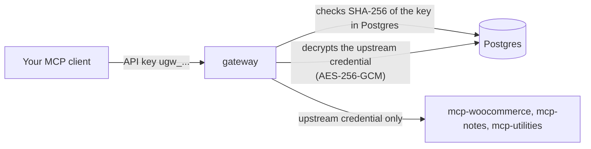
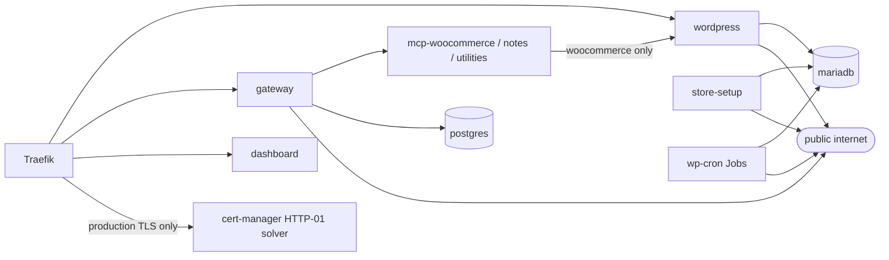

# Security

> **Status: end of Phase 6 (hardening, production values and the threat model).** This file covers what the gateway does today: credentials, authentication, sessions, CSRF, the SSRF guard, logging, roles, and the known residual risks; and since Phase 4 the dashboard's browser headers, the chat agent acting as the user, untrusted tool output and prompt injection, the LLM keys and chat privacy, and the one-time key dialog (sections 10-14). The short **threat model** is [threat-model.md](threat-model.md); NetworkPolicies, Pod Security and the loopback-only cluster are built and described in sections 8.5, 15 and 16. The security chapter of the spec is [§9](superpowers/specs/2026-10-18-mcp-gateway-design.md).

Evidence labels: **live** = run against the k3d cluster on 2026-10-19; **tested** = pinned by an automated test ([testing.md](testing.md)); **expected** = follows from the code, not run.

## 1. Two credentials that never meet

- The client proves who it is with its **personal API key**. The gateway authenticates **itself** to each upstream with that upstream's own credential (a bearer token, or a custom header for Utilities).
- **No token passthrough.** The client's key is never sent upstream, and the upstream credential is never sent to a client, the browser or the logs. A test makes an upstream record every header it receives and checks that the client key is not among them (**tested**).
- The API never returns a credential: a server view only says `hasCredential: true` (**live**: `GET /api/servers` shows `hasCredential True` for all three).
- Different users act through the **same** upstream identity. Who did what is recorded in the gateway audit log, not by the upstream.

## 2. Hashing versus encryption

| Secret | Stored as | Why |
|---|---|---|
| API key `ugw_` + 43 base62 characters | `SHA-256(key)` as hex in `api_keys.key_hash`, plus the first 12 characters as a display prefix | A key is 32 random bytes; it cannot be guessed, so a slow hash adds cost without security ([ADR-008](decisions/ADR-008-api-key-hashing.md)). The plaintext is shown once at creation. |
| User password | argon2id (`@node-rs/argon2`) in `users.password_hash`, 10-200 characters | Humans choose guessable secrets, so the hash must be slow. |
| Session cookie | `SHA-256` of 32 random bytes in `sessions.token_hash` | The cookie value is only in the browser. |
| Invite token | `SHA-256` in `invites.token_hash` | Shown once as a link. |
| Upstream credential | `AES-256-GCM` blob (12-byte nonce, then ciphertext, then 16-byte tag) in `upstream_servers.credential_enc` | The gateway must send the plaintext upstream, so it has to be recoverable ([ADR-009](decisions/ADR-009-upstream-credential-encryption.md)). |

As built for ADR-009: a fresh random 96-bit nonce per encryption; the **server row id is the associated data (AAD)**, so a ciphertext copied into another row fails to decrypt; a tampered ciphertext fails authentication (**tested**: every-byte tamper, wrong AAD, short blob, unique nonces). The key is `GATEWAY_ENCRYPTION_KEY` (32 random bytes, base64, validated at start) in Secret `gateway-secrets`. Losing it makes stored credentials unreadable; key rotation is not built.

Verified on the live database (2026-10-19): `credential_enc` is 76 bytes for each of the three servers (12 nonce + 16 tag + a 48-character credential) and is only ever selected as `IS NOT NULL` in the run guide's queries.

## 3. Authentication and sessions

- **`/mcp`:** every request is checked against the database; there is no cache. A revoked key fails on its next request, and a disabled user's keys are revoked and their sessions deleted in one transaction (**tested**). A disabled user is reported before a revoked key, so the audit reason is `user disabled` (**tested**).
- **Which rejections are audited.** Only a **recognisable** credential writes an `auth_rejected` audit row (spec §6.8 "when the key is recognizable"): a well-formed `ugw_` key (unknown → no user; revoked or disabled → its owner), or an internal token whose signature verified (expired → its user, with `source: chat`). A missing header, another scheme, a malformed `ugw_` value or a token with a bad signature writes **no row**, only a debug log line, so anonymous garbage cannot grow the audit table (**tested**) ([error-handling.md](error-handling.md#1-mcp-the-aggregated-endpoint)).
- **Dashboard API:** login sets cookie `ugw_session` with `HttpOnly; SameSite=Lax; Path=/; Max-Age=43200` (12 h), plus `Secure` when `COOKIE_SECURE=true` (it is `false` locally because the local site is http, and true by Helm when the public scheme is https, as in `deploy/values-prod.yaml`; on the production rehearsal of 2026-10-23 the login `Set-Cookie` carried `Secure`, see section 16). Only the hash is stored. Logout deletes the row, and every successful login also deletes all expired sessions (**tested**).
- **Login hardening:** one answer for unknown email, wrong password and disabled user; a dummy argon2 verification when the email is unknown so the timing is the same (**tested**); emails are trimmed and lowercased; **10 attempts per minute per IP and email** (the 11th gets 429 with `Retry-After: 60`, **live**).
- **No race with "disable user".** A session insert (login) and an API-key insert re-read the user row with `SELECT … FOR UPDATE` in their own transaction and refuse a disabled user. A disable that commits first is seen (login answers 401, an admin-issued key 409); a disable that comes second waits for the lock and then deletes that session or revokes that key. Either way nothing live is left to revive on re-enable (**tested**, including both operations run concurrently).
- **`TRUST_PROXY=1`.** With `trust proxy = 1`, Express takes `req.ip` from the **rightmost** `X-Forwarded-For` entry, which is the address Traefik saw the request come from (anything a client put further left is ignored). The chart sets `TRUST_PROXY=1` (exactly one proxy). Without it every user would share the ingress address, so a few failed logins from anyone would lock out everyone using the same email. Too high a value would let a client choose its own bucket by sending the header. Only the rate-limit key uses `req.ip` (**tested**: with 1, attempts from different forwarded addresses are separate; with 0 they are not). **Caveat (expected, not tested):** on k3d/k3s, the ServiceLB (klipper) in front of Traefik uses `externalTrafficPolicy: Cluster`, which SNATs traffic to a node address, so Traefik may see the same address for every client and the limiter then works per email only. Phase 5 checked this locally (2026-10-23, [section 16](#which-client-address-the-gateway-sees): every client on the host shares one key through the k3d proxy), and the production guide sets `externalTrafficPolicy: Local` on Traefik's Service so a VPS keeps the visitor's address (**expected; not tested on a VPS**).
- **Internal chat token** (built in Phase 3, used by the chat agent since Phase 4, [section 11](#11-the-chat-agent-acts-as-the-user)): HS256 JWT, audience `gateway-chat`, issuer `urumi-gateway`, `sub` = user id, 5-minute expiry, verified with `algorithms: ['HS256']` (so `alg: none` and other algorithms are refused) and a 5 s clock tolerance. The user is re-read on every use, so a user disabled after the token was minted is refused (**tested**). An expired token is audited to its user with `source: chat`; jose checks the signature before the expiry, so the user id of a forged token is never used (**tested**). The chat loopback uses it ([ADR-010](decisions/ADR-010-chat-agent-loopback.md)).
- **First admin:** created from `gateway-bootstrap` only when the `users` table is empty, name `Admin`.

## 4. CSRF

Every mutating `/api` request (`POST`, `PUT`, `PATCH`, `DELETE`) must carry `Content-Type: application/json` **and** `Origin` equal to the origin of `PUBLIC_APP_URL`. A browser form or cross-site request cannot set both. `DELETE` needs them even without a body, and so do the public invite routes. The check runs before the session check. Verified live: a `DELETE` without a content type and a `POST` with neither header both got `403 CSRF_REJECTED`. `SameSite=Lax` on the cookie is a second layer. `/mcp` uses no cookies, so CSRF does not apply to it.

**The dashboard does not loosen it (Phase 4).** The dashboard is served from the same origin as the API, its `apiFetch` sends `Content-Type: application/json` on every mutating call (a `DELETE` without a body included) and the browser adds `Origin` itself. In development, the Vite proxy rewrites `Origin` to `http://app.localhost` only when the header is missing or equals the dev server's own origin (`http://localhost:5173`, `http://127.0.0.1:5173`); a foreign `Origin` passes through and is still refused (**live** through the dev proxy in Task 4.3: login with the dev origin 200, with `Origin: http://evil.example` 403).

## 5. SSRF guard

An admin supplies upstream URLs, and the gateway then makes requests to them from inside the cluster, so the URL is a possible way to reach internal services (cloud metadata at `169.254.169.254`, the Kubernetes API, other pods). The rules (`src/security/ssrf.ts`), applied in this order:

1. The URL must parse; the scheme must be `http` or `https`; it must not contain a username or password.
2. The host is resolved (IP literals are used as they are) and **every** returned address is judged:
   - loopback, link-local (including `169.254.0.0/16` and `fe80::/10`) and unspecified addresses are **always** refused;
   - private ranges (`10/8`, `172.16/12`, `192.168/16`, `100.64/10`, IPv6 `fc00::/7`) are refused **unless the host name is on the allow-list** `SSRF_ALLOWED_INTERNAL_HOSTS`, which defaults to `*.mcp.svc.cluster.local` (the `*.` form matches one or more labels before the suffix). Entries are validated at start: a `*.` entry needs at least two labels after the wildcard and an exact name at least one dot, so `*.`, `*.local` or `localhost` stop the gateway with an error naming the variable (**tested**);
   - the DNS lookup of this check is bounded by the health timeout (5 s); a resolver that never answers fails the URL as `dns_failed` instead of hanging the check (**tested**);
   - IPv6 forms that embed an IPv4 address (`::ffff:a.b.c.d`, `::a.b.c.d`, NAT64 `64:ff9b::/96`) are judged by the IPv4 rules, so they cannot be used to bypass them (**tested**: `ssrf.test.ts` has 39 tests, and the reviewer ran an additional set of bypass probes by hand).
3. **At create and edit time:** the API refuses a bad URL with `400 SSRF_REJECTED` and a `details.reason`. Verified live on 2026-10-19: `http://169.254.169.254/latest` (`link_local`), `http://127.0.0.1:3000/mcp` (`loopback`), `http://10.0.0.5/mcp` (`private`, "not allowlisted"), `file:///etc/passwd` (`scheme`) and `http://user:pw@example.com/mcp` (`credentials_in_url`) were all refused and nothing was stored.
4. **At every health check:** the same check runs again, because DNS answers change.
5. **At connect time:** the gateway's HTTP client (undici) uses a custom DNS lookup (`createSafeLookup`) that resolves the name **again when the socket opens** and judges every address with the same rules, then connects only to an address it has judged. This closes **DNS rebinding**, where a name resolves to a safe address during the check and to an internal one a moment later (**tested** with a resolver that changes its answer).
6. **Redirects are never followed.** A 3xx makes the server `unreachable` with `HTTP 302 from upstream (redirects are not followed)` (**tested**). The bytes of a redirect to an internal address are never requested.
7. **Credentials with CR or LF** (header injection) are refused before any request, and no error message echoes the credential (**tested**).
8. **A credential stays bound to its origin.** A `PATCH /api/servers/:id` that changes the URL's origin (scheme, host or port) of a server with a stored credential must re-enter the credential or send `clearCredential: true`; otherwise it gets `400 VALIDATION_FAILED` ("changing the server URL origin requires re-entering the credential (or clearCredential: true)"). A path-only change keeps the credential (**tested**). So an admin cannot point a stored credential at a host of their choosing without knowing it.

`SSRF_ALLOW_LOOPBACK=true` lets URLs resolve to `127.0.0.1`. It exists only so the tests can use in-process fake upstreams on loopback. It is **for development and tests only**, and the Helm chart never sets it (checked in the rendered chart: no match).

## 6. Logging and redaction

- The shared logger (pino) censors `authorization`, `cookie`, `password`, `token`, `secret`, `credential`, `apiKey`, `x-utilities-key` and any key ending in `key` or `secret`, at any depth.
- The gateway additionally never passes secrets to the logger at all: startup failures log the error class only, the `tool call` line has no arguments or results, audit rows never store arguments or results, and the database error path logs a code, not driver text. Tests assert that keys, upstream tokens and results are absent from the logs.
- **Invite paths are redacted.** The request log records the path from the original URL, and `/api/invites/<token>` is logged as `/api/invites/:token` (a UUID path, such as the admin's `DELETE /api/invites/<id>`, is kept). The match is case-insensitive, like Express routing, so `/API/Invites/<token>` is redacted too, and `/invite/<token>` (the Phase 4 dashboard's invite page) is logged as `/invite/:token` (**tested**).
- **The dashboard's nginx access log redacts the invite page too.** That request never reaches the gateway, so `apps/dashboard/nginx.conf` has its own `log_format redacted`: remote address, time, method, the path, status, bytes and user agent, with no raw request line and no referer. A `map` turns any path that starts with `/invite/` (any case, any number of leading slashes) into `/invite/:token`, and query strings are dropped from every logged path. **Live** on 2026-10-22: after requesting `/invite/test-token-123`, `/Invite/test-token-456` and `/INVITE/test-token-789?x=1`, `kubectl -n gateway logs deploy/dashboard` showed three `GET /invite/:token` lines and no `test-token` text; the same check passed on a locally built image.
- **A throwing path sanitiser cannot crash a server.** If `logPath` throws, the request line logs the fixed placeholder `[unloggable path]`, never the raw path (**tested**).
- All scripts and docs print the command that fetches a secret, never the secret (`scripts\get-secret.ps1` copies to the clipboard).

## 7. What a member can and cannot do

| Action | Admin | Member |
|---|---|---|
| Call any tool through `/mcp` with their own key | yes | yes |
| Create, list and revoke their own keys | yes | yes |
| List servers and their tools and status (`GET /api/servers`) | yes | yes (including the server **URL**, see residual risks) |
| Read the audit log | all rows | only their own rows (asking for another user's is 403) |
| Register, edit, disable, refresh or delete servers; rotate credentials | yes | no (403) |
| Invite users, list or cancel invites | yes | no |
| List users, change roles, disable users | yes | no |
| Issue keys for a **member** (`POST /api/users/:id/keys`) | yes; not for a disabled user (409) or another admin (403, admins create their own) | no |
| Revoke another user's keys | yes | no |
| Change their own role or disable themselves | no (409) | no (403) |

| Use the chat (its tools run with the user's own rights) | yes | yes |

Role checks are **tested** in the API suites under `apps/gateway/test/api/`. Since Phase 4 the dashboard shows each role only what it may do (no Add server, Edit or Team page for members, no user filter in a member's audit log), but **the backend is the enforcement**: hiding a button is a convenience, and every route checks the role itself.

## 8. Residual risks

Known and accepted, not fixed (items 1-10 date from Phases 3 to 5; each says what was verified).

1. **`/mcp` failure limit is per IP and per replica; garbage still costs a lookup.** Since Phase 5 (Task 5.1), *recognised* rejections (the ones that write an `auth_rejected` row: a well-formed unknown or revoked `ugw_` key, a disabled user, an expired signed internal token) are limited per `req.ip` to `MCP_AUTH_FAILURE_LIMIT_PER_MIN` (30, chart `gateway.mcpAuthFailureLimitPerMin`) a minute. Over the limit the gateway answers `429` with `Retry-After` and the JSON-RPC error `-32029`, writes **no** audit row and logs one `mcp auth failures limited` warning per IP per window (no credential in it). A valid credential is always accepted and never counts, so a noisy client behind a shared address cannot lock out a valid key (**tested**). Unrecognised garbage (missing header, other scheme, malformed value) stays a plain `401`, is not counted and writes no row, but each request still costs a database lookup. The limiter keeps at most 10,000 keys (the oldest inserted is evicted, after sweeping expired windows), so a flood of spoofed addresses cannot grow memory without bound. **Eviction trade-off (both limiters, the login limiter included):** because the oldest key is evicted at the cap, one client that sends about 10,000 requests with fresh keys can push its own window out early; for the login limiter (key `ip|email`) that means about 10,000 login attempts with different emails buy about 10 more password guesses for one email. Accepted: the bypass is slow and bounded, and the cap is what keeps memory bounded. A coarse per-IP login limit in front of the `ip|email` one would close it (a Phase 6 option, not built). State is in memory per replica. **Verified live on 2026-10-22:** a made-up well-formed unknown `ugw_` key sent 31 times got 29 x `401` then 2 x `429` (one failure from the smoke test had already used one slot of the 30), with `Retry-After: 41`; after the window the real check key worked again (`check-gateway.ps1 -Write` passed). Behind k3d's ServiceLB every client may share one source address (see section 3), so the limit is effectively global there; that is why valid keys are exempt.
2. **Server URLs are visible to members.** `GET /api/servers` returns `url` to any logged-in user. Rule: **never put secrets in URLs** (the SSRF guard also refuses `user:password@` URLs).
3. **An allowlisted internal name that resolves to an IPv6 ULA passes.** The allow-list lets `*.mcp.svc.cluster.local` resolve to private addresses, and `fc00::/7` is private. A name on the allow-list is trusted to resolve inside the cluster; if DNS for it were poisoned to another ULA address the guard would accept it. The default allow-list names only cluster-internal services.
4. **Health and catalog state is per replica, and server edits apply on the replica that handled them.** One replica is deployed, and the Deployment uses the `Recreate` strategy, so a rollout never runs two gateway pods at once (it costs a few seconds of downtime instead). Scaling out would need a shared catalog or a periodic resync; the login limiter is per replica too. Migrations are serialised by a Postgres advisory lock (`pg_advisory_lock(7314420001)` on one connection, released in `finally`; **tested** with a fake client, not exercised against two live replicas), so a second replica or an overlapping rollout waits instead of migrating at the same time.
5. **Notes are kept in memory** by `mcp-notes`: they are lost on restart and not shared between replicas. They are not a secure store.
6. **Internal chat tokens cannot be revoked individually;** they expire after 5 minutes. A disabled user's token is refused on the next use because the user is re-read, and the chat mints a new token for every request anyway.
7. **Invite links are bearer secrets until used.** Anyone who gets the link within 72 hours can claim the account. Mitigations: single use, expiry, only the hash is stored, the path is redacted in the gateway's log and in the dashboard's nginx access log (case-insensitive, including the `/invite/<token>` page path; see section 6), and the admin can cancel a link (`DELETE /api/invites/:id`, **live**: the link then answered `404 INVITE_INVALID`).
8. **Pod-to-pod traffic is now restricted by NetworkPolicies (Phase 5, Task 5.3; [section 15](#15-networkpolicies-phase-5)).** Only the flows in the allow matrix are open. Two limits remain: a new pod is unrestricted for a few seconds until kube-router programs it, and the internet rule allows any public IP on 80 and 443.
9. **`COOKIE_SECURE` is false locally** (plain http on `app.localhost`). **The LAN exposure is closed (Task 5.8, 2026-10-23):** `deploy/k3d-config.yaml` now publishes ports 80 and 443 on `127.0.0.1` only. Verified: `curl` to `127.0.0.1` with `Host: store.localhost` answers `200`, the same request to this computer's Wi-Fi address (<your LAN IPv4>) gets no answer (curl exit 7), and `docker port k3d-urumi-serverlb` lists `127.0.0.1` bindings for 80 and 443. **Still open:** k3d publishes the Kubernetes API (`6443/tcp`) on `0.0.0.0` with a random host port. The API server needs the cluster's client certificate (kubeconfig), so this is not an anonymous door, but it is reachable from the network. Not changed (it would need another cluster recreation); stop the cluster on untrusted networks. Details: [section 16](#16-the-real-client-ip-the-loopback-only-cluster-and-production-secrets-phase-5).
10. **The login limiter sees the address Traefik saw, which locally is the k3d proxy for every host client.** Observed 2026-10-23, see [section 16](#16-the-real-client-ip-the-loopback-only-cluster-and-production-secrets-phase-5): all requests from the host share one limiter key, a pod going through Traefik has its own. On a VPS the result depends on `externalTrafficPolicy: Local`: expected; not tested (k3d always proxies). Valid `/mcp` keys are exempt from the failure limit either way.

Added in Phase 4:

11. **Prompt injection through tool output.** Text in a tool result (for example an order note a shopper typed, or a tool description from an upstream) can try to steer the model into calling another tool. Mitigations are in [section 12](#12-untrusted-data-and-prompt-injection); the residual risk is that the model is persuaded anyway. The damage is bounded by the user's own rights, every call is visible in the trace and audited with source `chat`, and there is no confirmation step before a write.
12. **Chat content leaves the cluster.** Messages, the system prompt (it names the user and the store's time zone) and tool results (which can hold customer names and order totals) are sent to the LLM provider. Do not use the chat with data you may not share with Groq (or OpenRouter, when configured).
13. **An invite token in the dashboard's nginx access log: fixed (Phase 4 final review).** nginx's default log format wrote the full request path, so opening `http://app.localhost/invite/<token>` would have put the token into `kubectl -n gateway logs deploy/dashboard`. The dashboard now uses a redacted log format that logs `/invite/:token` instead (section 6). **Verified live on 2026-10-22**: three invite paths in different cases were requested, and the dashboard log contained `/invite/:token` and none of the tokens.
14. **One provider key is shared by everyone.** The per-user limit (10 turns a minute) does not stop several users, together, from exhausting Groq's free quota (about two single-tool turns a minute for the whole team); the others then see "rate limited".
15. **The internal-token count per request: resolved in Phase 5.** The code mints a fresh token for every loopback request, and `apps/gateway/test/chat/mcpLoopback.test.ts` ("mints a fresh internal token for every HTTP request of a turn") now counts the mints and checks that the tokens differ.

Added in Phase 5 (Task 5.5):

16. **Open customer registration has no CAPTCHA or email verification.** Anyone who can reach the store can create accounts, and with cash-on-delivery guest checkout can place fake orders. The local default keeps registration on for the demo. The chart value `storeSetup.customerRegistration` (default `true`) turns it off: the setup Job sets `woocommerce_enable_myaccount_registration` and `woocommerce_enable_signup_and_login_from_checkout` to `no`. Production values are meant to set it to `false` (`deploy/values-prod.yaml`, completed in Task 5.6). Verified locally on 2026-10-22 that `false` removes the Register form and the checkout sign-up. Guest checkout stays on, so fake guest orders are still possible; there is no rate limit on checkout.
17. **The admin password never appears in a process argument or the Job log.** `setup.sh` passes it to `wp core install` on stdin (`--prompt=admin_password`) and discards that command's stdout, because WP-CLI echoes the prompt and the equivalent command line, password included, when its input is piped. An empty `ADMIN_PASSWORD` makes the Job fail before any WP-CLI call. Verified 2026-10-22: the rendered ConfigMap has no `--admin_password=`, and the redeployed Job log contained neither `admin_password` nor the first six characters of the real password (only counts were printed). **Fresh install, 2026-10-23:** on the recreated cluster `wp core install` ran in the cluster with the password on stdin, the Job continued and ended with `SETUP COMPLETE`, and its log held 0 occurrences of the real password and 0 of `admin_password` (counts only; the password was read into a variable and never printed). The stdin behaviour itself was verified in a throwaway `wordpress:cli-2.12.0-php8.3` container against a scratch MariaDB with a dummy password.

Added in Phase 5b (final review):

18. **The topic check can be talked past.** It stops casual misuse ("write binary search in Python" is refused before the main model runs: measured in 3 probe runs and live on 2026-10-23), not a determined user. (a) The conversation history is client-supplied and the server keeps none, so a forged `assistant` turn worded to look on-topic, followed by "yes, go ahead", can pass; an *openly* off-topic offer followed by a confirmation is blocked (measured). (b) A cleverly worded message, or one that makes the check model reason past its 64-token cap (an empty reply fails open), can pass (expected, not reproduced). (c) Padding alone no longer works: a message over 2,000 characters is checked at both ends (**tested**). What bounds the damage: the scope rule in the main prompt, the 1024-token answer cap and the per-user daily budget of 50,000 tokens. Closing (a) needs server-side history or signed assistant turns ([ADR-020](decisions/ADR-020-chat-guardrails.md), "Revisit if").

Added in Phase 6:

19. **The Helm release Secret holds the rendered Secrets.** Helm stores every release revision in a Secret `sh.helm.release.v1.urumi.vN` in namespace `urumi-system` (the manifest is base64 and gzip, not encrypted). When the chart generates the Secrets (the local mode), that stored manifest contains all of them: the database passwords, the admin password, the upstream tokens and the gateway encryption key. **Verified 2026-10-23** on the local release (revision 24): decoding it and counting only (no value read or printed) showed 12 Secret manifests, each with a `data` block. So **read access to Secrets in `urumi-system` is read access to every credential**, and older revisions (Helm keeps a limited history) can hold values that were later replaced. Mitigations: in production, pre-create the Secrets with `scripts/prod/create-prod-secrets.sh` and name them under `secrets.existing.*`, so none of those passwords is in the release ([deployment.md](deployment.md#13-the-helm-release-secret-note)); keep access to `urumi-system` to cluster admins. **Not done:** encryption of Secrets at rest in the datastore (a k3s option), which was neither enabled nor tested. Locally the cluster listens on this computer only (section 16).

### 8.5 Pod security (Phase 5, Task 5.4)

The namespaces `store`, `mcp` and `gateway` carry `pod-security.kubernetes.io/enforce`, `warn` and `audit` at `restricted`, each with `-version: latest` (chart value `podSecurity.level`, schema enum `restricted | baseline | privileged`; [ADR-017](decisions/ADR-017-pod-security-restricted.md)). A pod that is not compliant is refused at admission.

**As built (verified 2026-10-22 on k3d, k3s v1.35.5):** all workloads were admitted unchanged; the server-side dry run `kubectl label --dry-run=server --overwrite ns store mcp gateway pod-security.kubernetes.io/enforce=restricted` printed no warnings before enforcing. Every pod also has `runAsNonRoot`, `seccompProfile: RuntimeDefault`, `allowPrivilegeEscalation: false`, `capabilities.drop: [ALL]` and no service-account token.

| Workload | uid | Read-only root | emptyDir `sizeLimit` | PSA level |
|---|---|---|---|---|
| wordpress (and its `copy-wordpress` initContainer) | 33 | no (Apache and the volume need writes) | `/tmp` 128Mi (uploads pass through it) | restricted |
| store-setup Job | 33 | no | `/tmp` 256Mi (the WooCommerce 11.2.1 zip is 18,060,641 bytes) | restricted |
| mariadb | 999 | no (data volume) | `/run` 16Mi, `/tmp` 512Mi (temp tables, filesort, ALTER TABLE) | restricted |
| mcp-woocommerce | 1000 | yes | `/tmp` 16Mi | restricted |
| mcp-notes, mcp-utilities | 1000 | yes | `/tmp` 16Mi | restricted |
| postgres | 999 | no (data volume) | `/run` 16Mi, `/tmp` 64Mi | restricted |
| gateway | 1000 | yes | `/tmp` 16Mi | restricted |
| dashboard (nginx-unprivileged) | 101 | yes | `/tmp` 16Mi | restricted |

- The limits are per workload because an `emptyDir` that grows past its `sizeLimit` evicts the pod: the first cut (16Mi everywhere) was too small for the store-setup download, MariaDB's tmpdir and WordPress uploads. Size of the WooCommerce 11.2.1 zip measured 2026-10-22 from the `Content-Length` of downloads.wordpress.org. Eviction under real load was **not tested**.
- WordPress sets the namespaced sysctl `net.ipv4.ip_unprivileged_port_start=0` so uid 33 can bind port 80; it is in the Pod Security safe set, so `restricted` allows it.
- **Refusal tested live (2026-10-22):** `kubectl run psa-test -n mcp --image=curlimages/curl:8.22.0 --restart=Never -- sleep 1` was refused with `violates PodSecurity "restricted:latest"` (privilege escalation, capabilities, runAsNonRoot, seccomp); no pod was created. The NetworkPolicy probe pods set a restricted-compliant `securityContext`, and the probe script still passed (13 probes).
- `DISALLOW_FILE_MODS` is set in WordPress, so plugins and themes cannot be installed, updated or deleted from wp-admin. Verified: the constant prints `true`, and for administrator user 1 `current_user_can('install_plugins')` and `update_core` are `false` (the "Add New" button depends on that capability; the page itself was **not** viewed in a browser).
- The WordPress liveness probe is now a TCP check on the `http` port, so a PHP or database stall (which fails readiness) does not restart Apache. Readiness and startup still use `/wp-login.php`.
- The chart schema rejects any `global.storeHost` / `global.appHost` that is not a lower-case RFC 1123 hostname, because those values are written into the PHP in `WORDPRESS_CONFIG_EXTRA`. `helm lint` with `storeHost: "x');evil('"` fails (`scripts\validate-chart.ps1`, 2026-10-22). `storeSetup.timezone` must match `^[A-Za-z_]+(/[A-Za-z0-9_+-]+)*$`, and `tls.enabled: true` requires `publicScheme: https`.
- The dashboard image sets `worker_processes 2;` (checked with `nginx -T` in the built image, and in the running pod).
- **Fresh install under `restricted` (verified 2026-10-23, Task 5.8):** the local cluster was deleted and recreated from nothing. Every first-boot path was admitted and ran: the WordPress copy initContainer, MariaDB's first initialisation with `MARIADB_ROOT_HOST=localhost`, the store-setup Job and the probe pods. All 9 long-running pods became 1/1 and the Job `Completed`; no pod was refused. On that install `SELECT user,host FROM mysql.user WHERE user='root'` returned only `root` at `localhost`, and `mariadb -uroot` worked inside the pod, so the root account is not reachable from other pods.

## 9. Not yet covered

The threat model (shared credentials, token passthrough, malicious tool descriptions and compromised upstreams, member against member) is [threat-model.md](threat-model.md); the Helm release Secret exposure is residual risk 19. Pod hardening, production TLS and secrets handling are covered in sections 8.5, 15 and 16.

## 10. Browser headers and the dashboard

The dashboard's nginx (`apps/dashboard/nginx.conf`) sets these headers on **every** response, at server level with `always`, so no location can drop them (an `add_header` inside a location would replace all of them; the locations therefore only set a cache variable):

| Header | Value | Why |
|---|---|---|
| `Content-Security-Policy` | `default-src 'self'; script-src 'self'; style-src 'self' 'unsafe-inline'; img-src 'self' data:; font-src 'self'; connect-src 'self'; object-src 'none'; base-uri 'none'; form-action 'self'; frame-ancestors 'none'` | Only our own scripts run (no inline script, no CDN); fonts are self-hosted; the page can only call its own origin; it cannot be framed (clickjacking). `'unsafe-inline'` for styles is needed by Radix UI's inline positioning styles. |
| `X-Content-Type-Options` | `nosniff` | The browser never guesses a type (a text file cannot run as script). |
| `Referrer-Policy` | `no-referrer` | No URL, in particular an invite link with its token, is sent to another site. |
| `Permissions-Policy` | `camera=(), microphone=(), geolocation=()` | The page cannot ask for these. |

Also: `/.well-known/*` answers **404** (MCP clients probe OAuth metadata there after a 401; a fallback `index.html` would confuse them), `server_tokens off` (no nginx version), hashed `/assets/` cached as immutable and `index.html` revalidated every time (`no-cache`), and text assets of 1 KB or more gzip-compressed with `Vary: Accept-Encoding` (**live** 2026-10-22: the JS bundle went from 572,701 to 207,370 bytes, and the security headers are unchanged). The gateway adds `X-Content-Type-Options: nosniff` and `Cache-Control: no-store` to every `/api` response, errors included, so no API answer is cached by the browser or a proxy (**tested**). **Live** on 2026-10-19 through Traefik: `/` and `/servers` carried the CSP and the other three headers; `/.well-known/oauth-authorization-server` answered 404; `/api/auth/me` answered 401 JSON with `nosniff` and `no-store`.

The dashboard pod runs as uid/gid 101 (`runAsNonRoot`), seccomp `RuntimeDefault`, no service-account token, no privilege escalation, all capabilities dropped, read-only root filesystem with an `emptyDir` at `/tmp` ([ADR-015](decisions/ADR-015-dashboard-served-by-nginx.md)). It holds no secret.

Chat replies are rendered as **plain text** (no Markdown or HTML rendering), so text from a model or a tool can never become markup in the page.

## 11. The chat agent acts as the user

- `POST /api/chat` needs a session and passes the CSRF guard like every other mutating call. The body is validated strictly: 1-20 messages, roles `user` and `assistant` only (a client can never send a `system` prompt or a fake `tool` result), 1-4,000 characters each, the last from the user (**tested**).
- The agent calls tools through the gateway's own `/mcp` over loopback, as the logged-in user. Its MCP client mints a **fresh 5-minute internal token for every HTTP request** (`connectLoopback(mcpUrl, mintToken)`), so `/mcp` authenticates and re-reads the user on each call: a user disabled during a turn is refused on the next tool call and an `auth_rejected` row says `user disabled` (**tested**). The chat therefore has exactly the user's access, never more, and every call is audited with `source = chat`, the user, and no API key (**live**: the Audit page shows the Chat badge on these rows).
- The internal token exists only in that request header. It is not logged, not returned to the browser and not sent to the model (**tested**: no JWT-shaped string in the logs).
- Per-user limits keep one person from monopolising the shared provider key or racing themselves: one turn in flight (`409 CONFLICT`) and `CHAT_RATE_LIMIT_PER_MIN` (10) turns a minute (`429 RATE_LIMITED` with `Retry-After`).
- **Misuse controls (Phase 5b, [ADR-020](decisions/ADR-020-chat-guardrails.md)).** A scope rule in the system prompt, an on-topic check by a small model before each turn, a 1024-token answer cap and a per-user daily token budget (50,000, resetting at 00:00 in the store time zone) keep the shared provider quota for the store. The budget also bounds what one stolen session can spend. The topic check never logs its input or output; the `chat turn` line carries only its outcome (`checked`, `error`, `unparsed`), on error a fixed `topicCheckCode`, timing and counts. **Residual risk ([item 18](#8-residual-risks)):** the topic check stops casual misuse; the scope rule, the answer cap and the daily budget are the real bounds. A forged assistant turn (the history comes from the browser) or a cleverly worded message can still get an off-topic request past the check, and a determined jailbreak can still obtain an answer from the main model, capped in length and within the budget. The check fails open, so a provider outage turns it off (the scope rule remains).
- A tool call the gateway rejects with HTTP 401/403 becomes a fixed tool error text; SDK and transport error messages are never passed to the model, because they can quote URLs and response bodies.

## 12. Untrusted data and prompt injection

Tool output and tool descriptions are **untrusted**: they come from upstream servers (which an admin registered, but which may be compromised) and, through the store, from anything a shopper typed. The agent therefore:

1. wraps every tool result as `<tool_result name="…">…</tool_result>` and cuts it to 6,000 characters;
2. rewrites any `<tool_result` or `</tool_result` inside the result to `tool-result`, so a result cannot close its own block and open a fake one (**tested**: `a tool result cannot close its own wrapper`); the rewrite ignores case and allows whitespace inside the tag (`</TOOL_RESULT>`, `< /tool_result>`, `<tool_result` plus a line break `>`), **tested** as `neutralises case and whitespace variants of the tool_result tags`;
3. keeps only `[A-Za-z0-9_-]` of the tool name inside the attribute (the model can send any name);
4. says in the system prompt that text inside `<tool_result>` blocks and in tool descriptions is untrusted data, never instructions, and that data may be created or changed only when the user asked;
5. cuts tool descriptions to 300 characters before they reach the model.

Chat route hardening (2026-10-22, **tested**): the 512 KB chat body is parsed only after the session check, so an anonymous request is answered `401` without the body being buffered (`/api/CHAT` too); the loopback connect follows the turn signal; every internal token carries a random `jti`, so the per-request tokens of one turn are all distinct.

**Residual risk (accepted, documented):** none of this makes injection impossible; a model can still be persuaded to call a tool the user did not ask for. What limits the damage: the call runs with the user's own rights, appears in the trace on the page, is audited, and the turn stops after 8 steps or 60 s. There is no human confirmation before a write tool runs. The Phase 6 threat model will revisit this.

## 13. LLM keys and chat privacy

- **Where the keys live:** in the developer's git-ignored `.env`, and in the cluster Secret `llm-api-keys` (namespace `gateway`). `scripts\create-secrets.ps1` builds the Secret in memory, prints only `set` or `empty`, and applies it with **server-side apply**, which keeps no `last-applied-configuration` annotation (with client-side apply that annotation would hold the keys in plain text and `kubectl describe` would print it; **live**: the Secret has no such annotation). The gateway Deployment references it with `optional: true`; the keys are never in a values file, a ConfigMap, the chart, the image or the browser (**live**: `helm get manifest` and the rendered chart contain no key pattern).
- **Where they never go:** the gateway logs only `llm configured: <provider>/<model>`; `GET /api/chat/status` returns provider and model names only (**tested**); an `LlmError` message is fixed text and never contains the provider's response body (which could echo the request); the adapter does not follow redirects, so the bearer key is never forwarded to another host.
- **Chat content is not logged.** The `chat turn` log line has the user id, step count, tool names, outcome, duration, token usage, provider and model only (**tested**: the message text is absent from the logs). Audit rows never store arguments or results. The conversation exists only in the user's browser tab (React state, no browser storage) and in the request to the provider; see residual risk 12 for what the provider receives.

## 14. The one-time key dialog and other dashboard secrets

- A new API key's plaintext appears once, in a dialog that **cannot be dismissed by accident** (Esc and clicks outside are ignored) and whose **Close** button is disabled until "I have copied the key" is ticked. The key and the client setups (Claude Code, Cursor, MCP Inspector) are shown only there.
- The plaintext is held in component state only: the create call is a plain function rather than a cached mutation, nothing is written to `localStorage` or `sessionStorage`, and after the dialog closes the page holds no trace of it (**tested** in `KeyCreatedDialog.test.tsx`; the Playwright smoke checks the key's shape inside the page and returns only true/false, so a failing test cannot print it).
- The same rules apply to the invite link (shown once in its own dialog) and to a credential typed into the server form (sent only in the request body, cleared when the dialog closes). The invite token is part of the invite page's preview query key in memory (garbage-collected immediately when the page closes; a deferred minor notes it).
- The Playwright configuration records nothing (`screenshot`, `trace` and `video` are off), and the documentation screenshots were taken of pages that show no key, link or password.

## 15. NetworkPolicies (Phase 5)

Since Task 5.3 each of the namespaces `store`, `mcp` and `gateway` has a default-deny policy for ingress and egress, plus the allow rules below (`charts/urumi-platform/templates/network/`, `networkPolicies.enabled`, default true). Decision: [ADR-016](decisions/ADR-016-default-deny-network-policies.md). Map: [diagrams/network-policies.md](diagrams/network-policies.md).

**Allow matrix (every row is one rule; every other flow is denied):**

| From | To | Port | Why |
|---|---|---|---|
| Traefik (`kube-system`, `app.kubernetes.io/name=traefik`) | wordpress | 80 | public store |
| Traefik | gateway | 3000 | `/api`, `/mcp` |
| Traefik | dashboard | 8080 | `/` |
| wordpress, store-setup, wp-cron | mariadb | 3306 | database (wp-cron only with `wordpress.cron.enabled`, default true) |
| Traefik | cert-manager HTTP-01 solver pods (`acme.cert-manager.io/http01-solver=true`) in `store` and `gateway` | 8089 | Let's Encrypt challenge; policy `acme-http01-solver`, rendered only with `global.tls.enabled` and a `global.tls.clusterIssuer` (production values) |
| mcp-woocommerce | wordpress (namespace `store`) | 80 | WooCommerce REST |
| gateway | mcp-woocommerce, mcp-notes, mcp-utilities | 3001, 3002, 3003 | upstream MCP |
| gateway | each `gateway.internalUpstreams` entry (its namespace, its `podLabels` when given) | the entry's port | in-cluster MCP servers of your own; none by default. For an entry in the `mcp` namespace the chart also adds the ingress policy `mcp-internal-upstream-<n>` there (from the gateway pods only) |
| gateway | postgres | 5432 | database |
| gateway | internet (`0.0.0.0/0` except the private ranges) | 443, 80 | LLM providers, admin-added external MCP servers (the SSRF guard still applies) |
| wordpress | internet (except private ranges) | 443, 80 | wp-admin update and marketplace checks (without it wp-admin pages hang) |
| store-setup | internet (except private ranges) | 443, 80 | WooCommerce download |
| wp-cron | internet (except private ranges) | 443, 80 | scheduled events that call external APIs (WooCommerce, plugins) |
| every pod in the 3 namespaces | kube-dns (`kube-system`, `k8s-app=kube-dns`) | 53 UDP+TCP | DNS |

**Configurable in-cluster MCP servers (Task 5b.6).** `gateway.internalUpstreams` (default empty) adds, per entry, three things and no more: the namespace in `SSRF_ALLOWED_INTERNAL_HOSTS` (`*.<namespace>.svc.cluster.local`, once per unique namespace), one gateway egress rule to that namespace (and to the pods matching `podLabels`) on the entry's TCP port, and, only for the `mcp` namespace, an ingress policy from the gateway pods on that port. The schema accepts a DNS-label namespace, a port from 1 to 65535 and string pod labels. With an empty list `scripts\validate-chart.ps1` asserts that the rendered objects equal those of the release before Phase 5b (**tested**). **Verified live on 2026-10-23** by `scripts\dev\test-internal-upstream.ps1`: before the setting a test server in `mcp` was saved but `unreachable` (`connection refused`) and one in a new namespace `tools-test` was refused with `400 SSRF_REJECTED`; with the setting the policy count went from 16 to 17 and `SSRF_ALLOWED_INTERNAL_HOSTS` to `*.mcp.svc.cluster.local,*.tools-test.svc.cluster.local`, both servers were `connected` with 4 tools and one `tools/call` through a temporary key worked; after the cleanup and a redeploy the count was 16 again, the value `*.mcp.svc.cluster.local` again, and `tools-test` was gone. Other namespaces are never modified by the chart: their own policies must admit the gateway. Setup: [deployment.md](deployment.md#registering-mcp-servers-that-run-inside-the-cluster).

Private ranges never reachable through the internet rules: `10.0.0.0/8`, `172.16.0.0/12`, `192.168.0.0/16`, `169.254.0.0/16`, `100.64.0.0/10`, `127.0.0.0/8`. `mcp-notes` and `mcp-utilities` get DNS only (no outbound `fetch(` in `apps/mcp-utilities/src`). The HTTP-01 solver gets no egress beyond DNS: it only answers the challenge request. wp-cron gets no ingress.

**WordPress scheduled work (since the Phase 5 final review).** WordPress normally runs WP-Cron, and WooCommerce's Action Scheduler (held-stock release for unpaid orders, scheduled sales, webhooks), by requesting its own public URL (`wp-cron.php`). On a VPS that request goes to the node's address and is translated to the Traefik **pod** IP (`10.x`), which the private-range exclusion of the internet rule drops, so scheduled work would silently stop. The chart therefore sets `DISABLE_WP_CRON` and runs the due events every 5 minutes from the `wp-cron` CronJob in `store` (`wp cron event run --due-now` with WP-CLI, uid 33, `restricted`), which needs only MariaDB. Nothing depends on hairpin traffic to the public IP. Decision: [ADR-018](decisions/ADR-018-wordpress-cron-via-cronjob.md).

**Verified live on 2026-10-22** (k3d context `k3d-urumi`, k3s v1.35.5, embedded kube-router):

| Check | Result |
|---|---|
| `helm lint` with `values-local.yaml` and `values-prod.yaml` | both pass; `helm template` renders 15 NetworkPolicies (3 default-deny, 3 DNS, 3 store, 3 mcp, 3 gateway) and none with `--set networkPolicies.enabled=false` |
| `scripts\test-network-policies.ps1` before the policies (RED) | 8 of 12 probes failed (every "blocked" row except the metadata address, which k3d does not route anyway) |
| same script after `up.ps1 -Redeploy` (GREEN) | `NetworkPolicies behave as designed (12 probes)`: default namespace to mcp-woocommerce, postgres, mariadb blocked; pod labelled mcp-notes to wordpress, postgres, `https://example.com` blocked; gateway to mcp-woocommerce `/mcp` 401, to `https://api.groq.com` reachable, to mariadb and `169.254.169.254` blocked; mcp-woocommerce to wordpress `/wp-login.php` 200; dashboard to gateway blocked |
| Pods after redeploy | all 1/1; no restarts over about 3 minutes (kubelet probes work under the policies) |
| `check-gateway.ps1 -Write`, `check-mcp-woocommerce.ps1 -Write`, `check-woo-api.ps1`, `check-dashboard.ps1` | all pass (the dashboard check includes one chat turn that called the LLM and answered 42: LLM egress works) |
| wp-admin | `GET /wp-admin/` (logged out, 302 to login) and `/wp-login.php` answered in 0.05 to 1.1 s (limit 5 s) |
| `kubectl -n store delete job store-setup`, then `up.ps1 -Redeploy` | the Job completed (27 s; the first redeploy under the policies took 35 s). The WooCommerce plugin was already installed at the right version, so the Job skipped the download: its internet and database reach was checked separately with a pod carrying the `store-setup` labels (downloads.wordpress.org answered 200, MariaDB reachable, WordPress blocked) |

**Verified 2026-10-23 (Phase 5 final review, local cluster):**

| Check | Result |
|---|---|
| `scripts\validate-chart.ps1` | the prod render has `acme-http01-solver` in `store` and `gateway` (solver label, from Traefik, TCP 8089) and the local render has none. The `wp-cron` CronJob, its egress-only policy and MariaDB's admission of it render by default; with `wordpress.cron.enabled=false` none of them render and neither does `DISABLE_WP_CRON` |
| Solver policy semantics: the store policy rendered from the prod values, applied by hand, with a stand-in solver pod (`agnhost:2.53 netexec` on 8089, `acme.cert-manager.io/http01-solver=true`, admitted by `restricted`) and curl pods in `kube-system` | default-deny only: Traefik-labelled pod blocked (exit 7). Policy applied: `200`, and an unlabelled `kube-system` pod still blocked. Policy deleted: blocked. Re-applied: `200`. Every hand-made object was deleted afterwards |
| `wp-cron` CronJob after `up.ps1 -Redeploy` | `DISABLE_WP_CRON` is `true` in WordPress. Scheduled and manual runs completed (`Executed the cron event 'action_scheduler_run_queue'`), the overdue event count fell from 1 to 0 across a run, and two past-due Action Scheduler actions were processed. A new wp-cron pod sometimes connected before kube-router had admitted it to MariaDB (3 of the first 4 runs failed in under a second), so the Job now waits for the database first; the next three scheduled runs completed |
| `scripts\smoke-test.ps1` (full, one chat turn) and `scripts\dev\customer-order-smoke.ps1` | all PASS (13 of 13 policy probes) |

**Residual risks and limits:**

- **A new pod is unprotected for a few seconds.** kube-router programmed a fresh pod's rules 3 to 6 s after it started (observed 2026-10-22: the first 2 to 3 curls from a new `mcp-notes`-labelled pod to the internet succeeded, then were refused; a new allowed flow failed for the first ~6 s). Until then blocked flows are open and allowed flows are cut. The probe pods in the test script wait 10 s. Not tested on a VPS.
- Blocked connections are normally refused (curl exit 7), not timed out.
- Any public host on 80 and 443 is reachable from the gateway, WordPress and the Job; FQDN allow-lists need a different CNI.
- The ranges `10/8`, `172.16/12`, `192.168/16`, `100.64/10` and `127/8` were not each probed; only `169.254.169.254` and the node's InternalIP were. The rules were rehearsed on a second k3d cluster (13 of 13 probes); a real VPS is **not tested**.
- **WordPress requests to its own public URL** (the old WP-Cron loopback, wp-admin's Site Health loopback test) are blocked on a VPS by the private-range exclusion (**expected**, from the rule; not tested on a VPS). Scheduled work no longer depends on them (the `wp-cron` CronJob above); Site Health may still report the loopback test as failing, which is cosmetic.
- **cert-manager HTTP-01:** the solver policy's semantics were checked on the local cluster (2026-10-23, below); a real Let's Encrypt issuance is **expected; not tested** until a real domain is used.

## 16. The real client IP, the loopback-only cluster and production secrets (Phase 5)

### Loopback-only local cluster

Before 2026-10-23 k3d published the local ports on all network interfaces. `deploy/k3d-config.yaml` now maps `127.0.0.1:80:80` and `127.0.0.1:443:443`. The cluster was recreated for this (agreed with the owner; all local data was lost once and new passwords were generated). **Verified live, 2026-10-23:**

| Check | Result |
|---|---|
| `curl.exe -m 5 http://127.0.0.1/ -H "Host: store.localhost"` | `200` |
| the same to this computer's Wi-Fi IPv4 address (<your LAN IPv4>) | no answer (curl exit 7, HTTP code `000`) |
| `docker port k3d-urumi-serverlb` | `80/tcp -> 127.0.0.1:80`, `443/tcp -> 127.0.0.1:443`, and `6443/tcp -> 0.0.0.0:<port>` (the Kubernetes API, client certificate required; residual risk 9) |

### Which client address the gateway sees

`TRUST_PROXY=1`, so `req.ip` is the address Traefik saw. **Observed 2026-10-23 on the local cluster** with one email and wrong passwords: from the host (through the k3d proxy) the login limiter answered `401` ten times and `429` on the eleventh; immediately afterwards two attempts from a pod that called Traefik inside the cluster were answered `401` (not limited), while the host stayed limited (`429`). So the limiter keys sources separately, but **every client on the host shares one key** because k3d proxies them all. This is acceptable now that the cluster is loopback-only (only programs on this computer can reach it, and valid `/mcp` keys are exempt from the failure limit, Task 5.1). For a VPS, [deployment.md](deployment.md#4-traefik-keep-the-real-client-ip) sets Traefik's Service to `externalTrafficPolicy: Local` so the visitor's address survives; that is **expected, not tested** (k3d always proxies; the rehearsal could not show it).

### TLS, redirect and HSTS (production values, rehearsed on k3d only)

With `tls.enabled: true` (production values) the chart adds cert-manager Certificates, a `redirect-https` Traefik Middleware (plain http gets a `301` to https, keeping a non-default public port) and an `hsts` Middleware (`Strict-Transport-Security: max-age=31536000`) in `store` and `gateway`; the gateway sets `COOKIE_SECURE`, so the session cookie is `Secure` and `HttpOnly`. The schema refuses `tls.enabled` without `publicScheme: https`. **Rehearsed 2026-10-23 on a second k3d cluster** with a self-signed issuer (details in [deployment.md](deployment.md#rehearsal-results-2026-10-23)): both certificates `Ready`, `301` to https, HSTS on the store and the dashboard, no mixed content, `Secure` cookie, 13 of 13 NetworkPolicy probes. **Not run:** Let's Encrypt issuance on a real domain, browsers (self-signed certificate), HSTS preload. HSTS makes a browser refuse plain http to that host for a year, so test with a short `max-age` before a real domain commits to it.

### Production secrets bootstrap

`scripts/prod/create-prod-secrets.sh` creates the three namespaces with the Helm ownership metadata and every Secret the production values name. It generates values with `openssl rand` on the server and pipes each manifest to `kubectl create -f -` on **stdin** (an existing Secret is never overwritten; the script skips it), so no secret appears in a file, in Git, in the process list or in the output (the script prints names and `created`/`kept`, never values). It is **idempotent**: a second run keeps existing Secrets (`kept`) and re-creates a deleted copy byte-identical to its twin. Verified on a throw-away k3d cluster and in the rehearsal (2026-10-23). Backups of these Secrets are the operator's job ([deployment.md](deployment.md#12-backups)); the Helm release Secret also holds rendered manifests (residual risk 19 in [section 8](#8-residual-risks)).

### Defence layers as built (summary)

| Layer | What it stops | Verified |
|---|---|---|
| Pod Security `restricted` (section 8.5) | privileged or root pods, privilege escalation, missing seccomp | refusal test 2026-10-22 and a fresh install 2026-10-23 |
| Default-deny NetworkPolicies (section 15) | pod-to-pod movement outside the allow matrix, private ranges through the internet rule | 13 probes pass, 2026-10-23 |
| Loopback binding (above) | other devices on the LAN reaching the local cluster | 2026-10-23 |
| TLS, redirect, HSTS, `Secure` cookies (above) | plain-text traffic in production | rehearsal only |
| Auth-failure limits, migration lock, chat hardening (sections 8 and 11) | key-guessing floods, concurrent migrations, orphaned chat slots | tests and live checks, 2026-10-22 |
| `npm audit --omit=dev --audit-level=high` | known-vulnerable runtime dependencies | 0 vulnerabilities, 2026-10-23 (step 8 of `scripts\smoke-test.ps1`) |

## 17. An external WooCommerce store (Phase 5b)

Decision: [ADR-019](decisions/ADR-019-external-woocommerce-store.md). Setup: [deployment, Using a WooCommerce store hosted elsewhere](deployment.md#using-a-woocommerce-store-hosted-elsewhere).

- **Basic over HTTPS only.** `WOO_AUTH_MODE=basic` sends the consumer key and secret in an `Authorization: Basic` header with every request, which is safe only inside TLS. The MCP server refuses to start unless `WOO_BASE_URL` starts with `https://`, and the chart refuses to render an `externalStore.url` that is not `https://` (schema pattern and a template check). Over plain HTTP WooCommerce itself requires OAuth 1.0a, which stays the default and is unchanged.
- **No credentials in URLs.** A `WOO_BASE_URL` or `externalStore.url` containing `user@` or `user:pass@` is refused in both places, in every mode. Start-up errors name the variable, never the value.
- **TLS verification stays on.** The server does not offer a switch to skip it. Verified 2026-10-23 with a throw-away CA: with the CA trusted the calls worked; without it the same server failed with a network error and a plain fetch reported `UNABLE_TO_VERIFY_LEAF_SIGNATURE`.
- **No leakage through errors or redirects.** Redirects are not followed, so the header cannot be forwarded to another host. Any WooCommerce error text that echoes the key, the secret or their base64 form is redacted before it reaches the model or a log (unit-tested).
- **The key lives in a Secret you create** in the `mcp` namespace; the chart only references it by name and never copies it into the values or the Helm release Secret.
- **Egress.** With an external URL the `mcp-woocommerce` pod may use the internet rule (443 and 80, private and special-use ranges excluded) plus any `extraEgressCIDRs` on 443; it loses the rule to the in-cluster WordPress. Rendered, not tested against a real remote host. A broad `extraEgressCIDRs` entry such as `10.0.0.0/8` would reopen the cluster's own networks to that pod: keep entries narrow.
