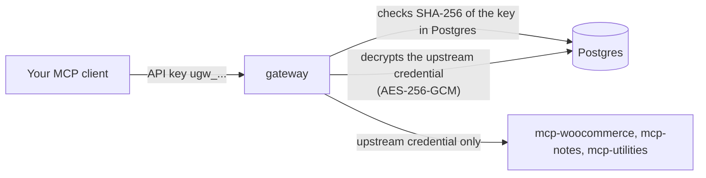

# Security

> **Status: partial (end of Phase 3).** This file covers what the gateway does today: credentials, authentication, sessions, CSRF, the SSRF guard, logging, roles, and the known residual risks. **NetworkPolicies are Phase 5** and the full **threat model** is Phase 6 (`threat-model.md`); neither exists yet, and nothing here relies on them. The security chapter of the spec is [§9](superpowers/specs/2026-10-18-mcp-gateway-design.md).

Evidence labels: **live** = run against the k3d cluster on 2026-10-19; **tested** = pinned by an automated test ([testing.md](testing.md)); **expected** = follows from the code, not run.

## 1. Two credentials that never meet

- The client proves who it is with its **personal API key**. The gateway authenticates **itself** to each upstream with that upstream's own credential (a bearer token, or a custom header for Utilities).
- **No token passthrough.** The client's key is never sent upstream, and the upstream credential is never sent to a client, the browser or the logs. A test makes an upstream record every header it receives and checks that the client key is not among them (**tested**).
- The API never returns a credential: a server view only says `hasCredential: true` (**live**: `GET /api/servers` shows `hasCredential True` for all three).
- Different users act through the **same** upstream identity. Who did what is recorded in the gateway audit log, not by the upstream.

## 2. Hashing versus encryption

| Secret | Stored as | Why |
|---|---|---|
| API key `ugw_` + 43 base62 characters | `SHA-256(key)` as hex in `api_keys.key_hash`, plus the first 12 characters as a display prefix | A key is 32 random bytes; it cannot be guessed, so a slow hash adds cost without security ([ADR-008](decisions/ADR-008-api-key-hashing.md)). The plaintext is shown once at creation. |
| User password | argon2id (`@node-rs/argon2`) in `users.password_hash`, 10-200 characters | Humans choose guessable secrets, so the hash must be slow. |
| Session cookie | `SHA-256` of 32 random bytes in `sessions.token_hash` | The cookie value is only in the browser. |
| Invite token | `SHA-256` in `invites.token_hash` | Shown once as a link. |
| Upstream credential | `AES-256-GCM` blob (12-byte nonce, then ciphertext, then 16-byte tag) in `upstream_servers.credential_enc` | The gateway must send the plaintext upstream, so it has to be recoverable ([ADR-009](decisions/ADR-009-upstream-credential-encryption.md)). |

As built for ADR-009: a fresh random 96-bit nonce per encryption; the **server row id is the associated data (AAD)**, so a ciphertext copied into another row fails to decrypt; a tampered ciphertext fails authentication (**tested**: every-byte tamper, wrong AAD, short blob, unique nonces). The key is `GATEWAY_ENCRYPTION_KEY` (32 random bytes, base64, validated at start) in Secret `gateway-secrets`. Losing it makes stored credentials unreadable; key rotation is not built.

Verified on the live database (2026-10-19): `credential_enc` is 76 bytes for each of the three servers (12 nonce + 16 tag + a 48-character credential) and is only ever selected as `IS NOT NULL` in the run guide's queries.

## 3. Authentication and sessions

- **`/mcp`:** every request is checked against the database; there is no cache. A revoked key fails on its next request, and a disabled user's keys are revoked and their sessions deleted in one transaction (**tested**). Each rejection (except a missing header) writes an `auth_rejected` audit row ([error-handling.md](error-handling.md#1-mcp-the-aggregated-endpoint)).
- **Dashboard API:** login sets cookie `ugw_session` with `HttpOnly; SameSite=Lax; Path=/; Max-Age=43200` (12 h), plus `Secure` when `COOKIE_SECURE=true` (it is `false` locally because the local site is http, and true by Helm when the public scheme is https; production is Phase 5). Only the hash is stored. Logout deletes the row.
- **Login hardening:** one answer for unknown email, wrong password and disabled user; a dummy argon2 verification when the email is unknown so the timing is the same (**tested**); emails are trimmed and lowercased; **10 attempts per minute per IP and email** (the 11th gets 429 with `Retry-After: 60`, **live**).
- **`TRUST_PROXY=1`.** Behind Traefik the real client IP is the first hop of `X-Forwarded-For`. The chart sets `TRUST_PROXY=1` (exactly one proxy). Without it every user would share the ingress address, so a few failed logins from anyone would lock out everyone using the same email. Too high a value would let a client choose its own bucket by sending the header. Only the rate-limit key uses `req.ip` (**tested**: with 1, attempts from different forwarded addresses are separate; with 0 they are not).
- **Internal chat token (built, not yet used):** HS256 JWT, audience `gateway-chat`, issuer `urumi-gateway`, `sub` = user id, 5-minute expiry, verified with `algorithms: ['HS256']` (so `alg: none` and other algorithms are refused) and a 5 s clock tolerance. The user is re-read on every use, so a user disabled after the token was minted is refused (**tested**). Phase 4 will use it for the chat loopback ([ADR-010](decisions/ADR-010-chat-agent-loopback.md)).
- **First admin:** created from `gateway-bootstrap` only when the `users` table is empty, name `Admin`.

## 4. CSRF

Every mutating `/api` request (`POST`, `PUT`, `PATCH`, `DELETE`) must carry `Content-Type: application/json` **and** `Origin` equal to the origin of `PUBLIC_APP_URL`. A browser form or cross-site request cannot set both. `DELETE` needs them even without a body, and so do the public invite routes. The check runs before the session check. Verified live: a `DELETE` without a content type and a `POST` with neither header both got `403 CSRF_REJECTED`. `SameSite=Lax` on the cookie is a second layer. `/mcp` uses no cookies, so CSRF does not apply to it.

## 5. SSRF guard

An admin supplies upstream URLs, and the gateway then makes requests to them from inside the cluster, so the URL is a possible way to reach internal services (cloud metadata at `169.254.169.254`, the Kubernetes API, other pods). The rules (`src/security/ssrf.ts`), applied in this order:

1. The URL must parse; the scheme must be `http` or `https`; it must not contain a username or password.
2. The host is resolved (IP literals are used as they are) and **every** returned address is judged:
   - loopback, link-local (including `169.254.0.0/16` and `fe80::/10`) and unspecified addresses are **always** refused;
   - private ranges (`10/8`, `172.16/12`, `192.168/16`, `100.64/10`, IPv6 `fc00::/7`) are refused **unless the host name is on the allow-list** `SSRF_ALLOWED_INTERNAL_HOSTS`, which defaults to `*.mcp.svc.cluster.local` (the `*.` form matches one or more labels before the suffix);
   - IPv6 forms that embed an IPv4 address (`::ffff:a.b.c.d`, `::a.b.c.d`, NAT64 `64:ff9b::/96`) are judged by the IPv4 rules, so they cannot be used to bypass them (**tested**, more than 50 bypass attempts in review).
3. **At create and edit time:** the API refuses a bad URL with `400 SSRF_REJECTED` and a `details.reason`. Verified live on 2026-10-19: `http://169.254.169.254/latest` (`link_local`), `http://127.0.0.1:3000/mcp` (`loopback`), `http://10.0.0.5/mcp` (`private`, "not allowlisted"), `file:///etc/passwd` (`scheme`) and `http://user:pw@example.com/mcp` (`credentials_in_url`) were all refused and nothing was stored.
4. **At every health check:** the same check runs again, because DNS answers change.
5. **At connect time:** the gateway's HTTP client (undici) uses a custom DNS lookup (`createSafeLookup`) that resolves the name **again when the socket opens** and judges every address with the same rules, then connects only to an address it has judged. This closes **DNS rebinding**, where a name resolves to a safe address during the check and to an internal one a moment later (**tested** with a resolver that changes its answer).
6. **Redirects are never followed.** A 3xx makes the server `unreachable` with `HTTP 302 from upstream (redirects are not followed)` (**tested**). The bytes of a redirect to an internal address are never requested.
7. **Credentials with CR or LF** (header injection) are refused before any request, and no error message echoes the credential (**tested**).

`SSRF_ALLOW_LOOPBACK=true` lets URLs resolve to `127.0.0.1`. It exists only so the tests can use in-process fake upstreams on loopback. It is **for development and tests only**, and the Helm chart never sets it (checked in the rendered chart: no match).

## 6. Logging and redaction

- The shared logger (pino) censors `authorization`, `cookie`, `password`, `token`, `secret`, `credential`, `apiKey`, `x-utilities-key` and any key ending in `key` or `secret`, at any depth.
- The gateway additionally never passes secrets to the logger at all: startup failures log the error class only, the `tool call` line has no arguments or results, audit rows never store arguments or results, and the database error path logs a code, not driver text. Tests assert that keys, upstream tokens and results are absent from the logs.
- **Invite paths are redacted.** The request log records the path from the original URL, and `/api/invites/<token>` is logged as `/api/invites/:token` (a UUID path, such as the admin's `DELETE /api/invites/<id>`, is kept) (**tested**). **Planned (Phase 3 final-review fix wave):** the redaction is currently case-sensitive, so `/API/Invites/<token>` would be logged unredacted; a case-insensitive match is planned.
- All scripts and docs print the command that fetches a secret, never the secret (`scripts\get-secret.ps1` copies to the clipboard).

## 7. What a member can and cannot do

| Action | Admin | Member |
|---|---|---|
| Call any tool through `/mcp` with their own key | yes | yes |
| Create, list and revoke their own keys | yes | yes |
| List servers and their tools and status (`GET /api/servers`) | yes | yes (including the server **URL**, see residual risks) |
| Read the audit log | all rows | only their own rows (asking for another user's is 403) |
| Register, edit, disable, refresh or delete servers; rotate credentials | yes | no (403) |
| Invite users, list or cancel invites | yes | no |
| List users, change roles, disable users | yes | no |
| Issue or revoke another user's keys | yes | no |
| Change their own role or disable themselves | no (409) | no (403) |

Role checks are **tested** in the API suites under `apps/gateway/test/api/`. All of this goes through the REST API today; the dashboard that will use it is Phase 4.

## 8. Residual risks

Known, accepted for Phase 3, not fixed. Phase 5 hardening and the Phase 3 final-review fix wave are named where a change is planned.

1. **No rate limit on `/mcp`.** Every request with an unknown, revoked or malformed credential writes an `auth_rejected` audit row, so the audit table can grow without bound under a flood. (Verified live that the rows are written: 9 `unauthorized` rows exist after the checks.) A `/mcp` rate limit is planned for Phase 5. Requests with no header write nothing.
2. **Changing a server's URL keeps its stored credential.** An admin can edit a server's URL to a host they control (it still must pass the SSRF guard), and the gateway will then send the stored credential to it. This is an admin-only action, but it means a credential is not bound to its original host. **Planned:** the Phase 3 final-review fix wave will require the credential to be supplied again, or clear it, when the URL's origin changes. Until that lands, the behaviour described here is the current one.
3. **Server URLs are visible to members.** `GET /api/servers` returns `url` to any logged-in user. Rule: **never put secrets in URLs** (the SSRF guard also refuses `user:password@` URLs).
4. **An allowlisted internal name that resolves to an IPv6 ULA passes.** The allow-list lets `*.mcp.svc.cluster.local` resolve to private addresses, and `fc00::/7` is private. A name on the allow-list is trusted to resolve inside the cluster; if DNS for it were poisoned to another ULA address the guard would accept it. The default allow-list names only cluster-internal services.
5. **Health and catalog state is per replica, and server edits apply on the replica that handled them.** With more than one replica, replicas would disagree until their next check. One replica is deployed. The login limiter is per replica too.
6. **Notes are kept in memory** by `mcp-notes`: they are lost on restart and not shared between replicas. They are not a secure store.
7. **Internal chat tokens cannot be revoked individually;** they expire after 5 minutes. A disabled user's token is refused on the next use because the user is re-read.
8. **Invite links are bearer secrets until used.** Anyone who gets the link within 72 hours can claim the account. Mitigations: single use, expiry, only the hash is stored, the path is redacted in logs (case-insensitive redaction planned), and the admin can cancel a link (`DELETE /api/invites/:id`, **live**: the link then answered `404 INVITE_INVALID`).
9. **Session and key races (minor, deferred).** A login or key creation that overlaps a "disable user" call could leave a live session or key that revives if the user is re-enabled. An admin may issue keys for a disabled user. Both are listed for the fix wave.
10. **Nothing limits which pods can reach the gateway or the upstreams** until NetworkPolicies exist (Phase 5). Any pod in the cluster can reach `mcp-woocommerce`, but needs its bearer token.
11. **`COOKIE_SECURE` is false locally** (plain http on `app.localhost`), and k3d publishes ports 80 and 443 without a host IP, so the gateway may be reachable from the local network (**not verified**). Stop the cluster on untrusted networks.

## 9. Not yet covered

NetworkPolicies and pod hardening review (Phase 5), production TLS and secrets handling (Phase 5), the dashboard's own headers and the chat agent's prompt-injection stance (Phase 4), the threat model including malicious tool descriptions and compromised upstreams (Phase 6).
