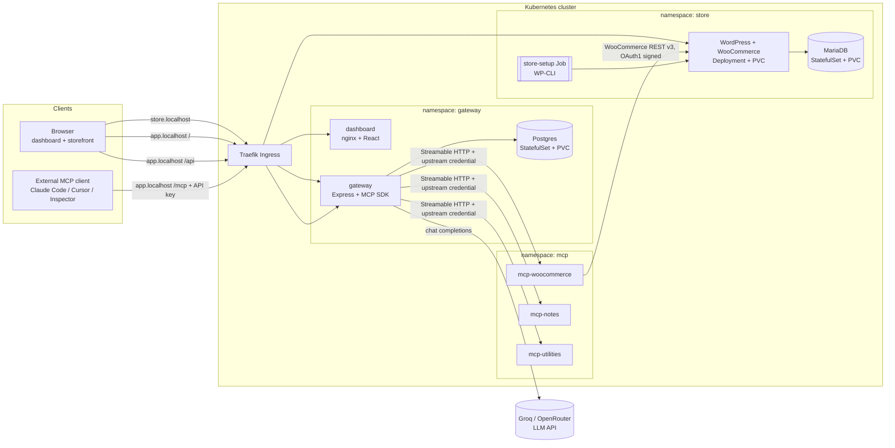
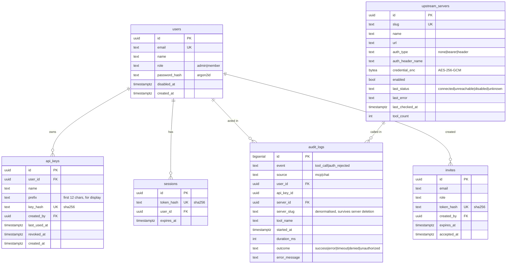
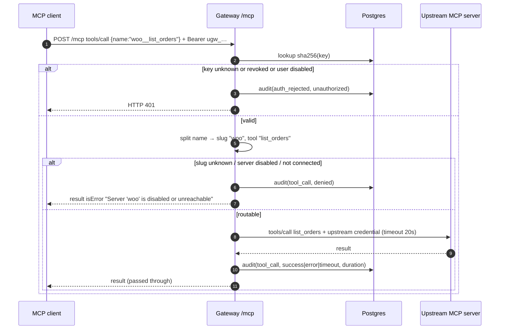
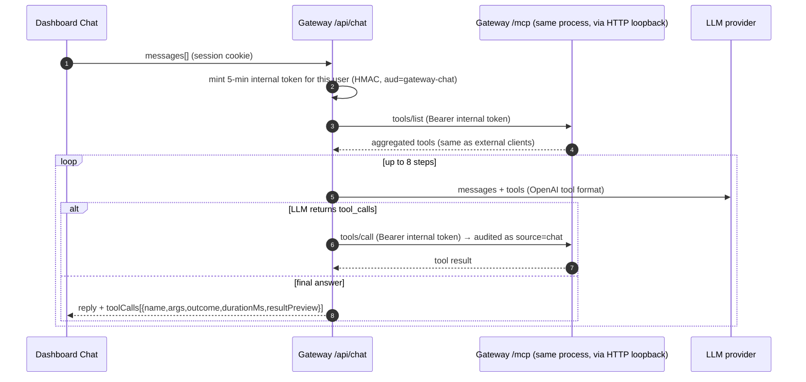

# Design Spec — WooCommerce Hosting with a Team MCP Gateway on Kubernetes

| | |
|---|---|
| **Status** | Approved (2026-10-18) |
| **Assignment** | Urumi AI FDE Internship — Round 1 |
| **Time budget** | 4 days (core first; extras only after the definition of done passes) |
| **Implementation plan** | [`docs/superpowers/plans/2026-10-18-mcp-gateway-implementation-plan.md`](../plans/2026-10-18-mcp-gateway-implementation-plan.md) |
| **Decision records** | [`docs/decisions/`](../../decisions/) |

---

## 1. Goal

Build a small platform on Kubernetes where:

1. A **WooCommerce store** (WordPress + WooCommerce + MariaDB) runs in the cluster with persistent storage.
2. A **WooCommerce MCP server we write ourselves** exposes the store's products and orders as MCP tools.
3. A **gateway** (backend + React dashboard) lets admins register MCP servers once. The gateway is an MCP *client* to every registered server and an MCP *server* that exposes all their tools through **one endpoint** (`/mcp`).
4. A **chat agent** inside the dashboard answers questions by calling those same tools *through the gateway*, acting as the logged-in user.

Everything is deployed with **one Helm chart**. Local (k3d) and production-like (k3s on a VPS) differ only by **values files**.

### Out of scope (explicitly)

- Bonus: multi-store provisioning.
- Stand-out items other than **security hardening** (no per-tool permissions, no OAuth, no tool search, no hosted MCP servers, no multi-replica demo, no metrics stack).
- An actual VPS deployment (we document it and validate the prod values by rendering/linting them; see §11).
- Email delivery (invites are links the admin copies).
- Persisting chat history (lives in the browser tab only).

---

## 2. Requirements traceability

| Assignment requirement | Where it is satisfied |
|---|---|
| Store runs on K8s, checkout with COD, order visible in wp-admin | §5.1 store chart + setup Job enables COD |
| Own WooCommerce MCP server, Streamable HTTP, 5 tools, internal-only | §5.2 |
| Document how the MCP server talks to the store | §5.2 + ADR-005 |
| Admin add/edit/disable/remove upstreams with optional static credential | §6.2, §6.6 |
| One MCP endpoint, aggregated listing, routed calls | §6.3, §6.4 |
| Tool name collision scheme | §6.4 + ADR-006 |
| Slow/dead upstream does not break others; timeouts with clear errors | §6.5 |
| Upstream credentials never reach browser or MCP clients | §6.6, §9 |
| ≥ 3 upstreams | WooCommerce, Notes, Utilities (§5.3) |
| Roles admin/member; per-user revocable hashed API keys | §6.1, §6.7 |
| Audit log of every tool call, visible in dashboard | §6.8, §7 |
| Chat agent with LLM tool loop, shows tools called, acts as user | §6.9 |
| LLM keys handled like any other secret | §6.10, §8.4 |
| Local K8s (k3d) + VPS (k3s) with same Helm chart; values-local / values-prod | §8 |
| Persistent storage for DB and WordPress content | §8.2 |
| Ingress with stable URLs; documented local domain approach | §8.3 |
| Probes + requests/limits on every workload | §8.5 |
| No hardcoded secrets; credentials in K8s Secrets | §8.4 |
| Security hardening (stand-out #6) | §9 |

---

## 3. Architecture overview



**Key rule:** the only path to an upstream MCP server is *through the gateway*. MCP servers have no Ingress, and NetworkPolicies only admit traffic from gateway pods.

### Components and responsibilities

| Component | Tech | Responsibility |
|---|---|---|
| `apps/dashboard` | React 19 + Vite + TypeScript + Tailwind + Radix UI + TanStack Query + React Router | UI for servers, team, keys, audit log, chat. Talks only to `/api` on the same origin. |
| `apps/gateway` | Node 24 + Express 5 + TypeScript + MCP TS SDK + Drizzle ORM + pg + pino + zod | Dashboard REST API, auth, API keys, upstream registry and health, aggregated `/mcp`, audit log, chat agent. |
| `apps/mcp-woocommerce` | Node 24 + MCP TS SDK + zod | MCP tools over the WooCommerce REST API v3. |
| `apps/mcp-notes` | Node 24 + MCP TS SDK | Upstream #2: simple in-memory notes; bearer-token protected. |
| `apps/mcp-utilities` | Node 24 + MCP TS SDK | Upstream #3: date ranges, current time, calculator; custom-header protected. |
| `packages/shared` | TypeScript | Logger, env config loader, MCP HTTP server bootstrap, health endpoints, auth middleware for upstreams. |
| `charts/urumi-platform` | Helm 4 (chart `apiVersion: v2`, also installable with Helm 3.x) | Every Kubernetes resource. |

The repo is an **npm workspaces monorepo**: one `package.json` at the root, one lockfile, shared TypeScript config.

---

## 4. MCP SDK and protocol version

- The TypeScript SDK has two lines: **v2** (`@modelcontextprotocol/server` and `@modelcontextprotocol/client`, 2.3.x, implementing the **2026-07-28** spec, where Streamable HTTP is stateless) and **v1** (`@modelcontextprotocol/sdk` 1.32.x, still maintained, stateful sessions optional).
- **Default: v2.** The stateless transport fits a gateway well: no session affinity, and nothing to share between replicas.
- **Compatibility gate (first hour of Phase 2):** confirm that MCP Inspector and Claude Code can list and call tools against a v2 server. If either fails, switch every component to **v1 in stateless mode** (`sessionIdGenerator: undefined`), which works with older clients. Record the outcome in ADR-007.
- All servers expose **`POST /mcp`** for JSON-RPC, plus `GET /healthz` (liveness) and `GET /readyz` (readiness).

---

## 5. Store and upstream MCP servers

### 5.1 Store (namespace `store`)

| Resource | Details |
|---|---|
| MariaDB `StatefulSet` (1 replica) | Official `mariadb:11.8.9` image, **non-root (uid/gid 999)**; PVC via `volumeClaimTemplates`; root and app passwords from Secret `store-db`; probes use the image's `healthcheck.sh`. |
| WordPress `Deployment` (1 replica, `Recreate` strategy) | Official `wordpress:7.1.3-php8.3-apache` image, **non-root (uid/gid 33, `www-data`)** with the safe sysctl `net.ipv4.ip_unprivileged_port_start=0` (so Apache can bind port 80 without root or capabilities); a `copy-wordpress` initContainer pre-copies the WordPress files onto the PVC (see §8.5); PVC mounted at `/var/www/html` (holds plugins and uploads); DB credentials from Secret; `WORDPRESS_CONFIG_EXTRA` sets `WP_HOME`/`WP_SITEURL` from values (the image's `wp-config.php` evaluates it from the environment at every start, verified in Task 1.5). |
| `store-setup` Job (Helm `post-install,post-upgrade` hook, idempotent) | `wordpress:cli-2.12.0-php8.3` image (also uid 33) on the same PVC, scheduled next to the WordPress pod by pod affinity (the volume is `ReadWriteOnce`). It waits for `wp-config.php` and the DB, then: `wp core install` (if not installed); installs and activates WooCommerce 11.2.1 (version pinned); sets the store to USD and the timezone from values; turns **coming-soon mode off** (new WooCommerce stores hide the shop otherwise); **disables shipping** (`woocommerce_ship_to_countries=disabled`) so checkout needs no shipping zones; enables **Cash on Delivery**; hides the onboarding task list (`woocommerce_task_list_hidden_lists`, because the older `woocommerce_task_list_hidden` option fails in 11.2.1); sets pretty permalinks; seeds 3 sample products (only if none exist); upserts a **WooCommerce REST API key** (read/write) whose consumer key and secret come from Secret `store-woo-api`. The key is written with WooCommerce's own hashing (`wc_api_hash`) through `wp eval-file`. `backoffLimit: 3`, `activeDeadlineSeconds: 480` (shorter than the 10 min Helm `--wait` timeout). |
| Services | `mariadb` (headless, port 3306), `wordpress` (ClusterIP 80). |
| Ingress | `store.localhost` → `wordpress:80`. |

The WordPress admin password comes from Secret `store-admin`. Helm generates it when it isn't supplied, and `NOTES.txt` prints the `kubectl` command to read it. A pre-created `secrets.existing.storeAdmin` Secret must use the key `password`; a pre-created `storeWooApi` Secret needs the keys `consumer-key` and `consumer-secret` (the consumer secret must be at most 43 characters, the width of WooCommerce's `char(43)` column), and a pre-created `storeDb` Secret needs `root-password` and `password`.

**Hook ordering (observed, Task 1.4 Step 11 and Task 1.5).** With `--wait`, Helm 4.3.1 starts the post-install/post-upgrade hook after the release's resources are Ready. On the Task 1.4 upgrade, WordPress became Ready at 10:23:45Z and the Job started at 10:28:34Z. On the fresh install in Task 1.5, WordPress became Ready at 10:46:54Z and the Job started at 10:46:55Z. In both cases the Job started after Ready; the Job's own waits for `wp-config.php` and the database make it safe either way.

### 5.2 WooCommerce MCP server (`apps/mcp-woocommerce`, namespace `mcp`)

**How it talks to the store:** HTTP calls to the **WooCommerce REST API v3** at `http://wordpress.store.svc.cluster.local/wp-json/wc/v3/...`, authenticated with the consumer key/secret using **OAuth 1.0a one-legged signing**. WooCommerce documents this method for plain-HTTP connections, and ours is plain HTTP inside the cluster.

| Alternative | Why not |
|---|---|
| WP-CLI via `kubectl exec` | The MCP pod would need Kubernetes API credentials with exec rights into the store namespace. That's a large privilege, and the coupling is tied to pod names. |
| Direct SQL against MariaDB | Bypasses WooCommerce logic (totals, stock, status transitions, hooks, cache) and couples us to its internal schema. |
| Basic auth with a consumer key | WooCommerce only accepts it over HTTPS; in-cluster traffic is HTTP. |
| WordPress application passwords | Also require HTTPS unless the environment type is `local`. This was the fallback if OAuth1 signing hit the Host-header problem below; the spike passed, so it is not needed. |

**Signing base URL (resolved in Phase 1, [ADR-005](../../decisions/ADR-005-woocommerce-rest-oauth1.md)):** the OAuth1 signature covers the URL, but **not the URL the client requested**. WooCommerce rebuilds the base URI from `get_home_url( null, $path, is_ssl() ? 'https' : 'http' )`, i.e. from `WP_HOME` (`store.localhost`) with the scheme `http` for any non-TLS request. So the client sends the request to the in-cluster Service but signs `http://<WP_HOME host>[:port]<path>`. Verified on WooCommerce 11.2.1 with `scripts/check-woo-api.ps1`: signing the public URL gives 200, signing the URL actually requested gives 401. The MCP server therefore needs two settings, `baseUrl` (where it connects) and `signingBaseUrl` (what it signs). The verification used `kubectl port-forward`; requests to the in-cluster Service DNS name are expected to behave the same but are unverified until Phase 2.

**Tools** (inputs validated with zod; outputs trimmed to the fields a model needs, and also returned as `structuredContent`):

| Tool | Input | Notes |
|---|---|---|
| `list_products` | `search?`, `status?`, `page?`, `per_page?` (≤ 50) | id, name, price, status, stock, permalink |
| `create_product` | `name`, `regular_price` (string, decimal), `description?`, `status?` (default `publish`) | Returns the created product with its storefront permalink |
| `list_orders` | `period?` (`today` \| `yesterday` \| `last_7_days`), `after?`, `before?` (ISO), `status?`, `page?`, `per_page?` | `period` is computed in the store timezone (`STORE_TIMEZONE`), which makes "what orders came in today" reliable even with weak models |
| `get_order` | `order_id` | Line items, totals, billing name, status, dates |
| `update_order_status` | `order_id`, `status` (enum of WooCommerce statuses) | |
| `ping` | — | Liveness tool; intentionally shares its name with the other upstreams to demonstrate collision handling |

**Upstream credential:** the server requires `Authorization: Bearer <token>` (Secret `mcp-woocommerce-token`). The gateway holds this credential, so a NetworkPolicy mistake still isn't an open door (defense in depth).

**Errors:** WooCommerce HTTP errors map to MCP tool results with `isError: true` and a short message (for example `WooCommerce returned 404: order 123 not found`). Network errors and timeouts (10s) map the same way.

### 5.3 Two more upstreams we write

| Server | Credential type | Tools | Storage |
|---|---|---|---|
| `mcp-notes` | Bearer token (Secret `mcp-notes-token`) | `create_note`, `list_notes`, `search_notes`, `delete_note`, `ping` | In-memory (documented limitation: a restart clears notes) |
| `mcp-utilities` | Custom header `X-Utilities-Key` (Secret `mcp-utilities-key`) | `date_range` (today/yesterday/last_7_days → ISO bounds in a timezone), `current_time`, `calculate` (safe arithmetic parser; no `eval`), `ping` | Stateless |

Using one bearer-token server and one custom-header server exercises **both credential styles** the gateway must support.

**Cross-server demo prompt:** *"What orders came in today? Save a short summary of them as a note titled 'Daily orders'."* This uses `woo__list_orders` and `notes__create_note`, and optionally `utils__date_range`.

---

## 6. Gateway

### 6.1 Data model (Postgres, Drizzle migrations run on startup)



### 6.2 Dashboard REST API (`/api`, JSON, session cookie)

| Method & path | Role | Purpose |
|---|---|---|
| `POST /api/auth/login`, `POST /api/auth/logout`, `GET /api/auth/me` | any | Session login/logout/current user |
| `GET /api/invites/:token`, `POST /api/invites/:token/accept` | public | Validate an invite; set name and password |
| `GET/POST /api/invites`, `DELETE /api/invites/:id` | admin | List, create (returns link once), cancel |
| `GET /api/users`, `PATCH /api/users/:id` | admin | List; change role; disable/enable (disabling revokes sessions and keys) |
| `GET /api/keys`, `POST /api/keys`, `DELETE /api/keys/:id` | any (own keys) | List, generate (plaintext returned **once**), revoke |
| `GET/POST /api/users/:id/keys`, `DELETE /api/users/:id/keys/:keyId` | admin | Issue or revoke keys for a member |
| `GET /api/servers`, `GET /api/servers/:id` | any | Status, tool list, `hasCredential` (never the credential) |
| `POST /api/servers`, `PATCH /api/servers/:id`, `DELETE /api/servers/:id`, `POST /api/servers/:id/refresh` | admin | Register, edit (incl. enable/disable, rotate credential), remove, force a health check |
| `GET /api/audit` | admin: all; member: own | Filters: user, server, tool, outcome, time range; cursor pagination |
| `POST /api/chat` | any | Run one agent turn (§6.9) |
| `GET /healthz`, `GET /readyz` | public (in cluster) | Probes; `readyz` checks Postgres |

**Error shape:** `{"error": {"code": "VALIDATION_FAILED", "message": "…", "details": {…}, "requestId": "…"}}`. Every request gets an `X-Request-Id` that appears in the logs.

### 6.3 Upstream manager

- On startup and whenever a server is created or edited, the manager builds an MCP client for that server (Streamable HTTP transport, credential decrypted **in memory only** and attached as a header).
- **Health loop** every 15s per enabled server: `tools/list` with a 5s timeout.
  - Success → `connected`, tool cache replaced, `last_error = null`.
  - Failure → `unreachable`, cached tools **dropped**, `last_error` set to a human-readable reason (`connection refused`, `timeout after 5000ms`, `HTTP 401 from upstream`, `DNS lookup failed`).
- `enabled = false` → status `disabled`, client closed, no checks.
- State lives in memory (per replica) and is mirrored to `upstream_servers.last_*` for the dashboard.

### 6.4 Aggregated `tools/list` and the naming scheme

- `tools/list` on the gateway returns the **cached** tools of every server that is `enabled` and `connected`. It never fans out live, so a dead or slow upstream adds zero latency to listing.
- **Naming:** `<slug>__<original_tool_name>`. For example, `woo__list_orders`, `notes__ping`, `utils__ping`.
  - The slug is chosen by the admin and validated as `^[a-z][a-z0-9-]{1,15}$`, unique, and immutable after creation (renaming it would silently break clients).
  - The double underscore cannot appear in a slug, so splitting on the **first** `__` is unambiguous.
  - The total name must satisfy `^[a-zA-Z0-9_-]{1,64}$`, the strictest common client rule (Claude Code / Anthropic API). Upstream tools that would break the rule are skipped and reported as a warning on the server's detail page.
- Each tool's description is prefixed with `[<Server name>] `. Its input schema is passed through unchanged.

### 6.5 `tools/call` routing and failure handling



- **Timeouts:** 20s per call (`UPSTREAM_CALL_TIMEOUT_MS`), enforced with `AbortSignal.timeout`. A timeout returns `isError: true` with `Upstream 'woo' did not respond within 20000ms`, and the audit outcome is `timeout`.
- **Retries:** tool calls are **not** retried automatically, because `create_product` is not idempotent and a retry could create duplicates. Health checks retry naturally on the next tick.
- **Failure on call** also marks the server `unreachable` immediately when the error is a connection-level failure, so its tools disappear from the next `tools/list`.

### 6.6 Upstream credentials

- Stored as `AES-256-GCM(nonce ‖ ciphertext ‖ tag)` in `upstream_servers.credential_enc`. The key `GATEWAY_ENCRYPTION_KEY` (32 random bytes, base64) is in Secret `gateway-secrets`.
- The API returns `hasCredential: boolean`. Editing a server without supplying a credential keeps the existing one. Supplying an empty string with `clearCredential: true` removes it.
- The credential is decrypted only when the MCP client for that upstream is built. It is never logged (pino redaction covers `authorization`, `x-*-key`, `credential`).

### 6.7 Users, sessions, API keys, invites

- **Bootstrap:** if `users` is empty at startup, create the admin from `BOOTSTRAP_ADMIN_EMAIL` and `BOOTSTRAP_ADMIN_PASSWORD` (from Secret `gateway-bootstrap`; Helm generates the password when not supplied).
- **Seed servers:** on startup, `SEED_SERVERS` (JSON in a ConfigMap; credentials referenced by env var names that point at Secrets) is **upserted by slug only if absent**. This is how WooCommerce, Notes and Utilities are registered from the first boot without overriding admin edits.
- **Passwords:** argon2id; minimum 10 characters. Login has an in-memory rate limit of 10 attempts per minute per IP+email.
- **Sessions:** a random 32-byte token in an `HttpOnly`, `SameSite=Lax` cookie (also `Secure` in prod). Only its SHA-256 is stored. 12h expiry. Mutating `/api` requests must carry `Content-Type: application/json` and a same-origin `Origin` header (CSRF defense).
- **API keys:** `ugw_` + 32 random bytes in base62. Stored as **SHA-256**, plus a display prefix. SHA-256 (not bcrypt/argon2) is right here because the key is high-entropy random data, so brute-forcing the hash is infeasible, and a fast hash keeps per-request auth cheap. That's the same reasoning GitHub uses for tokens. Revocation sets `revoked_at`, and the very next request is rejected because there is no auth cache.
- **Invites:** admin enters an email and role → a random token (hash stored) → link `${PUBLIC_APP_URL}/invite/<token>` (`http://app.localhost` locally, `https://app.<domain>` in prod), valid 72h and single-use.

### 6.8 Audit log

- Written for **every `tools/call`** (from external clients and from chat), including denied and failed calls, and for **rejected authentication** on `/mcp` when the key is recognizable (revoked key → attributed to its owner; unknown key → `user_id = null`).
- The write happens after the call completes, in the same request. If the gateway process crashes mid-call, that call has no row (documented limitation).
- The dashboard shows the time, user, source (MCP client vs chat), server, tool, duration, outcome and error, with filters.

### 6.9 Chat agent



- The **internal token** is a JWT signed with `GATEWAY_INTERNAL_TOKEN_SECRET` (`sub` = user id, `aud` = `gateway-chat`, 5 min). `/mcp` accepts it alongside API keys. It never leaves the server.
- The system prompt includes the current date/time and store timezone, and tells the model to use tools rather than guess.
- **Limits:** max 8 tool steps per turn; tool results truncated to 6,000 characters before going back to the model (protects the token budget); 60s total turn timeout.
- Untrusted tool output is wrapped in a delimited block and the system prompt states that tool output is data, not instructions (§9).

### 6.10 LLM provider abstraction

```ts
interface LlmProvider {
  readonly name: string;
  chat(req: { messages: ChatMessage[]; tools: ToolSpec[]; signal: AbortSignal }): Promise<{ message: ChatMessage; toolCalls: ToolCall[]; usage?: Usage }>;
}
```

- `OpenAICompatibleProvider` implements it with `fetch` against `${baseUrl}/chat/completions`. **Groq** and **OpenRouter** are both configurations of this one adapter (`providers.ts` holds their base URLs and default models).
- **Config:** `LLM_PROVIDER` (`groq` | `openrouter`), `LLM_MODEL`, `LLM_BASE_URL` (optional override), `GROQ_API_KEY`, `OPENROUTER_API_KEY`, `LLM_FALLBACK_PROVIDER` (optional), `LLM_TIMEOUT_MS` (30000), `LLM_MAX_RETRIES` (2).
- **Retries:** on 429 and 5xx, with exponential backoff and jitter, honoring `retry-after`. When retries are exhausted, the fallback provider (if configured) is tried once.
- **Normalized errors:** `LLM_RATE_LIMITED`, `LLM_AUTH_FAILED`, `LLM_UNAVAILABLE`, `LLM_BAD_RESPONSE`, `LLM_NOT_CONFIGURED`. The chat UI shows a clear message for each.
- **Default model:** chosen in the Phase 4 spike between `openai/gpt-oss-120b` and `llama-3.3-70b-versatile` on Groq, based on tool-calling reliability and the account's limits page. The free Developer plan publishes 30 RPM / 1K RPD / 8K TPM for gpt-oss-120b, so tool descriptions are kept short.
- A provider needing a non-OpenAI wire format would get a new adapter class implementing `LlmProvider`. Nothing else changes.

---

## 7. Dashboard

**Routes:** `/login`, `/invite/:token`, `/` (overview: server health summary, recent calls, quick-start), `/servers`, `/servers/:id`, `/team` (admin), `/keys`, `/audit`, `/chat`.

**Design system:**
- Neutral slate surfaces with one indigo accent, and status colors (green connected, red unreachable, grey disabled) that always pair with a text label.
- Inter font, 4px spacing scale.
- Reusable components: Button, Input, Select, Badge, Card, Table, Dialog, ConfirmDialog, Toast, EmptyState, ErrorState, Skeleton, CopyField.
- Light and dark themes via CSS variables.

**Behavior:**
- Every data view has loading, empty and error states.
- Destructive actions (delete server, revoke key, disable user) use confirmation dialogs.
- Forms validate inline.
- The newly generated API key appears in a "shown once" dialog with copy buttons and ready-to-paste config for **Claude Code**, **Cursor**, and **MCP Inspector**.
- Server status refetches every 10s.

**Responsive:** the sidebar collapses to a drawer below 1024px; tables become stacked cards below 640px.

**Accessibility:** semantic landmarks, labeled inputs, visible focus rings, focus-trapped dialogs, WCAG AA contrast.

**Member vs admin:** members see Servers read-only (no add/edit/delete), no Team page, and only their own audit rows. The backend enforces this; the UI only hides it.

**Serving:** a static build served by `nginxinc/nginx-unprivileged` (non-root, port 8080) with an SPA fallback.

---

## 8. Kubernetes and Helm

### 8.1 Chart layout

```
charts/urumi-platform/
  Chart.yaml  values.yaml  values.schema.json  templates/NOTES.txt  templates/_helpers.tpl
  templates/namespaces.yaml
  templates/store/      mariadb.yaml wordpress.yaml store-setup.yaml store-secrets.yaml ingress.yaml   (built in Phase 1)
  files/store-setup/    setup.sh upsert-api-key.php   (mounted into the setup Job via a ConfigMap)
  templates/mcp/        mcp-woocommerce.yaml mcp-notes.yaml mcp-utilities.yaml secrets.yaml
  templates/gateway/    postgres-*.yaml gateway-*.yaml dashboard-*.yaml secrets.yaml configmap.yaml ingress.yaml
  templates/network/    default-deny.yaml allow-*.yaml
deploy/values-local.yaml   deploy/values-prod.yaml
```

- One release (`helm upgrade --install urumi charts/urumi-platform -n urumi-system --create-namespace -f deploy/values-local.yaml`). The chart creates and owns the three namespaces `store`, `mcp` and `gateway`. Namespaces, the standalone `wordpress-data` PVC **and the generated Secrets** carry `helm.sh/resource-policy: keep` so an accidental `helm uninstall` doesn't destroy store data or the credentials that match it. The MariaDB PVC comes from the StatefulSet's `volumeClaimTemplates`, which Helm does not manage, so it survives `helm uninstall` without any annotation (verified in Task 1.5).
- **Generated secrets** use the helper `urumi.generatedValue`: a value is looked up in this order: (1) memoised earlier in the same render, (2) the existing Secret in the cluster (`lookup`, so upgrades never rotate credentials), (3) a new `randAlphaNum`. The `lookup` always targets one **canonical namespace** per secret, and every copy of that secret in another namespace must pass the same canonical namespace, so copies cannot diverge. Prod can set `secrets.existing.*` names instead.

### 8.2 Storage

PVCs use the cluster's default StorageClass (`local-path` on k3s/k3d) unless `global.storageClass` is set. MariaDB 2Gi, WordPress 2Gi, Postgres 1Gi locally.

### 8.3 Ingress and local domains

- **Controller:** Traefik, bundled with k3s and k3d, so the same ingress class is used in both environments. (ingress-nginx is being retired upstream, so it is avoided.)
- **Hosts (local):** `store.localhost`, `app.localhost`. Browsers resolve `*.localhost` to loopback automatically. Windows/Node-based MCP clients need hosts-file entries (`127.0.0.1 store.localhost app.localhost`), and `scripts/setup-hosts.ps1` adds them (admin prompt).
- **k3d** maps host port 80 → the cluster load balancer (if 80 is busy, 8081, and the URLs become `http://app.localhost:8081`; 8080 is already taken on the dev machine).
- **Prod:** real DNS A records → VPS IP; optional TLS with cert-manager + Let's Encrypt (`global.tls.enabled`).

### 8.4 Secrets

| Secret (namespace) | Contents | Source |
|---|---|---|
| `store-db` (store) | MariaDB root and app passwords | Helm-generated |
| `store-admin` (store) | WordPress admin password | Helm-generated |
| `store-woo-api` (store **and** mcp) | WooCommerce consumer key/secret | Helm-generated; canonical namespace `store`. Built in Phase 1 for `store`; the `mcp` copy is added in Phase 2 using the same canonical namespace so both match |
| `mcp-woocommerce-token`, `mcp-notes-token`, `mcp-utilities-key` (mcp **and** gateway) | Upstream credentials | Helm-generated |
| `gateway-secrets` (gateway) | Postgres password, `GATEWAY_ENCRYPTION_KEY`, `GATEWAY_INTERNAL_TOKEN_SECRET` | Helm-generated |
| `gateway-bootstrap` (gateway) | Bootstrap admin email + password | Helm-generated / values |
| `llm-api-keys` (gateway) | `GROQ_API_KEY`, `OPENROUTER_API_KEY` | **Never in values.** Created by `scripts/create-secrets.ps1` from a git-ignored `.env`; the chart references it as `existingSecret` |

Upstream-credential Secrets in the `gateway` namespace are used **only to seed** the server registry. After seeding, the source of truth is the encrypted column, so credential edits in the dashboard persist.

### 8.5 Workload standards (every pod)

- `readinessProbe` and `livenessProbe` (HTTP `/readyz` and `/healthz` for our apps; `healthcheck.sh` for MariaDB; `pg_isready` for Postgres; `httpGet /wp-login.php` for WordPress, with a generous `startupProbe`).
- `resources.requests` and `resources.limits` on every container (starting points in §8.7).
- `securityContext` (every pod): `runAsNonRoot: true` with explicit `runAsUser`/`runAsGroup`/`fsGroup`, `seccompProfile: RuntimeDefault`, `automountServiceAccountToken: false`; (every container): `allowPrivilegeEscalation: false`, `capabilities.drop: [ALL]`. `readOnlyRootFilesystem: true` for our Node apps and nginx (with `emptyDir` for `/tmp`).
- **The store runs fully non-root (built and verified in Phase 1); there is no root exception.** This replaces the earlier plan that treated WordPress and MariaDB as root-needing:
  - MariaDB runs as uid/gid 999, the image's built-in `mysql` user.
  - WordPress runs as uid/gid 33 (`www-data`). Apache normally needs root to bind port 80; the pod sets the namespaced "safe" sysctl `net.ipv4.ip_unprivileged_port_start=0`, which lets any user bind low ports, so no capability and no root are needed.
  - The `copy-wordpress` initContainer exists because the official image's entrypoint copies WordPress onto the volume with `tar` and then `chmod`s the volume root; run as non-root, that `chmod` on a root-owned mount fails and the container crashes. The initContainer copies the files first with `cp -R` (which never touches the root directory's mode); the entrypoint then sees `index.php` and skips its own copy, and it still creates `wp-config.php`.
  - The `store-setup` Job runs as uid 33 too (the `wordpress:cli` image is Alpine where `www-data` is uid 82, but the volume belongs to the Debian image's uid 33).
  - `readOnlyRootFilesystem` is not set for MariaDB, WordPress or WP-CLI (they write to the volume and `/tmp`; `/tmp` and `/run/mysqld` are `emptyDir`s).
  - NetworkPolicies (Phase 5) remain defense in depth, not a compensation for root.
- Our images: multi-stage builds on `node:24-alpine`, running as the `node` user (uid 1000).

### 8.6 NetworkPolicies (security hardening)

| Namespace | Default | Allowed ingress |
|---|---|---|
| `store` | deny all ingress | Traefik (kube-system) → wordpress:80; mcp-woocommerce (mcp ns) → wordpress:80; wordpress → mariadb:3306; store-setup Job → mariadb, wordpress |
| `mcp` | deny all ingress | gateway pods (gateway ns) → each MCP server on its port |
| `gateway` | deny all ingress | Traefik → dashboard:8080, gateway:3000; gateway → postgres:5432 |

**Egress:** `mcp-woocommerce` may only reach wordpress (store ns) and kube-dns; the other MCP servers may only reach kube-dns. The gateway may reach mcp, postgres, kube-dns and the internet on 443 (LLM API). k3s enforces NetworkPolicies with its embedded kube-router controller. Phase 5 verifies enforcement with `kubectl run` curl probes.

### 8.7 Resource starting points (local)

| Workload | requests (cpu / mem) | limits (cpu / mem) |
|---|---|---|
| MariaDB | 100m / 256Mi | 500m / 512Mi |
| WordPress | 100m / 256Mi | 1 / 512Mi |
| Postgres | 50m / 128Mi | 500m / 256Mi |
| gateway | 50m / 128Mi | 500m / 384Mi |
| dashboard (nginx) | 10m / 16Mi | 100m / 64Mi |
| each MCP server | 20m / 64Mi | 200m / 160Mi |

Total requests come to about 0.5 CPU and 1.1 GiB, which fits a k3d cluster under Docker Desktop capped at about 8–9 GB.

### 8.8 Local vs production values

| Concern | `values-local.yaml` | `values-prod.yaml` |
|---|---|---|
| Hosts | `store.localhost`, `app.localhost` | `store.<your-domain>`, `app.<your-domain>` |
| TLS | off | cert-manager `ClusterIssuer` (letsencrypt) |
| Images | local tags, `imagePullPolicy: IfNotPresent`, loaded with `k3d image import` | `ghcr.io/<user>/…:<version>`, `IfNotPresent`, pinned tags |
| Storage | default `local-path`, small sizes | `local-path` (single-node k3s) or another class; larger sizes |
| Secrets | Helm-generated | `existingSecret` names pre-created with `kubectl create secret` |
| Cookies | `secure: false` | `secure: true` |
| Resources | small | larger limits |

---

## 9. Security posture (summary; full detail in `docs/security.md` and `docs/threat-model.md`)

- **Credential separation:** clients hold only their own gateway key. Upstream credentials are encrypted at rest and attached server-side. **No token passthrough:** the client's key is never forwarded to upstreams, as the MCP authorization spec requires. Forwarding it would let a malicious upstream replay the key against the gateway, and it would make upstreams trust tokens not issued for them.
- **What a member can do with a credential they never see:** call any tool on any enabled server through the gateway (as themselves, audited). They cannot read, export, or reuse the credential outside the gateway, and revoking their key stops everything immediately.
- **Untrusted upstreams:**
  - Tool descriptions are prefixed with the server name.
  - The chat system prompt treats tool output and descriptions as untrusted data.
  - Tool results are size-capped.
  - Admins can disable a server instantly.
  - The SSRF guard limits where a newly added URL may point.
  - A malicious upstream can still lie in its results or try prompt injection. That residual risk is documented, not eliminated.
- **SSRF guard:** applied on server create/edit and again at connect time.
  - Only `http`/`https` are allowed.
  - Hostnames are resolved, and loopback, link-local (`169.254.0.0/16`, including cloud metadata `169.254.169.254`), `0.0.0.0/8`, and IPv6 equivalents are rejected.
  - RFC1918 and cluster-internal addresses are rejected **unless** the hostname matches `SSRF_ALLOWED_INTERNAL_HOSTS` (default `*.mcp.svc.cluster.local`).
  - Redirects are not followed.
- **Member-vs-member:** members can't see others' keys or audit rows and can't change servers. Shared upstream credentials mean a member's actions (for example, updating an order status) affect shared data. That is mitigated by attribution in the audit log, not prevented (no per-tool permissions in scope).
- **Containers:** non-root where possible; NetworkPolicies are default-deny.
- **Input validation:** zod on every `/api` body and every MCP tool input.

---

## 10. Error handling (summary; full detail in `docs/error-handling.md`)

| Failure | Detection | Behavior | User sees |
|---|---|---|---|
| Upstream down | health loop / connection error | status `unreachable`, tools removed from listing | red badge + reason; tools vanish from clients |
| Upstream slow | 20s abort | `isError` result, audit `timeout` | "did not respond within 20000ms" |
| Bad/revoked API key | hash lookup | HTTP 401, audit `auth_rejected` | client shows unauthorized |
| LLM 429 | status code | retry with backoff, then fallback provider | chat shows "AI provider is rate limited, try again in N s" |
| Postgres down | `readyz` fails | pod removed from Service endpoints | dashboard error state with retry |
| WooCommerce error | REST status | `isError` result with WooCommerce message | tool error shown in chat trace |
| Invalid input | zod | 400 `VALIDATION_FAILED` / MCP invalid params | inline form errors |

---

## 11. Testing strategy (summary; full detail in `docs/testing.md`)

- **Unit (Vitest):**
  - Gateway: tool-name scheme, key generation and hashing, AES-GCM round trip, SSRF validator (including metadata IPs and rebinding), audit writer, LLM adapter (mocked fetch: success, tool calls, 429 retry, fallback), agent loop with a fake provider.
  - Upstreams: utilities date math and calculator.
- **Integration (Vitest):**
  - The gateway against three in-process fake MCP servers (healthy, slow, dead) proves aggregated listing, routing, collision prefixes, timeout, and isolation. Uses a Postgres test container or a throwaway DB in k3d.
  - The WooCommerce MCP server against a mocked WooCommerce REST API (OAuth signature checked).
- **Frontend:** a Vitest component test for key flows, and a Playwright smoke test (login → servers → generate key → audit) at 1440px and 390px viewports.
- **Cluster:**
  - `helm lint` and `helm template` for both values files.
  - `scripts/smoke-test.ps1`: storefront 200, dashboard 200, `/mcp` 401 without key, tools/list with key.
  - NetworkPolicy checks: denied paths time out.
- **Manual:** `docs/demo-script.md`, the definition of done step by step, executed in full before the demo.

---

## 12. Documentation deliverables

The CLAUDE.md set (`architecture.md`, `system-design.md`, `workflows.md`, `diagrams/`, `ai-integration.md`, `error-handling.md`, `security.md`, `testing.md`, `decisions/`, `troubleshooting.md`, `deployment.md`), plus the assignment-specific `system-design-and-tradeoffs.md` (short note), `threat-model.md` (short note), `demo-script.md`, `stand-out-items.md`, and `learning/` (Kubernetes and MCP primers for the interview).

---

## 13. Risks and mitigations

| Risk | Likelihood | Mitigation |
|---|---|---|
| MCP SDK v2 not yet supported by Claude Code / Inspector | Medium | Compatibility gate at the start of Phase 2; fall back to v1 stateless |
| OAuth1 signature mismatch (internal Host vs `WP_HOME`) | **Resolved (Phase 1)** | Sign the **public** store URL (`http://<WP_HOME host>[:port]<path>`), not the URL requested; verified on WooCommerce 11.2.1 by `scripts/check-woo-api.ps1` and a PHP-derived known-answer test ([ADR-005](../../decisions/ADR-005-woocommerce-rest-oauth1.md)). Remaining: Service-DNS access and POST/PUT signing are confirmed in Phase 2 |
| Groq TPM limit (8K) exceeded by tool schemas | Medium | Concise descriptions, result truncation, model choice in the spike, OpenRouter fallback |
| RAM pressure on a 15 GB laptop | Medium | `.wslconfig` caps WSL at about 9 GB; small limits; only one cluster running at a time |
| WordPress image needs root, so it can't be fully hardened | **Resolved (Phase 1)** | Runs as uid 33 with a safe sysctl and a `copy-wordpress` initContainer; MariaDB runs as uid 999 (see §8.5). NetworkPolicies still come in Phase 5 as defense in depth |
| Port 80 busy on Windows | Low | Use 8081 mapping (8080 is already in use on the dev machine) |
| Time overrun | High | Strict phase exit checks; extras only after the definition of done passes |

---

## 14. Assumptions

- The machine has Docker Desktop (WSL2), 12 CPUs, 15 GB RAM and 69 GB free disk. Helm and k3d are installed in Phase 0.
- The user creates a free Groq account (and optionally OpenRouter) and puts the key in `.env`.
- The store currency is USD and the timezone is configurable (default `Asia/Kolkata`).
- One gateway replica in the demo. The design is stateless (MCP transport, sessions in DB), but in-memory health state and the rate limiter are per-replica (documented).
