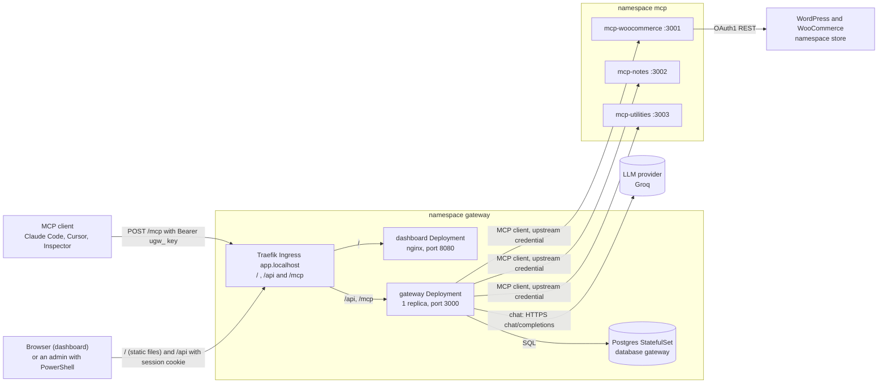
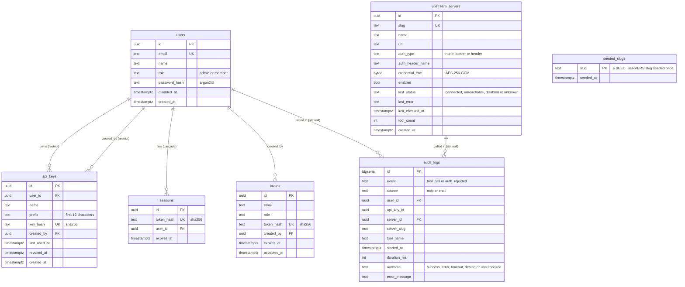
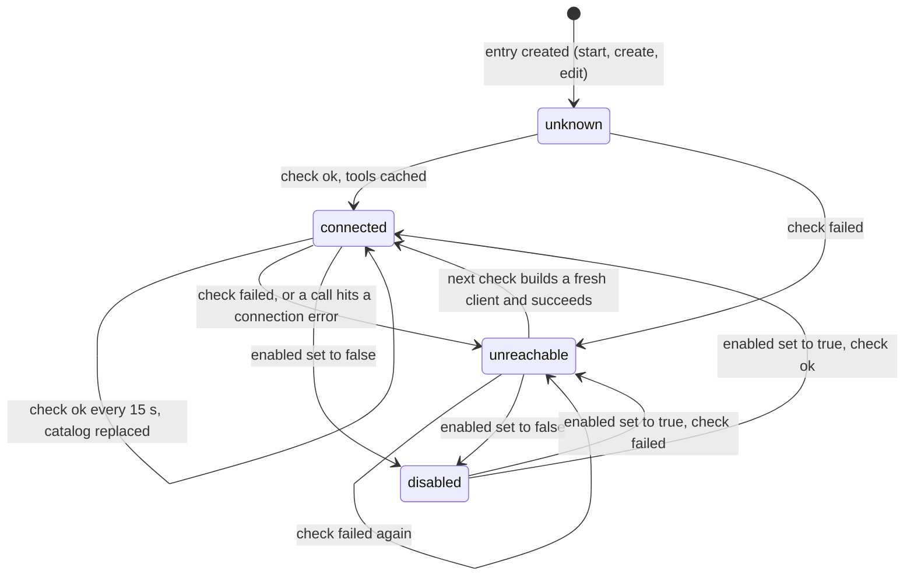
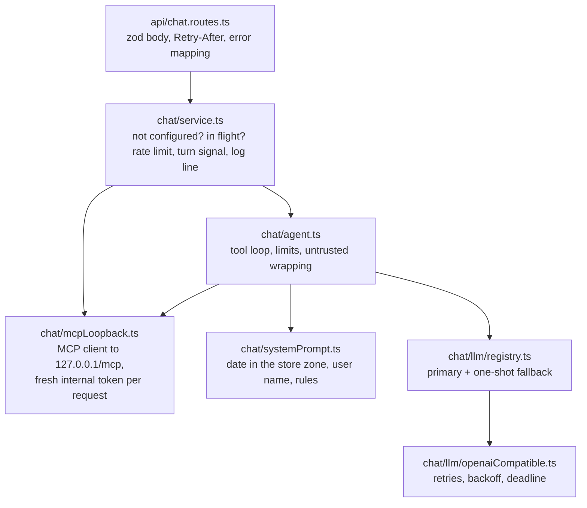

# System design

> **Status (end of Phase 4).** This file describes the gateway **as built**: the components, the data model, the interfaces, the upstream manager and the trade-offs, plus (since Phase 4) the dashboard and the chat agent ([section 10](#10-the-dashboard-and-the-chat-agent-phase-4)). Everything stated here exists in the code on the `phase-4-dashboard-chat` branch and was run on the local k3d cluster, unless it is labelled **expected** or **not tested**. The complete document (NetworkPolicies, production values) is finished in Phase 6.

Related: the overview is [architecture.md](architecture.md), each flow step by step is in [workflows.md](workflows.md), failures are in [error-handling.md](error-handling.md), and the security view is [security.md](security.md). The source of truth for intent is the [design spec](superpowers/specs/2026-10-18-mcp-gateway-design.md).

## 1. Components

| Component | What it does | Where |
|---|---|---|
| `gateway` | MCP server for clients, MCP client for upstreams, REST API, auth, audit, and (Phase 4) the chat agent. | `apps/gateway`, Deployment `gateway` |
| `dashboard` | The web UI: static files and the SPA fallback, nothing else (Phase 4). | `apps/dashboard`, Deployment `dashboard` |
| LLM provider | Groq (OpenRouter as an optional fallback); called only by the chat agent. | external, HTTPS |
| Postgres 17.11 | The gateway's own database: users, keys, invites, sessions, server registry, audit log. | StatefulSet `postgres-0`, PVC |
| `mcp-woocommerce`, `mcp-notes`, `mcp-utilities` | The three upstreams, 6 + 5 + 4 = 15 tools. | namespace `mcp`, no Ingress |
| `packages/shared` | Logger, env loader, the MCP HTTP server bootstrap (auth hook, extra routes, request ids) used by all four apps. | `packages/shared` |

The gateway is two things at once ([learning/03-gateway.md](learning/03-gateway.md#1-the-gateway-is-a-client-and-a-server)): to your Claude Code it is a server; to `mcp-woocommerce` it is a client with its own credential. The two credentials never meet (no token passthrough).

## 2. Data model

Seven tables in database `gateway`, created by the migrations in `apps/gateway/drizzle/` (`0000_init.sql`, and `0001_seeded_slugs.sql` from the final-review fix wave), which run at every start.

Points worth knowing:

- **`seeded_slugs` is a tombstone list.** Seeding inserts a built-in server only if its slug is in neither `upstream_servers` nor `seeded_slugs`, and records the slug in the same transaction; `DELETE /api/servers/:id` never touches it, so **a deleted built-in server stays deleted; re-add it with `POST /api/servers`**. On the first start after the upgrade, slugs already present in `upstream_servers` were marked as seeded without being re-inserted.
- **`invites` has no `created_at`** (the spec lists none). Pending invites are listed by `expires_at`, newest first.
- **`audit_logs.server_id` is `ON DELETE SET NULL`.** Deleting a server keeps its history readable because `server_slug` is denormalised into every row. `audit_logs.user_id` is also `SET NULL`. `api_key_id` has no foreign key, so a key row can never block or be blocked by history.
- **`tool_name` holds the upstream's own tool name** (`list_orders`) with `server_slug` beside it (`woo`). A call that matched no server keeps the name as the client sent it (`zzz__ping`) with a null slug. The gateway name is `<server_slug>__<tool_name>`.
- **Only hashes are stored** for API keys, session cookies, invite tokens and passwords ([security.md](security.md)). `credential_enc` is encrypted, not hashed, because the gateway must send it upstream.
- **`bytea` and PGlite.** The Drizzle `bytea` column maps both drivers' return types to a Node `Buffer`: node-postgres returns a `Buffer`, PGlite (the in-process Postgres the tests use) returns a `Uint8Array`.

## 3. Interfaces

### The REST API (`/api`)

Mounted at `/api` by `src/api/router.ts`. Order of processing: JSON body parser (limit 100 kb; **512 kb for `/api/chat`**, because 20 messages of 4,000 characters in a non-Latin script are about 240 KB of UTF-8), then the **CSRF guard**, then per route the session check and the role check, then the handler. Every `/api` response, errors included, carries `X-Content-Type-Options: nosniff` and `Cache-Control: no-store` (Phase 4). Errors always use the shape `{"error":{"code","message","details"?,"requestId"}}`.

**CSRF rule.** Every `POST`, `PUT`, `PATCH` and `DELETE` needs `Content-Type: application/json` **and** `Origin` equal to the origin of `PUBLIC_APP_URL` (`http://app.localhost` locally). This includes `DELETE` with no body and the public invite routes. Anything else is `403 CSRF_REJECTED` before the session is even looked at (verified 2026-10-19).

| Method and path | Who | Purpose | Success |
|---|---|---|---|
| `POST /api/auth/login` | public (rate limited) | Email and password; sets cookie `ugw_session` | 200 `{user}` |
| `POST /api/auth/logout` | session | Deletes the session, clears the cookie | 204 |
| `GET /api/auth/me` | session | The current user | 200 `{user}` |
| `GET /api/invites/:token` | public | Preview an invite (email, role, expiry) | 200 |
| `POST /api/invites/:token/accept` | public | Body `{name, password}`; creates the user, logs them in | 201 `{user}` |
| `GET /api/invites` | admin | Pending invites (expired ones included) | 200 list |
| `POST /api/invites` | admin | Body `{email, role}`; returns the link **once** | 201 `{invite, link}` |
| `DELETE /api/invites/:id` | admin | Cancel a pending invite | 204 |
| `GET /api/users` | admin | List users | 200 list |
| `PATCH /api/users/:id` | admin | `{role?, disabled?}`; disabling deletes the user's sessions and revokes their keys | 200 `{user}` |
| `GET /api/keys`, `POST /api/keys` | session | Own keys; create returns `{key, plaintext}` once | 200 / 201 |
| `DELETE /api/keys/:id` | session | Revoke an own key (another user's key looks like 404) | 204 |
| `GET/POST /api/users/:id/keys`, `DELETE /api/users/:id/keys/:keyId` | admin | Manage another user's keys | 200 / 201 / 204 |
| `GET /api/servers`, `GET /api/servers/:id` | session | A `ServerView` (below) | 200 |
| `POST /api/servers` | admin | Register a server (SSRF check, credential encrypted) | 201 `ServerView` |
| `PATCH /api/servers/:id` | admin | Edit, enable or disable, rotate or clear the credential; `slug` cannot change | 200 `ServerView` |
| `DELETE /api/servers/:id` | admin | Remove | 204 |
| `POST /api/servers/:id/refresh` | admin | Run a health check now | 200 `ServerView` |
| `GET /api/audit` | session | Filters `userId`, `serverSlug`, `toolName`, `outcome`, `from`, `to`, `limit` (1-100, default 50), `cursor`. Admin sees all rows, a member only their own (asking for someone else's is 403). | 200 `{items, nextCursor}` |
| `GET /api/chat/status` | session | `{configured, provider, model, fallbackProvider}`; never key material (Phase 4) | 200 |
| `POST /api/chat` | session | Body `{messages: [{role: "user" \| "assistant", content}]}`: 1-20 messages, content 1-4,000 characters, the last from the user, no other fields. Runs one agent turn as the user (section 10) | 200 `{reply, toolCalls, stoppedReason, provider, model, usage}` |
| `GET /healthz`, `GET /readyz` | public | Probes | 200 / 503 |

`POST /api/chat` answers, besides the codes below: `503 LLM_NOT_CONFIGURED`, `429 LLM_RATE_LIMITED` (always with `Retry-After`, 60 s when the provider gave none), `502 LLM_AUTH_FAILED`, `502 LLM_UNAVAILABLE`, `502 LLM_BAD_RESPONSE` (each with `details.toolCalls`, the calls that already ran), `409 CONFLICT` (a turn already running for this user) and `429 RATE_LIMITED` (more than `CHAT_RATE_LIMIT_PER_MIN` turns a minute). Full table: [ai-integration.md](ai-integration.md#7-failures-retries-deadline-and-fallback).

**`ServerView`** (never contains the credential): `id, slug, name, url, authType, authHeaderName, hasCredential, enabled, status, lastError, checkedAt, toolCount, tools[{name, description}], skippedTools[]`. `skippedTools` lists upstream tools whose prefixed name was not valid and which were therefore left out (see section 5).

`POST /api/servers` has **no `enabled` field** (its body is strict, so one would be refused): a new server is always created enabled, and the dashboard's create form therefore has no Enabled box (only the edit form does). Other rules enforced by the API: emails are trimmed and lowercased everywhere; passwords are 10-200 characters; an admin cannot change their own role or disable themselves (409 `CONFLICT`, so one active admin always remains); `url` is checked by the SSRF guard on create and on edit ([security.md](security.md#5-ssrf-guard)).

### The MCP endpoint (`POST /mcp`)

- **Transport:** stateless Streamable HTTP, one JSON-RPC message per request, no session id ([learning/02-mcp-protocol.md](learning/02-mcp-protocol.md)). A new `McpServer` object is built for every request. `GET /mcp` is `405`.
- **Order of checks:** Host header allow-list (`MCP_ALLOWED_HOSTS`), then **authentication**, then body parsing (limit 1 MB), then the MCP handler.
- **Authentication** (`src/mcp/auth.ts`, `src/auth/bearer.ts`): `Authorization: Bearer <credential>`. A credential starting with `ugw_` is an API key (SHA-256 lookup, revoked and disabled-user checks, `last_used_at` updated). Anything else is tried as the internal chat token (HS256 JWT, audience `gateway-chat`; the user is re-read so a user disabled after minting is refused). There is **no cache**: a revoked key fails on its very next request. A failure answers `401` with `WWW-Authenticate: Bearer` and the JSON-RPC error `-32001 Unauthorized`.
- **`tools/list`:** the cached catalog of every server that is enabled **and** connected, sorted by name, with no network call.
- **`tools/call`:** routed to the owning upstream (section 6), result passed through unchanged. Failures that the model can read are `isError` results, not protocol errors.

Captured traffic for all of this is in [learning/03-gateway.md](learning/03-gateway.md#5-captured-traffic).

## 4. The upstream manager

One `UpstreamManager` per process (`src/upstreams/manager.ts`). It holds, for every registered server, an entry with the row, one MCP client connection (or none), the cached state, and a name index.

Rules, each pinned by a test in `test/upstreams/manager.test.ts`:

- **The loop.** Every 15 s (`UPSTREAM_HEALTH_INTERVAL_MS`) each enabled server whose previous check has finished gets a check: re-run the SSRF check on the URL (DNS answers change), connect if there is no client, `tools/list` with a 5 s timeout (`UPSTREAM_HEALTH_TIMEOUT_MS`). A check never throws; every failure becomes `unreachable` with a readable `lastError`.
- **A failure drops the client and the tools.** The next check builds a **fresh** client and connection pool, so a restarted upstream is never met with a stale socket. The tools are removed from `tools/list` at once.
- **Call-time failures.** A transport error during `tools/call` (refused, `connection reset`, DNS, SSRF block, redirect) or an HTTP 401, 403, 404 or 5xx marks the server `unreachable` immediately, without waiting for the tick. Any other HTTP status (for example 413 for one oversized request), a timeout or an error answered by the upstream (JSON-RPC error) fails that call only and leaves the server `connected`.
- **Mirror.** After each check the status, error, time and tool count are written to `upstream_servers.last_*` and `tool_count`, which is what the dashboard shows.
- **Edits.** `upsert` replaces the entry as a whole and checks it now; a check still running for the old entry sees it is stale and drops its result. `remove` closes the connection. A call cut off by an upsert or remove answers `Server '<slug>' was reconfigured during the call` (outcome `error`) and does not mark the server unreachable.
- **Superseded checks.** If a failed call drops the connection while a check is still listing tools on it, that check publishes nothing, so it cannot bring back tools on a closed client.
- **DNS.** The SSRF check's DNS lookup is bounded by the 5 s health timeout, so a hung resolver cannot hold a check forever.
- **Disabled servers** are not connected, not checked and not listed; a call to them is `denied`.
- **Isolation.** Because `tools/list` reads memory only, a dead or slow upstream costs its own background check and nothing else. Measured on the cluster (2026-10-19): with `mcp-utilities` scaled to 0 its `utils__` tools were gone from the list after 12.2 s (4.1 s in a later run), `woo__ping` kept working, and 16.4 s after scaling back the 15 tools were complete again ([run guide](run-guide.md#the-end-to-end-and-isolation-checks)).

## 5. Naming ([ADR-006](decisions/ADR-006-tool-naming-scheme.md))

- Slug: `^[a-z][a-z0-9-]{1,15}$`, unique, immutable (the API refuses a `slug` in a `PATCH`).
- Gateway tool name: `<slug>__<upstream tool>`, which must match `^[a-zA-Z0-9_-]{1,64}$`. A tool whose prefixed name does not match (too long, a dot, a space) is **skipped on its own** and listed in `skippedTools`; the server's other tools are still served, and a warning is logged.
- Routing splits on the **first** `__`. Slugs cannot contain `_`, so the first `__` always ends the slug; the tool part may itself contain `__`.
- The description is prefixed with `[<Server name>] ` (trailing space included, even when the upstream gives no description) and the input schema is passed through unchanged.
- This is why the three `ping` tools coexist as `woo__ping`, `notes__ping` and `utils__ping`.

## 6. `tools/call` routing

1. Auth (section 3). On failure: 401, and an `auth_rejected` audit row only when the credential is recognisable (a well-formed `ugw_` key, or an internal token with a valid signature); other values write no row.
2. Split the name, find the server by slug (a map lookup, no sort). Unknown name or server: `isError` `Unknown tool: <name>` (a requested name longer than 200 characters is cut to 200 plus `…` here and in the log line), audit outcome `denied`.
3. Server disabled or not connected: `isError` `Server '<slug>' is disabled or unreachable`, outcome `denied`.
4. Call the upstream with its own credential and a 20 s deadline (`UPSTREAM_CALL_TIMEOUT_MS`), also aborted if the client cancels. **Never retried.**
5. Write the audit row (`tool_call`, `source`, user, key, server, upstream tool name, duration, outcome, message capped at 500 characters) and one `tool call` log line (name, server, outcome, duration, user, never arguments or results).
6. Return the upstream result unchanged (including its own `isError`).

Audit outcomes: `success`; `error` (the upstream returned `isError`, a protocol error, a connection error, a cancel); `timeout`; `denied`; `unauthorized` (only on `auth_rejected` rows).

## 7. Timeouts and sizes

| What | Value | Where set |
|---|---|---|
| Health check interval / timeout | 15 s / 5 s | `UPSTREAM_HEALTH_INTERVAL_MS`, `UPSTREAM_HEALTH_TIMEOUT_MS`; the gateway refuses to start unless the timeout is below the interval. |
| Tool call | 20 s | `UPSTREAM_CALL_TIMEOUT_MS`; must stay above the WooCommerce server's own 10 s so a slow store comes back as that server's clean `isError`. Both the gateway's config and the chart schema reject values below 11000. |
| Postgres connect at start | 30 attempts, 2 s apart | `src/main.ts` |
| Postgres pool | connect 5 s, statement 10 s (migrations run on a separate one-client pool with no statement timeout), idle client 30 s | `src/db/client.ts` (`connectionTimeoutMillis`, `statement_timeout`, `idleTimeoutMillis`) |
| Shutdown drain | 25 s for in-flight requests, after a 5 s `preStop` sleep; pod grace 35 s | `src/main.ts`, `terminationGracePeriodSeconds` |
| Session | 12 h | cookie `Max-Age=43200` |
| Invite | 72 h, single use | |
| Internal chat token | 5 min | minted fresh for every loopback HTTP request of a chat turn (Phase 4) |
| `/api` body / `/api/chat` body / `/mcp` body | 100 kb / 512 kb / 1 MB | Express JSON parsers |
| Chat turn / one LLM request / LLM retries | 60 s / 30 s / 2 | `CHAT_TURN_TIMEOUT_MS`, `LLM_TIMEOUT_MS`, `LLM_MAX_RETRIES` |
| Chat tool steps / turns per user | 8 per turn / 10 a minute, one at a time | `CHAT_MAX_STEPS`, `CHAT_RATE_LIMIT_PER_MIN` |
| Chat: tool result to the model / trace preview / tool description | 6,000 / 500 / 300 characters | `chat/agent.ts` |
| Chat loopback: connect / `tools/list` | 10 s / 20 s | `chat/mcpLoopback.ts` |
| Dashboard server status refresh | 10 s | `features/servers/api.ts` |
| Audit `error_message` / `tool_name` | 500 / 200 characters | `AuditWriter` |
| Login attempts | 10 per minute per IP and email | `LoginRateLimiter` |

## 8. Trade-offs and limits

| Decision | Gain | Cost / limit |
|---|---|---|
| Cached catalog instead of live fan-out ([ADR-014](decisions/ADR-014-cached-tool-catalog.md)) | `tools/list` is fast and survives dead upstreams. | The list can be stale for up to one interval (about 20 s with the 5 s timeout). Observed in the isolation check: 4-12 s to disappear, 16 s to return. |
| No auth cache ([ADR-008](decisions/ADR-008-api-key-hashing.md)) | Revocation is immediate (verified: a revoked key gets 401 on the next request). | One indexed database read per `/mcp` request. |
| Stateless `/mcp` | No session affinity; any pod can answer. | The client re-sends its context each request. |
| One gateway client per upstream with a pinned connection | Cheap calls, fresh client after any failure. | A reconfigured server drops in-flight calls (they answer `Server '<slug>' was reconfigured during the call`). |
| No retries of tool calls | No duplicate writes (`create_product` is not idempotent). | The caller sees the failure and decides. |
| In-memory state per replica | Simple. | **Health and catalog state is per replica, and a server edit is applied on the replica that handled it.** One replica is deployed, and the Deployment uses the `Recreate` strategy: a rollout stops the old pod before the new one starts, so two gateway pods never overlap (no stale catalog on the new pod, no migration or seed race), at the cost of a short downtime per rollout. Any future scale-out would need a shared catalog or a periodic resync from the database; the login rate limiter is per replica too. |
| Notes in memory | Trivial upstream. | A `mcp-notes` restart empties the notes. |
| Audit row written after the call | Records the outcome and duration. | A crash mid-call leaves no row (spec §6.8). |
| Seeding each slug once, ever (table `seeded_slugs`) | Admin edits and deletions survive restarts: **a deleted built-in server stays deleted; re-add it with `POST /api/servers`**. | Changing the Helm seed later does not change an existing row; edit it through the API. A seed slug is inserted only if it is in neither `upstream_servers` nor `seeded_slugs`; rows from before the table existed are marked as seeded on the first start, never re-inserted. |
| One shared upstream credential per server | Simple, matches the spec. | All users act through the same upstream identity; per-user attribution is in the gateway audit log only. |

## 9. Kubernetes shape (as deployed)

Postgres: StatefulSet `postgres-0`, uid/gid 999, `PGDATA` in a subdirectory of the volume, Service `postgres`. Gateway: Deployment `gateway`, 1 replica, strategy `Recreate`, `terminationGracePeriodSeconds: 35` with a 5 s `preStop` sleep (then SIGTERM: stop accepting, drain in-flight requests up to 25 s, stop upstream clients, close the pool), uid 1000, read-only root filesystem with a `/tmp` emptyDir, probes on `/healthz` and `/readyz`, requests 50m/128Mi, limits 500m/384Mi. Ingress `gateway` for host `app.localhost` routes `/api` and `/mcp` to the gateway and, since Phase 4, `/` to the `dashboard` Service (port 8080). Dashboard: Deployment `dashboard` (nginx-unprivileged, uid/gid 101, read-only root filesystem with a `/tmp` emptyDir, no service-account token, probes on `/healthz`, requests 10m/16Mi, limits 100m/64Mi, default rolling update because it is stateless). Secrets: `gateway-secrets` (Postgres password, encryption key, internal token secret), `gateway-bootstrap` (admin email and password), plus gateway copies of the three upstream credentials used only to seed, and (Phase 4, optional, not created by Helm) `llm-api-keys` with the AI provider keys. Details and commands: [run guide](run-guide.md#9-the-gateway-phase-3) and [deployment.md](deployment.md).

## 10. The dashboard and the chat agent (Phase 4)

### The dashboard

- **What it is.** A React 19 single-page app (`apps/dashboard`), built by Vite into static files and served by nginx in its own pod ([ADR-015](decisions/ADR-015-dashboard-served-by-nginx.md)). It talks only to `/api` on the same origin; it holds no secret of its own.
- **Routes.** `/login` and `/invite/:token` are public; `/` (Overview), `/servers`, `/servers/:id`, `/keys`, `/audit`, `/chat` need a session; `/team` is admin only (a member sees "You don't have access to this page"; the API refuses anyway). Anything else shows a Not found page.
- **Data layer** (`src/lib`): `apiFetch` sends `Content-Type: application/json` on every mutating call (the browser adds `Origin`), maps error bodies to `ApiError {code, status, requestId, details, retryAfterSec}`, and turns network failures and non-JSON answers into `NETWORK`. TanStack Query caches reads (10 s stale time; reads retry only network errors and 5xx, at most twice); the server list refetches every 10 s. Writes that carry secrets (create key, invite, server create and edit) are plain function calls, so typed credentials and one-time keys never enter the query cache. Any `401 UNAUTHENTICATED` clears the cache and redirects to `/login?next=<path>` ([workflow 12](workflows.md#12-log-in-to-the-dashboard-and-what-happens-when-the-session-ends)).
- **Browser storage.** Only the theme preference (`urumi.theme` in `localStorage`). No token, key, invite link or chat message is stored in the browser.
- **States.** Every data view has a loading skeleton, an empty state and an error state with a retry; destructive actions use a confirmation dialog; forms validate inline and map `details.issues` from `400 VALIDATION_FAILED` to fields.
- **Responsive and accessible.** The sidebar becomes a drawer below 1024 px and tables become cards below 640 px (only one of the two is rendered, chosen by a media query); dialogs trap focus and return it to the opener; contrast is WCAG AA in both themes (computed and listed in `src/styles/tokens.css`).
- **Development.** `npm run dev -w @urumi/dashboard` serves it at `http://localhost:5173` and proxies `/api` and `/mcp` to `http://app.localhost`. The proxy rewrites `Origin` to `http://app.localhost` **only** when the request has no `Origin` or comes from the dev server's own origin, so the CSRF guard is not loosened for any other site.

### The chat agent

- **Interfaces.** `runAgentTurn({history, llm, mcp, now, storeTimeZone, userName, maxSteps, signal, deadline})` returns `{reply, toolCalls, stoppedReason, usage, provider, model, steps}` or throws `AgentLlmError` (with the traces, steps and usage so far). `AgentToolTrace` is `{name, arguments, outcome: "success" | "error", durationMs, resultPreview}`; `arguments` is the parsed JSON object, or the raw text cut to 500 characters when the model's JSON did not parse. `connectLoopback(mcpUrl, mintToken)` returns an `McpToolClient {listTools, callTool, close}` whose `callTool` never throws except on abort.
- **The turn signal** is `AbortSignal.any([client disconnect, timeout(CHAT_TURN_TIMEOUT_MS)])`; the client disconnect comes from the response's `close` event (on current Node the request's `close` fires as soon as the body is read). Every LLM call also receives the absolute `deadline`.
- **Concurrency.** The in-flight check, the limiter hit and the in-flight insert run synchronously with no `await` between them, so two simultaneous requests from one user cannot both start; the slot is released in `finally`, after the loopback client is closed.
- **Audit.** Chat tool calls are audited by `/mcp` itself: `source = chat`, the real user, `api_key_id` null. The chat service adds one `chat turn` log line per turn and stores nothing else.
- **Failure handling, retries and the token budget:** [ai-integration.md](ai-integration.md); the turn step by step with its failure table: [workflow 15](workflows.md#15-a-chat-turn-tool-loop-retries-and-fallback).

### Trade-offs

| Decision | Gain | Cost / limit |
|---|---|---|
| Chat loops back through `/mcp` ([ADR-010](decisions/ADR-010-chat-agent-loopback.md)) | One auth, routing and audit path for every client. | An extra in-process HTTP hop per call; a connect or listing failure is a generic 500. |
| A fresh internal token per request | No turn can outlive its token; a disabled user is refused on the next call. | One HMAC per request. |
| Conversation kept only in the browser tab | Nothing to store, no chat history to protect. | A reload or **New conversation** loses it; the whole history is re-sent each turn (at most 20 messages). |
| Plain-text replies (no Markdown rendering) | No HTML from a model ever reaches the page, so no XSS path through the chat. | The model is told to write plain text; a model that ignores it shows literal `**`. |
| No automatic retry of a turn or a tool call | No duplicate writes. | The user decides; the page lists what already ran. |
| One free provider key shared by all users | Free. | Groq's 8K tokens a minute allow about two single-tool turns a minute **for the whole team**. |
