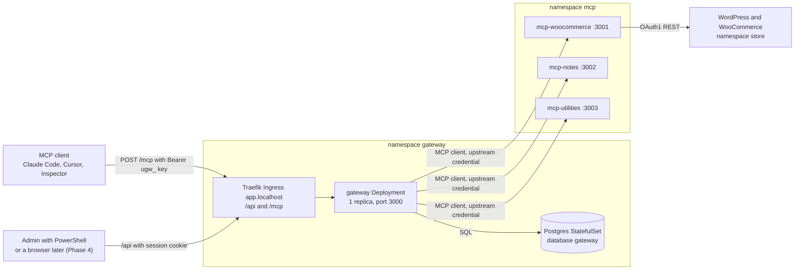
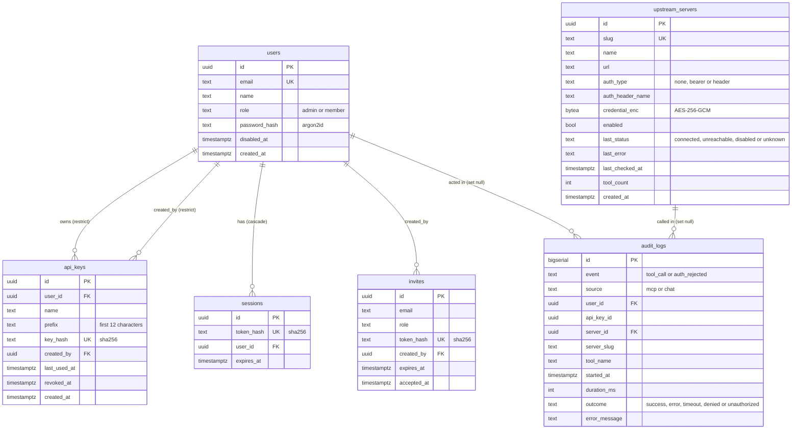
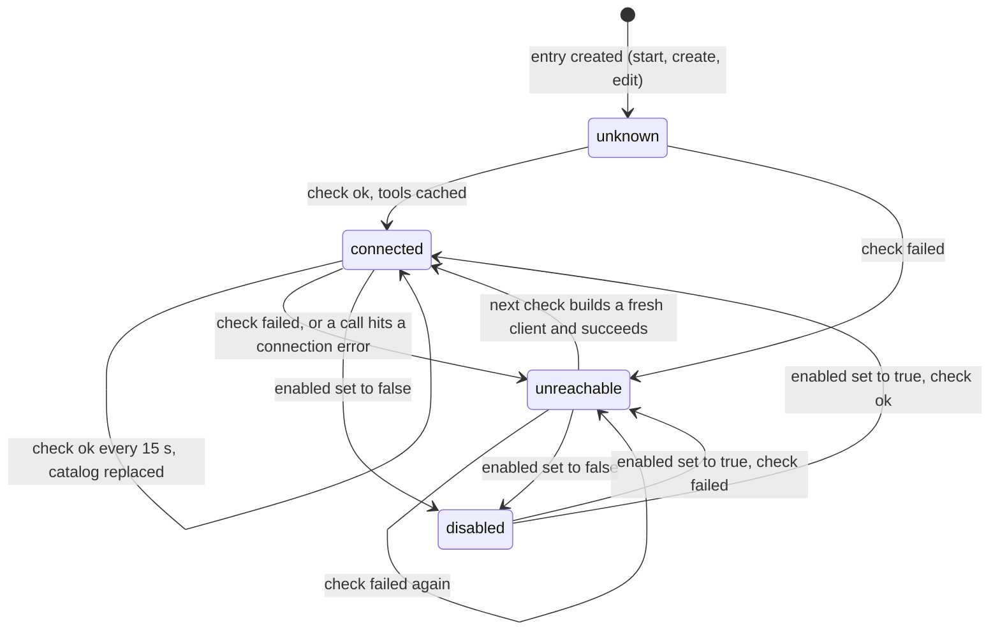

# System design

> **Status (end of Phase 3).** This file describes the gateway **as built**: the components, the data model, the interfaces, the upstream manager and the trade-offs. Everything stated here exists in the code on the `phase-3-gateway` branch and was run on the local k3d cluster, unless it is labelled **expected** or **not tested**. The dashboard, the chat agent and the LLM layer are Phase 4 and are not described as available. The complete document (NetworkPolicies, production values, the chat flow) is finished in Phase 6.

Related: the overview is [architecture.md](architecture.md), each flow step by step is in [workflows.md](workflows.md), failures are in [error-handling.md](error-handling.md), and the security view is [security.md](security.md). The source of truth for intent is the [design spec](superpowers/specs/2026-10-18-mcp-gateway-design.md).

## 1. Components

| Component | What it does | Where |
|---|---|---|
| `gateway` | MCP server for clients, MCP client for upstreams, REST API, auth, audit. | `apps/gateway`, Deployment `gateway` |
| Postgres 17.11 | The gateway's own database: users, keys, invites, sessions, server registry, audit log. | StatefulSet `postgres-0`, PVC |
| `mcp-woocommerce`, `mcp-notes`, `mcp-utilities` | The three upstreams, 6 + 5 + 4 = 15 tools. | namespace `mcp`, no Ingress |
| `packages/shared` | Logger, env loader, the MCP HTTP server bootstrap (auth hook, extra routes, request ids) used by all four apps. | `packages/shared` |

The gateway is two things at once ([learning/03-gateway.md](learning/03-gateway.md#1-the-gateway-is-a-client-and-a-server)): to your Claude Code it is a server; to `mcp-woocommerce` it is a client with its own credential. The two credentials never meet (no token passthrough).

## 2. Data model

Six tables in database `gateway`, created by the migration `apps/gateway/drizzle/0000_init.sql` that runs at every start.

Points worth knowing:

- **`invites` has no `created_at`** (the spec lists none). Pending invites are listed by `expires_at`, newest first.
- **`audit_logs.server_id` is `ON DELETE SET NULL`.** Deleting a server keeps its history readable because `server_slug` is denormalised into every row. `audit_logs.user_id` is also `SET NULL`. `api_key_id` has no foreign key, so a key row can never block or be blocked by history.
- **`tool_name` holds the upstream's own tool name** (`list_orders`) with `server_slug` beside it (`woo`). A call that matched no server keeps the name as the client sent it (`zzz__ping`) with a null slug. The gateway name is `<server_slug>__<tool_name>`.
- **Only hashes are stored** for API keys, session cookies, invite tokens and passwords ([security.md](security.md)). `credential_enc` is encrypted, not hashed, because the gateway must send it upstream.
- **`bytea` and PGlite.** The Drizzle `bytea` column maps both drivers' return types to a Node `Buffer`: node-postgres returns a `Buffer`, PGlite (the in-process Postgres the tests use) returns a `Uint8Array`.

## 3. Interfaces

### The REST API (`/api`)

Mounted at `/api` by `src/api/router.ts`. Order of processing: JSON body parser (limit 100 kb), then the **CSRF guard**, then per route the session check and the role check, then the handler. Errors always use the shape `{"error":{"code","message","details"?,"requestId"}}`.

**CSRF rule.** Every `POST`, `PUT`, `PATCH` and `DELETE` needs `Content-Type: application/json` **and** `Origin` equal to the origin of `PUBLIC_APP_URL` (`http://app.localhost` locally). This includes `DELETE` with no body and the public invite routes. Anything else is `403 CSRF_REJECTED` before the session is even looked at (verified 2026-10-19).

| Method and path | Who | Purpose | Success |
|---|---|---|---|
| `POST /api/auth/login` | public (rate limited) | Email and password; sets cookie `ugw_session` | 200 `{user}` |
| `POST /api/auth/logout` | session | Deletes the session, clears the cookie | 204 |
| `GET /api/auth/me` | session | The current user | 200 `{user}` |
| `GET /api/invites/:token` | public | Preview an invite (email, role, expiry) | 200 |
| `POST /api/invites/:token/accept` | public | Body `{name, password}`; creates the user, logs them in | 201 `{user}` |
| `GET /api/invites` | admin | Pending invites (expired ones included) | 200 list |
| `POST /api/invites` | admin | Body `{email, role}`; returns the link **once** | 201 `{invite, link}` |
| `DELETE /api/invites/:id` | admin | Cancel a pending invite | 204 |
| `GET /api/users` | admin | List users | 200 list |
| `PATCH /api/users/:id` | admin | `{role?, disabled?}`; disabling deletes the user's sessions and revokes their keys | 200 `{user}` |
| `GET /api/keys`, `POST /api/keys` | session | Own keys; create returns `{key, plaintext}` once | 200 / 201 |
| `DELETE /api/keys/:id` | session | Revoke an own key (another user's key looks like 404) | 204 |
| `GET/POST /api/users/:id/keys`, `DELETE /api/users/:id/keys/:keyId` | admin | Manage another user's keys | 200 / 201 / 204 |
| `GET /api/servers`, `GET /api/servers/:id` | session | A `ServerView` (below) | 200 |
| `POST /api/servers` | admin | Register a server (SSRF check, credential encrypted) | 201 `ServerView` |
| `PATCH /api/servers/:id` | admin | Edit, enable or disable, rotate or clear the credential; `slug` cannot change | 200 `ServerView` |
| `DELETE /api/servers/:id` | admin | Remove | 204 |
| `POST /api/servers/:id/refresh` | admin | Run a health check now | 200 `ServerView` |
| `GET /api/audit` | session | Filters `userId`, `serverSlug`, `toolName`, `outcome`, `from`, `to`, `limit` (1-100, default 50), `cursor`. Admin sees all rows, a member only their own (asking for someone else's is 403). | 200 `{items, nextCursor}` |
| `GET /healthz`, `GET /readyz` | public | Probes | 200 / 503 |

`POST /api/chat` is **not built** (Phase 4).

**`ServerView`** (never contains the credential): `id, slug, name, url, authType, authHeaderName, hasCredential, enabled, status, lastError, checkedAt, toolCount, tools[{name, description}], skippedTools[]`. `skippedTools` lists upstream tools whose prefixed name was not valid and which were therefore left out (see section 5).

Other rules enforced by the API: emails are trimmed and lowercased everywhere; passwords are 10-200 characters; an admin cannot change their own role or disable themselves (409 `CONFLICT`, so one active admin always remains); `url` is checked by the SSRF guard on create and on edit ([security.md](security.md#5-ssrf-guard)).

### The MCP endpoint (`POST /mcp`)

- **Transport:** stateless Streamable HTTP, one JSON-RPC message per request, no session id ([learning/02-mcp-protocol.md](learning/02-mcp-protocol.md)). A new `McpServer` object is built for every request. `GET /mcp` is `405`.
- **Order of checks:** Host header allow-list (`MCP_ALLOWED_HOSTS`), then **authentication**, then body parsing (limit 1 MB), then the MCP handler.
- **Authentication** (`src/mcp/auth.ts`, `src/auth/bearer.ts`): `Authorization: Bearer <credential>`. A credential starting with `ugw_` is an API key (SHA-256 lookup, revoked and disabled-user checks, `last_used_at` updated). Anything else is tried as the internal chat token (HS256 JWT, audience `gateway-chat`; the user is re-read so a user disabled after minting is refused). There is **no cache**: a revoked key fails on its very next request. A failure answers `401` with `WWW-Authenticate: Bearer` and the JSON-RPC error `-32001 Unauthorized`.
- **`tools/list`:** the cached catalog of every server that is enabled **and** connected, sorted by name, with no network call.
- **`tools/call`:** routed to the owning upstream (section 6), result passed through unchanged. Failures that the model can read are `isError` results, not protocol errors.

Captured traffic for all of this is in [learning/03-gateway.md](learning/03-gateway.md#5-captured-traffic).

## 4. The upstream manager

One `UpstreamManager` per process (`src/upstreams/manager.ts`). It holds, for every registered server, an entry with the row, one MCP client connection (or none), the cached state, and a name index.

Rules, each pinned by a test in `test/upstreams/manager.test.ts`:

- **The loop.** Every 15 s (`UPSTREAM_HEALTH_INTERVAL_MS`) each enabled server whose previous check has finished gets a check: re-run the SSRF check on the URL (DNS answers change), connect if there is no client, `tools/list` with a 5 s timeout (`UPSTREAM_HEALTH_TIMEOUT_MS`). A check never throws; every failure becomes `unreachable` with a readable `lastError`.
- **A failure drops the client and the tools.** The next check builds a **fresh** client and connection pool, so a restarted upstream is never met with a stale socket. The tools are removed from `tools/list` at once.
- **Call-time failures.** A connection-level error during `tools/call` (refused, DNS, SSRF block, redirect, HTTP status, reset) marks the server `unreachable` immediately, without waiting for the tick. A timeout or an error answered by the upstream (JSON-RPC error) leaves it `connected`.
- **Mirror.** After each check the status, error, time and tool count are written to `upstream_servers.last_*` and `tool_count`, which is what the dashboard will show.
- **Edits.** `upsert` replaces the entry as a whole and checks it now; a check still running for the old entry sees it is stale and drops its result. `remove` closes the connection.
- **Disabled servers** are not connected, not checked and not listed; a call to them is `denied`.
- **Isolation.** Because `tools/list` reads memory only, a dead or slow upstream costs its own background check and nothing else. Measured on the cluster (2026-10-19): with `mcp-utilities` scaled to 0 its `utils__` tools were gone from the list after 12.2 s (4.1 s in a later run), `woo__ping` kept working, and 16.4 s after scaling back the 15 tools were complete again ([run guide](run-guide.md#the-end-to-end-and-isolation-checks)).

## 5. Naming ([ADR-006](decisions/ADR-006-tool-naming-scheme.md))

- Slug: `^[a-z][a-z0-9-]{1,15}$`, unique, immutable (the API refuses a `slug` in a `PATCH`).
- Gateway tool name: `<slug>__<upstream tool>`, which must match `^[a-zA-Z0-9_-]{1,64}$`. A tool whose prefixed name does not match (too long, a dot, a space) is **skipped on its own** and listed in `skippedTools`; the server's other tools are still served, and a warning is logged.
- Routing splits on the **first** `__`. Slugs cannot contain `_`, so the first `__` always ends the slug; the tool part may itself contain `__`.
- The description is prefixed with `[<Server name>] ` and the input schema is passed through unchanged.
- This is why the three `ping` tools coexist as `woo__ping`, `notes__ping` and `utils__ping`.

## 6. `tools/call` routing

1. Auth (section 3). On failure: 401, and an `auth_rejected` audit row unless the header was missing.
2. Split the name, find the server by slug. Unknown name or server: `isError` `Unknown tool: <name>`, audit outcome `denied`.
3. Server disabled or not connected: `isError` `Server '<slug>' is disabled or unreachable`, outcome `denied`.
4. Call the upstream with its own credential and a 20 s deadline (`UPSTREAM_CALL_TIMEOUT_MS`), also aborted if the client cancels. **Never retried.**
5. Write the audit row (`tool_call`, `source`, user, key, server, upstream tool name, duration, outcome, message capped at 500 characters) and one `tool call` log line (name, server, outcome, duration, user, never arguments or results).
6. Return the upstream result unchanged (including its own `isError`).

Audit outcomes: `success`; `error` (the upstream returned `isError`, a protocol error, a connection error, a cancel); `timeout`; `denied`; `unauthorized` (only on `auth_rejected` rows).

## 7. Timeouts and sizes

| What | Value | Where set |
|---|---|---|
| Health check interval / timeout | 15 s / 5 s | `UPSTREAM_HEALTH_INTERVAL_MS`, `UPSTREAM_HEALTH_TIMEOUT_MS` |
| Tool call | 20 s | `UPSTREAM_CALL_TIMEOUT_MS`; must stay above the WooCommerce server's own 10 s so a slow store comes back as that server's clean `isError`. The chart schema rejects values below 11000. |
| Postgres connect at start | 30 attempts, 2 s apart | `src/main.ts` |
| Session | 12 h | cookie `Max-Age=43200` |
| Invite | 72 h, single use | |
| Internal chat token | 5 min | built, not yet used by anything (Phase 4) |
| `/api` body / `/mcp` body | 100 kb / 1 MB | Express JSON parsers |
| Audit `error_message` / `tool_name` | 500 / 200 characters | `AuditWriter` |
| Login attempts | 10 per minute per IP and email | `LoginRateLimiter` |

## 8. Trade-offs and limits

| Decision | Gain | Cost / limit |
|---|---|---|
| Cached catalog instead of live fan-out ([ADR-014](decisions/ADR-014-cached-tool-catalog.md)) | `tools/list` is fast and survives dead upstreams. | The list can be stale for up to one interval (about 20 s with the 5 s timeout). Observed in the isolation check: 4-12 s to disappear, 16 s to return. |
| No auth cache ([ADR-008](decisions/ADR-008-api-key-hashing.md)) | Revocation is immediate (verified: a revoked key gets 401 on the next request). | One indexed database read per `/mcp` request. |
| Stateless `/mcp` | No session affinity; any pod can answer. | The client re-sends its context each request. |
| One gateway client per upstream with a pinned connection | Cheap calls, fresh client after any failure. | A reconfigured server drops in-flight calls. |
| No retries of tool calls | No duplicate writes (`create_product` is not idempotent). | The caller sees the failure and decides. |
| In-memory state per replica | Simple. | **Health and catalog state is per replica, and a server edit is applied on the replica that handled it.** Several replicas could briefly disagree. One replica is deployed, so this does not occur today. The login rate limiter is per replica too. |
| Notes in memory | Trivial upstream. | A `mcp-notes` restart empties the notes. |
| Audit row written after the call | Records the outcome and duration. | A crash mid-call leaves no row (spec §6.8). |
| Seeding by insert-if-absent | Admin edits survive restarts. | Changing the Helm seed later does not change an existing row; edit it through the API. |
| One shared upstream credential per server | Simple, matches the spec. | All users act through the same upstream identity; per-user attribution is in the gateway audit log only. |

## 9. Kubernetes shape (as deployed)

Postgres: StatefulSet `postgres-0`, uid/gid 999, `PGDATA` in a subdirectory of the volume, Service `postgres`. Gateway: Deployment `gateway`, 1 replica, uid 1000, read-only root filesystem with a `/tmp` emptyDir, probes on `/healthz` and `/readyz`, requests 50m/128Mi, limits 500m/384Mi. Ingress `gateway` for host `app.localhost` routes `/api` and `/mcp` (the dashboard will own `/` in Phase 4). Secrets: `gateway-secrets` (Postgres password, encryption key, internal token secret), `gateway-bootstrap` (admin email and password), plus gateway copies of the three upstream credentials used only to seed. Details and commands: [run guide](run-guide.md#9-the-gateway-phase-3) and [deployment.md](deployment.md).
