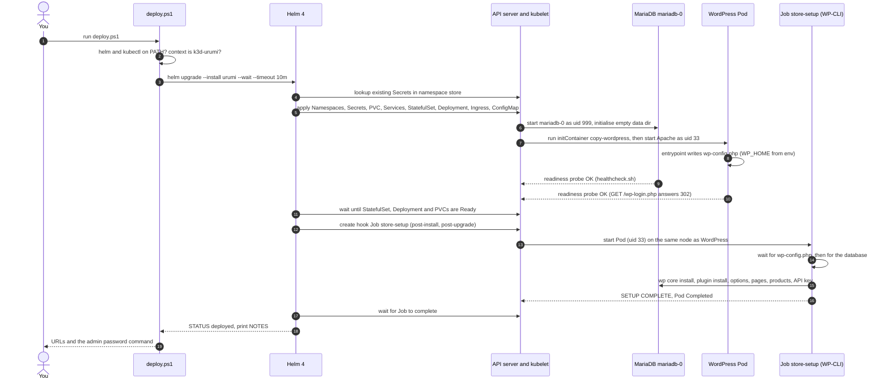
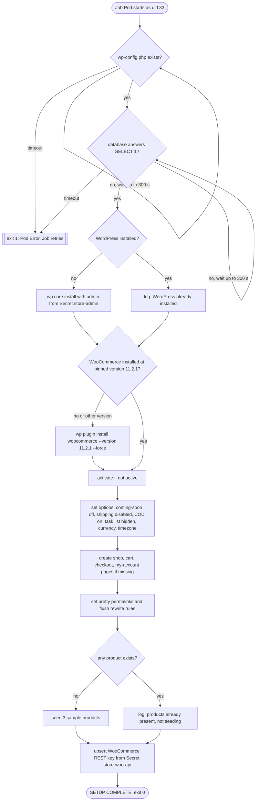
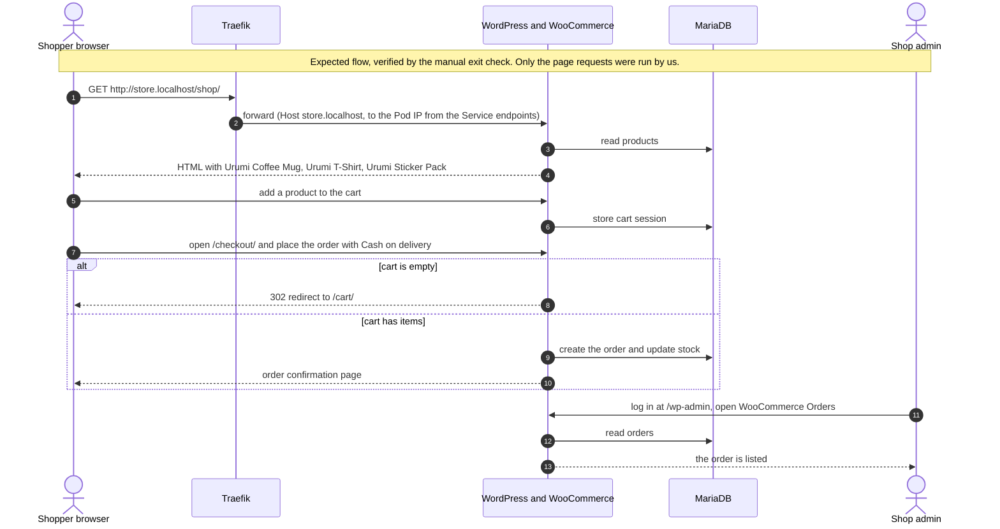
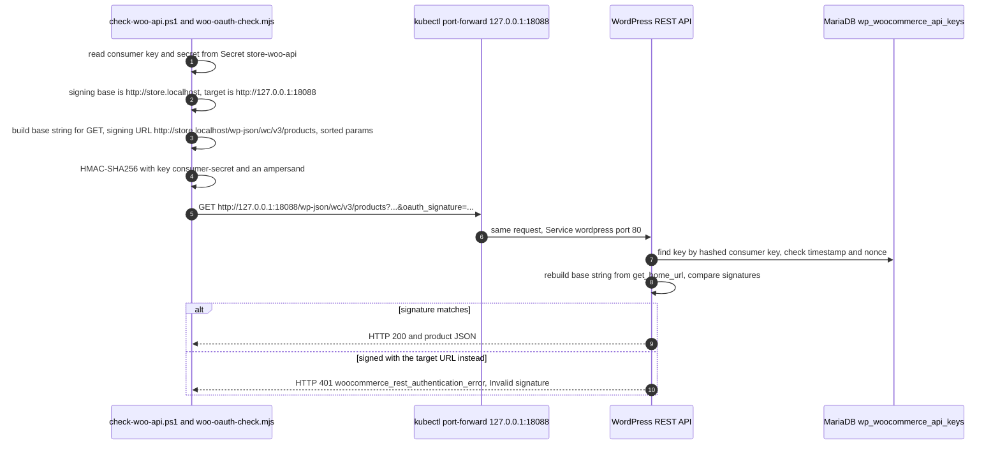
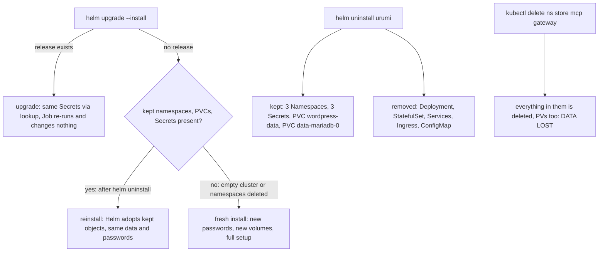
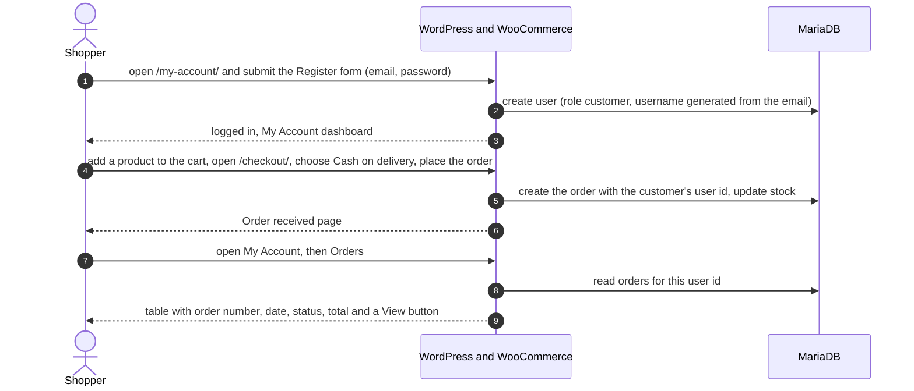

# Workflows

> **Status (end of Phase 1).** Only the **store** workflows exist today: installing the store, a shopper checking out, and signed REST access to WooCommerce. The gateway, MCP-server and dashboard workflows are **(planned)** for Phases 2-5 and are added here as they are built. Workflows 1, 3 and 4 were run against the real local cluster (unless a statement is explicitly marked *expected*, meaning derived from the configuration and not forced to happen). **Workflow 2 (cart, order, wp-admin) was not executed by us**: it is the manual Phase 1 exit check that you run, so its diagram and order-flow rows are labelled *expected, verified by the manual exit check*. Only the page and API checks listed in that section were run.

How to read the failure sections: every workflow answers the same questions: what can fail, how it is detected, what is retried, what the timeouts are, how duplicates and half-finished work are handled, what the user sees, and where the logs are. Statements marked **(observed)** were seen during Phase 1; statements marked **(expected)** follow from the Kubernetes/Helm/WooCommerce documented behavior and the chart's settings but were not deliberately triggered.

Contents: [1. Store install](#1-store-install-helm--hook-job) | [2. Shopper checkout](#2-shopper-checkout-cash-on-delivery) | [3. WooCommerce REST access (OAuth1)](#3-woocommerce-rest-access-oauth1) | [4. Data lifecycle: upgrade, uninstall, fresh install](#4-data-lifecycle-upgrade-uninstall-reinstall-fresh-install) | [5. Customer account and order history](#5-customer-account-and-order-history)

---

## 1. Store install (helm → hook Job)

**What it does.** One command, `scripts\deploy.ps1`, turns an empty cluster into a working WooCommerce store at `http://store.localhost`: database, WordPress, the Ingress, generated credentials, a configured shop (Cash on delivery, three sample products) and a REST API key. Running it again is safe; it is also the upgrade command.

**Actors.**

- **You / `scripts/deploy.ps1`:** checks that `helm` and `kubectl` are on `PATH`, refuses to deploy local values to a non-`k3d-urumi` context, then runs `helm upgrade --install urumi charts/urumi-platform -n urumi-system --create-namespace -f deploy/values-local.yaml --wait --timeout 10m`.
- **Helm:** renders the templates (reading existing Secrets with `lookup`), sends them to the Kubernetes API server, waits for readiness (`--wait`), then runs the hook Job and waits for it.
- **Kubernetes (API server, scheduler, kubelet, local-path provisioner):** creates the PVCs and Pods, runs the `copy-wordpress` initContainer and the probes.
- **MariaDB (`mariadb-0`) and WordPress (`wordpress-...`) Pods.**
- **`store-setup` Job (WP-CLI):** the only thing that knows about WooCommerce settings. Script: `charts/urumi-platform/files/store-setup/setup.sh`.

### Sequence



**Reading the diagram.** The step numbers are the diagram's own (`autonumber` also counts messages a participant sends to itself, such as the checks in step 2). Steps 1-3 are the user action, the local checks and the single Helm call. Steps 4-5 are Helm preparing: it reads previous Secrets so passwords never change on upgrade, then submits all ordinary resources at once. Steps 6-10 happen in parallel inside the cluster: MariaDB initialises, WordPress's initContainer copies the application files onto the (empty) volume, the main container starts and writes `wp-config.php`, and both report ready through probes. Step 11 is the `--wait` barrier: Helm does not start the post-install hook until the workloads are Ready. Steps 12-17 are the hook Job: create it, start its Pod, wait for `wp-config.php` and the database, run the setup, finish, and Helm waits for the Job as well, so the command only finishes when the store is fully configured. Steps 18-19 report the result. The Job tolerates being started early because it waits for `wp-config.php` and the database by itself.

**Observed timings (fresh install, reference machine, 2026-10-18).** Release created 16:16:28 IST, finished about 16:17:35 IST (about 67 s with images already cached). WordPress Ready at 10:46:54Z, Job `startTime` 10:46:55Z, so **on the fresh install the Job started after WordPress was Ready**; the Job ran 39 s (10:46:55Z to 10:47:34Z). In the setup log the WooCommerce step runs from `installing WooCommerce 11.2.1` at 10:46:57 to `configuring store options` at 10:47:16, about 19 s. This fresh install is the only run that demonstrates the ordering. An earlier upgrade showed WordPress Ready at 10:23:45Z and the Job starting at 10:28:34Z, but that proves nothing about ordering: WordPress had already been Ready before that upgrade started. No timestamps were recorded for the reinstall.

### Decision points inside the Job



**Reading the diagram.** The Job is a linear script with a "check first, change only if needed" decision at every state-changing step: *already installed?*, *does the installed WooCommerce version equal the pinned one?*, *do products exist?*. Each decision is what makes a re-run harmless. Any command that fails aborts the script (`set -eu`), which fails the Pod. The two wait loops are the only places that loop (60 tries x 5 s = 300 s each).

### Why each step exists (the non-obvious ones)

| Step | Reason |
|---|---|
| Wait for `wp-config.php` | The Job shares the WordPress volume. The WordPress container writes `wp-config.php` on its first start; WP-CLI cannot work without it. |
| `woocommerce_coming_soon = no` | A new WooCommerce 11 store starts in "coming soon" mode, which hides the shop from visitors. |
| `woocommerce_ship_to_countries = disabled` | No shipping: checkout works without any shipping zones configured. |
| Cash on delivery enabled (`woocommerce_cod_settings`) | The only payment method; no external payment provider is needed. |
| `woocommerce_task_list_hidden_lists = ["setup"]` | Hides the onboarding checklist. The older option `woocommerce_task_list_hidden` fails on WooCommerce 11.2.1 and was replaced. On a fresh store the first Job attempt succeeded, which confirms the replacement works. |
| Pretty permalinks (`/%postname%/`) | WooCommerce REST paths (`/wp-json/...`) need them. |
| Upsert of the REST key | Deletes the row with the description `urumi-mcp (managed by Helm; do not edit)` and inserts it again with the key/secret from Secret `store-woo-api`. The consumer key is stored hashed (`wc_api_hash`), so the same Secret always produces a working key. |

### Failure and recovery

| What can fail | When | Detected by | Retried? | What you see | Where to look |
|---|---|---|---|---|---|
| `helm` / `kubectl` missing | Before anything runs | `deploy.ps1` checks `Get-Command` | n/a | `ERROR: 'helm' was not found on PATH ... open a NEW terminal` | [troubleshooting](troubleshooting.md#helm-or-k3d-not-found) |
| Wrong kube context | Before anything runs | `deploy.ps1` compares the context to `k3d-urumi` for local values | n/a | `ERROR: Refusing to deploy local values to context '...'` | [troubleshooting](troubleshooting.md#refusing-to-deploy-local-values-to-context) |
| An image cannot be pulled (no internet) | Pod creation | kubelet: `ErrImagePull` / `ImagePullBackOff` | kubelet retries with backoff | `helm` waits, then times out (see below) | `kubectl -n store describe pod ...` |
| Namespace exists but is not owned by this release | First install | Helm ownership check | no | `helm` error mentioning "exists and cannot be imported" **(expected, not forced)** | [troubleshooting](troubleshooting.md#helm-namespace-adoption-failures) |
| MariaDB or WordPress never becomes Ready | Pod start | probes (`startupProbe`: MariaDB 60 x 5 s, WordPress 30 x 10 s) | kubelet restarts a container that fails its startup/liveness probe | after 10 min `helm --wait` fails: `ERROR: helm upgrade --install failed. Diagnose with: kubectl get pods -A ; kubectl -n store logs job/store-setup ; see docs/troubleshooting.md` | `kubectl -n store get pods` and `describe` |
| WordPress started before MariaDB | First seconds | WordPress startup probe gets HTTP 500 | the probe simply tries again every 10 s | Event `Startup probe failed: HTTP probe failed with statuscode: 500` **(observed, harmless)** | `kubectl -n store get events` |
| `wp-config.php` or the database not reachable within 300 s | Job start | `setup.sh` loop counter | The Job Pod exits 1; Kubernetes creates a new Pod (`backoffLimit: 3`, so up to 4 Pods in total) | Pods `store-setup-xxxxx` in `Error`; logs `ERROR: database not reachable within 300s` | `kubectl -n store logs job/store-setup` |
| WooCommerce download fails (no internet, `downloads.wordpress.org` down) | Job, plugin install | WP-CLI exits non-zero, `set -e` aborts | yes, same Pod-retry rule | Job `Failed`; Helm reports the post-install hook failure; `deploy.ps1` prints the ERROR line above | job logs, `kubectl -n store describe job store-setup` |
| Job runs out of memory (limit 768 Mi) | Plugin unpack | Pod `OOMKilled` | Pod-retry rule | same as above, `describe pod` shows `OOMKilled` | `kubectl -n store describe pod -l job-name=store-setup` |
| Job takes longer than `activeDeadlineSeconds: 480` | Any step | Kubernetes marks the Job `Failed` (`DeadlineExceeded`) | no further Pods | Helm fails with the Job's reason, **before** its own 10-minute timeout, because 480 s < 10 min | `describe job` |
| Two deploys at once | Operator error | Helm release lock | no | `another operation (install/upgrade/rollback) is in progress` **(expected)** | `helm history urumi -n urumi-system` |

**Timeouts.** `helm --wait --timeout 10m` bounds the whole command; the Job's `activeDeadlineSeconds: 480` is deliberately shorter, so a stuck Job fails with a precise reason instead of being cut off by the Helm timeout; the two waits inside the Job are 300 s each; probes: see above.

**Retries.** Kubelet restarts containers that fail probes. The Job is retried by Kubernetes with `restartPolicy: Never` and `backoffLimit: 3`: each retry is a **new Pod** (so failed attempts leave `Error` Pods whose logs you can read). A successful fresh install shows exactly one Pod (verified on the reference machine, 2026-10-18).

**Duplicates, partial work, inconsistent state.**

- Re-running the Job (every `deploy.ps1` run) is idempotent because of the check-first decisions above. Verified: on the reinstall test it logged `WordPress already installed` and `products already present (3); not seeding`, and every `wp option update` reported `unchanged`.
- A Job that dies half-way (for example WooCommerce installed, options not yet set) leaves a half-configured store, but the next run starts from the beginning and completes it. Nothing else depends on the Job, so WordPress and MariaDB stay up in the meantime.
- Credentials cannot drift: generated once per Secret and re-read with `lookup`, and the Secrets are kept on uninstall (see [workflow 4](#4-data-lifecycle-upgrade-uninstall-reinstall-fresh-install)).
- After a failed install the release is left in a `failed` state in Helm's records; running `deploy.ps1` again performs `helm upgrade --install` over it **(expected)**.

**Logs and diagnostics.** `kubectl -n store logs job/store-setup` (every line starts with `[store-setup] HH:MM:SS`; the last line is `SETUP COMPLETE`); `kubectl -n store get pods,job`; `kubectl -n store get events --sort-by=.lastTimestamp`; `helm status urumi -n urumi-system`; `helm history urumi -n urumi-system`. The `store-setup` Job from the last run is kept (not deleted) until the next deploy.

---

## 2. Shopper checkout (Cash on delivery)

**What it does.** A shopper visits the storefront, adds a product to the cart and checks out as a guest paying with Cash on delivery; the order then appears in WooCommerce → Orders in wp-admin. This is the Phase 1 exit check (steps 2-4), which you run by hand; the automated checks in Phase 1 verify the pages and the REST API, not a full order. **The cart-to-order sequence below is therefore (expected — verified by the manual exit check): we did not place an order ourselves.** The page-level steps (shop, cart, empty-cart redirect) were run.

**Actors.** Browser; Traefik (k3s ingress controller in `kube-system`); the `wordpress` Pod (Apache + PHP + WooCommerce); MariaDB; the shop admin (browser, wp-admin).



**Reading the diagram.** Everything the shopper does is plain HTTP through Traefik to one WordPress Pod; every state (products, cart session, orders, stock) lives in MariaDB, nothing important lives in the web Pod. The decision point is the empty cart: `/checkout/` with nothing in the cart answers **HTTP 302 to `/cart/`**. That is correct WooCommerce behavior (verified: `curl -s -o NUL -w "%{http_code} -> %{redirect_url}" http://store.localhost/checkout/` printed `302 -> http://store.localhost/cart/`), not an error. Cash on delivery needs no external service, and shipping is disabled, so checkout asks only for billing details. WooCommerce 11.2.1 exposes its Store API at `/wp-json/wc/store/v1/` (HTTP 200 on `/wp-json/wc/store/v1/cart`), which the block-based cart and checkout use. Order status for Cash on delivery is WooCommerce's default (`processing` for physical products); the order placement itself (expected — verified by the manual exit check) was not scripted and not run by us.

**What was verified automatically in Phase 1** (fresh install): `/shop/` contains `Urumi Coffee Mug`; `/cart/` returns 200; `/checkout/` with an empty cart returns 302 to `/cart/`; `/`, `/my-account/` and `/wp-login.php` return 200. After `kubectl -n store delete pod -l app.kubernetes.io/name=wordpress` and `kubectl -n store delete pod mariadb-0`, both Pods came back Ready (MariaDB first, then WordPress; the `copy-wordpress` initContainer logged `WordPress files present`), `/shop/` still listed the products and `check-woo-api.ps1` still passed, showing that state lives on the volumes. The same persistence for a real order is step 4 of the manual exit check.

### Failure and recovery

| What can fail | Detected by | Retried? | What the shopper sees | Recovery |
|---|---|---|---|---|
| WordPress Pod restarting (deploy, crash, `kubectl delete pod`) | Readiness probe fails, Pod leaves the Service endpoints | The shopper's browser retry | A short "no available server"/503 from Traefik while no Pod is Ready **(expected)**; the `Recreate` strategy means a brief gap during upgrades | Self-heals when the new Pod is Ready. Orders are in MariaDB and are expected to survive (expected — verified by the manual exit check, step 4; the products surviving a Pod deletion was run). |
| MariaDB down | WordPress shows the database error; its probes fail | Probes retry every 10-20 s | "Error establishing a database connection" **(expected)**. After about 2 minutes of failed liveness probes (6 x 20 s) WordPress is restarted too. This is a known trade-off: the liveness probe uses `/wp-login.php`, which needs the database | When MariaDB is back, WordPress recovers by itself. |
| Order e-mail cannot be sent | PHP `sendmail` finds no mail server | no | **Not blocking.** There is no mail server in the cluster; the setup log shows `sendmail: can't connect to remote host (127.0.0.1): Connection refused` **(observed in the Job)**. Customer and admin e-mails are not delivered. | Known limitation; a mail relay is out of scope. |
| Checkout says there is no payment or shipping method | Visible at checkout | no | WooCommerce message about no available methods | Means the setup Job's options were not applied; see [troubleshooting](troubleshooting.md#checkout-says-no-payment-or-shipping-methods-are-available). |
| Storefront shows "coming soon" | Visible on `/` | no | A "coming soon" page instead of the shop | `woocommerce_coming_soon` is not `no`; re-run `deploy.ps1`. |
| Duplicate submissions | WooCommerce's own checkout handling | n/a | One order per completed checkout (expected — verified by the manual exit check) | Not specific to this project. |

**Logs.** `kubectl -n store logs deploy/wordpress -c wordpress` (Apache access log lines and PHP errors); `kubectl -n store logs mariadb-0`; WooCommerce's own status log under WooCommerce → Status → Logs in wp-admin.

---

## 3. WooCommerce REST access (OAuth1)

**What it does.** Proves (and will let the Phase 2 MCP server use) the WooCommerce REST API v3 from outside WordPress, authenticated with the consumer key/secret that the setup Job created. Today only `scripts/check-woo-api.ps1` exercises it; the MCP server is **(planned)** for Phase 2. Decision record: [ADR-005](decisions/ADR-005-woocommerce-rest-oauth1.md).

**The important rule.** The OAuth 1.0a signature must be computed over the **public store URL** (`http://store.localhost` + path), **not** over the URL the request is actually sent to. WooCommerce checks the signature by rebuilding the URL from its own configuration (`includes/class-wc-rest-authentication.php`, `check_oauth_signature()`):

```php
$base_request_uri = rawurlencode( get_home_url( null, $request_path, is_ssl() ? 'https' : 'http' ) );
```

`get_home_url()` returns the `WP_HOME` host (`store.localhost`, plus the port if not default) and the scheme is `http` for any non-TLS request. The `Host` header the client sent is irrelevant.



**Reading the diagram.** Actors: the checker script (Node), a `kubectl port-forward` standing in for "some address that reaches the Service", WordPress, and the key table in MariaDB. The script sends the request to `127.0.0.1:18088` but signs `http://store.localhost/...`; WordPress recomputes the signature from `WP_HOME` and compares. The decision at the end is the proof: the same request signed with the *target* URL gets 401. The script runs three requests and expects 200 / 200 / 401 (verified on the fresh install: `HTTP 200`, `HTTP 200 []` for the second request whose search term matches no product, and `HTTP 401 ... Invalid signature - provided signature does not match.`).

**Details that matter for Phase 2.**

- Signature method `HMAC-SHA256`; the HMAC key is `<consumer secret>&` (there is no token secret). OAuth parameters are sent in the query string.
- Parameters are sorted by raw key in byte order (like PHP's `uksort( $params, 'strcmp' )`), percent-encoded per RFC 3986, and the whole normalized string is encoded again. `scripts/dev/woo-oauth-check.test.mjs` checks the signer against values generated independently by PHP: run `node --test "scripts/dev/*.test.mjs"` (5 tests pass; the directory form `node --test scripts/dev/` fails on Node 24.0.1).
- Only unique scalar query keys are supported; send lists comma-separated (`include=1,2`).
- The signing base is the public store URL (`WP_HOME`) with its scheme replaced by `http`. The port is included only if `WP_HOME` has one (non-default `publicPort`); production https/443 signs `http://store.example.com` with no `:443`. The check script derives the base from the Ingress host only (correct for port 80); the non-default-port case is **not tested**.
- The spike reached WordPress through `kubectl port-forward`. Access via the in-cluster Service name `wordpress.store.svc.cluster.local` is **expected to behave identically but was not exercised**; confirmed in Phase 2.
- Only GET was exercised; signed POST/PUT is verified in Phase 2.

### Failure and recovery

| What can fail | Detected by | Retried? | What you see | Fix |
|---|---|---|---|---|
| Signed with the wrong base URL (target URL, wrong host, missing port) | WooCommerce signature comparison | **Never retry with the same nonce.** Fix the base and send a new request with a fresh nonce | `401 woocommerce_rest_authentication_error: Invalid signature` | Sign `http://<WP_HOME host>[:port]<path>`. |
| Clock skew larger than 15 minutes between signer and cluster | WooCommerce rejects the timestamp (window of plus or minus 15 minutes) | no | `401` (looks like a signature error) | Fix the clock (WSL2/Docker clock drift after sleep is the usual cause; restart Docker Desktop or run `wsl --shutdown`). |
| Nonce reused | WooCommerce stores used nonces per consumer key | no | `401` | Always generate a fresh random nonce per request. |
| Key missing or changed | No row matches the hashed consumer key | no | `401` (consumer key invalid) | Re-run `deploy.ps1`: the Job re-inserts the key from Secret `store-woo-api`. |
| Port-forward not up yet | `fetch` fails | no | Node connection error | Re-run `check-woo-api.ps1`; it waits 3 s for the forward. |
| Query uses `a[]=`, duplicate keys, `.` or spaces in keys | The signer throws before sending | n/a | `unsupported query key` / `duplicate query key` | Pass lists comma-separated. |

**Logs.** The checker prints one line per request. WordPress access log: `kubectl -n store logs deploy/wordpress -c wordpress`. Troubleshooting: [401 from check-woo-api.ps1](troubleshooting.md#check-woo-apips1-returns-401).

---

## 4. Data lifecycle: upgrade, uninstall, reinstall, fresh install

**What it does.** Defines what survives each operation, because the store is the only stateful part so far. Verified on the reference machine (2026-10-18).



**Reading the diagram.** The two entry points on the left are the commands you type. `helm uninstall` removes only the workloads and routing; it deliberately keeps the namespaces, the three Secrets and both PVCs, so data and the matching passwords survive (the MariaDB data directory was initialised with the password in `store-db`, so a regenerated password would lock WordPress out). Only an explicit `kubectl delete ns` destroys data.

**Verified results (reference machine, 2026-10-18, namespace `store`).**

1. *Uninstall:* Helm printed that it kept `[PersistentVolumeClaim] wordpress-data`, `[Secret] store-db`, `[Secret] store-admin`, `[Secret] store-woo-api` and the three Namespaces. `data-mariadb-0` also stayed (a `volumeClaimTemplates` PVC is not Helm-managed). Both PVCs stayed `Bound`; the Deployment and StatefulSet were gone. The finished `store-setup` Job and Pod were still present: hook resources are not removed by uninstall, and the next hook run deletes them first (`before-hook-creation`). Harmless.
2. *Reinstall:* `deploy.ps1` reported `STATUS: deployed` (revision 1 of the new release) with no adoption error. The setup log said `WordPress already installed` and `products already present (3); not seeding`, and `check-woo-api.ps1` returned 200 / 200 / 401. Reinstall works only with the same release name and namespace (`urumi` / `urumi-system`), because the kept objects carry `meta.helm.sh/release-name` and `release-namespace` annotations.
3. *Fresh install:* after `helm uninstall` and `kubectl delete ns store mcp gateway --wait=true --timeout=300s`, `kubectl get pv` returned `No resources found` (the `local-path` PVs have reclaim policy `Delete`). `deploy.ps1` then built a new store: new Secrets and PVs, the setup Job succeeded on its **first** Pod, with no `Error` Pods, `status.failed` empty, and the WordPress Pod had 0 restarts.

**Failure and recovery.**

| What can fail | Why | What you see | Recovery |
|---|---|---|---|
| Reinstall under another release name or namespace | Kept objects belong to the old release | Helm "cannot be imported" ownership error **(expected)** | Use `urumi` / `urumi-system`, or delete the kept objects deliberately (destroys data). |
| Secrets deleted but PVC kept | Passwords regenerated, data directory still has the old ones | MariaDB starts but WordPress cannot log in (database error, probe failures) | Restore the old Secret, or delete the PVCs too (data lost). See [troubleshooting](troubleshooting.md#mariadb-crashloopbackoff-or-wordpress-cannot-reach-the-database). |
| Namespace deletion is slow | Pods and volumes still terminating | `kubectl delete ns` waits | Use `--wait=true --timeout=300s` as in the test; it completed within that. |

**Logs.** `helm history urumi -n urumi-system`, `kubectl get ns,pvc -A`, `kubectl get pv`.

---

## 5. Customer account and order history

**What it does.** A shopper registers an account, places a Cash-on-delivery order while logged in, and then sees that order under My Account → Orders. **Verified by `scripts/dev/customer-order-smoke.ps1`** (run 2026-10-18: order 18 belongs to customer 2 and was listed on `/my-account/orders/`). The script registers through the real My Account form, places the order through the WooCommerce Store API (the API the block checkout uses), and then fetches the orders page as that customer.

**Actors.** Shopper browser; WordPress and WooCommerce; MariaDB.



**Reading the diagram.** Registration is configured by WooCommerce options set by the setup Job: `woocommerce_enable_myaccount_registration`, `woocommerce_enable_signup_and_login_from_checkout` and `woocommerce_enable_checkout_login_reminder` are `yes`. `woocommerce_registration_generate_username` is `yes`, so the username comes from the email. `woocommerce_registration_generate_password` is `no`: with generated passwords WooCommerce would e-mail the password, and there is no mail server, so customers choose their own. The block checkout also offers sign-up at checkout (its flag is `checkoutAllowsSignup`). The decisive step is 5: the order is stored with the **logged-in user's id** (`_customer_user` in `wp_postmeta`), and step 7 reads exactly the orders with that id.

**Guest orders are not linked.** An order placed as a guest keeps customer id `0`. In WooCommerce 11.2.1, registering later with the same email does **not** attach it (**verified 2026-10-18** with `customer-order-smoke.ps1 -CheckGuestLinking`: guest order 19 stayed customer 0 and did not appear in My Orders). Guest orders are visible only to the admin, in WooCommerce → Orders. To have an order in My Account, log in (or register) before checking out.

### Failure and recovery

| What can fail | Detected by | What the shopper sees | Recovery |
|---|---|---|---|
| Registration is disabled (options not applied) | `customer-order-smoke.ps1` reports no `woocommerce-register-nonce` on My Account | No Register form on `/my-account/` | Run `scripts\up.ps1 -Redeploy` so the setup Job re-applies the options. |
| Registering with an email that already has an account | WooCommerce form error | "An account is already registered with your email address" | Log in instead. |
| Order placed as a guest | The order is absent from My Account → Orders | An orders list without that order | Expected, see above. The admin sees it in WooCommerce → Orders. |
| Order e-mails are not delivered | There is no mail server in the cluster | No confirmation e-mail | Known limitation; the order itself is created and visible. |
| Store restarting | Pods not ready | 503 or a database error for a short time | Wait until `kubectl -n store get pods` shows `Running`, then reload. |

**Logs and checks.** `kubectl -n store logs deploy/wordpress -c wordpress`; re-run `scripts\dev\customer-order-smoke.ps1`. More: [troubleshooting](troubleshooting.md#i-cannot-see-my-guest-order-in-my-account).
