# Workflows

> **Status (end of Phase 3).** Workflows 7-11 are the **gateway** workflows (registering an upstream, a tool call through the gateway, the API key lifecycle, inviting a teammate, an upstream going down and coming back); each says which steps were run on the cluster and which are covered by automated tests only. The dashboard and chat workflows are **(planned, Phase 4)**; NetworkPolicies and production values are **(planned, Phase 5)**; none is described here as available. The **store** workflows (installing the store, a shopper checking out, signed REST access to WooCommerce) and the **MCP tool call to the store** (workflow 6) exist today. Planned workflows are added here as they are built. Workflow 5 (customer account and order history) is verified by `scripts/dev/customer-order-smoke.ps1`. Workflows 1, 3 and 4 were run against the real local cluster (unless a statement is explicitly marked *expected*, meaning derived from the configuration and not forced to happen). **Workflow 2 (cart, order, wp-admin) was not executed by us**: it is the manual Phase 1 exit check that you run, so its diagram and order-flow rows are labelled *expected, verified by the manual exit check*. Only the page and API checks listed in that section were run.

How to read the failure sections: every workflow answers the same questions: what can fail, how it is detected, what is retried, what the timeouts are, how duplicates and half-finished work are handled, what the user sees, and where the logs are. Statements marked **(observed)** were seen during Phase 1; statements marked **(expected)** follow from the Kubernetes/Helm/WooCommerce documented behavior and the chart's settings but were not deliberately triggered.

Contents: [1. Store install](#1-store-install-helm--hook-job) | [2. Shopper checkout](#2-shopper-checkout-cash-on-delivery) | [3. WooCommerce REST access (OAuth1)](#3-woocommerce-rest-access-oauth1) | [4. Data lifecycle: upgrade, uninstall, fresh install](#4-data-lifecycle-upgrade-uninstall-reinstall-fresh-install) | [5. Customer account and order history](#5-customer-account-and-order-history) | [6. MCP tool call to the store](#6-mcp-tool-call-to-the-store) | [7. Register an upstream](#7-register-an-upstream-and-how-it-appears-in-toolslist) | [8. MCP tool call through the gateway](#8-mcp-tool-call-through-the-gateway) | [9. API key lifecycle](#9-api-key-lifecycle-create-use-revoke) | [10. Invite a teammate](#10-invite-a-teammate) | [11. Upstream goes down and comes back](#11-upstream-goes-down-and-comes-back)

---

## 1. Store install (helm → hook Job)

**What it does.** One command, `scripts\deploy.ps1`, turns an empty cluster into a working WooCommerce store at `http://store.localhost`: database, WordPress, the Ingress, generated credentials, a configured shop (Cash on delivery, three sample products) and a REST API key. Running it again is safe; it is also the upgrade command.

**Actors.**

- **You / `scripts/deploy.ps1`:** checks that `helm` and `kubectl` are on `PATH`, refuses to deploy local values to a non-`k3d-urumi` context, then runs `helm upgrade --install urumi charts/urumi-platform -n urumi-system --create-namespace -f deploy/values-local.yaml --wait --timeout 10m`.
- **Helm:** renders the templates (reading existing Secrets with `lookup`), sends them to the Kubernetes API server, waits for readiness (`--wait`), then runs the hook Job and waits for it.
- **Kubernetes (API server, scheduler, kubelet, local-path provisioner):** creates the PVCs and Pods, runs the `copy-wordpress` initContainer and the probes.
- **MariaDB (`mariadb-0`) and WordPress (`wordpress-...`) Pods.**
- **`store-setup` Job (WP-CLI):** the only thing that knows about WooCommerce settings. Script: `charts/urumi-platform/files/store-setup/setup.sh`.

### Sequence

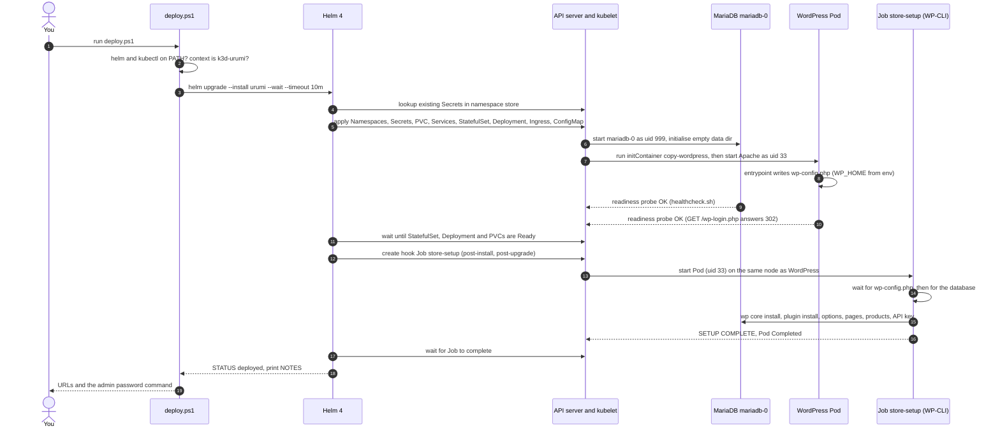

**Reading the diagram.** The step numbers are the diagram's own (`autonumber` also counts messages a participant sends to itself, such as the checks in step 2). Steps 1-3 are the user action, the local checks and the single Helm call. Steps 4-5 are Helm preparing: it reads previous Secrets so passwords never change on upgrade, then submits all ordinary resources at once. Steps 6-10 happen in parallel inside the cluster: MariaDB initialises, WordPress's initContainer copies the application files onto the (empty) volume, the main container starts and writes `wp-config.php`, and both report ready through probes. Step 11 is the `--wait` barrier: Helm does not start the post-install hook until the workloads are Ready. Steps 12-17 are the hook Job: create it, start its Pod, wait for `wp-config.php` and the database, run the setup, finish, and Helm waits for the Job as well, so the command only finishes when the store is fully configured. Steps 18-19 report the result. The Job tolerates being started early because it waits for `wp-config.php` and the database by itself.

**Observed timings (fresh install, reference machine, 2026-10-18).** Release created 16:16:28 IST, finished about 16:17:35 IST (about 67 s with images already cached). WordPress Ready at 10:46:54Z, Job `startTime` 10:46:55Z, so **on the fresh install the Job started after WordPress was Ready**; the Job ran 39 s (10:46:55Z to 10:47:34Z). In the setup log the WooCommerce step runs from `installing WooCommerce 11.2.1` at 10:46:57 to `configuring store options` at 10:47:16, about 19 s. This fresh install is the only run that demonstrates the ordering. An earlier upgrade showed WordPress Ready at 10:23:45Z and the Job starting at 10:28:34Z, but that proves nothing about ordering: WordPress had already been Ready before that upgrade started. No timestamps were recorded for the reinstall.

### Decision points inside the Job

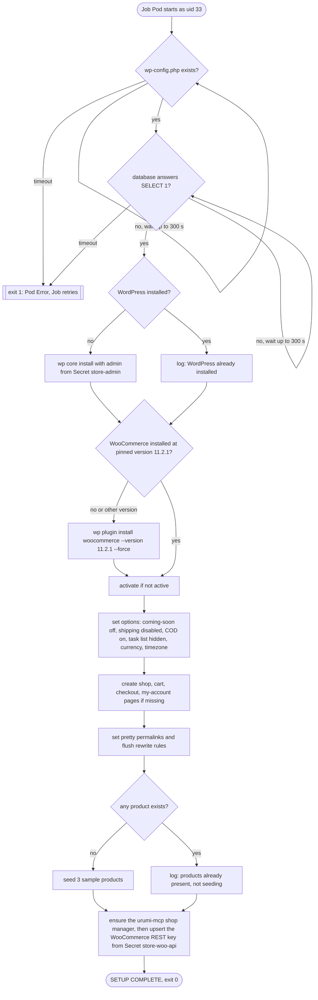

**Reading the diagram.** The Job is a linear script with a "check first, change only if needed" decision at every state-changing step: *already installed?*, *does the installed WooCommerce version equal the pinned one?*, *do products exist?*. Each decision is what makes a re-run harmless. Any command that fails aborts the script (`set -eu`), which fails the Pod. The two wait loops are the only places that loop (60 tries x 5 s = 300 s each).

### Why each step exists (the non-obvious ones)

| Step | Reason |
|---|---|
| Wait for `wp-config.php` | The Job shares the WordPress volume. The WordPress container writes `wp-config.php` on its first start; WP-CLI cannot work without it. |
| `woocommerce_coming_soon = no` | A new WooCommerce 11 store starts in "coming soon" mode, which hides the shop from visitors. |
| `woocommerce_ship_to_countries = disabled` | No shipping: checkout works without any shipping zones configured. |
| Cash on delivery enabled (`woocommerce_cod_settings`) | The only payment method; no external payment provider is needed. |
| `woocommerce_task_list_hidden_lists = ["setup"]` | Hides the onboarding checklist. The older option `woocommerce_task_list_hidden` fails on WooCommerce 11.2.1 and was replaced. On a fresh store the first Job attempt succeeded, which confirms the replacement works. |
| Pretty permalinks (`/%postname%/`) | WooCommerce REST paths (`/wp-json/...`) need them. |
| The `urumi-mcp` key owner | The REST key belongs to a dedicated user `urumi-mcp` with the Shop manager role (least privilege: a leaked key cannot manage plugins or users). The Job creates it with a random password that nobody sees, and marks it with user meta `urumi_managed_key_owner=1`. If a user with that login **already exists without the marker**, the Job **fails** instead of promoting it: with open registration and WooCommerce deriving logins from e-mail addresses, a stranger could otherwise register `urumi-mcp` and be handed the key. Fix: [troubleshooting](troubleshooting.md#the-store-setup-job-fails-with-missing-urumi_managed_key_owner-marker). |
| Upsert of the REST key | Looks for the key row by its description `urumi-mcp (managed by Helm; do not edit)`. If it exists it is **updated in place** (same `key_id`, so existing nonces are kept); otherwise it is inserted; duplicate rows are removed. The consumer key is stored hashed (`wc_api_hash`), so the same Secret always produces a working key. The update-then-insert is atomic in the sense that there is no moment without a valid key (verified 2026-10-18: `key_id` stayed 4 across redeploys). |

### Failure and recovery

| What can fail | When | Detected by | Retried? | What you see | Where to look |
|---|---|---|---|---|---|
| `helm` / `kubectl` missing | Before anything runs | `deploy.ps1` checks `Get-Command` | n/a | `ERROR: 'helm' was not found on PATH ... open a NEW terminal` | [troubleshooting](troubleshooting.md#helm-or-k3d-not-found) |
| Wrong kube context | Before anything runs | `deploy.ps1` compares the context to `k3d-urumi` for local values | n/a | `ERROR: Refusing to deploy local values to context '...'` | [troubleshooting](troubleshooting.md#refusing-to-deploy-local-values-to-context) |
| An image cannot be pulled (no internet) | Pod creation | kubelet: `ErrImagePull` / `ImagePullBackOff` | kubelet retries with backoff | `helm` waits, then times out (see below) | `kubectl -n store describe pod ...` |
| Namespace exists but is not owned by this release | First install | Helm ownership check | no | `helm` error mentioning "exists and cannot be imported" **(expected, not forced)** | [troubleshooting](troubleshooting.md#helm-namespace-adoption-failures) |
| MariaDB or WordPress never becomes Ready | Pod start | probes (`startupProbe`: MariaDB 60 x 5 s, WordPress 30 x 10 s) | kubelet restarts a container that fails its startup/liveness probe | after 10 min `helm --wait` fails: `ERROR: helm upgrade --install failed. Diagnose with: kubectl get pods -A ; kubectl -n store logs job/store-setup ; see docs/troubleshooting.md` | `kubectl -n store get pods` and `describe` |
| WordPress started before MariaDB | First seconds | WordPress startup probe gets HTTP 500 | the probe simply tries again every 10 s | Event `Startup probe failed: HTTP probe failed with statuscode: 500` **(observed, harmless)** | `kubectl -n store get events` |
| `wp-config.php` or the database not reachable within 300 s | Job start | `setup.sh` loop counter | The Job Pod exits 1; Kubernetes creates a new Pod (`backoffLimit: 3`, so up to 4 Pods in total) | Pods `store-setup-xxxxx` in `Error`; logs `ERROR: database not reachable within 300s` | `kubectl -n store logs job/store-setup` |
| WooCommerce download fails (no internet, `downloads.wordpress.org` down) | Job, plugin install | WP-CLI exits non-zero, `set -e` aborts | yes, same Pod-retry rule | Job `Failed`; Helm reports the post-install hook failure; `deploy.ps1` prints the ERROR line above | job logs, `kubectl -n store describe job store-setup` |
| Job runs out of memory (limit 768 Mi) | Plugin unpack | Pod `OOMKilled` | Pod-retry rule | same as above, `describe pod` shows `OOMKilled` | `kubectl -n store describe pod -l job-name=store-setup` |
| Job takes longer than `activeDeadlineSeconds: 480` | Any step | Kubernetes marks the Job `Failed` (`DeadlineExceeded`) | no further Pods | Helm fails with the Job's reason, **before** its own 10-minute timeout, because 480 s < 10 min | `describe job` |
| Two deploys at once | Operator error | Helm release lock | no | `another operation (install/upgrade/rollback) is in progress` **(expected)** | `helm history urumi -n urumi-system` |

**Timeouts.** `helm --wait --timeout 10m` bounds the whole command; the Job's `activeDeadlineSeconds: 480` is deliberately shorter, so a stuck Job fails with a precise reason instead of being cut off by the Helm timeout; the two waits inside the Job are 300 s each; probes: see above.

**Retries.** Kubelet restarts containers that fail probes. The Job is retried by Kubernetes with `restartPolicy: Never` and `backoffLimit: 3`: each retry is a **new Pod** (so failed attempts leave `Error` Pods whose logs you can read). A successful fresh install shows exactly one Pod (verified on the reference machine, 2026-10-18).

**Duplicates, partial work, inconsistent state.**

- Re-running the Job (every `deploy.ps1` run) is idempotent because of the check-first decisions above. Verified: on the reinstall test it logged `WordPress already installed` and `products already present (3); not seeding`, and every `wp option update` reported `unchanged`.
- A Job that dies half-way (for example WooCommerce installed, options not yet set) leaves a half-configured store, but the next run starts from the beginning and completes it. Nothing else depends on the Job, so WordPress and MariaDB stay up in the meantime.
- Credentials cannot drift: generated once per Secret and re-read with `lookup`, and the Secrets are kept on uninstall (see [workflow 4](#4-data-lifecycle-upgrade-uninstall-reinstall-fresh-install)).
- After a failed install the release is left in a `failed` state in Helm's records; running `deploy.ps1` again performs `helm upgrade --install` over it **(expected)**.

**Logs and diagnostics.** `kubectl -n store logs job/store-setup` (every line starts with `[store-setup] HH:MM:SS`; the last line is `SETUP COMPLETE`); `kubectl -n store get pods,job`; `kubectl -n store get events --sort-by=.lastTimestamp`; `helm status urumi -n urumi-system`; `helm history urumi -n urumi-system`. The `store-setup` Job from the last run is kept (not deleted) until the next deploy.

---

## 2. Shopper checkout (Cash on delivery)

**What it does.** A shopper visits the storefront, adds a product to the cart and checks out as a guest paying with Cash on delivery; the order then appears in WooCommerce → Orders in wp-admin. This is the Phase 1 exit check (steps 2-4), which you run by hand; the automated checks in Phase 1 verify the pages and the REST API, not a full order. **The cart-to-order sequence below is therefore (expected — verified by the manual exit check): we did not place an order ourselves.** The page-level steps (shop, cart, empty-cart redirect) were run.

**Actors.** Browser; Traefik (k3s ingress controller in `kube-system`); the `wordpress` Pod (Apache + PHP + WooCommerce); MariaDB; the shop admin (browser, wp-admin).

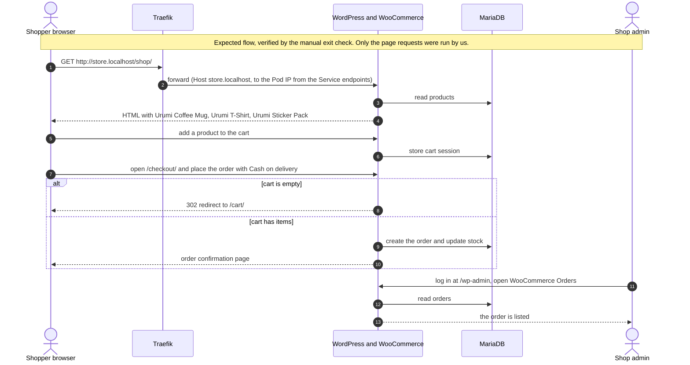

**Reading the diagram.** Everything the shopper does is plain HTTP through Traefik to one WordPress Pod; every state (products, cart session, orders, stock) lives in MariaDB, nothing important lives in the web Pod. The decision point is the empty cart: `/checkout/` with nothing in the cart answers **HTTP 302 to `/cart/`**. That is correct WooCommerce behavior (verified: `curl -s -o NUL -w "%{http_code} -> %{redirect_url}" http://store.localhost/checkout/` printed `302 -> http://store.localhost/cart/`), not an error. Cash on delivery needs no external service, and shipping is disabled, so checkout asks only for billing details. WooCommerce 11.2.1 exposes its Store API at `/wp-json/wc/store/v1/` (HTTP 200 on `/wp-json/wc/store/v1/cart`), which the block-based cart and checkout use. Order status for Cash on delivery is WooCommerce's default (`processing` for physical products); the order placement itself (expected — verified by the manual exit check) was not scripted and not run by us.

**What was verified automatically in Phase 1** (fresh install): `/shop/` contains `Urumi Coffee Mug`; `/cart/` returns 200; `/checkout/` with an empty cart returns 302 to `/cart/`; `/`, `/my-account/` and `/wp-login.php` return 200. After `kubectl -n store delete pod -l app.kubernetes.io/name=wordpress` and `kubectl -n store delete pod mariadb-0`, both Pods came back Ready (MariaDB first, then WordPress; the `copy-wordpress` initContainer logged `WordPress files present`), `/shop/` still listed the products and `check-woo-api.ps1` still passed, showing that state lives on the volumes. The same persistence for a real order is step 4 of the manual exit check.

### Failure and recovery

| What can fail | Detected by | Retried? | What the shopper sees | Recovery |
|---|---|---|---|---|
| WordPress Pod restarting (deploy, crash, `kubectl delete pod`) | Readiness probe fails, Pod leaves the Service endpoints | The shopper's browser retry | A short "no available server"/503 from Traefik while no Pod is Ready **(expected)**; the `Recreate` strategy means a brief gap during upgrades | Self-heals when the new Pod is Ready. Orders are in MariaDB and are expected to survive (expected — verified by the manual exit check, step 4; the products surviving a Pod deletion was run). |
| MariaDB down | WordPress shows the database error; its probes fail | Probes retry every 10-20 s | "Error establishing a database connection" **(expected)**. After about 2 minutes of failed liveness probes (6 x 20 s) WordPress is restarted too. This is a known trade-off: the liveness probe uses `/wp-login.php`, which needs the database | When MariaDB is back, WordPress recovers by itself. |
| Order e-mail cannot be sent | PHP `sendmail` finds no mail server | no | **Not blocking.** There is no mail server in the cluster; the setup log shows `sendmail: can't connect to remote host (127.0.0.1): Connection refused` **(observed in the Job)**. Customer and admin e-mails are not delivered. | Known limitation; a mail relay is out of scope. |
| Checkout says there is no payment or shipping method | Visible at checkout | no | WooCommerce message about no available methods | Means the setup Job's options were not applied; see [troubleshooting](troubleshooting.md#checkout-says-no-payment-or-shipping-methods-are-available). |
| Storefront shows "coming soon" | Visible on `/` | no | A "coming soon" page instead of the shop | `woocommerce_coming_soon` is not `no`; re-run `deploy.ps1`. |
| Duplicate submissions | WooCommerce's own checkout handling | n/a | One order per completed checkout (expected — verified by the manual exit check) | Not specific to this project. |

**Logs.** `kubectl -n store logs deploy/wordpress -c wordpress` (Apache access log lines and PHP errors); `kubectl -n store logs mariadb-0`; WooCommerce's own status log under WooCommerce → Status → Logs in wp-admin.

---

## 3. WooCommerce REST access (OAuth1)

**What it does.** Proves (and lets the Phase 2 MCP server use) the WooCommerce REST API v3 from outside WordPress, authenticated with the consumer key/secret that the setup Job created. `scripts/check-woo-api.ps1` exercises it through a port-forward; the MCP server uses it from inside the cluster (see [workflow 6](#6-mcp-tool-call-to-the-store)). Decision record: [ADR-005](decisions/ADR-005-woocommerce-rest-oauth1.md).

**The important rule.** The OAuth 1.0a signature must be computed over the **public store URL** (`http://store.localhost` + path), **not** over the URL the request is actually sent to. WooCommerce checks the signature by rebuilding the URL from its own configuration (`includes/class-wc-rest-authentication.php`, `check_oauth_signature()`):

```php
$base_request_uri = rawurlencode( get_home_url( null, $request_path, is_ssl() ? 'https' : 'http' ) );
```

`get_home_url()` returns the `WP_HOME` host (`store.localhost`, plus the port if not default) and the scheme is `http` for any non-TLS request. The `Host` header the client sent is irrelevant.

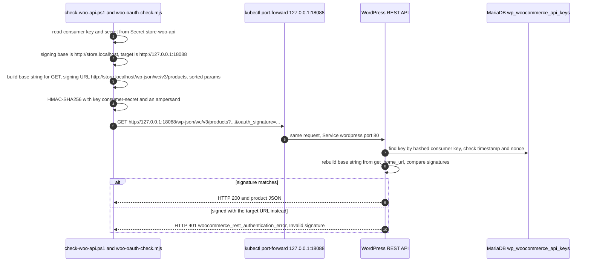

**Reading the diagram.** Actors: the checker script (Node), a `kubectl port-forward` standing in for "some address that reaches the Service", WordPress, and the key table in MariaDB. The script sends the request to `127.0.0.1:18088` but signs `http://store.localhost/...`; WordPress recomputes the signature from `WP_HOME` and compares. The decision at the end is the proof: the same request signed with the *target* URL gets 401. The script runs three requests and expects 200 / 200 / 401 (verified on the fresh install: `HTTP 200`, `HTTP 200 []` for the second request whose search term matches no product, and `HTTP 401 ... Invalid signature - provided signature does not match.`).

**Details that matter for the MCP server (built in Phase 2).**

- Signature method `HMAC-SHA256`; the HMAC key is `<consumer secret>&` (there is no token secret). OAuth parameters are sent in the query string.
- Parameters are sorted by raw key in byte order (like PHP's `uksort( $params, 'strcmp' )`), percent-encoded per RFC 3986, and the whole normalized string is encoded again. `scripts/dev/woo-oauth-check.test.mjs` checks the signer against values generated independently by PHP: run `node --test "scripts/dev/*.test.mjs"` (5 tests pass; the directory form `node --test scripts/dev/` fails on Node 24.0.1).
- Only unique scalar query keys are supported; send lists comma-separated (`include=1,2`).
- The signing base is the public store URL (`WP_HOME`) with its scheme replaced by `http`. The port is included only if `WP_HOME` has one (non-default `publicPort`); production https/443 signs `http://store.example.com` with no `:443`. The check script now derives the base with the same rule as the chart helper `urumi.storeSigningBaseUrl` (Task 2.6); the non-default-port case renders correctly in the chart (checked with `helm template --set global.publicPort=8081`) but was **not run end to end**.
- The Phase 1 spike reached WordPress through `kubectl port-forward`. **Verified in Phase 2 (2026-10-18):** the MCP server reaches `wordpress.store.svc.cluster.local` and its signed GET, POST (`create_product`) and PUT (`update_order_status`) all succeed, so the Service-DNS access and write signing that Phase 1 left open are confirmed.

### Failure and recovery

| What can fail | Detected by | Retried? | What you see | Fix |
|---|---|---|---|---|
| Signed with the wrong base URL (target URL, wrong host, missing port) | WooCommerce signature comparison | **Never retry with the same nonce.** Fix the base and send a new request with a fresh nonce | `401 woocommerce_rest_authentication_error: Invalid signature` | Sign `http://<WP_HOME host>[:port]<path>`. |
| Clock skew larger than 15 minutes between signer and cluster | WooCommerce rejects the timestamp (window of plus or minus 15 minutes) | no | `401` (looks like a signature error) | Fix the clock (WSL2/Docker clock drift after sleep is the usual cause; restart Docker Desktop or run `wsl --shutdown`). |
| Nonce reused | WooCommerce stores used nonces per consumer key | no | `401` | Always generate a fresh random nonce per request. |
| Key missing or changed | No row matches the hashed consumer key | no | `401` (consumer key invalid) | Re-run `deploy.ps1`: the Job re-inserts the key from Secret `store-woo-api`. |
| Port-forward not up yet | `fetch` fails | no | Node connection error | Re-run `check-woo-api.ps1`; it waits 3 s for the forward. |
| Query uses `a[]=`, duplicate keys, `.` or spaces in keys | The signer throws before sending | n/a | `unsupported query key` / `duplicate query key` | Pass lists comma-separated. |

**Logs.** The checker prints one line per request. WordPress access log: `kubectl -n store logs deploy/wordpress -c wordpress`. Troubleshooting: [401 from check-woo-api.ps1](troubleshooting.md#check-woo-apips1-returns-401).

---

## 4. Data lifecycle: upgrade, uninstall, reinstall, fresh install

**What it does.** Defines what survives each operation, because the store is the only stateful part so far. Verified on the reference machine (2026-10-18).

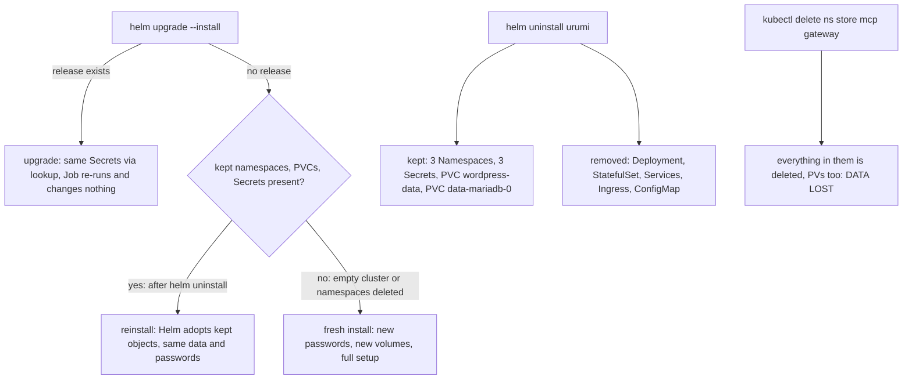

**Reading the diagram.** The two entry points on the left are the commands you type. `helm uninstall` removes only the workloads and routing; it deliberately keeps the namespaces, the three Secrets and both PVCs, so data and the matching passwords survive (the MariaDB data directory was initialised with the password in `store-db`, so a regenerated password would lock WordPress out). Only an explicit `kubectl delete ns` destroys data.

**Verified results (reference machine, 2026-10-18, namespace `store`).**

1. *Uninstall:* Helm printed that it kept `[PersistentVolumeClaim] wordpress-data`, `[Secret] store-db`, `[Secret] store-admin`, `[Secret] store-woo-api` and the three Namespaces. `data-mariadb-0` also stayed (a `volumeClaimTemplates` PVC is not Helm-managed). Both PVCs stayed `Bound`; the Deployment and StatefulSet were gone. The finished `store-setup` Job and Pod were still present: hook resources are not removed by uninstall, and the next hook run deletes them first (`before-hook-creation`). Harmless.
2. *Reinstall:* `deploy.ps1` reported `STATUS: deployed` (revision 1 of the new release) with no adoption error. The setup log said `WordPress already installed` and `products already present (3); not seeding`, and `check-woo-api.ps1` returned 200 / 200 / 401. Reinstall works only with the same release name and namespace (`urumi` / `urumi-system`), because the kept objects carry `meta.helm.sh/release-name` and `release-namespace` annotations.
3. *Fresh install:* after `helm uninstall` and `kubectl delete ns store mcp gateway --wait=true --timeout=300s`, `kubectl get pv` returned `No resources found` (the `local-path` PVs have reclaim policy `Delete`). `deploy.ps1` then built a new store: new Secrets and PVs, the setup Job succeeded on its **first** Pod, with no `Error` Pods, `status.failed` empty, and the WordPress Pod had 0 restarts.

**Failure and recovery.**

| What can fail | Why | What you see | Recovery |
|---|---|---|---|
| Reinstall under another release name or namespace | Kept objects belong to the old release | Helm "cannot be imported" ownership error **(expected)** | Use `urumi` / `urumi-system`, or delete the kept objects deliberately (destroys data). |
| Secrets deleted but PVC kept | Passwords regenerated, data directory still has the old ones | MariaDB starts but WordPress cannot log in (database error, probe failures) | Restore the old Secret, or delete the PVCs too (data lost). See [troubleshooting](troubleshooting.md#mariadb-crashloopbackoff-or-wordpress-cannot-reach-the-database). |
| Namespace deletion is slow | Pods and volumes still terminating | `kubectl delete ns` waits | Use `--wait=true --timeout=300s` as in the test; it completed within that. |

**Logs.** `helm history urumi -n urumi-system`, `kubectl get ns,pvc -A`, `kubectl get pv`.

---

## 5. Customer account and order history

**What it does.** A shopper registers an account, places a Cash-on-delivery order while logged in, and then sees that order under My Account → Orders. **Verified by `scripts/dev/customer-order-smoke.ps1`** (run 2026-10-18: order 18 belongs to customer 2 and was listed on `/my-account/orders/`). The script registers through the real My Account form, places the order through the WooCommerce Store API (the API the block checkout uses), and then fetches the orders page as that customer.

**Actors.** Shopper browser; WordPress and WooCommerce; MariaDB.

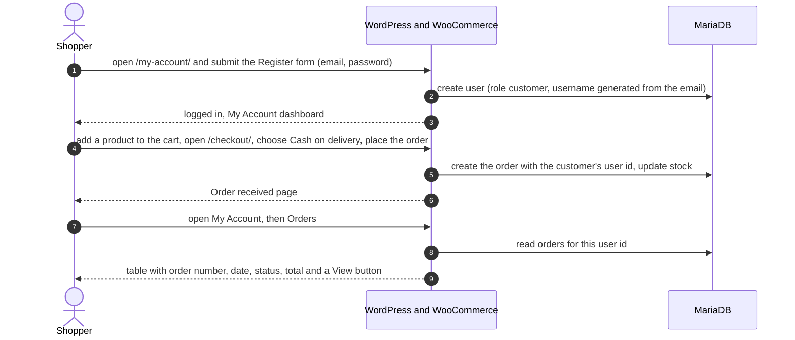

**Reading the diagram.** Registration is configured by WooCommerce options set by the setup Job: `woocommerce_enable_myaccount_registration`, `woocommerce_enable_signup_and_login_from_checkout` and `woocommerce_enable_checkout_login_reminder` are `yes`. `woocommerce_registration_generate_username` is `yes`, so the username comes from the email. `woocommerce_registration_generate_password` is `no`: with generated passwords WooCommerce would e-mail the password, and there is no mail server, so customers choose their own. The block checkout also offers sign-up at checkout (its flag is `checkoutAllowsSignup`). The decisive step is 5: the order is stored with the **logged-in user's id** (`_customer_user` in `wp_postmeta`), and step 7 reads exactly the orders with that id.

**Guest orders are not linked.** An order placed as a guest keeps customer id `0`. In WooCommerce 11.2.1, registering later with the same email does **not** attach it (**verified 2026-10-18** with `customer-order-smoke.ps1 -CheckGuestLinking`: guest order 19 stayed customer 0 and did not appear in My Orders). Guest orders are visible only to the admin, in WooCommerce → Orders. To have an order in My Account, log in (or register) before checking out.

> **Security note (demo setting).** Open registration is a demo-store choice. Anyone who can reach the store can register; there is no email verification and no CAPTCHA. The password-strength meter is client-side only, so a direct POST accepts weak passwords. The "already registered" error reveals which emails have accounts. With cash-on-delivery guest checkout, bots could create fake accounts and orders. k3d publishes ports 80/443 without a host IP, so Docker is **expected** to bind them on all interfaces and the store is then likely reachable from the local network (for example café Wi-Fi); this was **not verified** on this machine. Stop the cluster (`powershell -NoProfile -ExecutionPolicy Bypass -File scripts\stop.ps1`) on untrusted networks. A production toggle is planned for Phase 5.

### Failure and recovery

| What can fail | Detected by | What the shopper sees | Recovery |
|---|---|---|---|
| Registration is disabled (options not applied) | `customer-order-smoke.ps1` reports no `woocommerce-register-nonce` on My Account | No Register form on `/my-account/` | Run `powershell -NoProfile -ExecutionPolicy Bypass -File scripts\up.ps1 -Redeploy` so the setup Job re-applies the options. |
| Registering with an email that already has an account | WooCommerce form error | "An account is already registered with your email address" | Log in instead. |
| Order placed as a guest | The order is absent from My Account → Orders | An orders list without that order | Expected, see above. The admin sees it in WooCommerce → Orders. |
| Order e-mails are not delivered | There is no mail server in the cluster | No confirmation e-mail | Known limitation; the order itself is created and visible. |
| Store restarting | Pods not ready | 503 or a database error for a short time | Wait until `kubectl -n store get pods` shows `Running`, then reload. |

**Logs and checks.** `kubectl -n store logs deploy/wordpress -c wordpress`; re-run `scripts\dev\customer-order-smoke.ps1`. More: [troubleshooting](troubleshooting.md#i-cannot-see-my-guest-order-in-my-account).

---

## 6. MCP tool call to the store

**What it does.** An MCP client asks the WooCommerce MCP server to run a tool (for example `list_orders` with `period=today`). The server checks the caller, validates the input, calls the store's REST API with a signed request, and returns a short, model-friendly result. Today the only callers are you (MCP Inspector, `scripts\check-mcp-woocommerce.ps1`) through a port-forward; since Phase 3 the gateway calls it on behalf of users ([workflow 8](#8-mcp-tool-call-through-the-gateway)). Real captured request and response JSON is in [learning/02-mcp-protocol.md](learning/02-mcp-protocol.md). Run it yourself: [run guide, section 8](run-guide.md#8-woocommerce-mcp-server-phase-2).

**Actors.**

- **MCP client:** Inspector or the SDK client in the smoke script (later: the gateway).
- **`mcp-woocommerce` pod (namespace `mcp`):** an Express app from `packages/shared` plus the tools in `apps/mcp-woocommerce`.
- **`WooClient`:** builds the WooCommerce URL, signs it with OAuth 1.0a, sends it, and maps the answer.
- **WordPress and WooCommerce (namespace `store`):** reached at `http://wordpress.store.svc.cluster.local`. It checks the signature and runs the REST handler.
- **MariaDB:** where products and orders live.

### Sequence

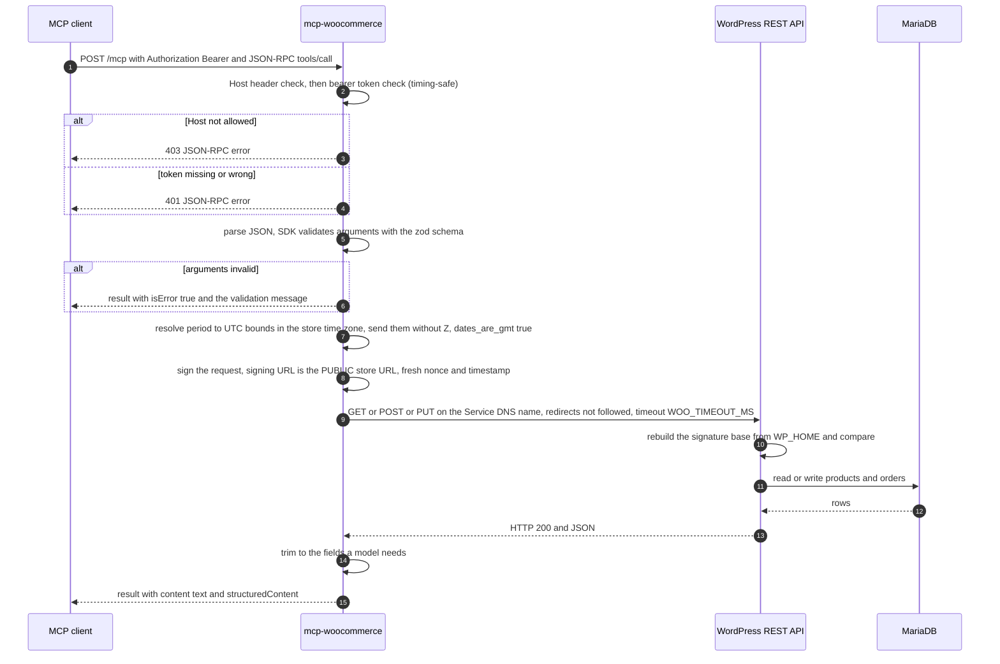

**Reading the diagram.** The two checks right after the request happen before any MCP code runs: a wrong `Host` gets 403 and a missing or wrong token gets 401, both as JSON-RPC errors with `id: null` (captured, see the protocol notes). Next, the SDK checks the arguments against the same zod schema that produced the tool's JSON Schema; a bad value never reaches WooCommerce and comes back as an `isError` result the model can read and fix. The signing step is the subtle one ([ADR-005](decisions/ADR-005-woocommerce-rest-oauth1.md)): the request goes to the in-cluster Service, but the OAuth1 signature is computed over the public store URL with scheme `http` (`WOO_SIGNING_BASE_URL`), because WooCommerce rebuilds the signature base from its own `WP_HOME`. Signing the URL actually requested would give 401. The answer is trimmed (a product becomes id, name, status, prices, stock, permalink) so the model sees little text and no credentials can leak into it.

**Order dates are sent without a time zone, on purpose.** `list_orders` turns `period=today` (or the caller's `after`/`before`, which must carry `Z` or an offset) into a UTC window, for example `2026-10-18T18:30:00.000Z` to `2026-10-19T18:30:00.000Z` for "today" in Asia/Kolkata. It sends WooCommerce `after=2026-10-18T18:30:00&before=2026-10-19T18:30:00&dates_are_gmt=true`: the same instants, but with no `Z`. With `dates_are_gmt=true` WooCommerce compares against the GMT date column, while WordPress's date query converts any bound that names a zone into the **site's local time** first; a `Z` bound would therefore be shifted by the store's offset (+5:30), and orders placed between local midnight and 05:30 would be counted on the wrong day. A bound with no zone is used as written. The `range` field in the result keeps the honest `Z` form. **Verified live** on 2026-10-19 (the store keeps orders as posts, HPOS off): order 27, placed at 00:41 IST, was listed under `yesterday` before this fix and under `today` after it, and a two-minute `after`/`before` window around an order's `date_created_gmt` now contains that order.

**No retries, on purpose.** The server never retries a WooCommerce request. WooCommerce stores every OAuth nonce it has seen, so replaying the same request is rejected. A fresh signature would be accepted, but `create_product` is **not idempotent**: after a timeout the first request may still have succeeded, and a blind retry could create a duplicate product. The failure is returned to the caller (the model or the user) with a clear message, and the caller decides.

**Verified.** Through the real cluster on 2026-10-18 and 2026-10-19: all six tools are listed; `ping`, `list_products` and `list_orders` succeed; `create_product` (as a draft) creates product 26 and `update_order_status` performs a signed PUT (via `check-mcp-woocommerce.ps1 -Write`); a wrong token gets 401, a foreign `Host` gets 403, `GET /mcp` gets 405; `get_order` for a missing order returns an `isError` result containing `WooCommerce returned 404: Invalid ID.`; a validation failure returns `isError`. Rows marked *unit-tested* below were exercised by the automated tests with a fake HTTP layer and were not forced live; rows marked *expected* follow from WooCommerce's documented behaviour.

### Failure and recovery

| What can fail | Detected by | Retried? | What the caller sees | Fix |
|---|---|---|---|---|
| Bad or missing bearer token | `upstreamAuthMiddleware` | no | HTTP 401, `WWW-Authenticate: Bearer`, JSON-RPC error `-32001 Unauthorized` (**captured**) | Use the token from Secret `mcp-woocommerce-token`: `scripts\get-secret.ps1 -Namespace mcp -Name mcp-woocommerce-token -Key token`. |
| `Host` header not in `MCP_ALLOWED_HOSTS` | `hostHeaderValidation` | no | HTTP 403, `-32000 Invalid Host: <name>` (**captured**) | Call the Service by one of its names, or through a port-forward to `localhost` or `127.0.0.1`. |
| Invalid input (page 0, price `"abc"`, `period` together with `after`) | zod schema | no | Normal result with `isError: true`, for example `Input validation error: Invalid arguments for tool create_product: regular_price: ...` (**captured**) | Fix the arguments and call again. |
| WooCommerce answers 4xx (missing order, bad status, 401 invalid signature) | `res.ok` is false in `WooClient` | no | `isError` result `WooCommerce returned 404: Invalid ID.` (**captured** for 404) | Depends on the status. For 401 see [troubleshooting](troubleshooting.md#an-mcp-tool-returns-woocommerce-401-invalid-signature). |
| WooCommerce answers 5xx | `res.ok` is false | no | `isError` result `WooCommerce returned 500: ...` (*unit-tested*) | Check `kubectl -n store logs deploy/wordpress -c wordpress`; call again once the store is healthy. |
| WooCommerce does not answer within `WOO_TIMEOUT_MS` (default 10 s) | `AbortSignal.timeout` | no | `isError` result `WooCommerce request failed (timeout): WooCommerce did not respond within 10000ms` (*unit-tested*) | Check the store pods. For a create, **look before calling again**: the product may exist. |
| Network error (pod or Service down, DNS) | `fetch` throws | no | `isError` result `WooCommerce request failed (network_error): Could not reach WooCommerce (network error)` (*unit-tested*) | `kubectl -n store get pods,svc`. |
| WooCommerce answers a 301 or 302 redirect (the store URL or permalinks changed) | redirects are not followed, so a 3xx is "not ok" | no | `isError` result `WooCommerce returned 301: HTTP 301: ...` (*unit-tested*) | Check `WOO_BASE_URL`, pretty permalinks and `WP_HOME`. Redirects are not followed because the signature belongs to the original request. |
| Empty store (no products, or no orders today) | n/a, this is a success | n/a | Normal result with an empty list, for example `Found 0 order(s) on page 1.` (**captured**) | Nothing to fix. |
| Clock skew greater than 15 minutes between the pod and WooCommerce | WooCommerce rejects the timestamp | no | `isError` result `WooCommerce returned 401: ...`, which looks like a bad signature (*expected*, same cause as workflow 3) | Fix the Docker/WSL2 clock: restart Docker Desktop or run `wsl --shutdown`. |
| Signing base wrong (`WOO_SIGNING_BASE_URL` differs from `WP_HOME` with scheme http) | WooCommerce signature comparison | no | `isError` result `WooCommerce returned 401: Invalid signature ...` (*expected*; the same failure is shown for the check script in workflow 3) | Correct the Helm values; see [troubleshooting](troubleshooting.md#an-mcp-tool-returns-woocommerce-401-invalid-signature). |
| Missing or invalid environment variable at start | `loadConfig` | Kubernetes restarts the container | Pod in `CrashLoopBackOff`; the log line lists variable names, never values | [Troubleshooting](troubleshooting.md#mcp-woocommerce-crashloopbackoff-with-an-environment-variable-message). |

**Logs.** `kubectl -n mcp logs deploy/mcp-woocommerce` (one `request` line per call: method, path, status, duration; no token, no key, no signed URL). The store side: `kubectl -n store logs deploy/wordpress -c wordpress`.

---

## 7. Register an upstream and how it appears in `tools/list`

**What it does.** An admin adds an MCP server (a name, a URL, optionally a credential). The gateway checks the URL is safe, stores the credential encrypted, connects, reads the server's tools, and from then on lists them with a `<slug>__` prefix. The three built-in servers (`woo`, `notes`, `utils`) are added the same way at the gateway's first start, from the Helm value `SEED_SERVERS`.

**Actors.** The admin (PowerShell today, the dashboard in Phase 4), the `/api` router, the SSRF guard, the crypto module, Postgres, the upstream manager, the upstream MCP server, and later any MCP client.

**Evidence.** The seeded path (`upsert` and the first check) ran on the cluster: all three servers `connected` with 6, 5 and 4 tools. The SSRF refusals were run live (metadata address, loopback, private address, `file:`, URL with a password), and a duplicate slug (`409`) and a bad slug (`400`). A **new** server was *not* created on the cluster, to keep the registry as it is; that path is covered by `apps/gateway/test/api/servers.test.ts` and `test/upstreams/manager.test.ts`.

### Sequence

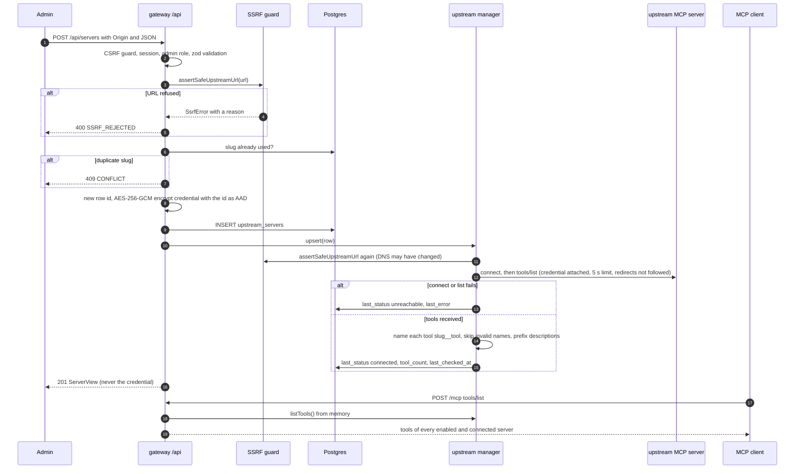

**Reading the diagram.** Two checks protect the registry. The SSRF guard runs before anything is stored, so a forbidden URL never reaches the database; it runs again inside every health check and once more when the socket opens ([security.md](security.md#5-ssrf-guard)). The credential is encrypted with the new row's id as associated data, which is why the id is created before the insert. Registering succeeds (`201`) even when the server is unreachable: the response is then a `ServerView` with `status: unreachable` and the reason in `lastError`. The tool list is only ever read from memory, so adding a slow server does not slow any client's listing.

**Naming at this step.** Each upstream tool becomes `<slug>__<tool>`. A tool whose prefixed name would not match `^[a-zA-Z0-9_-]{1,64}$` is skipped alone and shown in the view's `skippedTools`. Descriptions get `[<Server name>] ` in front. The slug cannot change later, because a rename would break every client that uses the old tool names ([ADR-006](decisions/ADR-006-tool-naming-scheme.md)).

### Failure and recovery

| What can fail | Detected by | Retried? | What the admin sees | Fix |
|---|---|---|---|---|
| Missing `Origin` or `Content-Type: application/json` | CSRF guard | no | `403 CSRF_REJECTED` | Send both headers ([run guide](run-guide.md#log-in-and-create-an-api-key-powershell-51)) |
| Not logged in / not an admin | session and role checks | no | `401 UNAUTHENTICATED` / `403 FORBIDDEN` | Log in as an admin |
| Bad slug, name, URL, auth fields | zod | no | `400 VALIDATION_FAILED` with `details.issues` | Fix the field named in the issue |
| URL to a metadata, loopback or non-allowlisted private address, a `file:` URL, credentials in the URL | SSRF guard | no | `400 SSRF_REJECTED` with `details.reason` (live) | Use the Service DNS name, for example `http://mcp-notes.mcp.svc.cluster.local:3002/mcp` |
| Slug already exists | unique check and constraint | no | `409 CONFLICT` (live) | Pick another slug |
| Credential with CR/LF or non-ASCII characters | zod and the connection | no | `400 VALIDATION_FAILED`; the value is never echoed | Re-enter a plain header value |
| Upstream down, wrong URL, wrong credential, redirect | the first check | next health check in 15 s | `201`, `status: unreachable`, `lastError` such as `connection refused` or `HTTP 401 from upstream` | Fix the URL or credential with `PATCH`, then `POST /api/servers/:id/refresh` |
| Upstream tool name too long or with a dot | naming | no | The server is `connected`; the tool is missing and listed in `skippedTools` (tested) | Rename the tool in the upstream |

Logs: `kubectl -n gateway logs deploy/gateway` shows `upstream status` lines when a server changes state and a `upstream tools skipped` warning for skipped tools.

---

## 8. MCP tool call through the gateway

**What it does.** An MCP client with a personal API key calls `woo__list_orders` (or any aggregated tool) at `POST http://app.localhost/mcp`. The gateway authenticates the key against the database, finds the owning server, calls it with its own credential, records an audit row and returns the upstream's answer unchanged. This is spec §6.5 as built. Captured JSON for every step is in [learning/03-gateway.md](learning/03-gateway.md#5-captured-traffic).

**Actors.** The MCP client; Traefik; the gateway (Host check, `/mcp` auth, the manager); Postgres; the upstream server; for `woo__*` calls, WordPress and MariaDB behind it ([workflow 6](#6-mcp-tool-call-to-the-store)).

### Sequence

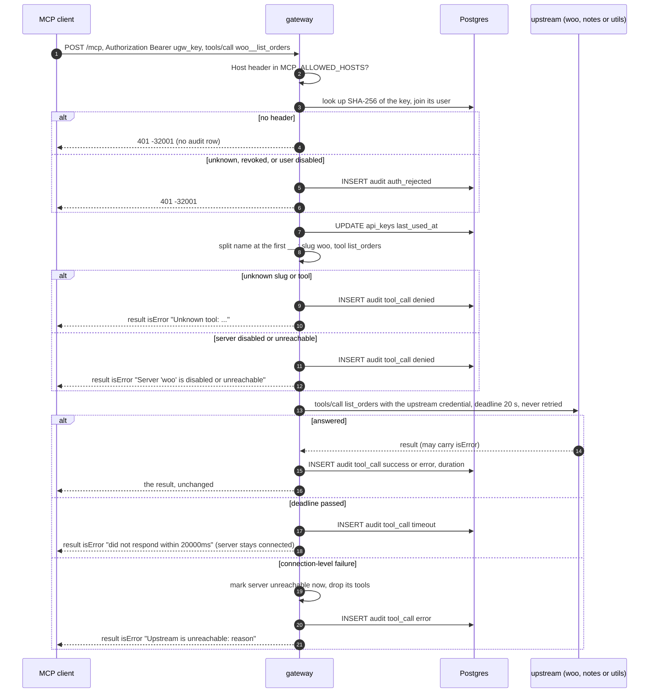

**Reading the diagram.** Authentication comes first and is checked against the database on every request, so revocation is immediate. Everything after it is routing by name: the first `__` ends the slug, so `utils__date_range` goes to `utils` as `date_range`. The gateway never validates arguments itself: the upstream's own schema does that, and its complaint comes back as an ordinary `isError` result. The client's key is never sent upstream; the upstream sees only its own credential. The audit row is written after the call (so it has the outcome and the duration) and holds the **upstream** tool name beside the server slug; arguments and results are never stored or logged. A call is never retried, because a retry could repeat a write such as `create_product`.

**Verified live (2026-10-19).** `utils__calculate` (`2+3*4 = 14`), `woo__list_orders` with `period=today`, `notes__create_note` and `notes__search_notes` through the real endpoint; `notes__delete_note` for a missing note gave an `isError` result and an audit row with outcome `error`; an unknown tool gave `denied`; no header, an unknown key and a revoked key gave `401`. The timeout and connection-failure branches are covered by tests only (`manager.test.ts`).

### Failure and recovery

The complete list, with exact texts, is [error-handling.md](error-handling.md#1-mcp-the-aggregated-endpoint). In short:

| What can fail | What the client sees | What to do |
|---|---|---|
| Missing, unknown or revoked key; disabled user | `401`, `-32001 Unauthorized` | Use a valid key (run guide); an admin can issue a new one |
| `GET /mcp` | `405` | Use `POST` |
| Unknown tool, or server disabled | `isError` result, audit `denied` | `tools/list` again; check the server in `GET /api/servers` |
| Upstream error or bad arguments | The upstream's own `isError` text | Fix the arguments |
| Upstream too slow | `isError` `Upstream '<slug>' did not respond within 20000ms` | Look before calling a write again; the call may have completed |
| Upstream unreachable | `isError` `Upstream '<slug>' is unreachable: <reason>`; its tools leave the list | [Workflow 11](#11-upstream-goes-down-and-comes-back) |

Logs: one `tool call` line per call (tool, server, outcome, duration, user) and the audit table ([run guide, section 10](run-guide.md#10-viewing-the-gateway-database-postgres)).

---

## 9. API key lifecycle (create, use, revoke)

**What it does.** A logged-in user creates a personal key, uses it from an MCP client, and revokes it. Keys are per person, so every audit row says who acted.

### Sequence

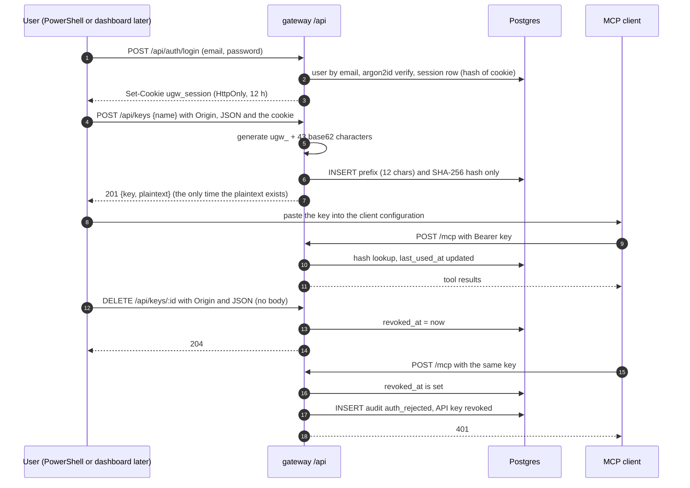

**Reading the diagram.** The plaintext key exists only in the create response; the database holds a hash and a display prefix, so a lost key cannot be recovered, only replaced. There is no cache between the request and the database, so the 401 after the revoke is immediate (verified live). Disabling a user (`PATCH /api/users/:id {"disabled":true}`) deletes their sessions and revokes every key in one transaction; re-enabling the user does **not** bring the keys back (tested). An admin can also issue and revoke keys for another user (`/api/users/:id/keys`). Another user's key id answers `404`, as if it did not exist.

**Verified live.** Login, create, list (the list shows the prefix, never the hash), use through the Inspector and `curl.exe`, revoke (`204`) and the following `401`, with the audit row `API key revoked`. A `DELETE` without `Content-Type` was refused with `403 CSRF_REJECTED`.

### Failure and recovery

| What can fail | What happens | Fix |
|---|---|---|
| `403 CSRF_REJECTED` on create or revoke | The two headers are required on every mutating call, even `DELETE` | Add `Origin` and `Content-Type: application/json` |
| `401 UNAUTHENTICATED` | No cookie, expired session (12 h), or user disabled | Log in again |
| `429 RATE_LIMITED` on login | 10 attempts per minute per IP and email | Wait for `Retry-After` (60 s) |
| Key lost | It cannot be shown again | Revoke it and create a new one |
| Key leaked | Anyone holding it can call every tool as you until it is revoked | Revoke it now; check `audit_logs` for its use |
| `401` from `/mcp` with a key that used to work | Revoked, or the user was disabled | [Troubleshooting](troubleshooting.md#mcp-answers-401-on-the-gateway) |

---

## 10. Invite a teammate

**What it does.** There is no email service, so an admin creates an invite and delivers the link themselves. The invitee opens the link, chooses a name and a password, and has an account. Decision: [ADR-013](decisions/ADR-013-invite-links.md).

### Sequence

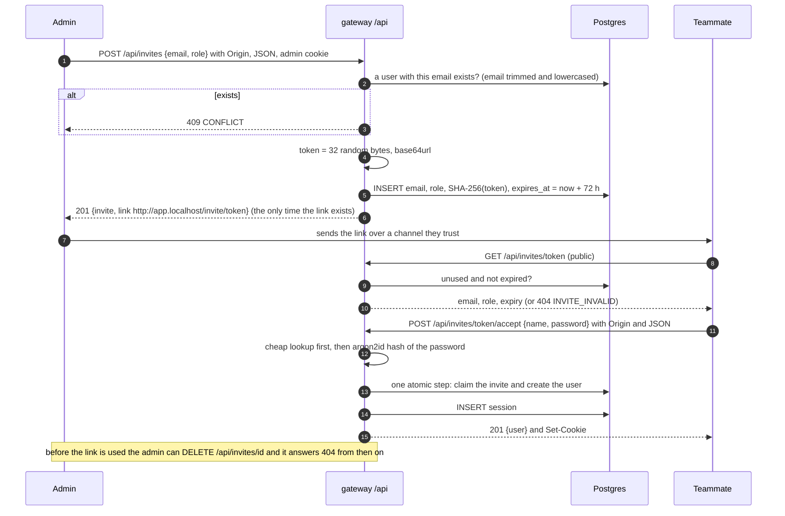

**Reading the diagram.** The link is a bearer secret: until it is used or expires (72 h), whoever holds it can claim the account. Only the SHA-256 of the token is stored and the request log writes `/api/invites/:token` instead of the token. The accept step claims the invite and creates the user in one atomic operation, so two people racing on one link cannot both succeed. A second use, an expired link and a cancelled link all give the same `404 INVITE_INVALID`.

**Verified live (2026-10-19).** Create (`201`, link shape `http://app.localhost/invite/<43 characters>`), list (the pending invite with `expired: False`), preview of the link (email, role, expiry), cancel (`204`) and the cancelled link answering `404 INVITE_INVALID`. The *accept* step was **not run on the cluster** (it would leave a test user behind); it is covered by `apps/gateway/test/api/invites.test.ts`, including single use, expiry and the conflict case. There is no web page for the link until Phase 4: the teammate can use `POST /api/invites/<token>/accept` directly, as in the [run guide](run-guide.md#invite-a-teammate).

### Failure and recovery

| What can fail | What happens | Fix |
|---|---|---|
| Email already has an account (any letter case) | `409 CONFLICT` at creation (tested) | Nothing to invite; reset is not built |
| The link was lost | It cannot be shown again | Cancel it and create a new one |
| The link expired (72 h), was used, or was cancelled | `404 INVITE_INVALID` | Create a new invite |
| Password shorter than 10 characters | `400 VALIDATION_FAILED` and the invite stays usable | Choose a longer password |
| Two people use one link at once | One wins, the other gets `404 INVITE_INVALID` (the claim is a conditional update inside a transaction; there is no automated concurrency test) | Create another invite |
| The link is intercepted before use | The interceptor can claim the account | Send links over a trusted channel; the admin can see the pending invite and cancel it |

---

## 11. Upstream goes down and comes back

**What it does.** When an MCP server stops answering, the gateway notices within seconds, removes its tools from the list, keeps everything else working, and restores the tools by itself when the server returns. This is the isolation the cached catalog ([ADR-014](decisions/ADR-014-cached-tool-catalog.md)) is for.

### Sequence

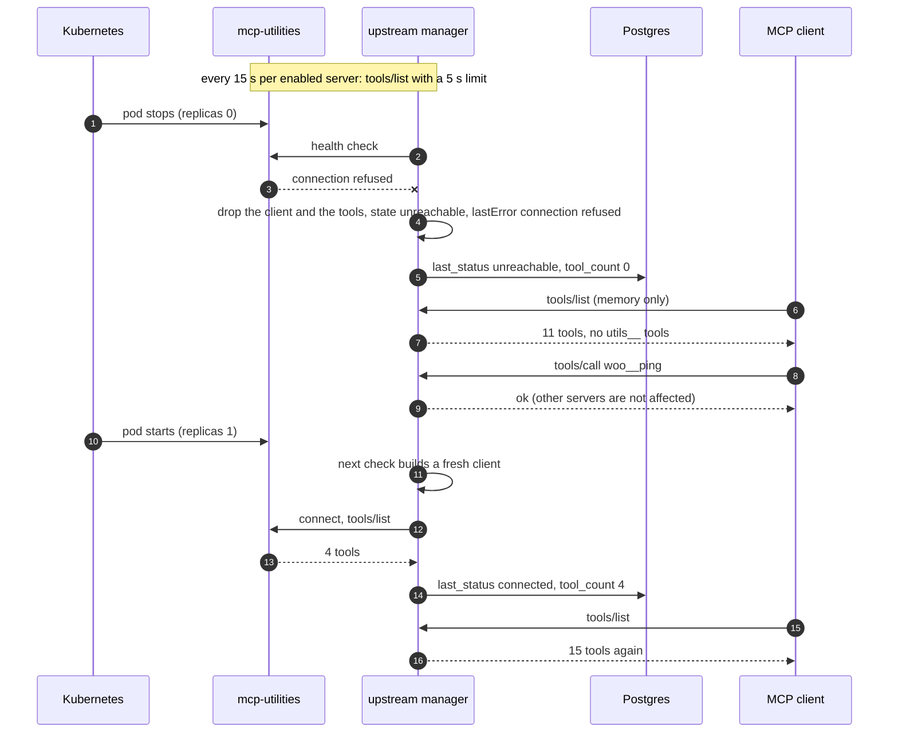

**Reading the diagram.** `tools/list` never touches an upstream, so the dead server costs the other servers and the clients nothing. The tools disappear when the *next health check* (or a failing call) notices, so the list can be wrong for up to about one interval plus the timeout (20 s). After any failure the gateway throws away its client and builds a **fresh** one on the next check, so a restarted pod is never met by a stale socket. A call that finds the server dead returns `isError: "Upstream '<slug>' is unreachable: <reason>"` and marks it unreachable at once, without waiting for the tick.

**Verified live (2026-10-19)**, `check-gateway.ps1 -Write -Isolation`: with `mcp-utilities` at 0 replicas the four `utils__` tools were gone after **12.2 s** (and after 4.1 s in a later run), 11 tools remained, `woo__ping` kept answering; after scaling back to 1 the `utils__` tools returned after **16.4 s** (both runs) and the list had 15 tools. The same check also confirms the revoked key gets 401 and the audit log lists the calls. The replica count is restored even on error (the Ctrl+C handler was not exercised).

### Failure and recovery

| `lastError` / symptom | Meaning | Fix |
|---|---|---|
| `connection refused` | Pod down, restarting, or wrong port | `kubectl -n mcp get pods`; wait for the next check or `POST /api/servers/:id/refresh` |
| `DNS lookup failed` | The Service name does not exist | Check the URL and `kubectl -n mcp get svc` |
| `timeout after 5000ms` | The pod is up but not answering | `kubectl -n mcp logs deploy/<name>` |
| `HTTP 401 from upstream` | The stored credential no longer matches the upstream | Update it with `PATCH /api/servers/:id` (`credential`); see [troubleshooting](troubleshooting.md#a-server-shows-unreachable-in-the-gateway) |
| `HTTP 302 from upstream (redirects are not followed)` | The URL redirects; the gateway never follows redirects | Use the final URL |
| `blocked by SSRF guard (<reason>)` | The name now resolves to a forbidden address | Check what the name resolves to; the allow-list is `SSRF_ALLOWED_INTERNAL_HOSTS` |
| Tools never return after the pod is back | A check is still running or the server is `disabled` | Wait 20 s; `GET /api/servers`; check `enabled` |
| The gateway itself is down | `/mcp` and `/api` fail; Kubernetes restarts the pod | [Troubleshooting](troubleshooting.md#the-gateway-pod-is-in-crashloopbackoff-database-not-ready-after-30-attempts) |
